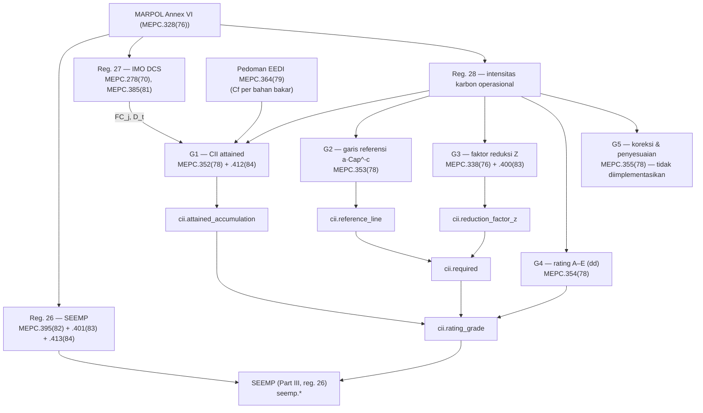

# Metodologi & Referensi — AIS Maritime Intelligence v2

> **Abstract (English).** This document traces every formula, empirical constant, threshold and rule of
> AIS Maritime Intelligence v2 (the successor of the AIS-ITS-CII-SEEMP MVP built for Vibra Dananjaya's
> thesis) to its source. It covers geodesy and kinematics of AIS fixes, AIS normalisation and the
> navigational-status prediction, the subsea-pipeline Early Warning System, collision risk from CPA/TCPA,
> fuel estimation (telemetry, vessel regressions, Holtrop–Mennen resistance with a Kwon weather
> correction), CO2 and the IMO Carbon Intensity Indicator (attained, reference, required, rating, grade),
> SEEMP measures and costs, transhipment, navstatus anomaly, dark-vessel, geofence and illegal-fishing
> detection, and the data sources and attributions. Each method lists its equation, variables, constants
> with their sources, the v2 implementation owner, the legacy location and numbered references. Values
> that come only from the thesis or from v2 design defaults, without a verified external source, are
> flagged "⚠️ Perlu sitasi" (needs citation). Regulatory values were checked through search extracts of
> the IMO texts, not verbatim; re-verify them before regulatory use. The machine-readable catalog lives in
> `docs/references/references.json` and `docs/references/methods.json`.

Versi dokumen: 1.0 (2026-11-21), selaras dengan spesifikasi `docs/PLATFORM_SPEC.md` v1.1. Riset sumber:
2026-11-20 (sumber CPA/TCPA: 2026-11-21).

## 1. Tujuan dan cara membaca

### 1.1 Tujuan

Spesifikasi §17 mewajibkan setiap rumus, konstanta empiris, ambang dan aturan di platform dapat
ditelusuri ke sumbernya. Dokumen ini adalah versi yang dapat dibaca manusia; katalog mesin
(`docs/references/references.json` dan `docs/references/methods.json`) adalah sumber tunggal yang
disalin ke paket `@darmawanweb/ais-its-contracts` (subpath `./references`) dan dipakai oleh README tiap
layanan, endpoint `GET /api/v2/emission/methodology`, endpoint `GET …/detectors` layanan safety dan
surveillance, serta halaman web **Metodologi & Referensi**. Bagian metode di dokumen ini dibangkitkan
dari katalog yang sama sehingga isinya tidak boleh menyimpang dari JSON.

Dokumen ini juga merupakan bahan metodologi tesis. Karena itu **kejujuran akademik lebih penting
daripada kelengkapan**: nilai yang berasal dari tesis (heuristik, regresi, asumsi biaya) diberi tanda
"⚠️ Perlu sitasi dari tesis" dan tidak dikaitkan dengan sumber yang belum terbukti memuat nilai itu.
Aturan baru v2 yang bukan dari tesis (risiko tubrukan, dark vessel, geofence, loitering) diberi tanda
"⚠️ Perlu sitasi / validasi domain" karena ambangnya adalah default desain.

### 1.2 Cara membaca blok metode

Setiap metode punya id stabil (misalnya `cii.required`) yang juga dipakai di kode (`@method` TSDoc),
event detektor, alert dan respons API. Blok metode berisi:

- **Deskripsi** — apa yang dihitung, sebagaimana diimplementasikan (paritas dengan legacy).
- **Persamaan** dalam LaTeX (dirender KaTeX di web).
- **Tabel variabel** — simbol, arti, satuan dan sumber nilai (pesan AIS, data armada, atau id metode lain).
- **Tabel konstanta dan ambang** — nilai beserta sumber bernomor `[n]`; "⚠️ perlu sitasi" bila belum ada
  sumber eksternal terverifikasi.
- **Pemilik v2** — layanan dan modul (konvensi `src/domain/…` untuk fungsi murni, `src/detectors/…` untuk
  detektor; untuk `contracts` artinya fungsi bersama di `@darmawanweb/ais-its-contracts` 0.2.0 yang sudah
  ada). **Status**: *diimplementasikan* (sudah ada di contracts 0.2.0), *direncanakan* (akan dibuat di
  layanan pemilik), *tidak diimplementasikan* (sengaja tidak dibawa ke v2).
- **Lokasi legacy** — `path:fungsi` relatif terhadap salinan read-only MVP (`be-legacy` = backend
  `ais-its-mvp-api`, `fe-legacy` = web MVP), untuk uji golden paritas.
- **Referensi** `[n]` yang menaut ke §16 (daftar pustaka).
- **Catatan** — penyimpangan legacy, keputusan terbuka (paritas vs perbaikan) dan pertanyaan untuk
  penulis tesis.

Konvensi: 1 nm = 1852 m (tepat) [[1]](#ref-nist-sp811-nautical-mile); kecepatan dalam knot (kn); bahan
bakar dalam ton (t); CII dalam g CO2 per (kapasitas · nm). Dalam teks berbahasa Indonesia dipakai koma
desimal; dalam rumus, tabel dan JSON dipakai titik desimal.

### 1.3 Status verifikasi sumber dan batas riset

Setiap referensi memiliki status **terverifikasi** (isi yang dikutip terlihat pada sumber atau salinan
resminya), **dikoreksi** (entri diperbaiki pada tahap verifikasi — identitas, tahun, URL atau isi — dan
koreksinya sudah diterapkan) atau **belum terverifikasi** (identitas atau isi belum dapat dikonfirmasi).
Batas riset yang perlu diketahui pembaca:

- PDF IMO di `wwwcdn.imo.org` tidak dapat dibuka langsung dari mesin riset; nilai IMO berasal dari
  ekstrak hasil pencarian atas PDF IMO dan salinan sekunder (ClassNK, LR, ABS, DNV). **Verifikasi ulang
  kata per kata sebelum dipakai untuk keperluan regulasi.**
- Banyak situs (imo.org, itu.int, un.org, doi.org, JDIH) diblokir DNS; konfirmasi diambil dari repositori
  sumber resmi penyedia (GitHub, registri npm) atau ekstrak pencarian. Teks tesis sendiri tidak tersedia
  di workspace, sehingga judul, tahun dan daftar pustaka tesis tidak dapat dicek.
- Angka "replika" (misalnya R_T = 18,96 kN pada 12 kn) adalah hasil perhitungan ulang kode legacy untuk
  kapal contoh, bukan nilai dari sumber.

### 1.4 Indeks metode

Katalog: **91 metode** dan **140 referensi** (88 terverifikasi, 41 dikoreksi, 11 belum terverifikasi); 67 metode masih bertanda ⚠️ perlu sitasi; status: 4 diimplementasikan, 82 direncanakan, 5 tidak diimplementasikan di v2.

| § | Id | Nama | Pemilik v2 | Status | Sitasi |
|---|---|---|---|---|---|
| 3.1 | [`geo.haversine_distance`](#geo.haversine_distance) | Jarak lingkaran besar antara dua posisi AIS (haversine, R = 3438 nm) | `contracts` | diimplementasikan | ✓ |
| 3.2 | [`geo.speed_from_positions`](#geo.speed_from_positions) | Kecepatan segmen dari dua posisi AIS (batas 30 kn) | `emission` | direncanakan | ⚠️ |
| 3.3 | [`geo.rhumb_line_course`](#geo.rhumb_line_course) | Haluan kapal dari dua posisi (bearing loksodrom dengan koreksi kuadran) | `emission` | direncanakan | ✓ |
| 3.4 | [`geo.coast_distance`](#geo.coast_distance) | Jarak posisi ke "garis pantai" (titik terdekat pada cincin poligon) | `ais-pipeline` | direncanakan | ✓ |
| 3.5 | [`geo.fe_marker_clustering`](#geo.fe_marker_clustering) | Clustering penanda dan filter posisi basi di frontend | — | tidak diimplementasikan di v2 | ✓ |
| 4.1 | [`data.ais_ingest_rules`](#data.ais_ingest_rules) | Normalisasi pesan AIS, filter duplikat dan retensi | `ais-pipeline` | direncanakan | ⚠️ |
| 4.2 | [`navstatus.ais_codes`](#navstatus.ais_codes) | Kode status navigasi AIS dan heading "tidak tersedia" | `contracts` | diimplementasikan | ✓ |
| 4.3 | [`navstatus.prediction`](#navstatus.prediction) | Prediksi status navigasi (berlabuh jangkar vs berlayar) secara heuristik | `ais-pipeline` | direncanakan | ⚠️ |
| 5.1 | [`ews.pipeline_distance_status`](#ews.pipeline_distance_status) | Status Early Warning System pipa (500 m / 1 750 m, hanya kapal berlabuh jangkar) | `safety` | direncanakan | ⚠️ |
| 5.2 | [`ews.fe_buffer_polygons`](#ews.fe_buffer_polygons) | Gambar buffer pipa 500 m / 1 750 m di frontend | — | tidak diimplementasikan di v2 | ✓ |
| 6.1 | [`collision.cpa_tcpa`](#collision.cpa_tcpa) | Risiko tubrukan dari CPA/TCPA (gerak relatif dua kapal) | `safety` | direncanakan | ⚠️ |
| 7.1.1 | [`fuel.method_selection`](#fuel.method_selection) | Prioritas metode estimasi bahan bakar (telemetri > rumus pertama > Holtrop) | `emission` | direncanakan | ⚠️ |
| 7.1.2 | [`telemetry.fuel_reading_usage`](#telemetry.fuel_reading_usage) | Pemakaian bacaan bahan bakar telemetri pada segmen CII | `emission` | direncanakan | ⚠️ |
| 7.1.3 | [`fuel.navstatus_multipliers`](#fuel.navstatus_multipliers) | Pengali bahan bakar ME/AE menurut status navigasi AIS | `emission` | direncanakan | ⚠️ |
| 7.2.1 | [`fuel.first_formula`](#fuel.first_formula) | Rumus bahan bakar pertama (regresi aliran bahan bakar per kapal) | `emission` | direncanakan | ⚠️ |
| 7.2.2 | [`fuel.me_regression_sample`](#fuel.me_regression_sample) | Contoh regresi bahan bakar mesin induk -0,0382 v^2 + 0,8658 v - 0,0197 | `fleet` | direncanakan | ⚠️ |
| 7.2.3 | [`fuel.ae_regression`](#fuel.ae_regression) | Regresi bahan bakar mesin bantu 1,5103 exp(-0,064 v) | `emission` | direncanakan | ⚠️ |
| 7.2.4 | [`fuel.density_conversion`](#fuel.density_conversion) | Konversi volume bahan bakar ke massa | `emission` | direncanakan | ⚠️ |
| 7.3.1 | [`resistance.hull_volumes_and_lengths`](#resistance.hull_volumes_and_lengths) | Panjang, displasemen dan volume dalam rantai Holtrop/Kwon | `emission` | direncanakan | ⚠️ |
| 7.3.2 | [`resistance.holtrop.reynolds_froude`](#resistance.holtrop.reynolds_froude) | Bilangan Froude dan Reynolds | `emission` | direncanakan | ⚠️ |
| 7.3.3 | [`resistance.holtrop.friction_line`](#resistance.holtrop.friction_line) | Garis gesek ITTC-1957 | `emission` | direncanakan | ✓ |
| 7.3.4 | [`resistance.holtrop.friction`](#resistance.holtrop.friction) | Hambatan gesek R_F (diimplementasikan dengan B/T, bukan luas permukaan basah) | `emission` | direncanakan | ⚠️ |
| 7.3.5 | [`resistance.holtrop.form_factor`](#resistance.holtrop.form_factor) | Faktor bentuk lambung 1 + k1 | `emission` | direncanakan | ⚠️ |
| 7.3.6 | [`resistance.holtrop.lcb_length_of_run`](#resistance.holtrop.lcb_length_of_run) | Asumsi LCB dan panjang run L_R | `emission` | direncanakan | ⚠️ |
| 7.3.7 | [`resistance.holtrop.appendage`](#resistance.holtrop.appendage) | Luas dan hambatan tambahan (appendage) | `emission` | direncanakan | ⚠️ |
| 7.3.8 | [`resistance.holtrop.wetted_surface`](#resistance.holtrop.wetted_surface) | Luas permukaan basah S (flag bulb dipakai sebagai luas) | `emission` | direncanakan | ✓ |
| 7.3.9 | [`resistance.holtrop.wave_c1_c7_ie`](#resistance.holtrop.wave_c1_c7_ie) | Koefisien hambatan gelombang c7, iE dan c1 | `emission` | direncanakan | ✓ |
| 7.3.10 | [`resistance.holtrop.wave_bulb_transom`](#resistance.holtrop.wave_bulb_transom) | Suku bulb dan transom (c2, c3, c5; R_B dan R_TR dihilangkan) | `emission` | direncanakan | ⚠️ |
| 7.3.11 | [`resistance.holtrop.wave_m1_m2_lambda`](#resistance.holtrop.wave_m1_m2_lambda) | Suku eksponen hambatan gelombang c15, c16, m1, m2, lambda | `emission` | direncanakan | ✓ |
| 7.3.12 | [`resistance.holtrop.wave`](#resistance.holtrop.wave) | Hambatan pembentukan gelombang R_W | `emission` | direncanakan | ✓ |
| 7.3.13 | [`resistance.holtrop.correlation_allowance`](#resistance.holtrop.correlation_allowance) | Tunjangan korelasi model-kapal C_A dan R_A | `emission` | direncanakan | ✓ |
| 7.3.14 | [`resistance.total_and_sea_margin`](#resistance.total_and_sea_margin) | Hambatan total dan sea margin 15 % | `emission` | direncanakan | ⚠️ |
| 7.3.15 | [`resistance.power.effective_power`](#resistance.power.effective_power) | Daya efektif P_E | `emission` | direncanakan | ✓ |
| 7.3.16 | [`resistance.power.propulsive_efficiency`](#resistance.power.propulsive_efficiency) | Fraksi arus ikut, deduksi gaya dorong dan efisiensi propulsif | `emission` | direncanakan | ⚠️ |
| 7.3.17 | [`resistance.power.transmission_mcr`](#resistance.power.transmission_mcr) | Daya poros, daya rem dan MCR (0,98; 0,98; 0,85) | `emission` | direncanakan | ⚠️ |
| 7.4.1 | [`weather.open_meteo_current`](#weather.open_meteo_current) | Angin terkini dari Open-Meteo pada posisi sebelumnya | `emission` | direncanakan | ✓ |
| 7.4.2 | [`weather.beaufort_number`](#weather.beaufort_number) | Bilangan Beaufort dari kecepatan angin dalam knot (maksimum 8) | `emission` | direncanakan | ⚠️ |
| 7.4.3 | [`weather.encounter_angle`](#weather.encounter_angle) | Sudut datang angin relatif terhadap haluan kapal | `emission` | direncanakan | ✓ |
| 7.4.4 | [`weather.kwon_direction_coefficient`](#weather.kwon_direction_coefficient) | Koefisien reduksi arah cuaca Kwon C_beta | `emission` | direncanakan | ⚠️ |
| 7.4.5 | [`weather.kwon_speed_coefficient`](#weather.kwon_speed_coefficient) | Koefisien reduksi kecepatan Kwon C_U (pita C_B) | `emission` | direncanakan | ⚠️ |
| 7.4.6 | [`weather.kwon_form_coefficient`](#weather.kwon_form_coefficient) | Koefisien bentuk kapal Kwon C_Form (varian legacy) | `emission` | direncanakan | ⚠️ |
| 7.4.7 | [`weather.speed_loss_correction`](#weather.speed_loss_correction) | Koreksi kehilangan kecepatan akibat cuaca ke kecepatan air tenang | `emission` | direncanakan | ⚠️ |
| 7.5.1 | [`fuel.second_formula_me`](#fuel.second_formula_me) | Bahan bakar mesin induk pada jalur Holtrop (MCR x SFOC x waktu) | `emission` | direncanakan | ⚠️ |
| 7.5.2 | [`fuel.second_formula_ae`](#fuel.second_formula_ae) | Bahan bakar mesin bantu pada jalur Holtrop (tidak dikali durasi) | `emission` | direncanakan | ⚠️ |
| 8.1 | [`emission.co2_conversion`](#emission.co2_conversion) | CO2 dari massa bahan bakar (faktor konversi Cf) | `emission` | direncanakan | ✓ |
| 8.2 | [`cii.attained_accumulation`](#cii.attained_accumulation) | CII attained (legacy: akumulasi berjalan; v2: per tahun kalender) | `emission` | direncanakan | ✓ |
| 8.3 | [`cii.reference_line`](#cii.reference_line) | Garis referensi CII a x Capacity^-c | `emission` | direncanakan | ✓ |
| 8.4 | [`cii.reduction_factor_z`](#cii.reduction_factor_z) | Faktor reduksi tahunan Z | `emission` | direncanakan | ✓ |
| 8.5 | [`cii.required`](#cii.required) | CII yang disyaratkan (required CII) | `emission` | direncanakan | ✓ |
| 8.6 | [`cii.rating_grade`](#cii.rating_grade) | Rating CII dan nilai A-E dengan vektor dd | `contracts` | diimplementasikan | ✓ |
| 8.7 | [`cii.dd_vector_boundaries`](#cii.dd_vector_boundaries) | Batas nilai untuk grafik (d_i x required) | `contracts` | diimplementasikan | ✓ |
| 8.8 | [`cii.annual_manual`](#cii.annual_manual) | Rekaman CII tahunan yang diisi manual | `emission` | direncanakan | ⚠️ |
| 8.9 | [`cii.default_seed`](#cii.default_seed) | Akumulator CII bawaan yang di-hard-code | — | tidak diimplementasikan di v2 | ✓ |
| 9.1 | [`seemp.reduction_type1_operational_share`](#seemp.reduction_type1_operational_share) | Reduksi SEEMP tipe 1 (potensi x porsi tahun di laut) | `emission` | direncanakan | ⚠️ |
| 9.2 | [`seemp.reduction_type2_fuel_switch`](#seemp.reduction_type2_fuel_switch) | Reduksi SEEMP tipe 2 (ganti bahan bakar lewat Cf) | `emission` | direncanakan | ⚠️ |
| 9.3 | [`seemp.reduction_type3_auxiliary`](#seemp.reduction_type3_auxiliary) | Reduksi SEEMP tipe 3 (substitusi energi bantu) | `emission` | direncanakan | ⚠️ |
| 9.4 | [`seemp.cost_by_power`](#seemp.cost_by_power) | Biaya investasi SEEMP dari daya terpasang | `emission` | direncanakan | ⚠️ |
| 9.5 | [`seemp.cost_amortization`](#seemp.cost_amortization) | Biaya SEEMP per tahun (jumlah tahun sampai D/E) | `emission` | direncanakan | ⚠️ |
| 9.6 | [`seemp.filter_sort_output`](#seemp.filter_sort_output) | Filter, peringkat dan keluaran rekomendasi SEEMP | `emission` | direncanakan | ⚠️ |
| 9.7 | [`seemp.measure.air_lubrication`](#seemp.measure.air_lubrication) | Langkah 1: pelumasan rongga udara lambung | `emission` | direncanakan | ⚠️ |
| 9.8 | [`seemp.measure.resistance_reduction_devices`](#seemp.measure.resistance_reduction_devices) | Langkah 2: perangkat pengurang hambatan | `emission` | direncanakan | ⚠️ |
| 9.9 | [`seemp.measure.hull_coating`](#seemp.measure.hull_coating) | Langkah 3: perawatan pelapisan lambung | `emission` | direncanakan | ⚠️ |
| 9.10 | [`seemp.measure.power_system_machinery`](#seemp.measure.power_system_machinery) | Langkah 4: pembangkitan listrik kecepatan variabel | `emission` | direncanakan | ⚠️ |
| 9.11 | [`seemp.measure.propulsion_efficiency_devices`](#seemp.measure.propulsion_efficiency_devices) | Langkah 5: perangkat efisiensi propulsi | `emission` | direncanakan | ⚠️ |
| 9.12 | [`seemp.measure.waste_heat_recovery`](#seemp.measure.waste_heat_recovery) | Langkah 6: pemanfaatan panas buang | `emission` | direncanakan | ⚠️ |
| 9.13 | [`seemp.measure.lng`](#seemp.measure.lng) | Langkah 7: LNG untuk ME dan AE | `emission` | direncanakan | ⚠️ |
| 9.14 | [`seemp.measure.biofuel`](#seemp.measure.biofuel) | Langkah 8: biofuel untuk ME dan AE | `emission` | direncanakan | ⚠️ |
| 9.15 | [`seemp.measure.solar`](#seemp.measure.solar) | Langkah 9: panel surya untuk kebutuhan listrik | `emission` | direncanakan | ⚠️ |
| 9.16 | [`seemp.measure.wind`](#seemp.measure.wind) | Langkah 10: tenaga angin untuk kebutuhan listrik | `emission` | direncanakan | ⚠️ |
| 9.17 | [`seemp.measure.cold_ironing`](#seemp.measure.cold_ironing) | Langkah 11: cold ironing (listrik darat) | `emission` | direncanakan | ⚠️ |
| 9.18 | [`seemp.measure.fuel_cells`](#seemp.measure.fuel_cells) | Langkah 12: sel bahan bakar untuk kebutuhan listrik | `emission` | direncanakan | ⚠️ |
| 10.1 | [`transhipment.speed_priority`](#transhipment.speed_priority) | Prioritas selisih kecepatan transhipment | `surveillance` | direncanakan | ⚠️ |
| 10.2 | [`transhipment.location_priority`](#transhipment.location_priority) | Prioritas kedekatan transhipment | `surveillance` | direncanakan | ⚠️ |
| 10.3 | [`transhipment.heading_priority`](#transhipment.heading_priority) | Prioritas heading transhipment | `surveillance` | direncanakan | ⚠️ |
| 10.4 | [`transhipment.candidate_queue`](#transhipment.candidate_queue) | Pemasangan kandidat dan antrean transhipment | `surveillance` | direncanakan | ⚠️ |
| 10.5 | [`transhipment.route_interpolation`](#transhipment.route_interpolation) | Resampling lintasan dan interpolasi linear | `surveillance` | direncanakan | ⚠️ |
| 10.6 | [`transhipment.sliding_window`](#transhipment.sliding_window) | Evaluasi jendela geser (jendela 30 menit, langkah 10 menit, cek 5 menit) | `surveillance` | direncanakan | ⚠️ |
| 10.7 | [`transhipment.weighted_score`](#transhipment.weighted_score) | Pemetaan prioritas ke bobot | `surveillance` | direncanakan | ⚠️ |
| 10.8 | [`transhipment.accuracy`](#transhipment.accuracy) | Skor "akurasi" transhipment dan ambangnya | `surveillance` | direncanakan | ⚠️ |
| 10.9 | [`transhipment.priority_distribution`](#transhipment.priority_distribution) | Prioritas rata-rata dan distribusi rendah/sedang/tinggi | `surveillance` | direncanakan | ⚠️ |
| 10.10 | [`transhipment.fe_accuracy_display`](#transhipment.fe_accuracy_display) | Akurasi deteksi yang ditampilkan frontend (x 0,95) | — | tidak diimplementasikan di v2 | ⚠️ |
| 11.1 | [`anomaly.navstatus_mismatch`](#anomaly.navstatus_mismatch) | Anomali status navigasi (dilaporkan vs prediksi) | `surveillance` | direncanakan | ⚠️ |
| 12.1 | [`dark.ais_gap`](#dark.ais_gap) | Kapal gelap / celah AIS (khusus v2) | `surveillance` | direncanakan | ⚠️ |
| 13.1 | [`geo.geofence_enter`](#geo.geofence_enter) | Deteksi masuk zona (geofence), khusus v2 | `surveillance` | direncanakan | ✓ |
| 14.1 | [`fishing.loitering`](#fishing.loitering) | Pola loitering penangkapan ikan, khusus v2 | `surveillance` | direncanakan | ⚠️ |
| 14.2 | [`fishing.apprehensions_2015_2017`](#fishing.apprehensions_2015_2017) | Dataset historis penangkapan kapal illegal fishing 2015-2017 (ilegal.json) | `surveillance` | direncanakan | ⚠️ |
| 14.3 | [`fishing.violation_log_2024`](#fishing.violation_log_2024) | Log inspeksi illegal fishing 2024, heatmap dan pencarian radius | — | tidak diimplementasikan di v2 | ⚠️ |
| 15.1 | [`data.indonesia_coastline`](#data.indonesia_coastline) | indonesia.json ("garis pantai" = poligon Provinsi Jawa Timur) | `ais-pipeline` | direncanakan | ⚠️ |
| 15.2 | [`data.pipeline_route`](#data.pipeline_route) | pipeline.json / pipe.json (titik KP pipa bawah laut) | `geo` | direncanakan | ⚠️ |
| 15.3 | [`data.batam_area`](#data.batam_area) | batam.json (poligon Provinsi Kepulauan Riau, tidak dipakai) | `geo` | direncanakan | ⚠️ |
| 15.4 | [`data.sample_vessel_reference`](#data.sample_vessel_reference) | Kapal contoh Postman dan data referensinya (vektor golden) | `fleet` | direncanakan | ⚠️ |

## 2. Dasar hukum dan regulasi (ringkasan)

**Rantai CII.** MARPOL Annex VI hasil revisi 2021 (resolusi MEPC.328(76), berlaku 1 November 2022)
[[2]](#ref-imo-mepc-328-76) menomori ulang Bab 4: reg. 26 mengatur SEEMP, reg. 27 sistem pengumpulan data
konsumsi bahan bakar IMO (DCS) yang dibuat oleh MEPC.278(70) [[3]](#ref-imo-mepc-278-70) dan diperluas
MEPC.385(81) [[4]](#ref-imo-mepc-385-81), [[5]](#ref-imo-mepc-1-circ-913), serta reg. 28 intensitas karbon operasional:
*attained* CII tahunan, *required* CII dan rating A–E yang didokumentasikan di SEEMP Part III. Reg. 28
dijabarkan oleh lima pedoman:

- **G1** — cara menghitung CII attained: MEPC.352(78) [[6]](#ref-imo-mepc-352-78), diubah MEPC.412(84)
  [[7]](#ref-imo-mepc-412-84); faktor CF per jenis bahan bakar mengikuti pedoman EEDI MEPC.364(79)
  [[8]](#ref-imo-mepc-364-79) (pengganti MEPC.308(73) [[9]](#ref-imo-mepc-308-73); diubah MEPC.410(84)
  [[10]](#ref-imo-mepc-410-84)); biofuel menurut MEPC.1/Circ.905 [[11]](#ref-imo-mepc-1-circ-905).
- **G2** — garis referensi `a · Capacity^−c`: MEPC.353(78) [[12]](#ref-imo-mepc-353-78) (mencabut MEPC.337(76)
  [[13]](#ref-imo-mepc-337-76)).
- **G3** — faktor reduksi Z: MEPC.338(76) [[14]](#ref-imo-mepc-338-76), Tabel 1 diganti MEPC.400(83)
  [[15]](#ref-imo-mepc-400-83) untuk 2027–2030.
- **G4** — batas rating (vektor dd): MEPC.354(78) [[16]](#ref-imo-mepc-354-78) (mencabut MEPC.339(76)
  [[17]](#ref-imo-mepc-339-76)).
- **G5** — faktor koreksi dan penyesuaian pelayaran: MEPC.355(78) [[18]](#ref-imo-mepc-355-78); **tidak
  diimplementasikan** di legacy maupun v2 (lihat §18).

SEEMP Part III kini diatur MEPC.395(82) sebagaimana diubah MEPC.401(83) dan MEPC.413(84)
[[19]](#ref-imo-mepc-395-82), [[20]](#ref-imo-mepc-413-84); MEPC.346(78) [[21]](#ref-imo-mepc-346-78) hanya versi historis.
Penjelasan populer IMO tersedia di [[22]](#ref-imo-eexi-cii-faq); ringkasan sekunder untuk cek silang
[[23]](#ref-classnk-cii-outline), [[24]](#ref-lr-class-news-13-25).

**Keberlakuan.** Reg. 28 berlaku untuk kapal ≥ 5 000 GT [[2]](#ref-imo-mepc-328-76). Kapal studi kasus
(Dharma Ferry VIII, 2 877 GT, rute domestik Lembar–Padang Bai) berada di bawah ambang itu, sehingga CII
di platform adalah **tolok ukur non-statutori**. Selain itu set parameter ro-ro penumpang di data legacy
(`a = 7540`, `c = 0,587`, `d = 0,72/0,90/1,12/1,41`) adalah set 2021 yang sudah dicabut
[[13]](#ref-imo-mepc-337-76), [[17]](#ref-imo-mepc-339-76); dengan set 2022 nilai 2024 kapal contoh berubah dari C (rating
0,924) menjadi D (rating 1,252). Tesis harus menyatakan set mana yang dipakai.

**Keselamatan dan pengawasan.** Konteks hukum detektor: COLREG 1972 Rule 7–8 untuk risiko tubrukan
[[25]](#ref-imo-colreg-1972); kewajiban AIS SOLAS V/19 [[26]](#ref-imo-solas-v-19-ais), pedoman operasional AIS
A.1106(29) [[27]](#ref-imo-a1106-29) dan kewajiban nasional PM 7/2019 yang diganti PM 18/2022
[[28]](#ref-permenhub-pm-7-2019-ais), [[29]](#ref-permenhub-pm-18-2022-ais); zona keselamatan instalasi UNCLOS Art. 60
[[30]](#ref-unclos-1982) serta pola nasional 500 m + 1 250 m pada PP 27/2021 Pasal 31 dan Permen ESDM
32/2021 [[31]](#ref-pp-27-2021-kelautan-perikanan), [[32]](#ref-permen-esdm-32-2021); hukum perikanan UU 45/2009,
Permen KP 18/2014 dan Permen KP 57/2014
[[33]](#ref-uu-45-2009-perikanan), [[34]](#ref-permen-kp-18-2014-wppnri), [[35]](#ref-permen-kp-57-2014-transhipment-ban).

## 3. Geodesi dan kinematika

Semua jarak segmen, kecepatan dan haluan diturunkan dari pasangan posisi AIS berurutan. Legacy
memakai rumus haversine standar [[36]](#ref-sinnott-1984-haversine), [[37]](#ref-veness-movable-type-latlong) pada bola
R = 3438 nm (bola di mana 1 nm = 1 menit busur) [[38]](#ref-williams-aviation-formulary), sedangkan turf
memakai jari-jari rata-rata IUGG [[39]](#ref-moritz-2000-grs80), [[40]](#ref-turf-helpers-earthradius). v2 menjaga bola
3438 nm untuk CII demi paritas; fungsi bersama sudah ada di contracts.

#### 3.1 `geo.haversine_distance` — Jarak lingkaran besar antara dua posisi AIS (haversine, R = 3438 nm)

*Great-circle distance between two AIS fixes (haversine, R = 3438 nm)*

**Deskripsi.** Kedua posisi diubah ke radian lalu jarak lingkaran besar dihitung dengan rumus haversine pada bola R = 3438 nm, dalam mil laut dan meter (x 1852). Dipakai untuk jarak dan kecepatan segmen CII, filter duplikat 0,1 m, dan jarak pasangan transhipment.

$$
a=\sin^2\frac{\varphi_2-\varphi_1}{2}+\cos\varphi_1\cos\varphi_2\sin^2\frac{\lambda_2-\lambda_1}{2},\quad c=2\,\operatorname{atan2}\left(\sqrt{a},\sqrt{1-a}\right),\quad d_{nm}=3438\,c,\quad d_m=1852\,d_{nm}
$$

| Simbol | Arti | Satuan | Sumber nilai |
|---|---|---|---|
| $\varphi_1,\ \lambda_1$ | Posisi pertama (pada CII: positions[0], yang terbaru), derajat x pi/180 | rad | AIS lat/lon |
| $\varphi_2,\ \lambda_2$ | Posisi kedua (pada CII: positions[1]) | rad | AIS lat/lon |
| $d_{nm},\ d_m$ | Jarak lingkaran besar | nm, m | dihitung |

**Konstanta dan ambang**

| Simbol | Nama | Nilai | Satuan | Sumber |
|---|---|---|---|---|
| $R$ | Jari-jari bola (1 nm = 1 menit busur) | 3438 | nm | [[38]](#ref-williams-aviation-formulary) |
| $k_{nm}$ | Meter per mil laut | 1852 | m/nm | [[1]](#ref-nist-sp811-nautical-mile) |

- **Pemilik v2:** layanan `contracts` (@darmawanweb/ais-its-contracts 0.2.0) — `src/domain/geo.ts#haversineDistance`; status: *diimplementasikan*.
- **Lokasi legacy:** `be-legacy/src/utils/cii/speed-calculation.ts:calculateDistance`; `be-legacy/src/services/ais.service.ts:createOrUpdateAis`; `be-legacy/src/utils/illegal-transhipment.ts:checkLocation`
- **Referensi:** [[36]](#ref-sinnott-1984-haversine), [[37]](#ref-veness-movable-type-latlong), [[38]](#ref-williams-aviation-formulary), [[1]](#ref-nist-sp811-nautical-mile), [[39]](#ref-moritz-2000-grs80)

**Catatan.** Sudah ada di @darmawanweb/ais-its-contracts 0.2.0 dengan urutan operasi floating point yang sama dengan legacy; dipakai emission (jarak segmen), ais-pipeline (filter duplikat) dan surveillance (jarak pasangan). R = 3438 nm adalah pembulatan 10800/pi = 3437,75 nm; referensi yang dipakai tesis untuk angka ini tidak diketahui. Legacy memakai empat bola berbeda (3438 nm; 6 371 008,8 m di turf; 6371 km dan 6 378 137 m di frontend). Jari-jari rata-rata IUGG (3440,07 nm) akan menambah jarak +0,06 % (CII attained -0,06 %); v2 tetap memakai 3438 nm demi paritas. Antimeridian tidak ditangani.

#### 3.2 `geo.speed_from_positions` — Kecepatan segmen dari dua posisi AIS (batas 30 kn)

*Segment speed from two AIS fixes (cap 30 kn)*

**Deskripsi.** Kecepatan segmen terakhir = jarak haversine dibagi selisih waktu mutlak positions[0] (terbaru) dan positions[1], dibatasi 30 kn, dikonversi ke m/s dengan 0,5144; durasi juga dikembalikan dalam jam dan menit. Jarak tidak dibatasi; selisih waktu nol memberi kecepatan 0 tetapi jarak tetap dihitung.

$$
\Delta t_h=\frac{\lvert t_0-t_1\rvert}{3.6\times10^{6}},\quad V_{kn}=\begin{cases}0 & \Delta t_h=0\\ \min\left(\dfrac{d_{nm}}{\Delta t_h},\,30\right) & \text{otherwise}\end{cases},\quad V_{ms}=0.5144\,V_{kn},\quad \Delta t_{min}=60\,\Delta t_h
$$

| Simbol | Arti | Satuan | Sumber nilai |
|---|---|---|---|
| $t_0,\ t_1$ | Waktu posisi tersimpan (timestamp pesan dikurangi utc detik) | ms | [`data.ais_ingest_rules`](#data.ais_ingest_rules) |
| $d_{nm}$ | Jarak segmen | nm | [`geo.haversine_distance`](#geo.haversine_distance) |
| $V_{kn},\ V_{ms}$ | Kecepatan segmen | kn, m/s | dihitung |
| $\Delta t_{min}$ | Durasi segmen | min | dihitung |

**Konstanta dan ambang**

| Simbol | Nama | Nilai | Satuan | Sumber |
|---|---|---|---|---|
| $3.6\times10^{6}$ | Milidetik per jam | 3600000 | ms/h | definisi / konversi |
| $V_{max}$ | Batas kecepatan masuk akal | 30 | kn | ⚠️ perlu sitasi |
| $k_{kn}$ | Faktor knot ke m/s (pembulatan legacy) | 0.5144 | (m/s)/kn | [[1]](#ref-nist-sp811-nautical-mile) |

- **Pemilik v2:** layanan `emission` (ais-its-emission-service) — `src/domain/segment.ts#calculateSpeed`; status: *direncanakan*.
- **Lokasi legacy:** `be-legacy/src/utils/cii/speed-calculation.ts:calculateSpeed`
- **Referensi:** [[1]](#ref-nist-sp811-nautical-mile), [[41]](#ref-legacy-mvp-backend)

> ⚠️ **Perlu sitasi dari tesis.** Jangan mengaitkan nilai ini dengan sumber yang belum terbukti memuatnya. Nilai yang belum bersumber: Batas kecepatan masuk akal.

**Catatan.** Batas 30 kn spesifik tesis. Lonjakan GPS yang terkena batas tetap menambah jarak CII penuh, dan timestamp ganda (dt = 0) menambah jarak dengan kecepatan 0: keduanya perlu diputuskan (paritas vs perbaikan). 0,5144 adalah pembulatan 1852/3600 = 0,514444 (-0,009 %), dipertahankan demi paritas (KNOTS_TO_MS di contracts). Alternatif: memakai SOG AIS sebagai pembanding.

#### 3.3 `geo.rhumb_line_course` — Haluan kapal dari dua posisi (bearing loksodrom dengan koreksi kuadran)

*Ship course from two fixes (rhumb-line bearing with quadrant fix-up)*

**Deskripsi.** Menghitung haluan untuk sudut datang angin dari posisi radian calculateDistance (titik 1 = positions[0] terbaru, titik 2 = positions[1]); memakai |dlambda| dan koreksi kuadran if/else.

$$
\Delta\psi=\ln\frac{\tan(\varphi_2/2+\pi/4)}{\tan(\varphi_1/2+\pi/4)},\quad \theta=\frac{180}{\pi}\operatorname{atan2}\left(\lvert\lambda_1-\lambda_2\rvert,\,\Delta\psi\right),\quad C=\begin{cases}\theta & \Delta\lambda>0\ \wedge\ \Delta\varphi\neq0\\ 360-\theta & \text{otherwise}\end{cases},\quad \Delta\varphi=\varphi_2-\varphi_1,\ \Delta\lambda=\lambda_2-\lambda_1
$$

| Simbol | Arti | Satuan | Sumber nilai |
|---|---|---|---|
| $\varphi_1,\ \lambda_1$ | positions[0] | rad | AIS lat/lon |
| $\varphi_2,\ \lambda_2$ | positions[1] | rad | AIS lat/lon |
| $C$ | Haluan untuk perhitungan cuaca | deg | dihitung |

- **Pemilik v2:** layanan `emission` (ais-its-emission-service) — `src/domain/weather/course.ts#calculateShipCourse`; status: *direncanakan*.
- **Lokasi legacy:** `be-legacy/src/utils/cii/second-formula/course-calculation.ts:calculateShipCourse`; `be-legacy/src/utils/cii/second-formula/index.ts:perCalculateSecondFormulaFuel`
- **Referensi:** [[37]](#ref-veness-movable-type-latlong), [[38]](#ref-williams-aviation-formulary)

**Catatan.** Penyimpangan legacy: titik awal adalah posisi terbaru sehingga haluan menunjuk dari posisi terbaru ke posisi sebelumnya (berlawanan dengan arah gerak); ke timur dengan dphi = 0 menghasilkan 270 derajat. Akibatnya angin haluan dan angin buritan tertukar pada koreksi Kwon. v2 menjaga paritas sampai diputuskan; alternatif: COG atau HDG AIS. Bearing loksodrom dipadukan dengan jarak lingkaran besar dapat diterima untuk segmen AIS pendek.

#### 3.4 `geo.coast_distance` — Jarak posisi ke "garis pantai" (titik terdekat pada cincin poligon)

*Distance from a fix to the 'coastline' (nearest point on polygon rings)*

**Deskripsi.** Cincin luar setiap bagian Polygon/MultiPolygon diubah menjadi LineString, lalu diambil jarak minimum (meter) dari posisi ke titik terdekat pada cincin (turf nearestPointOnLine + distance); Infinity bila tidak ada poligon.

$$
d_{coast}=\min_{r\in\mathcal{R}_{outer}}\operatorname{dist}\big(p,\ \operatorname{nearestPointOnLine}(r,p)\big),\qquad \operatorname{dist}=\text{haversine},\ R=6\,371\,008.8\ \mathrm{m}
$$

| Simbol | Arti | Satuan | Sumber nilai |
|---|---|---|---|
| $p$ | Posisi kapal [lon, lat] | deg | AIS lat/lon |
| $r$ | Cincin luar tiap bagian poligon | deg | [`data.indonesia_coastline`](#data.indonesia_coastline) |
| $d_{coast}$ | Jarak minimum ke cincin | m | dihitung |

**Konstanta dan ambang**

| Simbol | Nama | Nilai | Satuan | Sumber |
|---|---|---|---|---|
| $R_{turf}$ | Jari-jari bumi turf | 6371008.8 | m | [[40]](#ref-turf-helpers-earthradius), [[39]](#ref-moritz-2000-grs80) |

- **Pemilik v2:** layanan `ais-pipeline` (ais-its-pipeline) — `src/shared/domain/coastline.ts#coastDistanceM`; status: *direncanakan*.
- **Lokasi legacy:** `be-legacy/src/utils/calculate-ews.ts:findNearestCoastDistance`; `be-legacy/src/services/ais.service.ts:createOrUpdateAis`
- **Referensi:** [[42]](#ref-turfjs-7-2), [[40]](#ref-turf-helpers-earthradius), [[39]](#ref-moritz-2000-grs80), [[43]](#ref-flatbush)

**Catatan.** Legacy membaca data/indonesia.json dari disk pada setiap pesan; v2 memuat geometri sekali dan mengindeksnya (flatbush). Lubang poligon diabaikan dan posisi di darat mendapat jarak ke batas (bukan 0). Geometrinya hanya batas Provinsi Jawa Timur (data.indonesia_coastline), sehingga kapal di luar Jawa Timur selalu memenuhi syarat > 210 m. Jarak PostGIS (sferoid) akan sedikit berbeda dari turf 7.2.0: uji paritas perlu toleransi.

#### 3.5 `geo.fe_marker_clustering` — Clustering penanda dan filter posisi basi di frontend

*Frontend marker clustering and staleness filter*

**Deskripsi.** Khusus tampilan: kapal dengan posisi terakhir lebih tua dari 12 jam disembunyikan, dan posisi yang lebih dekat dari jarak yang bergantung pada zoom digabung dengan pendekatan bumi datar tanpa cos(lintang); pusat cluster = rata-rata lintang/bujur.

$$
d_{ij}\approx111\,000\sqrt{(\varphi_i-\varphi_j)^2+(\lambda_i-\lambda_j)^2},\quad \text{cluster if } d_{ij}<\max(500,\ 2000-100z)\ (z\le15),\quad \text{hide if } t_{latest}< t_{now}-12\,\mathrm{h}
$$

| Simbol | Arti | Satuan | Sumber nilai |
|---|---|---|---|
| $z$ | Tingkat zoom peta | — | Leaflet |
| $\varphi,\ \lambda$ | Posisi terakhir tiap kapal | deg | GET /ais |

**Konstanta dan ambang**

| Simbol | Nama | Nilai | Satuan | Sumber |
|---|---|---|---|---|
| $k_{deg}$ | Meter per derajat (kasar) | 111000 | m/deg | [[1]](#ref-nist-sp811-nautical-mile) |
| $t_{stale}$ | Umur penanda basi | 12 | h | [[44]](#ref-legacy-mvp-frontend) |
| $d_{cluster}$ | Jarak cluster (old-map: max(100, 2000 - 100 z)) | max(500, 2000 - 100 z) | m | [[44]](#ref-legacy-mvp-frontend) |

- **Pemilik v2:** — (tidak dibawa ke v2); status: *tidak diimplementasikan di v2*.
- **Lokasi legacy:** `fe-legacy/src/components/common/map.tsx:createClusters`; `fe-legacy/src/components/common/map.tsx:isTimestampTooOld`; `fe-legacy/src/components/common/old-map.tsx`
- **Referensi:** [[44]](#ref-legacy-mvp-frontend), [[1]](#ref-nist-sp811-nautical-mile)

**Catatan.** Heuristik tampilan MVP, bukan metode analitik; tidak perlu sitasi selain label "khusus tampilan" (111 km kira-kira panjang satu derajat lintang; 60 nm x 1852 m = 111,12 km). v2 memakai clustering bawaan MapLibre.

## 4. Pengolahan AIS dan prediksi status navigasi (ais-pipeline)

Layanan `ais-pipeline` hanya mengolah data AIS: normalisasi pesan, filter duplikat, jarak ke pantai dan
status navigasi *prediksi*. Kode status navigasi dan nilai "tidak tersedia" mengikuti ITU-R M.1371
[[45]](#ref-itu-r-m1371-5), [[46]](#ref-itu-r-m1371); makna field `utc` dari penyedia belum dikonfirmasi
[[47]](#ref-gpsd-aivdm-protocol). Status yang dilaporkan sering basi karena diisi manual
[[27]](#ref-imo-a1106-29), [[48]](#ref-harati-mokhtari-2007-ais-reliability) — itulah alasan adanya prediksi, tetapi
heuristik prediksinya sendiri spesifik tesis.

#### 4.1 `data.ais_ingest_rules` — Normalisasi pesan AIS, filter duplikat dan retensi

*AIS message normalisation, duplicate filter and retention*

**Deskripsi.** Pesan tanpa mmsi/navstatus/lat/lon/sog/cog/hdg dibuang; waktu posisi = timestamp pesan dikurangi "utc" detik; pembaruan dilewati bila posisi baru < 0,1 m dari posisi acuan; hanya posisi dalam 24 jam sebelum posisi baru yang disimpan (terbaru di depan); feed Batam menandai isBatam.

$$
t_{pos}=t_{msg}-utc\ [\mathrm{s}],\quad \text{skip if } d_m(p_{new},p_{ref})<0.1\ \mathrm{m},\quad P\leftarrow\{p:\ t_{new}-24\,\mathrm{h}\le t_p\le t_{new}\}\ \text{(sorted desc)}
$$

| Simbol | Arti | Satuan | Sumber nilai |
|---|---|---|---|
| $t_{msg}$ | Timestamp pesan socket.io dari penyedia | ISO 8601 | upstream message |
| `utc` | Makna tidak terdokumentasi; mungkin time stamp ITU (detik UTC 0-59, 60-63 khusus) | s (assumed) | AIS data.utc |
| $p_{ref}$ | Legacy: posisi TERTUA (bug); v2: posisi terakhir | deg | stored positions |

**Konstanta dan ambang**

| Simbol | Nama | Nilai | Satuan | Sumber |
|---|---|---|---|---|
| $d_{dup}$ | Ambang duplikat | 0.1 | m | [[41]](#ref-legacy-mvp-backend) ⚠️ perlu sitasi |
| $T_{ret}$ | Retensi posisi di dokumen kapal | 24 | h | [[41]](#ref-legacy-mvp-backend) ⚠️ perlu sitasi |

- **Pemilik v2:** layanan `ais-pipeline` (ais-its-pipeline) — `src/shared/domain/normalize.ts#normalizeAisMessage`; status: *direncanakan*.
- **Lokasi legacy:** `be-legacy/src/services/ais.service.ts:createOrUpdateAis`; `be-legacy/src/services/ais.service.ts:filterPositionsWithinOneDay`; `be-legacy/src/repositories/ais.repository.ts:getLastByMmsi`; `be-legacy/src/repositories/ais.repository.ts:streamRecent`; `be-legacy/src/config/ws.ts`; `be-legacy/src/config/ws-batam.ts`
- **Referensi:** [[45]](#ref-itu-r-m1371-5), [[47]](#ref-gpsd-aivdm-protocol), [[49]](#ref-platform-spec-v1-1), [[41]](#ref-legacy-mvp-backend)

> ⚠️ **Perlu sitasi dari tesis.** Jangan mengaitkan nilai ini dengan sumber yang belum terbukti memuatnya. Nilai yang belum bersumber: Ambang duplikat; Retensi posisi di dokumen kapal.

**Catatan.** Aturan implementasi MVP tanpa sumber eksternal. Makna field 'utc' penyedia belum dikonfirmasi: bila itu time stamp ITU-R M.1371 (detik UTC posisi), t_msg - utc bukan waktu posisi yang benar (rekonstruksi yang masuk akal: t terakhir <= t_msg dengan detik UTC = utc, hanya bila utc < 60). v2 mempertahankan rumus legacy demi paritas, menolak lat/lon di luar rentang (91/181 = tidak tersedia) dan MMSI bukan 9 digit, serta membandingkan duplikat dengan posisi TERAKHIR (spesifikasi 15.1). Posisi out-of-order yang lebih baru dari pesan masuk terhapus oleh filter 24 jam legacy.

#### 4.2 `navstatus.ais_codes` — Kode status navigasi AIS dan heading "tidak tersedia"

*AIS navigational status codes and 'not available' heading*

**Deskripsi.** Tabel label status navigasi AIS 0-15 dan nilai khusus "tidak tersedia" (HDG 511, SOG 102,3 kn, COG 360); logika bisnis memakai 0 (berlayar dengan mesin) dan 1 (berlabuh jangkar).

$$
n\in\{0,\dots,15\},\qquad HDG=511\ \Rightarrow\ \text{heading not available}
$$

| Simbol | Arti | Satuan | Sumber nilai |
|---|---|---|---|
| $n$ | Status navigasi yang dilaporkan | code | AIS navstatus |
| `HDG` | Heading sejati | deg | AIS hdg |

**Konstanta dan ambang**

| Simbol | Nama | Nilai | Satuan | Sumber |
|---|---|---|---|---|
| $n_{0}$ | Berlayar dengan mesin | 0 | code | [[45]](#ref-itu-r-m1371-5) |
| $n_{1}$ | Berlabuh jangkar | 1 | code | [[45]](#ref-itu-r-m1371-5) |
| $n_{5}$ | Tertambat | 5 | code | [[45]](#ref-itu-r-m1371-5) |
| $n_{14}$ | AIS-SART aktif | 14 | code | [[45]](#ref-itu-r-m1371-5) |
| $n_{15}$ | Tidak terdefinisi (bawaan) | 15 | code | [[45]](#ref-itu-r-m1371-5) |
| $HDG_{na}$ | Heading tidak tersedia | 511 | deg | [[45]](#ref-itu-r-m1371-5) |

- **Pemilik v2:** layanan `contracts` (@darmawanweb/ais-its-contracts 0.2.0) — `src/domain/ais.ts#NAV_STATUS`; status: *diimplementasikan*.
- **Lokasi legacy:** `fe-legacy/src/lib/navstatus-label.tsx:getNavStatusLabel`; `fe-legacy/src/pages/anomaly/components/navstatus-anomaly-card.tsx:getNavStatusDescription`; `fe-legacy/src/pages/ews/components/ews-card.tsx:getNavStatusDescription`; `be-legacy/src/services/predict-navstatus.service.ts:calculatePredictedNavStatus`
- **Referensi:** [[45]](#ref-itu-r-m1371-5), [[46]](#ref-itu-r-m1371), [[27]](#ref-imo-a1106-29)

**Catatan.** Label 0-15 dan nilai "tidak tersedia" sudah ada di contracts (NAV_STATUS_LABELS, HEADING_NOT_AVAILABLE, SOG_NOT_AVAILABLE, COG_NOT_AVAILABLE). Hanya kode 0, 1, 5, 9 (dicadangkan) dan 14 yang terkonfirmasi lewat pencarian; label lain dan nilai "tidak tersedia" perlu dicek terhadap tabel M.1371-5/-6. Frontend legacy memakai dua set label (kartu anomali menyebut 9/10 "High Speed Craft"/"Wing in Ground", padahal ITU mencadangkannya); v2 memakai label contracts. Unit AIS kelas B tidak mengirim status navigasi.

#### 4.3 `navstatus.prediction` — Prediksi status navigasi (berlabuh jangkar vs berlayar) secara heuristik

*Predicted navigational status (anchored vs under way) heuristic*

**Deskripsi.** Memprediksi 1 (berlabuh jangkar) bila rata-rata SOG pesan sebelumnya dan sekarang < 0,4 kn, rata-rata |COG - HDG| < 10 derajat (atau HDG sekarang = 511) dan posisi > 210 m dari poligon pantai; selain itu 0. Kapal baru memakai pesan sekarang sebagai pesan sebelumnya; kapal lama memakai posisi tersimpan terbaru.

$$
\bar V=\frac{\lvert SOG_o+SOG_c\rvert}{2},\quad \bar\delta=\frac{\big\lvert\,\lvert COG_o-HDG_o\rvert+\lvert COG_c-HDG_c\rvert\,\big\rvert}{2},\quad \hat n=\begin{cases}1 & \text{no previous fix}\\ 1 & \bar V<0.4\ \wedge\ (\bar\delta<10\ \vee\ HDG_c=511)\ \wedge\ d_{coast}>210\\ 0 & \text{otherwise}\end{cases}
$$

| Simbol | Arti | Satuan | Sumber nilai |
|---|---|---|---|
| $SOG_o,\ SOG_c$ | SOG sebelumnya / sekarang | kn | AIS sog |
| $COG,\ HDG$ | COG dan heading (tanpa wrap 360) | deg | AIS cog/hdg |
| $d_{coast}$ | Jarak ke poligon pantai | m | [`geo.coast_distance`](#geo.coast_distance) |
| $\hat n$ | 1 = berlabuh jangkar, 0 = lainnya | code | dihitung |

**Konstanta dan ambang**

| Simbol | Nama | Nilai | Satuan | Sumber |
|---|---|---|---|---|
| $V_{anchor}$ | Ambang SOG | 0.4 | kn | ⚠️ perlu sitasi |
| $\delta_{max}$ | Ambang selisih COG-HDG | 10 | deg | ⚠️ perlu sitasi |
| $d_{min}$ | Ambang jarak dari pantai | 210 | m | ⚠️ perlu sitasi |
| $HDG_{na}$ | Heading tidak tersedia | 511 | deg | [[45]](#ref-itu-r-m1371-5) |

- **Pemilik v2:** layanan `ais-pipeline` (ais-its-pipeline) — `src/shared/domain/navstatus.ts#calculatePredictedNavStatus`; status: *direncanakan*.
- **Lokasi legacy:** `be-legacy/src/services/predict-navstatus.service.ts:calculatePredictedNavStatus`; `be-legacy/src/services/ais.service.ts:createOrUpdateAis`
- **Referensi:** [[41]](#ref-legacy-mvp-backend), [[48]](#ref-harati-mokhtari-2007-ais-reliability), [[50]](#ref-pallotta-2013-tread)

> ⚠️ **Perlu sitasi dari tesis.** Jangan mengaitkan nilai ini dengan sumber yang belum terbukti memuatnya. Nilai yang belum bersumber: Ambang SOG; Ambang selisih COG-HDG; Ambang jarak dari pantai.

**Catatan.** Heuristik spesifik tesis: tidak ada sumber eksternal untuk 0,4 kn, 10 derajat dan 210 m. Pertanyaan terbuka: selisih COG-HDG tanpa wrap 360 (359 vs 1 = 358) dan HDG 511 posisi sebelumnya ikut dirata-rata; mengapa selisih kecil COG-HDG menjadi bukti berlabuh (kapal berlabuh berputar, COG pada ~0 kn adalah derau); kapal tertambat dekat dermaga (< 210 m) diprediksi 0. Harus divalidasi (presisi/recall) terhadap data AIS berlabel sebelum dipakai sebagai masukan EWS dan anomali. Cabang "tanpa posisi sebelumnya" tidak tercapai karena kapal baru memakai pesannya sendiri.

## 5. Early Warning System pipa bawah laut (safety, detektor `ews`)

Detektor `ews` di layanan safety menilai kapal yang diprediksi berlabuh jangkar di dekat zona pipa dari
layanan geo. Pita 500 m / 1 750 m cocok dengan pola zona terlarang 500 m + zona terbatas 1 250 m yang
tertulis di PP 27/2021 Pasal 31(3) [[31]](#ref-pp-27-2021-kelautan-perikanan), larangan membuang sauh di
daerah terbatas Permen ESDM 32/2021 [[32]](#ref-permen-esdm-32-2021) (melaksanakan PP 17/1974
[[51]](#ref-pp-17-1974-migas-lepas-pantai); menggantikan Kepmen PE 300.K/38/M.PE/1997
[[52]](#ref-kepmen-pe-300k-38-1997)), pola historis UU 1/1973 Pasal 6 [[53]](#ref-uu-1-1973-landas-kontinen) dan
preseden kenavigasian PP 5/2010 Pasal 38 [[54]](#ref-pp-5-2010-kenavigasian). Ditjen Migas menyatakan kapal
tidak boleh membuang jangkar dalam 1 750 m dari pipa [[55]](#ref-ditjen-migas-pipeline-anchoring-1750m).
UNCLOS Art. 60 hanya analogi untuk 500 m [[30]](#ref-unclos-1982); resolusi IMO A.671(16) dan Permenhub
PM 129/2016 adalah konteks yang belum memberi angka terverifikasi
[[56]](#ref-imo-a671-16), [[57]](#ref-permenhub-pm-129-2016). Pasal yang dipakai tesis belum diketahui.

#### 5.1 `ews.pipeline_distance_status` — Status Early Warning System pipa (500 m / 1 750 m, hanya kapal berlabuh jangkar)

*Pipeline Early Warning System status (500 m / 1,750 m, anchored vessels only)*

**Deskripsi.** Jarak posisi ke garis pipa; hanya kapal dengan status navigasi PREDIKSI 1 (berlabuh jangkar) yang dinilai: < 500 m = 0 bahaya, < 1 750 m = 1 peringatan, selain itu 3 aman.

$$
d=\operatorname{dist}\big(p,\ \operatorname{nearestPointOnLine}(L_{pipe},p)\big),\qquad s=\begin{cases}0\ (\text{danger}) & \hat n=1\ \wedge\ d<500\\ 1\ (\text{warning}) & \hat n=1\ \wedge\ 500\le d<1750\\ 3\ (\text{safe}) & \text{otherwise}\end{cases}
$$

| Simbol | Arti | Satuan | Sumber nilai |
|---|---|---|---|
| $p$ | Posisi kapal | deg | AIS lat/lon |
| $L_{pipe}$ | Legacy: data/pipeline.json (61 titik, urutan file); v2: semua zona aktif jenis pipeline dari layanan geo | deg | [`data.pipeline_route`](#data.pipeline_route) |
| $\hat n$ | Status navigasi prediksi | code | [`navstatus.prediction`](#navstatus.prediction) |
| $s$ | 0 bahaya, 1 peringatan, 3 aman (2 tidak dipakai) | code | dihitung |

**Konstanta dan ambang**

| Simbol | Nama | Nilai | Satuan | Sumber |
|---|---|---|---|---|
| $d_{danger}$ | Jarak bahaya (zona terlarang) | 500 | m | [[31]](#ref-pp-27-2021-kelautan-perikanan), [[32]](#ref-permen-esdm-32-2021), [[53]](#ref-uu-1-1973-landas-kontinen), [[55]](#ref-ditjen-migas-pipeline-anchoring-1750m) |
| $d_{warning}$ | Jarak peringatan (500 + 1 250 m zona terbatas) | 1750 | m | [[31]](#ref-pp-27-2021-kelautan-perikanan), [[32]](#ref-permen-esdm-32-2021), [[55]](#ref-ditjen-migas-pipeline-anchoring-1750m) |

- **Pemilik v2:** layanan `safety` (ais-its-safety-service) — `src/detectors/ews/ews.detector.ts`; status: *direncanakan*.
- **Lokasi legacy:** `be-legacy/src/utils/calculate-ews.ts:checkShipStatus`; `be-legacy/src/services/ais.service.ts:createOrUpdateAis`; `be-legacy/src/models/Ais.ts`; `fe-legacy/src/pages/ews/components/ews-card.tsx:allAlerts`; `fe-legacy/src/pages/anomaly/components/navstatus-anomaly-card.tsx:getEwsStatusInfo`
- **Referensi:** [[31]](#ref-pp-27-2021-kelautan-perikanan), [[32]](#ref-permen-esdm-32-2021), [[55]](#ref-ditjen-migas-pipeline-anchoring-1750m), [[53]](#ref-uu-1-1973-landas-kontinen), [[51]](#ref-pp-17-1974-migas-lepas-pantai), [[54]](#ref-pp-5-2010-kenavigasian), [[30]](#ref-unclos-1982), [[42]](#ref-turfjs-7-2), [[58]](#ref-dnv-rp-f107), [[41]](#ref-legacy-mvp-backend)

> ⚠️ **Perlu sitasi dari tesis.** Jangan mengaitkan nilai ini dengan sumber yang belum terbukti memuatnya. Aturan atau metode ini spesifik tesis atau asalnya belum terverifikasi (lihat catatan).

**Catatan.** Pola 500 m zona terlarang + 1 250 m zona terbatas (= 1 750 m dari titik terluar) tertulis di PP 27/2021 Pasal 31(3) untuk bangunan dan instalasi di laut; Permen ESDM 32/2021 melarang kapal pihak ketiga membuang atau membongkar sauh di daerah terbatas, dan Ditjen Migas menyatakan kapal tidak boleh berlabuh jangkar dalam 1 750 m dari pipa, sesuai dengan aturan "hanya kapal berlabuh". Pasal yang dipakai tesis belum diketahui, dan aturan ini bergantung pada prediksi navstatus yang belum divalidasi. Klasifikasi murni sudah ada di contracts (src/domain/ews.ts#classifyEwsStatus); v2 memakai zona pipa dari layanan geo, bukan file. Kode 2/3 berbeda antara frontend (2 "Normal") dan backend (3 aman). Kapal yang menyeret jangkar (SOG >= 0,4 kn) atau melaporkan navstatus 1 tidak dinilai.

#### 5.2 `ews.fe_buffer_polygons` — Gambar buffer pipa 500 m / 1 750 m di frontend

*Frontend 500 m / 1,750 m pipeline buffer drawing*

**Deskripsi.** Khusus tampilan: titik pipe.json (31 titik) diurutkan menurut KP, bearing awal tiap segmen dihitung, lalu setiap verteks digeser tegak lurus (+/-90 derajat) sejauh D dengan rumus titik tujuan sferis (R = 6 378 137 m); poligon = offset kiri + offset kanan terbalik.

$$
\beta_i=\operatorname{atan2}\big(\sin\Delta\lambda\cos\varphi_{i+1},\ \cos\varphi_i\sin\varphi_{i+1}-\sin\varphi_i\cos\varphi_{i+1}\cos\Delta\lambda\big),\quad \delta=\frac{D}{6\,378\,137},\quad \varphi'=\arcsin(\sin\varphi\cos\delta+\cos\varphi\sin\delta\cos\beta),\quad \lambda'=\lambda+\operatorname{atan2}(\sin\beta\sin\delta\cos\varphi,\ \cos\delta-\sin\varphi\sin\varphi'),\quad \beta=\beta_i\mp\frac{\pi}{2},\ D\in\{500,1750\}
$$

| Simbol | Arti | Satuan | Sumber nilai |
|---|---|---|---|
| $\varphi_i,\ \lambda_i$ | Verteks pipa terurut KP | deg / rad | fe-legacy/src/data/pipe.json |
| $D$ | Jarak buffer | m | konstanta |

**Konstanta dan ambang**

| Simbol | Nama | Nilai | Satuan | Sumber |
|---|---|---|---|---|
| $R_{WGS84}$ | Sumbu semi-mayor WGS 84 dipakai sebagai jari-jari bola | 6378137 | m | [[59]](#ref-nima-tr8350-2-wgs84) |
| $D$ | Lebar buffer | 500, 1750 | m | [[31]](#ref-pp-27-2021-kelautan-perikanan) |

- **Pemilik v2:** — (tidak dibawa ke v2); status: *tidak diimplementasikan di v2*.
- **Lokasi legacy:** `fe-legacy/src/components/common/map.tsx:sortedData`; `fe-legacy/src/components/common/map.tsx:calculateOffset`; `fe-legacy/src/components/common/map.tsx:createBufferPolygon`; `fe-legacy/src/components/common/old-map.tsx`
- **Referensi:** [[60]](#ref-veness-latlong), [[59]](#ref-nima-tr8350-2-wgs84), [[44]](#ref-legacy-mvp-frontend)

**Catatan.** Diganti di v2: peta menggambar zona pipa dari layanan geo (buffer PostGIS sejati), sehingga geometri yang ditampilkan sama dengan yang dievaluasi. Di legacy keduanya berbeda: tampilan 31 titik (KP 26,7-52,51, terurut) vs evaluasi 61 titik (KP 26,7-59,85, urutan file); offset verteks juga tanpa sambungan/tutup (celah di tikungan dan ujung).

## 6. Risiko tubrukan dari CPA/TCPA (safety, detektor `collision`)

Metode baru v2. Titik pendekatan terdekat (CPA) dan waktu menuju titik itu (TCPA) dihitung dari gerak
relatif dua kapal — formulasi klasik plotting radar/ARPA [[61]](#ref-bole-wall-norris-2014-radar-arpa) yang
diturunkan lengkap untuk data ARPA atau AIS oleh Lenart [[62]](#ref-lenart-2015-collision-threat). Standar
kinerja radar IMO mewajibkan tampilan CPA/TCPA dan alarm dengan batas yang diatur operator
[[63]](#ref-imo-msc-192-79), [[64]](#ref-imo-a823-19); COLREG Rule 7 dan 8 [[25]](#ref-imo-colreg-1972) memberi konteks
"risiko tubrukan" dan "jarak aman" tanpa angka. Karena itu seluruh ambang detektor adalah **default
desain yang dapat dikonfigurasi dan perlu validasi domain**, misalnya terhadap data near-miss AIS
[[65]](#ref-zhang-2015-near-miss-ais); akurasi CPA dari AIS terbatas [[66]](#ref-wawruch-2018-ais-arpa-cpa).

#### 6.1 `collision.cpa_tcpa` — Risiko tubrukan dari CPA/TCPA (gerak relatif dua kapal)

*Collision risk from CPA/TCPA (relative motion of two vessels)*

**Deskripsi.** Untuk setiap kapal yang bergerak, kandidat dalam radius 6 nm yang terlihat dalam 2 menit dinilai dengan gerak relatif dari SOG/COG: jarak titik pendekatan terdekat (CPA, nm) dan waktu menuju titik itu (TCPA, menit); pasangan dikelompokkan ke pita risiko high/medium/low dengan histeresis.

$$
\Delta x=60(\lambda_j-\lambda_i)\cos\varphi_i,\ \ \Delta y=60(\varphi_j-\varphi_i),\quad \mathbf{v}=SOG\,(\sin COG,\ \cos COG),\ \ \Delta\mathbf{v}=\mathbf{v}_j-\mathbf{v}_i,\quad TCPA=-60\,\frac{\Delta\mathbf{p}\cdot\Delta\mathbf{v}}{\lVert\Delta\mathbf{v}\rVert^{2}}\ [\mathrm{min}],\quad CPA=\frac{\lvert\Delta x\,\Delta v_y-\Delta y\,\Delta v_x\rvert}{\lVert\Delta\mathbf{v}\rVert}\ [\mathrm{nm}],\quad \text{risk}=\begin{cases}\text{high} & CPA<0.25\ \wedge\ 0\le TCPA<6\\ \text{medium} & CPA<0.5\ \wedge\ 0\le TCPA<12\\ \text{low} & CPA<1\ \wedge\ 0\le TCPA<20\\ \text{none} & \text{otherwise}\end{cases}
$$

| Simbol | Arti | Satuan | Sumber nilai |
|---|---|---|---|
| $\varphi_i,\lambda_i,\ \varphi_j,\lambda_j$ | Posisi terakhir (state store SDK); proyeksi bidang lokal di sekitar kapal i | deg | AIS lat/lon |
| $\Delta\mathbf{p}=(\Delta x,\Delta y)$ | Timur (x) dan utara (y) | nm | dihitung |
| $SOG,\ COG$ | Diasumsikan konstan sampai CPA | kn, deg | AIS sog/cog |
| $\Delta\mathbf{v}$ | Kecepatan relatif | kn | dihitung |
| $CPA,\ TCPA$ | TCPA < 0: kapal saling menjauh; untuk kecepatan relatif nol CPA = jarak sekarang dan TCPA tidak terdefinisi | nm, min | dihitung |

**Konstanta dan ambang**

| Simbol | Nama | Nilai | Satuan | Sumber |
|---|---|---|---|---|
| $R_{search}$ | Radius pencarian kandidat (COLLISION_SEARCH_RADIUS_NM) | 6 | nm | [[49]](#ref-platform-spec-v1-1) ⚠️ perlu sitasi |
| $t_{seen}$ | Umur maksimum posisi kandidat | 2 | min | [[49]](#ref-platform-spec-v1-1) ⚠️ perlu sitasi |
| $SOG_{min}$ | SOG minimum (kapal di bawahnya dikecualikan) | 0.5 | kn | [[49]](#ref-platform-spec-v1-1) ⚠️ perlu sitasi |
| $CPA_{high},\ TCPA_{high}$ | Pita high (kritis) | CPA < 0.25 nm and 0 <= TCPA < 6 min | — | [[49]](#ref-platform-spec-v1-1) ⚠️ perlu sitasi |
| $CPA_{med},\ TCPA_{med}$ | Pita medium (peringatan) | CPA < 0.5 nm and TCPA < 12 min | — | [[49]](#ref-platform-spec-v1-1) ⚠️ perlu sitasi |
| $CPA_{low},\ TCPA_{low}$ | Pita low (tanpa alert) | CPA < 1 nm and TCPA < 20 min | — | [[49]](#ref-platform-spec-v1-1) ⚠️ perlu sitasi |
| $k_{arcmin}$ | Mil laut per derajat (1 nm = 1 menit busur) | 60 | nm/deg | [[38]](#ref-williams-aviation-formulary) |

- **Pemilik v2:** layanan `safety` (ais-its-safety-service) — `src/domain/cpa.ts#computeCpaTcpa`; status: *direncanakan*.
- **Lokasi legacy:** — (khusus v2, tidak ada di MVP)
- **Referensi:** [[62]](#ref-lenart-2015-collision-threat), [[25]](#ref-imo-colreg-1972), [[63]](#ref-imo-msc-192-79), [[64]](#ref-imo-a823-19), [[61]](#ref-bole-wall-norris-2014-radar-arpa), [[66]](#ref-wawruch-2018-ais-arpa-cpa), [[65]](#ref-zhang-2015-near-miss-ais), [[49]](#ref-platform-spec-v1-1)

> ⚠️ **Perlu sitasi / validasi domain.** Default desain v2 (bukan dari tesis) tanpa sumber eksternal terverifikasi. Nilai yang belum bersumber: Radius pencarian kandidat (COLLISION_SEARCH_RADIUS_NM); Umur maksimum posisi kandidat; SOG minimum (kapal di bawahnya dikecualikan); Pita high (kritis); Pita medium (peringatan); Pita low (tanpa alert).

**Catatan.** Metode baru v2 (tidak ada di MVP), detektor collision di layanan safety. Rumus CPA/TCPA dari posisi dan kecepatan relatif adalah formulasi klasik plotting radar/ARPA, diturunkan lengkap oleh Lenart (2015) untuk data ARPA atau AIS; IMO MSC.192(79) (dan A.823(19) sebelumnya) mensyaratkan tampilan CPA/TCPA dan alarm dengan batas yang diatur pengguna; COLREG Rule 7 dan 8 memberi konteks risiko tubrukan dan "jarak aman" tanpa angka. Pengecualian: salah satu kapal diprediksi berlabuh jangkar atau melaporkan tertambat/berlabuh/kandas, SOG < 0,5 kn, TCPA < 0 (menjauh), MMSI sama. Semua ambang (pita risiko, 6 nm, 2 menit, 0,5 kn, histeresis) adalah default desain v2 yang dapat dikonfigurasi dan PERLU VALIDASI DOMAIN (misalnya terhadap data near-miss AIS). Asumsi: SOG/COG konstan, proyeksi bidang lokal (memadai untuk beberapa nm), posisi antena AIS bukan pusat kapal, ukuran kapal tidak diperhitungkan; akurasi CPA dari AIS terbatas (Wawruch 2018). Alert: high = critical, medium = warning, dedupKey collision:&lt;minMmsi>:&lt;maxMmsi>.

## 7. Konsumsi bahan bakar (emission)

Layanan emission menghitung bahan bakar per segmen AIS dengan prioritas telemetri → rumus pertama →
rumus kedua (Holtrop) dan mencatat metode per segmen. Pendekatan bottom-up berbasis AIS yang otoritatif
untuk pembanding adalah Fourth IMO GHG Study 2020 [[67]](#ref-imo-fourth-ghg-study-2020).

### 7.1 Prioritas metode, telemetri dan pengali status navigasi

Hierarki ketersediaan data dan pengali
mode operasi adalah pilihan tesis; inventori emisi pelabuhan hanya mendukung secara konseptual bahwa
mesin induk mati saat berlabuh/tertambat [[68]](#ref-imo-glomeep-port-emissions-toolkit-2018).

#### 7.1.1 `fuel.method_selection` — Prioritas metode estimasi bahan bakar (telemetri > rumus pertama > Holtrop)

*Fuel-estimation method priority (telemetry > first formula > Holtrop)*

**Deskripsi.** Untuk tiap pembaruan CII dipakai telemetri bila data bahan bakar terbaru masih "aktif", lalu rumus pertama bila kapal punya firstFuelFormula, selain itu rumus kedua berbasis Holtrop.

$$
\text{method}=\begin{cases}\text{telemetry} & \text{active}\\ \text{first\_formula} & \texttt{firstFuelFormula}\neq\texttt{undefined}\\ \text{holtrop} & \text{otherwise}\end{cases},\qquad \text{active}_{legacy}:\ \frac{t_{now}-t_{createdAt}}{10^{4}}\le1\ (=10\ \mathrm{s}),\qquad \text{active}_{v2}:\ t_{now}-t_{last}\le W
$$

| Simbol | Arti | Satuan | Sumber nilai |
|---|---|---|---|
| $t_{createdAt}$ | Waktu dibuatnya dokumen FuelData terbaru | ms | telemetry collection |
| $W$ | Jendela aktif telemetri v2 | min | TELEMETRY_ACTIVE_WINDOW_MIN |

**Konstanta dan ambang**

| Simbol | Nama | Nilai | Satuan | Sumber |
|---|---|---|---|---|
| $W_{legacy}$ | Jendela aktif sebagaimana diimplementasikan (bug satuan /10 000) | 10 | s | [[41]](#ref-legacy-mvp-backend) ⚠️ perlu sitasi |
| $W_{v2}$ | Jendela aktif v2 (bawaan) | 10 | min | [[49]](#ref-platform-spec-v1-1) ⚠️ perlu sitasi |
| `validMMSIs` | Daftar MMSI yang dihitung saat ingest (legacy) | [''] | — | [[41]](#ref-legacy-mvp-backend) |

- **Pemilik v2:** layanan `emission` (ais-its-emission-service) — `src/domain/fuel/method.ts#selectFuelMethod`; status: *direncanakan*.
- **Lokasi legacy:** `be-legacy/src/services/cii/cii.service.ts:calculateCII`; `be-legacy/src/services/cii/cii.service.ts:getCIIByMMSI`; `be-legacy/src/repositories/ships/fuel-data.repository.ts:isActive`; `be-legacy/src/services/ais.service.ts:createOrUpdateAis`
- **Referensi:** [[41]](#ref-legacy-mvp-backend), [[49]](#ref-platform-spec-v1-1)

> ⚠️ **Perlu sitasi dari tesis.** Jangan mengaitkan nilai ini dengan sumber yang belum terbukti memuatnya. Nilai yang belum bersumber: Jendela aktif sebagaimana diimplementasikan (bug satuan /10 000); Jendela aktif v2 (bawaan).

**Catatan.** Hierarki ketersediaan data (terukur > regresi kapal > model fisika) spesifik tesis. Pembagi /10 000 (bukan 60 000) adalah bug satuan yang diperbaiki di v2 (spesifikasi 15.5). Rumus pertama dipilih bila firstFuelFormula !== undefined, sehingga referensi null juga memilih jalur ini lalu error. Saat ingest legacy hanya menghitung CII untuk validMMSIs = [''] (tidak pernah); v2 menghitung untuk setiap kapal dengan data armada (15.2) dan mencatat metode per segmen (segments.method).

#### 7.1.2 `telemetry.fuel_reading_usage` — Pemakaian bacaan bahan bakar telemetri pada segmen CII

*Use of telemetry fuel readings in the CII segment*

**Deskripsi.** Bila telemetri aktif, legacy mengambil fuelLogs[0] (entri pertama) dari dokumen FuelData terbaru sebagai bahan bakar ME dan AE (ton) untuk segmen AIS saat ini, tanpa memperhatikan durasi segmen dan tanpa pengali navstatus.

$$
FC_{ME}=\mathrm{fuelLogs}[0].\mathit{fuelME},\quad FC_{AE}=\mathrm{fuelLogs}[0].\mathit{fuelAE},\quad FC=FC_{ME}+FC_{AE}\ [\mathrm{t}]\qquad (\text{v2: } FC_x=\textstyle\sum_{r\in[t_1,t_0]} r.\mathit{fuel}_x)
$$

| Simbol | Arti | Satuan | Sumber nilai |
|---|---|---|---|
| $\mathit{fuelME},\ \mathit{fuelAE}$ | Nilai Decimal128 dari POST /ships/fuel-data (legacy) atau fuel_readings (v2) | t (assumed) | telemetry |

- **Pemilik v2:** layanan `emission` (ais-its-emission-service) — `src/domain/fuel/telemetry.ts#segmentFuelFromReadings`; status: *direncanakan*.
- **Lokasi legacy:** `be-legacy/src/services/cii/cii.service.ts:calculateCII`; `be-legacy/src/repositories/ships/fuel-data.repository.ts:getLatestByMMSI`; `be-legacy/src/models/ships/Telemetry.ts`
- **Referensi:** [[41]](#ref-legacy-mvp-backend), [[49]](#ref-platform-spec-v1-1)

> ⚠️ **Perlu sitasi dari tesis.** Jangan mengaitkan nilai ini dengan sumber yang belum terbukti memuatnya. Aturan atau metode ini spesifik tesis atau asalnya belum terverifikasi (lihat catatan).

**Catatan.** Implementasi MVP tanpa sumber eksternal. Belum diketahui apa arti satu bacaan (ton per interval atau penghitung kumulatif) dan apakah fuelLogs[0] (log tertua dokumen itu) memang dimaksud: perlu spesifikasi perangkat. v2: layanan telemetry menyimpan bacaan (fuel_readings) dan menentukan status aktif; emission menjumlahkan bacaan dalam jendela segmen.

#### 7.1.3 `fuel.navstatus_multipliers` — Pengali bahan bakar ME/AE menurut status navigasi AIS

*ME/AE fuel multipliers by AIS navigational status*

**Deskripsi.** Bahan bakar ME dan AE hasil estimasi dikalikan faktor menurut status navigasi YANG DILAPORKAN pada posisi sebelumnya (positions[1]) di kedua jalur rumus; kode tidak dikenal menghasilkan bahan bakar nol.

$$
(k_{ME},k_{AE})=\begin{cases}(1,\,1) & n\in\{0,2,6,8,9,10,11,12,13,15\}\\ (0,\,0.5) & n=1\\ (0.5,\,1) & n\in\{3,4,7\}\\ (0,\,1) & n=5\\ (0,\,0) & n=14\ \text{or unknown}\end{cases},\qquad FC^{*}_{x}=k_x(n_{prev})\,FC_x
$$

| Simbol | Arti | Satuan | Sumber nilai |
|---|---|---|---|
| $n_{prev}$ | Status navigasi dilaporkan pada positions[1] | code | AIS navstatus |
| $FC_x$ | Bahan bakar ME atau AE hasil estimasi | L/min or t | rumus bahan bakar |

**Konstanta dan ambang**

| Simbol | Nama | Nilai | Satuan | Sumber |
|---|---|---|---|---|
| `k(1)` | Berlabuh jangkar (1): ME, AE | 0, 0.5 | — | [[41]](#ref-legacy-mvp-backend) ⚠️ perlu sitasi |
| `k(3,4,7)` | Olah gerak terbatas (3), sarat (4), menangkap ikan (7): ME, AE | 0.5, 1 | — | [[41]](#ref-legacy-mvp-backend) ⚠️ perlu sitasi |
| `k(5)` | Tertambat (5): ME, AE | 0, 1 | — | [[41]](#ref-legacy-mvp-backend) ⚠️ perlu sitasi |
| `k(14)` | AIS-SART (14) atau kode tidak dikenal: ME, AE | 0, 0 | — | [[41]](#ref-legacy-mvp-backend) ⚠️ perlu sitasi |
| $k(\text{other})$ | Kode 0-15 lainnya: ME, AE | 1, 1 | — | [[41]](#ref-legacy-mvp-backend) ⚠️ perlu sitasi |

- **Pemilik v2:** layanan `emission` (ais-its-emission-service) — `src/domain/fuel/navstatus-multipliers.ts#getFuelByNavStatus`; status: *direncanakan*.
- **Lokasi legacy:** `be-legacy/src/utils/cii/fuel-calculation.ts:fuelMultipliers`; `be-legacy/src/utils/cii/fuel-calculation.ts:getFuelByNavStatus`
- **Referensi:** [[41]](#ref-legacy-mvp-backend), [[67]](#ref-imo-fourth-ghg-study-2020), [[68]](#ref-imo-glomeep-port-emissions-toolkit-2018), [[27]](#ref-imo-a1106-29)

> ⚠️ **Perlu sitasi dari tesis.** Jangan mengaitkan nilai ini dengan sumber yang belum terbukti memuatnya. Nilai yang belum bersumber: Berlabuh jangkar (1): ME, AE; Olah gerak terbatas (3), sarat (4), menangkap ikan (7): ME, AE; Tertambat (5): ME, AE; AIS-SART (14) atau kode tidak dikenal: ME, AE; Kode 0-15 lainnya: ME, AE.

**Catatan.** Asumsi mode operasi spesifik tesis; tidak ada sumber terverifikasi untuk angka-angka ini. Fourth IMO GHG Study dan GloMEEP Port Emissions Toolkit hanya mendukung secara konseptual bahwa ME mati saat berlabuh/tertambat dengan beban AE per fase, bukan nilai 0,5/1. Status yang dilaporkan sering basi (A.1106(29)); kode 14 atau tidak dikenal diam-diam membuat bahan bakar segmen nol. Pertanyaan: dasar AE 0,5 saat berlabuh vs 1 saat tertambat dan ME 0,5 untuk kode 3/4/7; apakah status prediksi atau mode berbasis kecepatan lebih tepat.

### 7.2 Rumus pertama (regresi aliran bahan bakar per kapal)

Regresi per kapal berasal dari tesis; konversi
volume ke massa memakai densitas bahan bakar yang batas maksimumnya diatur ISO 8217 [[69]](#ref-iso-8217-2024).

#### 7.2.1 `fuel.first_formula` — Rumus bahan bakar pertama (regresi aliran bahan bakar per kapal)

*First fuel formula (vessel-specific fuel-flow regressions)*

**Deskripsi.** String rumus ME dan AE kapal dievaluasi dengan speedKnot (kecepatan AIS yang dibatasi), masing-masing dibatasi minimal 0,5 (0,5 bila error), dikalikan pengali navstatus, menit segmen dan densitas/1000 untuk mendapatkan ton.

$$
q_x=\max\big(f_x(V_{kn}),\,0.5\big),\qquad FC_x=\frac{k_x(n_{prev})\,q_x\,\Delta t_{min}\,\rho_{fuel}}{1000}\ [\mathrm{t}],\quad x\in\{ME,AE\},\qquad FC=FC_{ME}+FC_{AE}
$$

| Simbol | Arti | Satuan | Sumber nilai |
|---|---|---|---|
| $f_{ME},\ f_{AE}$ | String rumus ME dan AE | L/min (implied) | fleet fuel_formulas |
| $V_{kn}$ | Kecepatan segmen | kn | [`geo.speed_from_positions`](#geo.speed_from_positions) |
| $\Delta t_{min}$ | Durasi segmen | min | [`geo.speed_from_positions`](#geo.speed_from_positions) |
| $\rho_{fuel}$ | Densitas bahan bakar | kg/L (implied) | fleet fuels.density |
| $k_x$ | Pengali navstatus | — | [`fuel.navstatus_multipliers`](#fuel.navstatus_multipliers) |

**Konstanta dan ambang**

| Simbol | Nama | Nilai | Satuan | Sumber |
|---|---|---|---|---|
| $q_{min}$ | Aliran minimum | 0.5 | L/min (implied) | [[41]](#ref-legacy-mvp-backend) ⚠️ perlu sitasi |
| $10^{3}$ | Kilogram per ton | 1000 | kg/t | definisi / konversi |

- **Pemilik v2:** layanan `emission` (ais-its-emission-service) — `src/domain/fuel/first-formula.ts#calculateFirstFormulaFuel`; status: *direncanakan*.
- **Lokasi legacy:** `be-legacy/src/utils/cii/fuel-calculation.ts:evaluateFormula`; `be-legacy/src/utils/cii/fuel-calculation.ts:calculateFirstFormulaFuel`; `be-legacy/src/utils/cii/fuel-calculation.ts:calculateTotalFuelTon`; `be-legacy/docs/postman/3.7 Ships - First Fuel Formula.postman_collection.json`
- **Referensi:** [[41]](#ref-legacy-mvp-backend), [[49]](#ref-platform-spec-v1-1)

> ⚠️ **Perlu sitasi dari tesis.** Jangan mengaitkan nilai ini dengan sumber yang belum terbukti memuatnya. Nilai yang belum bersumber: Aliran minimum.

**Catatan.** Regresi per kapal spesifik tesis (sampel Dharma Ferry VIII); satuan L/min hanya tersirat dari konversi. Perlu dokumentasi satuan, data fitting dan rentang kecepatan valid tiap regresi, serta dasar batas bawah 0,5 (berlaku juga pada 0 kn). Legacy mengevaluasi string dengan new Function/with; NaN tidak dibatasi. v2 memakai evaluator ekspresi aman (spesifikasi 15.4: angka, speedKnot, + - * / ** ^ ( ), fungsi Math) dan mengartikan ^ sebagai pangkat (di JavaScript legacy ^ adalah XOR): uji golden harus memeriksa bahwa rumus yang ada tidak memakai ^.

#### 7.2.2 `fuel.me_regression_sample` — Contoh regresi bahan bakar mesin induk -0,0382 v^2 + 0,8658 v - 0,0197

*Sample main-engine fuel regression -0.0382 v^2 + 0.8658 v - 0.0197*

**Deskripsi.** Data, bukan kode: string rumus pertama ME yang tersimpan untuk kapal contoh. Pada 12 kn menghasilkan 4,87 L/min (sekitar 0,251 t/jam dengan densitas 0,86).

$$
f_{ME}(V)=-0.0382\,V^{2}+0.8658\,V-0.0197\quad[\mathrm{L/min}],\ V\ \text{in kn}
$$

| Simbol | Arti | Satuan | Sumber nilai |
|---|---|---|---|
| $V$ | Kecepatan dari AIS | kn | [`geo.speed_from_positions`](#geo.speed_from_positions) |

**Konstanta dan ambang**

| Simbol | Nama | Nilai | Satuan | Sumber |
|---|---|---|---|---|
| $a_2$ | Koefisien kuadrat | -0.0382 | (L/min)/kn^2 | [[41]](#ref-legacy-mvp-backend) ⚠️ perlu sitasi |
| $a_1$ | Koefisien linear | 0.8658 | (L/min)/kn | [[41]](#ref-legacy-mvp-backend) ⚠️ perlu sitasi |
| $a_0$ | Konstanta | -0.0197 | L/min | [[41]](#ref-legacy-mvp-backend) ⚠️ perlu sitasi |

- **Pemilik v2:** layanan `fleet` (ais-its-fleet-service) — `seeds/demo.ts (fuel_formulas row of the demo vessel)`; status: *direncanakan*.
- **Lokasi legacy:** `be-legacy/docs/postman/3.7 Ships - First Fuel Formula.postman_collection.json`
- **Referensi:** [[41]](#ref-legacy-mvp-backend)

> ⚠️ **Perlu sitasi dari tesis.** Jangan mengaitkan nilai ini dengan sumber yang belum terbukti memuatnya. Nilai yang belum bersumber: Koefisien kuadrat; Koefisien linear; Konstanta.

**Catatan.** Regresi spesifik tesis yang tampaknya di-fit pada kapal studi kasus; perlu sitasi (sumber data, metode fit, R^2, rentang valid). Parabola memuncak di sekitar 11,33 kn (4,89 L/min) lalu menurun: batasi validitas pada rentang kecepatan fitting. Belum diketahui apakah untuk satu mesin atau total dua mesin induk.

#### 7.2.3 `fuel.ae_regression` — Regresi bahan bakar mesin bantu 1,5103 exp(-0,064 v)

*Auxiliary-engine fuel regression 1.5103 exp(-0.064 v)*

**Deskripsi.** Aliran bahan bakar AE sebagai eksponensial menurun terhadap kecepatan (1,51 L/min pada 0 kn, 0,70 pada 12 kn). Dipakai sebagai string AE rumus pertama kapal contoh dan di-hard-code untuk SEMUA kapal pada jalur Holtrop.

$$
f_{AE}(V)=1.5103\,e^{-0.064\,V}\quad[\mathrm{L/min}]
$$

| Simbol | Arti | Satuan | Sumber nilai |
|---|---|---|---|
| $V$ | Kecepatan AIS pada rumus pertama; V_new terkoreksi cuaca pada jalur Holtrop | kn | dihitung |

**Konstanta dan ambang**

| Simbol | Nama | Nilai | Satuan | Sumber |
|---|---|---|---|---|
| $a$ | Koefisien | 1.5103 | L/min | [[41]](#ref-legacy-mvp-backend) ⚠️ perlu sitasi |
| $b$ | Eksponen | -0.064 | 1/kn | [[41]](#ref-legacy-mvp-backend) ⚠️ perlu sitasi |

- **Pemilik v2:** layanan `emission` (ais-its-emission-service) — `src/domain/fuel/second-formula.ts#auxiliaryFlowLMin`; status: *direncanakan*.
- **Lokasi legacy:** `be-legacy/src/utils/cii/fuel-calculation.ts:calculateSecondFormulaFuel`; `be-legacy/docs/postman/3.7 Ships - First Fuel Formula.postman_collection.json`
- **Referensi:** [[41]](#ref-legacy-mvp-backend), [[67]](#ref-imo-fourth-ghg-study-2020)

> ⚠️ **Perlu sitasi dari tesis.** Jangan mengaitkan nilai ini dengan sumber yang belum terbukti memuatnya. Nilai yang belum bersumber: Koefisien; Eksponen.

**Catatan.** Regresi kapal spesifik tesis (koefisien sama dengan rumus pertama AE kapal contoh). Menerapkannya ke semua kapal tidak punya dasar eksternal. Alternatif v2: model AE per kapal (daya AE terpasang x faktor beban per fase x SFOC_AE, seperti pendekatan Fourth IMO GHG Study). Mengapa konsumsi AE turun dengan kecepatan (beban hotel + manuver pada kecepatan rendah?) perlu penjelasan dari tesis.

#### 7.2.4 `fuel.density_conversion` — Konversi volume bahan bakar ke massa

*Fuel volume to mass conversion*

**Deskripsi.** Liter diubah ke ton dengan densitas bahan bakar (sampel Diesel/Gas Oil 0,86 kg/L).

$$
m\,[\mathrm{t}]=\frac{V\,[\mathrm{L}]\cdot\rho\,[\mathrm{kg/L}]}{1000}
$$

| Simbol | Arti | Satuan | Sumber nilai |
|---|---|---|---|
| $V$ | Volume bahan bakar | L | rumus bahan bakar |
| $\rho$ | Densitas bahan bakar | kg/L (= t/m3) | fleet fuels.density |

**Konstanta dan ambang**

| Simbol | Nama | Nilai | Satuan | Sumber |
|---|---|---|---|---|
| $10^{3}$ | Kilogram per ton | 1000 | kg/t | definisi / konversi |
| $\rho_{sample}$ | Densitas sampel Diesel/Gas Oil | 0.86 | kg/L | [[69]](#ref-iso-8217-2024) ⚠️ perlu sitasi |

- **Pemilik v2:** layanan `emission` (ais-its-emission-service) — `src/domain/fuel/units.ts#litresToTonnes`; status: *direncanakan*.
- **Lokasi legacy:** `be-legacy/src/utils/cii/fuel-calculation.ts:calculateTotalFuelTon`; `be-legacy/src/utils/cii/fuel-calculation.ts:calculateSecondFormulaFuel`; `be-legacy/src/models/ships/Fuel.ts`
- **Referensi:** [[69]](#ref-iso-8217-2024), [[41]](#ref-legacy-mvp-backend)

> ⚠️ **Perlu sitasi dari tesis.** Jangan mengaitkan nilai ini dengan sumber yang belum terbukti memuatnya. Nilai yang belum bersumber: Densitas sampel Diesel/Gas Oil.

**Catatan.** Massa = volume x densitas adalah konversi standar. Nilai 0,86 kg/L masuk akal untuk MGO, tetapi ISO 8217 hanya memberi batas maksimum (DMA 890 kg/m3 pada 15 derajat C), jadi sumber nilai ini (mis. bunker delivery note atau tesis) perlu dicantumkan. Perlu dijelaskan apakah densitas pada 15 derajat C atau terkoreksi suhu. Seed v2 mencatat sumber setiap densitas.

### 7.3 Rumus kedua: hambatan Holtrop–Mennen dan daya

Rantai hambatan mengikuti Holtrop dan Mennen (1982)
[[70]](#ref-holtrop-mennen-1982), faktor bentuk Holtrop (1984) [[71]](#ref-holtrop-1984) (garis keturunan: metode
1978 [[72]](#ref-holtrop-mennen-1978)), garis gesek ITTC-1957 [[73]](#ref-ittc-7-5-02-02-01-resistance-tests), [[74]](#ref-hadler-1958-ittc57),
sifat air laut ITTC [[75]](#ref-ittc-7-5-02-01-03-water-properties) dan densitas 1,025 t/m³ SOLAS
[[76]](#ref-solas-ii-1-reg-2-20-deadweight). Legacy menyimpang dari makalah di beberapa titik (B/T menggantikan S,
koefisien bulb, cabang c7/c15); penyimpangan itu dipertahankan demi paritas sampai diputuskan (§19).
Rantai daya memakai konvensi propulsi [[77]](#ref-man-es-basic-principles-ship-propulsion), [[78]](#ref-ittc-7-5-02-03-01-4-ppm-1978)
dan margin desain [[79]](#ref-man-es-propulsion-margins); konstanta efisiensinya spesifik tesis.

#### 7.3.1 `resistance.hull_volumes_and_lengths` — Panjang, displasemen dan volume dalam rantai Holtrop/Kwon

*Lengths, displacement and volumes used by the Holtrop/Kwon chain*

**Deskripsi.** Mendefinisikan panjang rata-rata L_m = (Lwl + Lpp)/2, massa displasemen dengan koefisien blok kedua "cbnsp" (untuk Kwon), volume dengan L_m dan C_B (faktor bentuk, c15, m1) serta volume dengan Lwl dan C_B (hambatan gelombang, iE).

$$
L_m=\frac{L_{wl}+L_{pp}}{2},\qquad \Delta=1.025\,L_m\,B\,T\,C_{b,nsp}\ [\mathrm{t}],\qquad \nabla_m=L_m B T C_B,\qquad \nabla_{wl}=L_{wl} B T C_B\ [\mathrm{m^3}]
$$

| Simbol | Arti | Satuan | Sumber nilai |
|---|---|---|---|
| $L_{wl},\ L_{pp},\ B,\ T$ | Panjang garis air, panjang antara garis tegak, lebar, sarat | m | fleet vessel_dimensions |
| $C_B,\ C_{b,nsp}$ | Sampel 0,644818 dan 0,661 | — | fleet vessel_dimensions |

**Konstanta dan ambang**

| Simbol | Nama | Nilai | Satuan | Sumber |
|---|---|---|---|---|
| $\rho_{sw}$ | Densitas air laut | 1.025 | t/m3 | [[76]](#ref-solas-ii-1-reg-2-20-deadweight) |

- **Pemilik v2:** layanan `emission` (ais-its-emission-service) — `src/domain/holtrop/hull.ts#hullParticulars`; status: *direncanakan*.
- **Lokasi legacy:** `be-legacy/src/utils/cii/second-formula/size-calculation.ts`; `be-legacy/src/utils/cii/second-formula/total-resistance-calculation.ts:calculateOnePlusK1`; `be-legacy/src/utils/cii/second-formula/total-resistance-calculation.ts:calculateRw`; `be-legacy/src/utils/cii/second-formula/total-resistance-calculation.ts:calculateM1`
- **Referensi:** [[76]](#ref-solas-ii-1-reg-2-20-deadweight), [[70]](#ref-holtrop-mennen-1982), [[41]](#ref-legacy-mvp-backend)

> ⚠️ **Perlu sitasi dari tesis.** Jangan mengaitkan nilai ini dengan sumber yang belum terbukti memuatnya. Aturan atau metode ini spesifik tesis atau asalnya belum terverifikasi (lihat catatan).

**Catatan.** Displasemen = volume x 1,025 t/m3 standar; panjang rata-rata dan "cbnsp" spesifik tesis (apa itu cbnsp?). Holtrop memakai satu L dan satu volume secara konsisten, sedangkan legacy mencampur (nabla_m pada faktor bentuk, c15, m1; nabla_wl pada hambatan gelombang dan iE); v2 mempertahankan campuran ini demi paritas.

#### 7.3.2 `resistance.holtrop.reynolds_froude` — Bilangan Froude dan Reynolds

*Froude and Reynolds numbers*

**Deskripsi.** Fn dengan kecepatan AIS (C_U Kwon) dan dengan V_new (hambatan gelombang); Rn dengan V_new dan Lwl.

$$
Fn=\frac{V}{\sqrt{9.81\,L_{wl}}},\qquad Rn=\frac{L_{wl}\,V_{new}}{1.188\times10^{-6}}
$$

| Simbol | Arti | Satuan | Sumber nilai |
|---|---|---|---|
| $V$ | V_ms (C_U Kwon) atau V_new (hambatan gelombang) | m/s | dihitung |
| $L_{wl}$ | Panjang garis air | m | fleet vessel_dimensions |

**Konstanta dan ambang**

| Simbol | Nama | Nilai | Satuan | Sumber |
|---|---|---|---|---|
| $g$ | Percepatan gravitasi (dibulatkan) | 9.81 | m/s2 | definisi / konversi |
| $\nu$ | Viskositas kinematik air laut (sekitar 15 derajat C) | 1.188e-6 | m2/s | [[75]](#ref-ittc-7-5-02-01-03-water-properties) ⚠️ perlu sitasi |

- **Pemilik v2:** layanan `emission` (ais-its-emission-service) — `src/domain/holtrop/numbers.ts#froudeNumber`; status: *direncanakan*.
- **Lokasi legacy:** `be-legacy/src/utils/cii/second-formula/coefisien-reduction-calculation.ts:calculateFN`; `be-legacy/src/utils/cii/second-formula/friction-resistance-calculation.ts:calculateNewFn`; `be-legacy/src/utils/cii/second-formula/friction-resistance-calculation.ts:calculateRenouldNumber`
- **Referensi:** [[75]](#ref-ittc-7-5-02-01-03-water-properties), [[70]](#ref-holtrop-mennen-1982)

> ⚠️ **Perlu sitasi dari tesis.** Jangan mengaitkan nilai ini dengan sumber yang belum terbukti memuatnya. Nilai yang belum bersumber: Viskositas kinematik air laut (sekitar 15 derajat C).

**Catatan.** Definisi standar. nu = 1,188e-6 m2/s konsisten dengan air laut sekitar 15 derajat C menurut tabel ITTC, tetapi nilai tabelnya tidak terlihat. Air laut Indonesia sekitar 28-30 derajat C (nu lebih kecil): v2 mempertahankan konvensi 15 derajat C demi paritas dan menyatakannya.

#### 7.3.3 `resistance.holtrop.friction_line` — Garis gesek ITTC-1957

*ITTC-1957 friction line*

**Deskripsi.** Koefisien hambatan gesek dari bilangan Reynolds.

$$
C_F=\frac{0.075}{(\log_{10}Rn-2)^{2}}
$$

| Simbol | Arti | Satuan | Sumber nilai |
|---|---|---|---|
| $Rn$ | Bilangan Reynolds | — | [`resistance.holtrop.reynolds_froude`](#resistance.holtrop.reynolds_froude) |

**Konstanta dan ambang**

| Simbol | Nama | Nilai | Satuan | Sumber |
|---|---|---|---|---|
| `0.075, 2` | Konstanta garis korelasi | 0.075, 2 | — | [[73]](#ref-ittc-7-5-02-02-01-resistance-tests) |

- **Pemilik v2:** layanan `emission` (ais-its-emission-service) — `src/domain/holtrop/friction.ts#frictionCoefficient`; status: *direncanakan*.
- **Lokasi legacy:** `be-legacy/src/utils/cii/second-formula/friction-resistance-calculation.ts:calculateFrictionResistance`
- **Referensi:** [[73]](#ref-ittc-7-5-02-02-01-resistance-tests), [[74]](#ref-hadler-1958-ittc57), [[70]](#ref-holtrop-mennen-1982)

**Catatan.** Identik dengan garis korelasi model-kapal ITTC-1957 yang juga dipakai Holtrop-Mennen. Menghasilkan NaN bila V_new <= 0 (ledakan koreksi Kwon): v2 perlu guard.

#### 7.3.4 `resistance.holtrop.friction` — Hambatan gesek R_F (diimplementasikan dengan B/T, bukan luas permukaan basah)

*Frictional resistance R_F (implemented with B/T instead of wetted surface)*

**Deskripsi.** Hambatan gesek; kode mengalikan dengan rasio B/T, padahal metode memakai luas permukaan basah S.

$$
R_F^{legacy}=\tfrac12\cdot1024\cdot C_F\cdot\frac{B}{T}\cdot V_{new}^{2}\ [\mathrm{N}]\qquad\big(\text{Holtrop: } R_F=\tfrac12\,\rho\,V^{2}\,S\,C_F\big)
$$

| Simbol | Arti | Satuan | Sumber nilai |
|---|---|---|---|
| $C_F$ | Koefisien gesek | — | [`resistance.holtrop.friction_line`](#resistance.holtrop.friction_line) |
| `B/T` | Rasio lebar/sarat | — | fleet vessel_dimensions |
| $V_{new}$ | Kecepatan terkoreksi cuaca | m/s | [`weather.speed_loss_correction`](#weather.speed_loss_correction) |

**Konstanta dan ambang**

| Simbol | Nama | Nilai | Satuan | Sumber |
|---|---|---|---|---|
| $\rho$ | Densitas air laut pada R_F (legacy) | 1024 | kg/m3 | [[76]](#ref-solas-ii-1-reg-2-20-deadweight) ⚠️ perlu sitasi |

- **Pemilik v2:** layanan `emission` (ais-its-emission-service) — `src/domain/holtrop/friction.ts#frictionResistance`; status: *direncanakan*.
- **Lokasi legacy:** `be-legacy/src/utils/cii/second-formula/friction-resistance-calculation.ts:calculateFrictionResistance`
- **Referensi:** [[70]](#ref-holtrop-mennen-1982), [[76]](#ref-solas-ii-1-reg-2-20-deadweight), [[41]](#ref-legacy-mvp-backend)

> ⚠️ **Perlu sitasi dari tesis.** Jangan mengaitkan nilai ini dengan sumber yang belum terbukti memuatnya. Nilai yang belum bersumber: Densitas air laut pada R_F (legacy).

**Catatan.** Penyimpangan (kemungkinan bug): B/T menggantikan S. Untuk kapal contoh (S = 1221,6 m2, B/T = 3,98) R_F sekitar 307 kali terlalu kecil (0,135 kN vs 41,5 kN pada 12 kn, replika). Memperbaikinya menaikkan R_T dan bahan bakar secara besar: perlu keputusan dan dicatat di spesifikasi 15. rho 1024 di sini vs 1025 pada R_W dan R_A tidak dijelaskan.

#### 7.3.5 `resistance.holtrop.form_factor` — Faktor bentuk lambung 1 + k1

*Hull form factor 1 + k1*

**Deskripsi.** Faktor bentuk yang dikenakan pada R_F, memakai B/L_R di tempat B/L pada rumus 1984.

$$
1+k_1=0.93+0.487118\,c_{14}\Big(\frac{B}{L_R}\Big)^{1.06806}\Big(\frac{T}{L_{wl}}\Big)^{0.46106}\Big(\frac{L_{wl}}{L_R}\Big)^{0.121563}\Big(\frac{L_{wl}^{3}}{\nabla_m}\Big)^{0.36486}(1-C_P)^{-0.604247},\qquad c_{14}=1+0.011\,C_{stern}
$$

| Simbol | Arti | Satuan | Sumber nilai |
|---|---|---|---|
| $L_R$ | Panjang run | m | [`resistance.holtrop.lcb_length_of_run`](#resistance.holtrop.lcb_length_of_run) |
| $C_P$ | Koefisien prismatik | — | fleet vessel_dimensions |
| $C_{stern}$ | Sampel 8 (panduan: -10 V, 0 normal, +10 U) | — | fleet vessel_dimensions |
| $\nabla_m$ | Volume dengan L_m | m3 | [`resistance.hull_volumes_and_lengths`](#resistance.hull_volumes_and_lengths) |

**Konstanta dan ambang**

| Simbol | Nama | Nilai | Satuan | Sumber |
|---|---|---|---|---|
| `0.93, 0.487118, 0.011` | Konstanta regresi | 0.93, 0.487118, 0.011 | — | [[71]](#ref-holtrop-1984) |
| `exponents` | Eksponen | 1.06806, 0.46106, 0.121563, 0.36486, -0.604247 | — | [[71]](#ref-holtrop-1984) |

- **Pemilik v2:** layanan `emission` (ais-its-emission-service) — `src/domain/holtrop/form-factor.ts#onePlusK1`; status: *direncanakan*.
- **Lokasi legacy:** `be-legacy/src/utils/cii/second-formula/total-resistance-calculation.ts:calculateOnePlusK1`
- **Referensi:** [[71]](#ref-holtrop-1984), [[70]](#ref-holtrop-mennen-1982), [[80]](#ref-aveva-holtrop-documentation)

> ⚠️ **Perlu sitasi dari tesis.** Jangan mengaitkan nilai ini dengan sumber yang belum terbukti memuatnya. Aturan atau metode ini spesifik tesis atau asalnya belum terverifikasi (lihat catatan).

**Catatan.** Konstanta adalah rumus Holtrop (1984), tetapi rumus 1984 memakai (B/L)^1,06806; B/L_R adalah variabel versi 1982 (eksponen 0,92497): penyimpangan yang harus dicek terhadap aslinya. Kapal contoh: 1 + k1 = 2,264 (legacy) vs 1,319 dengan B/L (tipikal 1,1-1,5). Campuran L (Lwl) dan volume dari L_m. C_stern = 8 perlu sumber dari tesis.

#### 7.3.6 `resistance.holtrop.lcb_length_of_run` — Asumsi LCB dan panjang run L_R

*Assumed LCB and length of run L_R*

**Deskripsi.** lcb ditetapkan 0,25 % dari panjang rata-rata dalam meter, lalu L_R dihitung dengan Lpp.

$$
lcb=\frac{0.25\,L_m}{100}\ [\mathrm{m}],\qquad L_R=L_{pp}\Big(1-C_P+\frac{0.06\,C_P\,lcb}{4C_P-1}\Big)
$$

| Simbol | Arti | Satuan | Sumber nilai |
|---|---|---|---|
| $L_m$ | Panjang rata-rata | m | [`resistance.hull_volumes_and_lengths`](#resistance.hull_volumes_and_lengths) |
| $C_P$ | Koefisien prismatik | — | fleet vessel_dimensions |

**Konstanta dan ambang**

| Simbol | Nama | Nilai | Satuan | Sumber |
|---|---|---|---|---|
| $f_{lcb}$ | Fraksi lcb (persen dari L_m) | 0.25 | % of L_m | [[41]](#ref-legacy-mvp-backend) ⚠️ perlu sitasi |
| `0.06, 4` | Konstanta Holtrop | 0.06, 4 | — | [[70]](#ref-holtrop-mennen-1982) |

- **Pemilik v2:** layanan `emission` (ais-its-emission-service) — `src/domain/holtrop/form-factor.ts#lengthOfRun`; status: *direncanakan*.
- **Lokasi legacy:** `be-legacy/src/utils/cii/second-formula/total-resistance-calculation.ts:calculateLCB`; `be-legacy/src/utils/cii/second-formula/total-resistance-calculation.ts:calculateLr`
- **Referensi:** [[70]](#ref-holtrop-mennen-1982)

> ⚠️ **Perlu sitasi dari tesis.** Jangan mengaitkan nilai ini dengan sumber yang belum terbukti memuatnya. Nilai yang belum bersumber: Fraksi lcb (persen dari L_m).

**Catatan.** L_R/L = 1 - C_P + 0,06 C_P lcb/(4 C_P - 1) adalah Holtrop-Mennen, dengan lcb = posisi LCB di depan 0,5L dalam persen L. Legacy memakai 0,25 % L dalam meter (0,17 untuk sampel) dan Lpp: asumsi tesis plus ketidaksesuaian satuan. Usulan v2: lcb (% L, konvensi tanda) sebagai input kapal di fleet.

#### 7.3.7 `resistance.holtrop.appendage` — Luas dan hambatan tambahan (appendage)

*Appendage area and appendage resistance*

**Deskripsi.** Luas basah tambahan (kemudi) diperkirakan dari aturan luas kemudi empiris dengan empat faktor, lalu R_APP dihitung dengan (1 + k2) = 4,3.

$$
S_{app}=c_1c_2c_3c_5\,\frac{1.75\,L_{wl}\,T}{100}\ [\mathrm{m^2}],\qquad R_{APP}=\tfrac12\cdot1024\cdot V_{new}^{2}\,C_F\,S_{app}\,(1+k_2),\quad 1+k_2=4.3
$$

| Simbol | Arti | Satuan | Sumber nilai |
|---|---|---|---|
| $c_1,c_2,c_3,c_5$ | Sampel 1, 1, 1, 1,5 | — | fleet vessel_dimensions |

**Konstanta dan ambang**

| Simbol | Nama | Nilai | Satuan | Sumber |
|---|---|---|---|---|
| `1.75/100` | Faktor luas aturan kelas | 0.0175 | — | [[81]](#ref-gl-rules-hull-sec14-rudder-area), [[82]](#ref-iacs-csr-bc-ch10-rudder) |
| $1+k_2$ | Faktor bentuk appendage | 4.3 | — | [[41]](#ref-legacy-mvp-backend) ⚠️ perlu sitasi |
| $\rho$ | Densitas air laut (legacy) | 1024 | kg/m3 | [[76]](#ref-solas-ii-1-reg-2-20-deadweight) ⚠️ perlu sitasi |

- **Pemilik v2:** layanan `emission` (ais-its-emission-service) — `src/domain/holtrop/appendage.ts#appendageResistance`; status: *direncanakan*.
- **Lokasi legacy:** `be-legacy/src/utils/cii/second-formula/friction-resistance-calculation.ts:calculateSaap`; `be-legacy/src/utils/cii/second-formula/friction-resistance-calculation.ts:calculateFrictionResistance`
- **Referensi:** [[70]](#ref-holtrop-mennen-1982), [[81]](#ref-gl-rules-hull-sec14-rudder-area), [[82]](#ref-iacs-csr-bc-ch10-rudder), [[83]](#ref-bki-rules-hull-vol2-sec14), [[80]](#ref-aveva-holtrop-documentation)

> ⚠️ **Perlu sitasi dari tesis.** Jangan mengaitkan nilai ini dengan sumber yang belum terbukti memuatnya. Nilai yang belum bersumber: Faktor bentuk appendage; Densitas air laut (legacy).

**Catatan.** R_APP = 0,5 rho V^2 S_APP (1+k2)eq C_F adalah Holtrop-Mennen. S_app mengikuti aturan luas kemudi minimum kelas A = c1 c2 c3 c4 x 1,75 L T/100 (faktor susunan 1,5 = kemudi di luar arus baling-baling), dengan c5 legacy berperan sebagai c4; luas aturan adalah luas proyeksi minimum, sedangkan S_APP Holtrop adalah luas basah (dua sisi). (1+k2) = 4,3 di luar semua nilai tabel (1,3-3,0); hipotesis: 1,5 + 2,8 dijumlahkan, bukan dirata-rata menurut luas. Input c3 juga dipakai sebagai koefisien bulb Holtrop: pisahkan menjadi dua field.

#### 7.3.8 `resistance.holtrop.wetted_surface` — Luas permukaan basah S (flag bulb dipakai sebagai luas)

*Wetted surface S (bulb flag used as area)*

**Deskripsi.** Regresi luas permukaan basah Holtrop; dipakai pada R_A dan biaya pelapisan lambung SEEMP, tidak pada R_F.

$$
S=L_{wl}(2T+B)\sqrt{C_M}\,\big(0.453+0.4425C_B-0.2862C_M-0.003467\tfrac{B}{T}+0.3696C_{WP}\big)+2.38\,\frac{A_{BT}}{C_B},\qquad A_{BT}^{legacy}=\begin{cases}1 & \text{bulbous bow}\\ 0 & \text{otherwise}\end{cases}
$$

| Simbol | Arti | Satuan | Sumber nilai |
|---|---|---|---|
| $C_M,\ C_{WP}$ | Koefisien midship dan bidang air | — | fleet vessel_dimensions |
| $A_{BT}$ | Luas penampang bulb (Holtrop, m2); legacy memakai flag boolean | m2 | fleet vessel_dimensions.bulbous_bow |

**Konstanta dan ambang**

| Simbol | Nama | Nilai | Satuan | Sumber |
|---|---|---|---|---|
| `regression` | Konstanta regresi | 0.453, 0.4425, 0.2862, 0.003467, 0.3696, 2.38 | — | [[70]](#ref-holtrop-mennen-1982) |

- **Pemilik v2:** layanan `emission` (ais-its-emission-service) — `src/domain/holtrop/wetted-surface.ts#wettedSurface`; status: *direncanakan*.
- **Lokasi legacy:** `be-legacy/src/utils/cii/second-formula/total-resistance-calculation.ts:calculateS`; `be-legacy/src/utils/cii/second-formula/total-resistance-calculation.ts:calculateRa`; `be-legacy/src/utils/seemp/first-formula.ts:calculateHullCoating`
- **Referensi:** [[70]](#ref-holtrop-mennen-1982)

**Catatan.** Rumus luas basah Holtrop-Mennen (1982). Penyimpangan: flag boolean dipakai sebagai A_BT (1 m2). Usulan v2: A_BT (m2) sebagai input kapal. Kapal contoh: S = 1221,6 m2.

#### 7.3.9 `resistance.holtrop.wave_c1_c7_ie` — Koefisien hambatan gelombang c7, iE dan c1

*Wave-resistance coefficients c7, iE and c1*

**Deskripsi.** Setengah sudut masuk iE (regresi eksponensial), koefisien kelangsingan c7 dan c1.

$$
c_7=\begin{cases}0.229577\,(B/L_{wl})^{0.33333} & B/L_{wl}\le0.11\\ B/L_{wl} & 0.11< B/L_{wl}<0.25\\ 0.5-0.0625\,B/T\ \ (\text{Holtrop: }0.5-0.0625\,L/B) & \text{otherwise}\end{cases},\quad i_E=1+89\exp\Big[-\big(\tfrac{L_{wl}}{B}\big)^{0.80856}(1-C_{WP})^{0.30484}(1-C_P-0.0225\,lcb)^{0.6367}\big(\tfrac{L_R}{B}\big)^{0.34574}\big(\tfrac{100\,\nabla_{wl}}{L_{wl}^{3}}\big)^{0.16302}\Big],\quad c_1=2223105\,c_7^{3.78613}\,(T/B)^{1.07961}\,(90-i_E)^{-1.37565}
$$

| Simbol | Arti | Satuan | Sumber nilai |
|---|---|---|---|
| $i_E$ | Setengah sudut masuk | deg | dihitung |
| `lcb` | LCB asumsi | m (legacy) | [`resistance.holtrop.lcb_length_of_run`](#resistance.holtrop.lcb_length_of_run) |

**Konstanta dan ambang**

| Simbol | Nama | Nilai | Satuan | Sumber |
|---|---|---|---|---|
| $c_1$ | Konstanta c1 | 2223105, 3.78613, 1.07961, -1.37565 | — | [[70]](#ref-holtrop-mennen-1982) |
| $i_E$ | Konstanta iE | 89, 0.80856, 0.30484, 0.0225, 0.6367, 0.34574, 0.16302 | — | [[70]](#ref-holtrop-mennen-1982) |

- **Pemilik v2:** layanan `emission` (ais-its-emission-service) — `src/domain/holtrop/wave.ts#c1`; status: *direncanakan*.
- **Lokasi legacy:** `be-legacy/src/utils/cii/second-formula/total-resistance-calculation.ts:calculateIE`; `be-legacy/src/utils/cii/second-formula/total-resistance-calculation.ts:calculateC1`; `be-legacy/src/utils/cii/second-formula/total-resistance-calculation.ts:calculateC7`
- **Referensi:** [[70]](#ref-holtrop-mennen-1982)

**Catatan.** Regresi iE (lebih dari 200 bentuk lambung) dan definisi c1/c7 Holtrop-Mennen. Penyimpangan: untuk B/L > 0,25 metode memakai c7 = 0,5 - 0,0625 L/B, legacy memakai B/T (tidak terpicu untuk sampel, B/L = 0,234). Masalah satuan lcb terbawa. Sampel: c7 = 0,2338, iE = 30,0 derajat, c1 = 7,32.

#### 7.3.10 `resistance.holtrop.wave_bulb_transom` — Suku bulb dan transom (c2, c3, c5; R_B dan R_TR dihilangkan)

*Bulb and transom terms (c2, c3, c5; R_B and R_TR omitted)*

**Deskripsi.** c2 dihitung dari input tersimpan c3; luas transom di-hard-code 0 sehingga c5 = 1; hambatan bulb R_B dan transom R_TR tidak dihitung; tunjangan korelasi memakai c2 = 1.

$$
c_2=e^{-1.89\sqrt{c_3}}\ (c_3=\text{stored input}),\qquad c_5=1-\frac{0.8\,A_T}{B\,C_B\,C_M}=1\ (A_T=0),\qquad R_B=R_{TR}=0\qquad\Big(\text{Holtrop: } c_3=\frac{0.56\,A_{BT}^{1.5}}{B\,T\,(0.31\sqrt{A_{BT}}+T_F-h_B)},\ c_5=1-\frac{0.8\,A_T}{B\,T\,C_M}\Big)
$$

| Simbol | Arti | Satuan | Sumber nilai |
|---|---|---|---|
| $c_3$ | Sampel 1 | — | fleet vessel_dimensions.c3 |
| $A_T$ | Di-hard-code 0 | m2 | konstanta |

**Konstanta dan ambang**

| Simbol | Nama | Nilai | Satuan | Sumber |
|---|---|---|---|---|
| `-1.89` | Eksponen c2 | -1.89 | — | [[70]](#ref-holtrop-mennen-1982) |
| $A_T$ | Luas transom (asumsi) | 0 | m2 | [[41]](#ref-legacy-mvp-backend) ⚠️ perlu sitasi |

- **Pemilik v2:** layanan `emission` (ais-its-emission-service) — `src/domain/holtrop/wave.ts#bulbTransomTerms`; status: *direncanakan*.
- **Lokasi legacy:** `be-legacy/src/utils/cii/second-formula/total-resistance-calculation.ts:calculateC2`; `be-legacy/src/utils/cii/second-formula/total-resistance-calculation.ts:calculateC5`; `be-legacy/src/utils/cii/second-formula/total-resistance-calculation.ts:calculateTotalResistance`
- **Referensi:** [[70]](#ref-holtrop-mennen-1982)

> ⚠️ **Perlu sitasi dari tesis.** Jangan mengaitkan nilai ini dengan sumber yang belum terbukti memuatnya. Nilai yang belum bersumber: Luas transom (asumsi).

**Catatan.** Bentuk Holtrop-Mennen: c2 = exp(-1,89 sqrt c3) dengan c3 dari A_BT, T_F dan h_B (c2 = 1 tanpa bulb), serta suku R_B dan R_TR terpisah. Dengan c3 tersimpan = 1 (tanpa bulb) legacy mendapat c2 = 0,151, bukan 1, sehingga R_W berkurang sekitar 85 %: penyimpangan. A_T = 0 dan penghilangan R_B/R_TR adalah asumsi tesis. Usulan v2: hitung c3 dari field baru A_BT, T_F, h_B dan implementasikan R_B/R_TR. Penyebut c5 memakai C_B, bukan T (tidak berpengaruh selama A_T = 0).

#### 7.3.11 `resistance.holtrop.wave_m1_m2_lambda` — Suku eksponen hambatan gelombang c15, c16, m1, m2, lambda

*Wave-resistance exponent terms c15, c16, m1, m2, lambda*

**Deskripsi.** Koefisien eksponen hambatan gelombang (bentuk m2 versi 1982).

$$
c_{15}=\begin{cases}-1.69385 & L^3/\nabla_m\le512\\ -1.69385+\dfrac{L/\nabla_m^{1/3}-8}{2.36} & 512< L^3/\nabla_m<1727\\ L^3/\nabla_m\ \ (\text{Holtrop: }0) & \text{otherwise}\end{cases},\quad c_{16}=\begin{cases}8.07981C_P-13.8673C_P^2+6.984388C_P^3 & C_P<0.8\\ 1.73014-0.7067C_P & C_P>0.8\\ 0 & C_P=0.8\end{cases},\quad m_1=0.0140407\frac{L}{T}-1.75254\frac{\nabla_m^{1/3}}{L}-4.79323\frac{B}{L}-c_{16},\quad m_2=c_{15}\,C_P^{2}\,e^{-0.1\,Fn^{-2}},\quad \lambda=\begin{cases}1.446C_P-0.03\,L/B & L/B\le12\\ 1.446C_P-0.36 & \text{otherwise}\end{cases}
$$

| Simbol | Arti | Satuan | Sumber nilai |
|---|---|---|---|
| $L$ | Panjang garis air (Lwl) | m | fleet vessel_dimensions |
| $Fn$ | Bilangan Froude pada V_new | — | [`resistance.holtrop.reynolds_froude`](#resistance.holtrop.reynolds_froude) |

**Konstanta dan ambang**

| Simbol | Nama | Nilai | Satuan | Sumber |
|---|---|---|---|---|
| `c15, c16, m1, lambda` | Konstanta regresi | -1.69385, 2.36, 512, 1727, 8.07981, 13.8673, 6.984388, 1.73014, 0.7067, 0.0140407, 1.75254, 4.79323, 1.446, 0.03, 0.36, -0.1 | — | [[70]](#ref-holtrop-mennen-1982) |

- **Pemilik v2:** layanan `emission` (ais-its-emission-service) — `src/domain/holtrop/wave.ts#exponentTerms`; status: *direncanakan*.
- **Lokasi legacy:** `be-legacy/src/utils/cii/second-formula/total-resistance-calculation.ts:calculateC15`; `be-legacy/src/utils/cii/second-formula/total-resistance-calculation.ts:calculateC16`; `be-legacy/src/utils/cii/second-formula/total-resistance-calculation.ts:calculateM1`; `be-legacy/src/utils/cii/second-formula/total-resistance-calculation.ts:calculateM2`; `be-legacy/src/utils/cii/second-formula/total-resistance-calculation.ts:calculateLamda`
- **Referensi:** [[70]](#ref-holtrop-mennen-1982), [[71]](#ref-holtrop-1984)

**Catatan.** Holtrop-Mennen (1982): m2 = c15 C_P^2 exp(-0,1 Fn^-2) dengan c15/c16/m1/lambda; Holtrop (1984) mengganti m2 dengan m4 (tidak terverifikasi). Penyimpangan: c15 seharusnya 0 untuk L^3/V > 1727 (legacy mengembalikan L^3/V; tidak terpicu untuk sampel, L^3/V = 116); C_P tepat 0,8 menghasilkan c16 = 0 (celah legacy). Bentuk m2, d dan pemisahan lambda hanya terkonfirmasi lewat kalkulator sekunder/OCR. Tidak ada cabang kecepatan tinggi (Fn > 0,55): nyatakan rentang validitas. Versi Holtrop yang dikutip tesis belum diketahui.

#### 7.3.12 `resistance.holtrop.wave` — Hambatan pembentukan gelombang R_W

*Wave-making resistance R_W*

**Deskripsi.** Hambatan gelombang pada kecepatan terkoreksi cuaca.

$$
R_W=c_1c_2c_5\,\nabla_{wl}\,\rho\,g\,\exp\big[m_1Fn^{d}+m_2\cos(\lambda Fn^{-2})\big]\ [\mathrm{N}],\qquad d=-0.9,\ \rho=1025,\ g=9.81
$$

| Simbol | Arti | Satuan | Sumber nilai |
|---|---|---|---|
| $Fn$ | Bilangan Froude pada V_new | — | [`resistance.holtrop.reynolds_froude`](#resistance.holtrop.reynolds_froude) |
| $\nabla_{wl}$ | Volume Lwl B T C_B | m3 | [`resistance.hull_volumes_and_lengths`](#resistance.hull_volumes_and_lengths) |

**Konstanta dan ambang**

| Simbol | Nama | Nilai | Satuan | Sumber |
|---|---|---|---|---|
| $\rho$ | Densitas air laut | 1025 | kg/m3 | [[76]](#ref-solas-ii-1-reg-2-20-deadweight) |
| $g$ | Percepatan gravitasi | 9.81 | m/s2 | definisi / konversi |
| $d$ | Eksponen Froude | -0.9 | — | [[70]](#ref-holtrop-mennen-1982) |

- **Pemilik v2:** layanan `emission` (ais-its-emission-service) — `src/domain/holtrop/wave.ts#waveResistance`; status: *direncanakan*.
- **Lokasi legacy:** `be-legacy/src/utils/cii/second-formula/total-resistance-calculation.ts:calculateRw`
- **Referensi:** [[70]](#ref-holtrop-mennen-1982), [[71]](#ref-holtrop-1984), [[76]](#ref-solas-ii-1-reg-2-20-deadweight)

**Catatan.** Bentuk Holtrop-Mennen / Holtrop. d = -0,9 hanya terkonfirmasi lewat sumber sekunder. Sampel pada 12 kn: R_W = 3,51 kN (termasuk artefak c2 = 0,151).

#### 7.3.13 `resistance.holtrop.correlation_allowance` — Tunjangan korelasi model-kapal C_A dan R_A

*Model-ship correlation allowance C_A and R_A*

**Deskripsi.** Tunjangan korelasi dengan c4 dari sarat rata-rata dan c2 tetap 1; R_A memakai luas permukaan basah S.

$$
c_4=\min(T/L_{wl},\,0.04),\quad C_A=0.006\,(L_{wl}+100)^{-0.16}-0.00205+0.003\sqrt{L_{wl}/7.5}\;C_B^{4}\cdot1\cdot(0.04-c_4),\quad R_A=\tfrac12\cdot1025\,V_{new}^{2}\,S\,C_A
$$

| Simbol | Arti | Satuan | Sumber nilai |
|---|---|---|---|
| $S$ | Luas permukaan basah | m2 | [`resistance.holtrop.wetted_surface`](#resistance.holtrop.wetted_surface) |

**Konstanta dan ambang**

| Simbol | Nama | Nilai | Satuan | Sumber |
|---|---|---|---|---|
| $C_A$ | Konstanta C_A | 0.006, 100, -0.16, 0.00205, 0.003, 7.5, 0.04 | — | [[70]](#ref-holtrop-mennen-1982) |
| $\rho$ | Densitas air laut | 1025 | kg/m3 | [[76]](#ref-solas-ii-1-reg-2-20-deadweight) |

- **Pemilik v2:** layanan `emission` (ais-its-emission-service) — `src/domain/holtrop/correlation.ts#correlationAllowance`; status: *direncanakan*.
- **Lokasi legacy:** `be-legacy/src/utils/cii/second-formula/total-resistance-calculation.ts:calculateC4`; `be-legacy/src/utils/cii/second-formula/total-resistance-calculation.ts:calculateCa`; `be-legacy/src/utils/cii/second-formula/total-resistance-calculation.ts:calculateRa`
- **Referensi:** [[70]](#ref-holtrop-mennen-1982), [[76]](#ref-solas-ii-1-reg-2-20-deadweight)

**Catatan.** Holtrop-Mennen (c4 = T_F/L, dibatasi 0,04, dengan c2). Legacy memakai T rata-rata untuk T_F dan c2 = 1 (benar tanpa bulb, tetapi tidak konsisten dengan c2 = 0,151 pada R_W). Sampel: C_A = 5,9e-4 dan R_A = 14,0 kN mendominasi R_T hanya karena R_F terlalu kecil.

#### 7.3.14 `resistance.total_and_sea_margin` — Hambatan total dan sea margin 15 %

*Total resistance and 15 % sea margin*

**Deskripsi.** Komponen dijumlahkan dalam kN lalu ditambah 15 %.

$$
R_T=\frac{R_F(1+k_1)+R_{APP}+R_W+R_A}{1000}\ [\mathrm{kN}],\qquad R_{T,SM}=1.15\,R_T
$$

| Simbol | Arti | Satuan | Sumber nilai |
|---|---|---|---|
| $R_F,\ R_{APP},\ R_W,\ R_A$ | Komponen hambatan | N | metode sebelumnya |

**Konstanta dan ambang**

| Simbol | Nama | Nilai | Satuan | Sumber |
|---|---|---|---|---|
| $k_{SM}$ | Sea margin | 1.15 | — | [[79]](#ref-man-es-propulsion-margins) |

- **Pemilik v2:** layanan `emission` (ais-its-emission-service) — `src/domain/holtrop/total.ts#totalResistance`; status: *direncanakan*.
- **Lokasi legacy:** `be-legacy/src/utils/cii/second-formula/total-resistance-calculation.ts:calculateTotalResistance`
- **Referensi:** [[70]](#ref-holtrop-mennen-1982), [[79]](#ref-man-es-propulsion-margins), [[77]](#ref-man-es-basic-principles-ship-propulsion)

> ⚠️ **Perlu sitasi dari tesis.** Jangan mengaitkan nilai ini dengan sumber yang belum terbukti memuatnya. Aturan atau metode ini spesifik tesis atau asalnya belum terverifikasi (lihat catatan).

**Catatan.** Dekomposisi Holtrop R_T = R_F(1+k1) + R_APP + R_W + R_B + R_TR + R_A (R_B dan R_TR dihilangkan). Sea margin sekitar 15 % adalah tunjangan desain tradisional (MAN) untuk kondisi laut rata-rata; di sini dikenakan di atas koreksi cuaca Kwon yang eksplisit, sehingga cuaca mungkin terhitung dua kali untuk bahan bakar operasional: pilihan tesis yang perlu sitasi. Sampel 12 kn: R_T = 18,96 kN.

#### 7.3.15 `resistance.power.effective_power` — Daya efektif P_E

*Effective power P_E*

**Deskripsi.** Daya efektif (towing power) dari hambatan bermargin pada V_new.

$$
P_E=V_{new}\,[\mathrm{m/s}]\cdot R_{T,SM}\,[\mathrm{kN}]\quad[\mathrm{kW}]
$$

| Simbol | Arti | Satuan | Sumber nilai |
|---|---|---|---|
| $V_{new}$ | Kecepatan terkoreksi cuaca | m/s | [`weather.speed_loss_correction`](#weather.speed_loss_correction) |

- **Pemilik v2:** layanan `emission` (ais-its-emission-service) — `src/domain/holtrop/power.ts#effectivePower`; status: *direncanakan*.
- **Lokasi legacy:** `be-legacy/src/utils/cii/second-formula/power-calculation.ts:calculateEHP`
- **Referensi:** [[77]](#ref-man-es-basic-principles-ship-propulsion), [[78]](#ref-ittc-7-5-02-03-01-4-ppm-1978)

**Catatan.** Definisi standar P_E = R_T V. Sampel 12 kn: P_E = 134,6 kW.

#### 7.3.16 `resistance.power.propulsive_efficiency` — Fraksi arus ikut, deduksi gaya dorong dan efisiensi propulsif

*Wake, thrust deduction and propulsive efficiency*

**Deskripsi.** Fraksi arus ikut Taylor, deduksi gaya dorong t = 0,9 w, efisiensi lambung dan koefisien quasi-propulsif dengan konstanta 0,96 dan 0,42.

$$
w=0.5\,C_B-0.05,\quad t=0.9\,w,\quad \eta_H=\frac{1-t}{1-w},\quad \eta_D=0.96\cdot0.42\cdot\eta_H,\quad P_D=\frac{P_E}{\eta_D}
$$

| Simbol | Arti | Satuan | Sumber nilai |
|---|---|---|---|
| $C_B$ | Koefisien blok | — | fleet vessel_dimensions |

**Konstanta dan ambang**

| Simbol | Nama | Nilai | Satuan | Sumber |
|---|---|---|---|---|
| `0.5, -0.05` | Konstanta Taylor (baling-baling tunggal) | 0.5, -0.05 | — | [[84]](#ref-taylor-wake-thrust-formulas) ⚠️ perlu sitasi |
| $k$ | Faktor deduksi gaya dorong | 0.9 | — | [[84]](#ref-taylor-wake-thrust-formulas) ⚠️ perlu sitasi |
| $\eta_R$ | Efisiensi rotatif relatif (dugaan) | 0.96 | — | ⚠️ perlu sitasi |
| $\eta_O$ | Efisiensi baling-baling air terbuka (dugaan) | 0.42 | — | ⚠️ perlu sitasi |

- **Pemilik v2:** layanan `emission` (ais-its-emission-service) — `src/domain/holtrop/power.ts#deliveredPower`; status: *direncanakan*.
- **Lokasi legacy:** `be-legacy/src/utils/cii/second-formula/power-calculation.ts:calculateW`; `be-legacy/src/utils/cii/second-formula/power-calculation.ts:calculateDHP`
- **Referensi:** [[84]](#ref-taylor-wake-thrust-formulas), [[85]](#ref-harvald-1983), [[77]](#ref-man-es-basic-principles-ship-propulsion), [[78]](#ref-ittc-7-5-02-03-01-4-ppm-1978)

> ⚠️ **Perlu sitasi dari tesis.** Jangan mengaitkan nilai ini dengan sumber yang belum terbukti memuatnya. Nilai yang belum bersumber: Konstanta Taylor (baling-baling tunggal); Faktor deduksi gaya dorong; Efisiensi rotatif relatif (dugaan); Efisiensi baling-baling air terbuka (dugaan).

**Catatan.** w = 0,5 C_B - 0,05 (Taylor, baling-baling tunggal) dan t = k w (k 0,7-0,9 untuk kemudi pelat ganda) hanya terlihat di catatan kuliah; eta_H = (1-t)/(1-w) standar. 0,96 dan 0,42 spesifik tesis; regresi w, t, eta_R milik Holtrop tidak dipakai. Sampel: w = 0,272, t = 0,245, eta_H = 1,037, eta_D = 0,418. Kapal contoh punya dua mesin induk: rumus baling-baling tunggal patut dipertanyakan (varian twin-screw 0,55 C_B - 0,20). eta_O dari data baling-baling (B-series) lebih tepat daripada konstanta.

#### 7.3.17 `resistance.power.transmission_mcr` — Daya poros, daya rem dan MCR (0,98; 0,98; 0,85)

*Shaft power, brake power and MCR (0.98, 0.98, 0.85)*

**Deskripsi.** Daya poros, daya rem dan rating MCR yang dipakai untuk bahan bakar.

$$
P_S=\frac{P_D}{0.98},\qquad P_B=\frac{P_S}{0.98},\qquad P_{MCR}=\frac{P_B}{0.85}=\frac{P_E}{\eta_D\cdot0.98\cdot0.98\cdot0.85}
$$

| Simbol | Arti | Satuan | Sumber nilai |
|---|---|---|---|
| $P_D$ | Daya yang diserahkan ke baling-baling | kW | [`resistance.power.propulsive_efficiency`](#resistance.power.propulsive_efficiency) |

**Konstanta dan ambang**

| Simbol | Nama | Nilai | Satuan | Sumber |
|---|---|---|---|---|
| $\eta_S$ | Efisiensi poros/stern tube | 0.98 | — | ⚠️ perlu sitasi |
| $\eta_G$ | Efisiensi gearbox/transmisi | 0.98 | — | ⚠️ perlu sitasi |
| $f_{MCR}$ | Rating layanan (85 % MCR) | 0.85 | — | [[79]](#ref-man-es-propulsion-margins) |

- **Pemilik v2:** layanan `emission` (ais-its-emission-service) — `src/domain/holtrop/power.ts#mcrPower`; status: *direncanakan*.
- **Lokasi legacy:** `be-legacy/src/utils/cii/second-formula/power-calculation.ts:calculateSHP`; `be-legacy/src/utils/cii/second-formula/power-calculation.ts:calculateBHPMCR`
- **Referensi:** [[79]](#ref-man-es-propulsion-margins), [[85]](#ref-harvald-1983)

> ⚠️ **Perlu sitasi dari tesis.** Jangan mengaitkan nilai ini dengan sumber yang belum terbukti memuatnya. Nilai yang belum bersumber: Efisiensi poros/stern tube; Efisiensi gearbox/transmisi.

**Catatan.** Konvensi desain umum (kerugian transmisi sekitar 2 % masing-masing; rating layanan 85 % / engine margin 15 % menurut MAN). Sumber 0,98 dan 0,98 tidak terverifikasi. Bahan bakar seharusnya memakai daya rem yang diperlukan, bukan rating terpasang: pilihan tesis. Sampel 12 kn tanpa angin: P_MCR = 394 kW.

### 7.4 Koreksi cuaca (Open-Meteo + Kwon)

Angin 10 m diambil dari Open-Meteo
[[86]](#ref-open-meteo-forecast-api), [[87]](#ref-open-meteo-licence) lalu kehilangan kecepatan dihitung dengan metode Kwon
[[88]](#ref-kwon-2008), [[89]](#ref-townsin-kwon-1983), [[90]](#ref-kwon-1981-phd-thesis) (reproduksi sekunder terverifikasi:
[[91]](#ref-jmse-2025-kwon-weather-routing), [[92]](#ref-springer-2021-kwon-arbitrary-heading), [[93]](#ref-lu-et-al-2015-ocean-eng)).
Alternatif yang lebih fisik bila data gelombang tersedia: ISO 15016 (edisi 2015 ditarik, diganti 2025)
[[94]](#ref-iso-15016-2015), [[95]](#ref-iso-15016-2025); f_w IMO adalah koefisien desain EEDI [[96]](#ref-imo-mepc1-circ796).

#### 7.4.1 `weather.open_meteo_current` — Angin terkini dari Open-Meteo pada posisi sebelumnya

*Current wind from Open-Meteo at the previous fix*

**Deskripsi.** Memanggil API forecast Open-Meteo (wind_speed_unit=kn, current_weather=true) pada positions[1] dan memakai windspeed (kn, 10 m) serta winddirection (derajat, arah datangnya angin). Kegagalan apa pun membatalkan perhitungan CII di legacy.

$$
\big(U_{10}\,[\mathrm{kn}],\ \theta_{wind}\,[^{\circ}]\big)=\text{OpenMeteo.current\_weather}(\varphi_{prev},\lambda_{prev})
$$

| Simbol | Arti | Satuan | Sumber nilai |
|---|---|---|---|
| $U_{10}$ | Kecepatan angin 10 m saat ini | kn | Open-Meteo API |
| $\theta_{wind}$ | Konvensi meteorologi "dari" diasumsikan legacy | deg | Open-Meteo API |

**Konstanta dan ambang**

| Simbol | Nama | Nilai | Satuan | Sumber |
|---|---|---|---|---|
| `API` | Endpoint dan parameter | api.open-meteo.com/v1/forecast?latitude&longitude&wind_speed_unit=kn&current_weather=true | — | [[86]](#ref-open-meteo-forecast-api) |

- **Pemilik v2:** layanan `emission` (ais-its-emission-service) — `src/modules/weather/open-meteo.client.ts#getCurrentWind`; status: *direncanakan*.
- **Lokasi legacy:** `be-legacy/src/utils/cii/weather.ts:getWeatherByLocation`; `be-legacy/src/utils/cii/second-formula/index.ts:perCalculateSecondFormulaFuel`
- **Referensi:** [[86]](#ref-open-meteo-forecast-api), [[97]](#ref-open-meteo-forecast-api-docs), [[98]](#ref-open-meteo-server-source), [[87]](#ref-open-meteo-licence), [[99]](#ref-open-meteo-terms), [[100]](#ref-zippenfenig-2023-open-meteo), [[101]](#ref-open-meteo-historical-and-marine-api), [[102]](#ref-cc-by-4-0-legalcode)

**Catatan.** Parameter current_weather sudah tidak didokumentasikan tetapi masih diterima server (jalur kompatibilitas); v2 memakai current= atau variabel per jam. v2: cache per sel 0,25 derajat dan jam, fallback cuaca tenang dengan flag segmen. Legacy menerapkan cuaca SAAT INI pada segmen lampau dan replay: alternatif API historis (ERA5) pada waktu segmen. Hanya angin, tanpa gelombang, padahal BN Kwon mewakili angin dan laut. Data CC BY 4.0: tampilkan "Weather data by Open-Meteo.com" dan nyatakan nilai turunan; tier gratis hanya non-komersial.

#### 7.4.2 `weather.beaufort_number` — Bilangan Beaufort dari kecepatan angin dalam knot (maksimum 8)

*Beaufort number from wind speed in knots (capped at 8)*

**Deskripsi.** Memetakan kecepatan angin 10 m (kn) ke BN 0-8.

$$
BN=\begin{cases}0 & U\le0.6\\ 1 & U\le3\\ 2 & U\le6.4\\ 3 & U\le10.6\\ 4 & U\le15.5\\ 5 & U\le21\\ 6 & U\le26.9\\ 7 & U\le33.4\\ 8 & U>33.4\end{cases}\qquad(U\ \text{in kn};\ \text{limits}\approx 0.836\,(B+0.5)^{1.5}\ \mathrm{m/s})
$$

| Simbol | Arti | Satuan | Sumber nilai |
|---|---|---|---|
| $U$ | Kecepatan angin | kn | [`weather.open_meteo_current`](#weather.open_meteo_current) |

**Konstanta dan ambang**

| Simbol | Nama | Nilai | Satuan | Sumber |
|---|---|---|---|---|
| $U_{0..7}$ | Batas atas BN0..BN7 | 0.6, 3, 6.4, 10.6, 15.5, 21, 26.9, 33.4 | kn | [[103]](#ref-wmo-558-beaufort-scale) ⚠️ perlu sitasi |
| $BN_{max}$ | BN maksimum | 8 | — | [[41]](#ref-legacy-mvp-backend) ⚠️ perlu sitasi |

- **Pemilik v2:** layanan `emission` (ais-its-emission-service) — `src/domain/weather/beaufort.ts#beaufortNumber`; status: *direncanakan*.
- **Lokasi legacy:** `be-legacy/src/utils/cii/second-formula/course-calculation.ts:calculateBeafortNumber`
- **Referensi:** [[103]](#ref-wmo-558-beaufort-scale), [[88]](#ref-kwon-2008), [[96]](#ref-imo-mepc1-circ796)

> ⚠️ **Perlu sitasi dari tesis.** Jangan mengaitkan nilai ini dengan sumber yang belum terbukti memuatnya. Nilai yang belum bersumber: Batas atas BN0..BN7; BN maksimum.

**Catatan.** Skala Beaufort (WMO). Batas legacy sama dengan relasi empiris v = 0,836 B^(3/2) m/s yang dievaluasi pada B + 0,5 dan dikonversi ke knot (0,57; 2,99; 6,42; 10,64; 15,51; 20,96; 26,93; 33,38 kn; derivasi sendiri); pita knot WMO (gaya 4 = 11-16, 5 = 17-21, 6 = 22-27 kn) berdekatan. Tabel WMO-No. 558 sendiri belum terlihat dan tabel yang dikutip tesis belum diketahui. Batas BN 8 adalah pilihan tesis (meremehkan badai; mungkin terkait ledakan koreksi Kwon).

#### 7.4.3 `weather.encounter_angle` — Sudut datang angin relatif terhadap haluan kapal

*Wind encounter angle relative to ship course*

**Deskripsi.** Sudut terkecil antara haluan kapal dan arah datangnya angin dalam [0, 180] (diimplementasikan dengan tujuh cabang if/else); 0 = angin haluan.

$$
\alpha=\min\big(\lvert\theta_{wind}-C\rvert,\ 360-\lvert\theta_{wind}-C\rvert\big)\in[0,180],\qquad \alpha=0\ \text{head wind}
$$

| Simbol | Arti | Satuan | Sumber nilai |
|---|---|---|---|
| $C$ | Haluan kapal (terbalik, lihat geo.rhumb_line_course) | deg | [`geo.rhumb_line_course`](#geo.rhumb_line_course) |
| $\theta_{wind}$ | Arah angin (dari) | deg | [`weather.open_meteo_current`](#weather.open_meteo_current) |

- **Pemilik v2:** layanan `emission` (ais-its-emission-service) — `src/domain/weather/encounter-angle.ts#calculateEncounterAngle`; status: *direncanakan*.
- **Lokasi legacy:** `be-legacy/src/utils/cii/second-formula/course-calculation.ts:calculateEncountedAngle`; `be-legacy/src/utils/cii/second-formula/course-calculation.ts:calculateWindCourse`
- **Referensi:** [[88]](#ref-kwon-2008), [[91]](#ref-jmse-2025-kwon-weather-routing)

**Catatan.** Sudut relatif dengan konvensi Kwon (0 derajat = laut haluan); implementasinya spesifik legacy. Karena haluan terbalik, angin haluan dan angin buritan tertukar: perbaiki di v2 atau pertahankan paritas (keputusan terbuka).

#### 7.4.4 `weather.kwon_direction_coefficient` — Koefisien reduksi arah cuaca Kwon C_beta

*Kwon weather direction reduction coefficient C_beta*

**Deskripsi.** Koefisien arah menurut sektor sudut datang dan BN (kode mengembalikan 2C_beta/2).

$$
C_\beta=\begin{cases}1 & 0\le\alpha\le30\\ \tfrac12\big(1.7-0.03(BN-4)^2\big) & 30<\alpha\le60\\ \tfrac12\big(0.9-0.06(BN-6)^2\big) & 60<\alpha\le150\\ \tfrac12\big(0.4-0.03(BN-8)^2\big) & 150<\alpha\le180\\ 0 & \text{otherwise}\end{cases}
$$

| Simbol | Arti | Satuan | Sumber nilai |
|---|---|---|---|
| $\alpha$ | Sudut datang | deg | [`weather.encounter_angle`](#weather.encounter_angle) |
| $BN$ | Bilangan Beaufort | — | [`weather.beaufort_number`](#weather.beaufort_number) |

**Konstanta dan ambang**

| Simbol | Nama | Nilai | Satuan | Sumber |
|---|---|---|---|---|
| `sectors` | Batas sektor | 30, 60, 150, 180 | deg | [[88]](#ref-kwon-2008) ⚠️ perlu sitasi |
| $2C_\beta^{bow}$ | Laut haluan serong (30-60) | 1.7 - 0.03 (BN - 4)^2 | — | [[91]](#ref-jmse-2025-kwon-weather-routing) |
| $2C_\beta^{beam}$ | Laut samping (60-150) | 0.9 - 0.06 (BN - 6)^2 | — | [[88]](#ref-kwon-2008) ⚠️ perlu sitasi |
| $2C_\beta^{follow}$ | Laut buritan (150-180) | 0.4 - 0.03 (BN - 8)^2 | — | [[88]](#ref-kwon-2008) ⚠️ perlu sitasi |

- **Pemilik v2:** layanan `emission` (ais-its-emission-service) — `src/domain/weather/kwon.ts#directionCoefficient`; status: *direncanakan*.
- **Lokasi legacy:** `be-legacy/src/utils/cii/second-formula/coefisien-reduction-calculation.ts:calculateWindCourseRedCoef`
- **Referensi:** [[88]](#ref-kwon-2008), [[91]](#ref-jmse-2025-kwon-weather-routing), [[89]](#ref-townsin-kwon-1983), [[90]](#ref-kwon-1981-phd-thesis), [[92]](#ref-springer-2021-kwon-arbitrary-heading)

> ⚠️ **Perlu sitasi dari tesis.** Jangan mengaitkan nilai ini dengan sumber yang belum terbukti memuatnya. Nilai yang belum bersumber: Batas sektor; Laut samping (60-150); Laut buritan (150-180).

**Catatan.** Kwon (2008), struktur metode dikonfirmasi lewat reproduksi sekunder; hanya laut haluan (1) dan haluan serong (1,7 - 0,03(BN-4)^2) yang terverifikasi, sektor samping dan buritan belum. Koefisien samping dan buritan negatif pada BN rendah (samping BN 2 = -0,03), artinya sedikit kenaikan kecepatan: apakah dimaksud?

#### 7.4.5 `weather.kwon_speed_coefficient` — Koefisien reduksi kecepatan Kwon C_U (pita C_B)

*Kwon speed reduction coefficient C_U (C_B bands)*

**Deskripsi.** C_U dari bilangan Froude AIS dengan pita koefisien blok; C_B < 0,55 atau >= 0,90 tidak memberi kehilangan kecepatan; varian ballast tidak dipakai.

$$
C_U=\begin{cases}1.7-1.4Fn-7.4Fn^2 & 0.55\le C_B<0.60\\ 2.2-2.5Fn-9.7Fn^2 & 0.60\le C_B<0.65\\ 2.6-3.7Fn-11.6Fn^2 & 0.65\le C_B<0.70\\ 3.1-5.3Fn-12.4Fn^2 & 0.70\le C_B<0.75\\ 2.4-10.6Fn-9.5Fn^2 & 0.75\le C_B<0.80\\ 2.6-13.1Fn-15.1Fn^2 & 0.80\le C_B<0.85\\ 3.1-18.7Fn+28Fn^2 & 0.85\le C_B<0.90\\ 0 & \text{otherwise}\end{cases},\qquad Fn=\frac{V_{ms}}{\sqrt{9.81\,L_{wl}}}
$$

| Simbol | Arti | Satuan | Sumber nilai |
|---|---|---|---|
| $Fn$ | Bilangan Froude pada kecepatan AIS | — | [`resistance.holtrop.reynolds_froude`](#resistance.holtrop.reynolds_froude) |
| $C_B$ | Koefisien blok | — | fleet vessel_dimensions |

**Konstanta dan ambang**

| Simbol | Nama | Nilai | Satuan | Sumber |
|---|---|---|---|---|
| `polynomials` | Koefisien polinomial per pita C_B | as in the equation | — | [[88]](#ref-kwon-2008) ⚠️ perlu sitasi |

- **Pemilik v2:** layanan `emission` (ais-its-emission-service) — `src/domain/weather/kwon.ts#speedCoefficient`; status: *direncanakan*.
- **Lokasi legacy:** `be-legacy/src/utils/cii/second-formula/coefisien-reduction-calculation.ts:calculateSpeedReductionCoef`
- **Referensi:** [[88]](#ref-kwon-2008), [[92]](#ref-springer-2021-kwon-arbitrary-heading), [[93]](#ref-lu-et-al-2015-ocean-eng)

> ⚠️ **Perlu sitasi dari tesis.** Jangan mengaitkan nilai ini dengan sumber yang belum terbukti memuatnya. Nilai yang belum bersumber: Koefisien polinomial per pita C_B.

**Catatan.** Kwon (2008) mentabulasikan C_U per nilai C_B dan kondisi muatan (normal/loaded; rumus ballast terpisah untuk C_B >= 0,75); polinomial belum diverifikasi. Pemakaian pita (bukan interpolasi), pengabaian kondisi ballast dan Fn pada kecepatan teramati adalah pilihan legacy.

#### 7.4.6 `weather.kwon_form_coefficient` — Koefisien bentuk kapal Kwon C_Form (varian legacy)

*Kwon ship form coefficient C_Form (legacy variant)*

**Deskripsi.** Koefisien bentuk; kode membagi KEDUA suku dengan 2,2 Delta^(2/3) dengan Delta sebagai massa displasemen dalam ton.

$$
C_{Form}^{legacy}=\frac{0.7\,BN+BN^{6.5}}{2.2\,\Delta^{2/3}}\qquad\text{vs Kwon: } 0.5BN+\frac{BN^{6.5}}{2.7\nabla^{2/3}}\ (\text{laden}),\quad 0.7BN+\frac{BN^{6.5}}{2.7\nabla^{2/3}}\ (\text{ballast}),\quad 0.7BN+\frac{BN^{6.5}}{22\nabla^{2/3}}\ (\text{container, normal})
$$

| Simbol | Arti | Satuan | Sumber nilai |
|---|---|---|---|
| $\Delta$ | Displasemen 1,025 L_m B T C_b,nsp | t | [`resistance.hull_volumes_and_lengths`](#resistance.hull_volumes_and_lengths) |
| $BN$ | Bilangan Beaufort | — | [`weather.beaufort_number`](#weather.beaufort_number) |

**Konstanta dan ambang**

| Simbol | Nama | Nilai | Satuan | Sumber |
|---|---|---|---|---|
| `2.2` | Pembagi (legacy) | 2.2 | — | [[41]](#ref-legacy-mvp-backend) ⚠️ perlu sitasi |
| `6.5` | Eksponen BN | 6.5 | — | [[89]](#ref-townsin-kwon-1983), [[91]](#ref-jmse-2025-kwon-weather-routing) |
| `0.7` | Faktor linear (ballast/kontainer) | 0.7 | — | [[89]](#ref-townsin-kwon-1983), [[91]](#ref-jmse-2025-kwon-weather-routing) |

- **Pemilik v2:** layanan `emission` (ais-its-emission-service) — `src/domain/weather/kwon.ts#formCoefficient`; status: *direncanakan*.
- **Lokasi legacy:** `be-legacy/src/utils/cii/second-formula/coefisien-reduction-calculation.ts:calculateShipShapeCoef`
- **Referensi:** [[89]](#ref-townsin-kwon-1983), [[91]](#ref-jmse-2025-kwon-weather-routing), [[88]](#ref-kwon-2008)

> ⚠️ **Perlu sitasi dari tesis.** Jangan mengaitkan nilai ini dengan sumber yang belum terbukti memuatnya. Nilai yang belum bersumber: Pembagi (legacy).

**Catatan.** Bentuk legacy (kedua suku dibagi, 2,2, massa alih-alih volume) tidak cocok dengan varian terbitan mana pun; kemungkinan salah transkripsi (2,2 vs 22,0): perlu konfirmasi dari tesis. Replika kapal contoh, angin haluan 12 kn: dV = 18,8 % (BN 4), 80,2 % (BN 5), > 100 % untuk BN >= 6 sehingga V_new negatif dan bahan bakar/CII NaN; bahkan bentuk pembagi 2,7 melampaui 100 % pada BN 6 untuk kapal 3000 m3: v2 harus menetapkan batas validitas. Varian mana untuk jenis kapal apa perlu ditentukan.

#### 7.4.7 `weather.speed_loss_correction` — Koreksi kehilangan kecepatan akibat cuaca ke kecepatan air tenang

*Weather speed-loss correction to calm-water-equivalent speed*

**Deskripsi.** dV % = C_U x C_Form x C_beta; kecepatan AIS teramati diubah menjadi kecepatan air tenang V_new yang dimasukkan ke Holtrop, dan waktu segmen dihitung ulang pada V_new.

$$
\Delta V\%=C_U\,C_{Form}\,C_\beta,\qquad V_{new,kn}=\frac{V_{kn}}{1-0.01\,\Delta V\%},\qquad V_{new,ms}=0.5144\,V_{new,kn},\qquad t_{new}=\frac{d_{nm}}{V_{new,kn}}
$$

| Simbol | Arti | Satuan | Sumber nilai |
|---|---|---|---|
| $V_{kn}$ | Kecepatan dari AIS | kn | [`geo.speed_from_positions`](#geo.speed_from_positions) |
| $\Delta V\%$ | Kehilangan kecepatan | % | dihitung |

**Konstanta dan ambang**

| Simbol | Nama | Nilai | Satuan | Sumber |
|---|---|---|---|---|
| `0.01` | Faktor persen | 0.01 | — | definisi / konversi |
| $k_{kn}$ | Knot ke m/s (legacy) | 0.5144 | (m/s)/kn | [[1]](#ref-nist-sp811-nautical-mile) |

- **Pemilik v2:** layanan `emission` (ais-its-emission-service) — `src/domain/weather/kwon.ts#calmWaterSpeed`; status: *direncanakan*.
- **Lokasi legacy:** `be-legacy/src/utils/cii/second-formula/coefisien-reduction-calculation.ts:calculateCoefisienReduction`; `be-legacy/src/utils/cii/second-formula/friction-resistance-calculation.ts:calculateNewSpeed`; `be-legacy/src/utils/cii/second-formula/friction-resistance-calculation.ts:calculateNewTime`
- **Referensi:** [[88]](#ref-kwon-2008), [[91]](#ref-jmse-2025-kwon-weather-routing), [[96]](#ref-imo-mepc1-circ796), [[95]](#ref-iso-15016-2025), [[101]](#ref-open-meteo-historical-and-marine-api)

> ⚠️ **Perlu sitasi dari tesis.** Jangan mengaitkan nilai ini dengan sumber yang belum terbukti memuatnya. Aturan atau metode ini spesifik tesis atau asalnya belum terverifikasi (lihat catatan).

**Catatan.** Kwon (2008): dV/V1 x 100 % = C_beta C_U C_Form dan V2 = V1 (1 - dV/V1). Membalik rumus untuk menaksir V1 dari V2 teramati (dengan C_U pada Fn dari V2) adalah pemakaian spesifik tesis. v2 perlu guard dV % >= 100 (pembagian nol / kecepatan negatif). Alternatif: ISO 15016:2025 atau metode tambahan hambatan ITTC dengan data gelombang (Open-Meteo Marine); f_w IMO (MEPC.1/Circ.796) adalah koefisien desain EEDI, bukan koreksi per segmen.

### 7.5 Bahan bakar pada jalur Holtrop

Daya × SFOC × waktu adalah pendekatan standar
[[67]](#ref-imo-fourth-ghg-study-2020); pemakaian MCR, waktu terkoreksi dan regresi AE tetap adalah pilihan tesis.

#### 7.5.1 `fuel.second_formula_me` — Bahan bakar mesin induk pada jalur Holtrop (MCR x SFOC x waktu)

*Main-engine fuel in the Holtrop path (MCR x SFOC x time)*

**Deskripsi.** Bahan bakar ME = daya MCR x SFOC mesin induk x waktu yang akan ditempuh segmen pada kecepatan terkoreksi cuaca, lalu pengali navstatus.

$$
FC_{ME}=k_{ME}(n_{prev})\,\frac{P_{MCR}\,\mathrm{SFOC}_{ME}\,t_{new}}{10^{6}}\ [\mathrm{t}],\qquad t_{new}=\frac{d_{nm}}{V_{new,kn}}\ [\mathrm{h}]
$$

| Simbol | Arti | Satuan | Sumber nilai |
|---|---|---|---|
| $P_{MCR}$ | Daya maximum continuous rating | kW | [`resistance.power.transmission_mcr`](#resistance.power.transmission_mcr) |
| $\mathrm{SFOC}_{ME}$ | Data mesin induk (sampel 179,2) | g/kWh | fleet engines.sfoc |
| $t_{new}$ | Waktu segmen pada V_new | h | [`weather.speed_loss_correction`](#weather.speed_loss_correction) |
| $d_{nm}$ | Jarak segmen | nm | [`geo.haversine_distance`](#geo.haversine_distance) |

**Konstanta dan ambang**

| Simbol | Nama | Nilai | Satuan | Sumber |
|---|---|---|---|---|
| $10^{6}$ | Gram per ton | 1000000 | g/t | definisi / konversi |

- **Pemilik v2:** layanan `emission` (ais-its-emission-service) — `src/domain/fuel/second-formula.ts#calculateSecondFormulaFuel`; status: *direncanakan*.
- **Lokasi legacy:** `be-legacy/src/utils/cii/fuel-calculation.ts:calculateSecondFormulaFuel`; `be-legacy/src/utils/cii/second-formula/friction-resistance-calculation.ts:calculateNewTime`
- **Referensi:** [[67]](#ref-imo-fourth-ghg-study-2020), [[79]](#ref-man-es-propulsion-margins), [[41]](#ref-legacy-mvp-backend)

> ⚠️ **Perlu sitasi dari tesis.** Jangan mengaitkan nilai ini dengan sumber yang belum terbukti memuatnya. Aturan atau metode ini spesifik tesis atau asalnya belum terverifikasi (lihat catatan).

**Catatan.** Bahan bakar = daya x SFOC x waktu adalah standar, tetapi memakai MCR (= P_B/0,85, +17,6 % dibanding daya rem yang diperlukan) dan t_new alih-alih waktu AIS yang sebenarnya adalah pilihan tesis: t_new < waktu nyata bila V_new > V sehingga sebagian koreksi cuaca batal. SFOC konstan tanpa kurva beban. Replika: 12 kn tanpa angin memberi 0,071 t/jam vs 0,251 t/jam dari regresi sampel (faktor 3,5).

#### 7.5.2 `fuel.second_formula_ae` — Bahan bakar mesin bantu pada jalur Holtrop (tidak dikali durasi)

*Auxiliary-engine fuel in the Holtrop path (not multiplied by duration)*

**Deskripsi.** Bahan bakar AE = regresi AE pada kecepatan terkoreksi cuaca x densitas/1000 x pengali navstatus; TIDAK dikalikan menit segmen, sehingga tiap segmen hanya mendapat sekitar satu menit bahan bakar AE.

$$
FC_{AE}=k_{AE}(n_{prev})\,\frac{1.5103\,e^{-0.064\,V_{new,kn}}\,\rho_{fuel}}{1000}\ [\mathrm{t}]
$$

| Simbol | Arti | Satuan | Sumber nilai |
|---|---|---|---|
| $V_{new,kn}$ | Kecepatan terkoreksi cuaca | kn | [`weather.speed_loss_correction`](#weather.speed_loss_correction) |
| $\rho_{fuel}$ | Densitas bahan bakar | kg/L | fleet fuels.density |

**Konstanta dan ambang**

| Simbol | Nama | Nilai | Satuan | Sumber |
|---|---|---|---|---|
| $a$ | Koefisien regresi AE | 1.5103 | L/min | [[41]](#ref-legacy-mvp-backend) ⚠️ perlu sitasi |
| $b$ | Eksponen regresi AE | -0.064 | 1/kn | [[41]](#ref-legacy-mvp-backend) ⚠️ perlu sitasi |

- **Pemilik v2:** layanan `emission` (ais-its-emission-service) — `src/domain/fuel/second-formula.ts#calculateSecondFormulaFuel`; status: *direncanakan*.
- **Lokasi legacy:** `be-legacy/src/utils/cii/fuel-calculation.ts:calculateSecondFormulaFuel`
- **Referensi:** [[41]](#ref-legacy-mvp-backend)

> ⚠️ **Perlu sitasi dari tesis.** Jangan mengaitkan nilai ini dengan sumber yang belum terbukti memuatnya. Nilai yang belum bersumber: Koefisien regresi AE; Eksponen regresi AE.

**Catatan.** Tidak adanya perkalian dengan menit segmen kemungkinan besar bug implementasi (laju dipakai sebagai jumlah). Memperbaikinya mengubah bahan bakar AE dengan faktor sebesar menit segmen: harus diputuskan (paritas vs perbaikan) dan, bila diperbaiki, dicatat di spesifikasi 15. Saat ini v2 menjaga paritas.

## 8. CO2 dan CII (emission)

CO2 = bahan bakar × Cf [[8]](#ref-imo-mepc-364-79); CII attained per tahun kalender menurut G1
[[6]](#ref-imo-mepc-352-78); required CII dari G2 dan G3 [[12]](#ref-imo-mepc-353-78), [[14]](#ref-imo-mepc-338-76), [[15]](#ref-imo-mepc-400-83);
rating dan nilai A–E menurut G4 [[16]](#ref-imo-mepc-354-78). Fungsi rating dan batas sudah ada di contracts;
seed jenis kapal (a, c, kapasitas tetap, d1..d4) dan bahan bakar (Cf, densitas) disimpan di layanan fleet
lengkap dengan sumbernya.

#### 8.1 `emission.co2_conversion` — CO2 dari massa bahan bakar (faktor konversi Cf)

*CO2 from fuel mass (conversion factor Cf)*

**Deskripsi.** CO2 = massa bahan bakar x Cf bahan bakar kapal, tertanam dalam CII attained (x 10^6 ke gram). carbonContent disimpan tetapi tidak dipakai.

$$
M_{CO_2}\,[\mathrm{t}]=FC\,[\mathrm{t}]\cdot C_F,\qquad C_F\approx\frac{44}{12}\,C_c\qquad(\text{in CII: } \textstyle\sum_j FC_j\,C_{F,j}\cdot10^{6}\ [\mathrm{g}])
$$

| Simbol | Arti | Satuan | Sumber nilai |
|---|---|---|---|
| $FC$ | Konsumsi bahan bakar | t | metode bahan bakar |
| $C_F$ | Faktor konversi bahan bakar ke CO2 | t CO2/t fuel | fleet fuels.conversion_factor |
| $C_c$ | Hanya informasi (tidak dipakai legacy) | — | fleet fuels.carbon_content |

**Konstanta dan ambang**

| Simbol | Nama | Nilai | Satuan | Sumber |
|---|---|---|---|---|
| $C_{F,diesel}$ | Diesel/gas oil (ISO 8217 DMX-DMB); Cc 0,8744 | 3.206 | t CO2/t | [[8]](#ref-imo-mepc-364-79) |
| $C_{F,LFO}$ | Light fuel oil | 3.151 | t CO2/t | [[8]](#ref-imo-mepc-364-79) |
| $C_{F,HFO}$ | Heavy fuel oil | 3.114 | t CO2/t | [[9]](#ref-imo-mepc-308-73), [[8]](#ref-imo-mepc-364-79) |
| $C_{F,LNG}$ | LNG | 2.75 | t CO2/t | [[8]](#ref-imo-mepc-364-79) |
| $C_{F,MeOH}$ | Metanol | 1.375 | t CO2/t | [[8]](#ref-imo-mepc-364-79) |
| $C_{F,EtOH}$ | Etanol | 1.913 | t CO2/t | [[8]](#ref-imo-mepc-364-79) |
| $C_{F,bio}$ | Biofuel (SEEMP legacy) | 2.45 | t CO2/t | [[11]](#ref-imo-mepc-1-circ-905) ⚠️ perlu sitasi |

- **Pemilik v2:** layanan `emission` (ais-its-emission-service) — `src/domain/cii.ts#co2FromFuel`; status: *direncanakan*.
- **Lokasi legacy:** `be-legacy/src/utils/cii/cii-calculation.ts:calculateCII`; `be-legacy/src/models/ships/Fuel.ts`; `be-legacy/docs/postman/3.3 Ships - Fuel.postman_collection.json`
- **Referensi:** [[8]](#ref-imo-mepc-364-79), [[6]](#ref-imo-mepc-352-78), [[9]](#ref-imo-mepc-308-73), [[10]](#ref-imo-mepc-410-84), [[11]](#ref-imo-mepc-1-circ-905)

**Catatan.** Tabel Cf MEPC.364(79) (pengganti MEPC.308(73) yang dirujuk G1). Bahan bakar sampel (Cc 0,8744, Cf 3,206) dan Cf LNG 2,75 cocok. Simpan Cf tabel, bukan turunan 44/12 x Cc (etana 2,927 vs 2,929). Cf biofuel 2,45 bukan nilai IMO (MEPC.1/Circ.905 mengaitkannya dengan intensitas WtW bersertifikat): perlu sitasi dari tesis. Seed fuels di fleet mencatat sumber (MEPC.364(79)).

#### 8.2 `cii.attained_accumulation` — CII attained (legacy: akumulasi berjalan; v2: per tahun kalender)

*Attained CII (legacy: running accumulation; v2: per calendar year)*

**Deskripsi.** Legacy menambahkan jarak dan bahan bakar segmen ke entri CII harian terakhir (total seumur hidup, tanpa reset tahunan) lalu menghitung CII attained. v2 menjumlahkan segmen per tahun kalender sesuai G1.

$$
CII_{att}(y)=\frac{\sum_{s\in y}FC_s\,C_F\cdot10^{6}}{\mathrm{Cap}\cdot\sum_{s\in y}d_s}\ \Big[\frac{\mathrm{g\,CO_2}}{\mathrm{cap\cdot nm}}\Big]\qquad\Big(\text{legacy: } D_n=D_{n-1}+d_n,\ FC_n=FC_{n-1}+FC^{seg}_n,\ CII_n=\frac{FC_n\,C_F}{D_n\,\mathrm{Cap}}\,10^{6}\Big)
$$

| Simbol | Arti | Satuan | Sumber nilai |
|---|---|---|---|
| $FC_s$ | Bahan bakar segmen (ME dan AE juga terpisah) | t | metode bahan bakar |
| $d_s$ | Jarak segmen | nm | [`geo.haversine_distance`](#geo.haversine_distance) |
| $\mathrm{Cap}$ | capacityFixed jenis kapal bila ada, selain itu capacity kapal | GT or DWT | fleet vessel_types / vessel_dimensions |

**Konstanta dan ambang**

| Simbol | Nama | Nilai | Satuan | Sumber |
|---|---|---|---|---|
| $10^{6}$ | Gram per ton | 1000000 | g/t | [[6]](#ref-imo-mepc-352-78) |

- **Pemilik v2:** layanan `emission` (ais-its-emission-service) — `src/domain/cii.ts#attainedCii`; status: *direncanakan*.
- **Lokasi legacy:** `be-legacy/src/utils/cii/cii-calculation.ts:calculateCII`; `be-legacy/src/services/cii/cii.service.ts:calculateCII`; `be-legacy/src/repositories/cii/dailycii.repository.ts:update`; `be-legacy/src/repositories/cii/dailycii.repository.ts:getLatestByMmsi`
- **Referensi:** [[6]](#ref-imo-mepc-352-78), [[7]](#ref-imo-mepc-412-84), [[2]](#ref-imo-mepc-328-76), [[3]](#ref-imo-mepc-278-70), [[20]](#ref-imo-mepc-413-84), [[18]](#ref-imo-mepc-355-78)

**Catatan.** CII attained tahunan operasional G1 (MEPC.352(78) sebagaimana diubah MEPC.412(84)): M/W dengan kapasitas DWT atau GT menurut jenis kapal. Akumulasi seumur hidup legacy tidak punya dasar regulasi; v2 menghitung per tahun kalender dari segmen (segments -> cii_daily -> cii_annual; spesifikasi 15.3). Faktor koreksi G5 tidak diterapkan. Kartu frontend legacy memberi label jarak "m" padahal nm. Segmen dengan metode berbeda tercatat di kolom method.

#### 8.3 `cii.reference_line` — Garis referensi CII a x Capacity^-c

*CII reference line a x Capacity^-c*

**Deskripsi.** Nilai referensi jenis kapal dari parameter a dan c serta kapasitas kapal (legacy tanpa pita kapasitas tetap).

$$
CII_{ref}=a\cdot\mathrm{Cap}^{-c},\qquad \mathrm{Cap}=\texttt{capacityFixed}\ ??\ \texttt{capacity}
$$

| Simbol | Arti | Satuan | Sumber nilai |
|---|---|---|---|
| `a, c` | Parameter jenis kapal | — | fleet vessel_types |
| $\mathrm{Cap}$ | Kapasitas | GT or DWT | fleet vessel_dimensions |

**Konstanta dan ambang**

| Simbol | Nama | Nilai | Satuan | Sumber |
|---|---|---|---|---|
| $a,c_{ro\text{-}pax}^{2021}$ | Ro-ro penumpang, set legacy (dicabut) | 7540, 0.587 | — | [[13]](#ref-imo-mepc-337-76) |
| $a,c_{ro\text{-}pax}^{2022}$ | Ro-ro penumpang, MEPC.353(78) | 2023, 0.460 | — | [[12]](#ref-imo-mepc-353-78) |
| $\mathrm{Cap}_{fixed}$ | Kapasitas tetap (bulk >= 279 000 DWT; LNG < 65 000 DWT; vehicle carrier >= 57 700 GT) | 279000, 65000, 57700 | DWT / GT | [[12]](#ref-imo-mepc-353-78) |

- **Pemilik v2:** layanan `emission` (ais-its-emission-service) — `src/domain/cii.ts#referenceCii`; status: *direncanakan*.
- **Lokasi legacy:** `be-legacy/src/utils/cii/cii-calculation.ts:calculateCIIRequired`; `be-legacy/src/models/ships/Type.ts`; `be-legacy/docs/postman/3.4 Ships - Type.postman_collection.json`
- **Referensi:** [[12]](#ref-imo-mepc-353-78), [[13]](#ref-imo-mepc-337-76), [[23]](#ref-classnk-cii-outline)

**Catatan.** G2 MEPC.353(78) Tabel 1 (mencabut MEPC.337(76)). Sampel legacy 7540/0,587 adalah nilai 2021; MEPC.353(78) memberi 2023/0,460 (kapal contoh: 70,303 vs 51,866). v2: fleet men-seed vessel_types (a, c, capacity_fixed, d1..d4) dengan sumber; kapasitas lewat ciiCapacity di contracts. Koreksi seed diterapkan (LNG < 65 000 DWT a = 14779E10; ro-ro cargo berbasis GT). Verifikasi ulang setiap a/c terhadap PDF resmi.

#### 8.4 `cii.reduction_factor_z` — Faktor reduksi tahunan Z

*Annual reduction factor Z*

**Deskripsi.** Z(tahun) dibaca dari tabel faktor reduksi (legacy: koleksi ZValue yang diisi manual; tahun yang tidak ada menimbulkan error); tahun tertinggi (bawaan 2030) membatasi horizon biaya SEEMP.

$$
Z(y)=\text{reduction\_factors}(y)\ [\%],\qquad y_{max}=\max(y)\ \ (\text{default } 2030)
$$

| Simbol | Arti | Satuan | Sumber nilai |
|---|---|---|---|
| $y$ | Legacy: jam server; v2: tahun segmen | year | dihitung |

**Konstanta dan ambang**

| Simbol | Nama | Nilai | Satuan | Sumber |
|---|---|---|---|---|
| $Z_{2023..2026}$ | Z 2023-2026 | 5, 7, 9, 11 | % | [[14]](#ref-imo-mepc-338-76) |
| $Z_{2027..2030}$ | Z 2027-2030 | 13.625, 16.25, 18.875, 21.5 | % | [[15]](#ref-imo-mepc-400-83), [[24]](#ref-lr-class-news-13-25) |
| $y_{max}$ | Tahun tertinggi bawaan (legacy) | 2030 | year | [[41]](#ref-legacy-mvp-backend) |

- **Pemilik v2:** layanan `emission` (ais-its-emission-service) — `src/domain/cii.ts#reductionFactor`; status: *direncanakan*.
- **Lokasi legacy:** `be-legacy/src/repositories/cii/zvalue.repository.ts:getValueByYear`; `be-legacy/src/repositories/cii/zvalue.repository.ts:getHighestYear`; `be-legacy/docs/postman/5.1 CII - ZValue.postman_collection.json`
- **Referensi:** [[14]](#ref-imo-mepc-338-76), [[15]](#ref-imo-mepc-400-83), [[24]](#ref-lr-class-news-13-25)

**Catatan.** G3 MEPC.338(76) (5/7/9/11 % untuk 2023-2026 relatif 2019) dan MEPC.400(83) (13,625/16,250/18,875/21,500 % untuk 2027-2030). v2 men-seed tabel reduction_factors (dapat diubah, dengan sumber). Hasil tesis sebelum MEPC 83 (April 2025) tidak dapat memuat 2027-2030, dan horizon SEEMP legacy bergantung pada tahun yang ada di basis data. Tidak ada nilai IMO setelah 2030.

#### 8.5 `cii.required` — CII yang disyaratkan (required CII)

*Required CII*

**Deskripsi.** Required CII untuk tahun kalender berjalan (atau tahun tertentu).

$$
CII_{req}(y)=\Big(1-\frac{Z(y)}{100}\Big)\,a\,\mathrm{Cap}^{-c}
$$

| Simbol | Arti | Satuan | Sumber nilai |
|---|---|---|---|
| `Z(y)` | Faktor reduksi | % | [`cii.reduction_factor_z`](#cii.reduction_factor_z) |

- **Pemilik v2:** layanan `emission` (ais-its-emission-service) — `src/domain/cii.ts#requiredCii`; status: *direncanakan*.
- **Lokasi legacy:** `be-legacy/src/utils/cii/cii-calculation.ts:calculateCIIRequired`
- **Referensi:** [[2]](#ref-imo-mepc-328-76), [[14]](#ref-imo-mepc-338-76), [[15]](#ref-imo-mepc-400-83), [[12]](#ref-imo-mepc-353-78), [[23]](#ref-classnk-cii-outline), [[22]](#ref-imo-eexi-cii-faq)

**Catatan.** MARPOL Annex VI reg. 28 dengan G2 dan G3. Legacy memakai tahun server, bukan tahun segmen (replay melintasi tahun baru memakai Z yang salah); v2 memakai tahun kalender segmen. Sampel ro-pax (set 2021): CII_ref 70,303 -> required 65,382 (2024), 63,976 (2025), 62,570 (2026), sama dengan data Postman; dengan set 2022: 48,235 (2024).

#### 8.6 `cii.rating_grade` — Rating CII dan nilai A-E dengan vektor dd

*CII rating and A-E grade by dd vector*

**Deskripsi.** Rating = attained/required; nilai ditentukan oleh d1..d4 jenis kapal (disimpan sebagai nilai exp(d)).

$$
R=\frac{CII_{att}}{CII_{req}},\qquad G=\begin{cases}A & R< d_1\\ B & d_1\le R< d_2\\ C & d_2\le R< d_3\\ D & d_3\le R< d_4\\ E & R\ge d_4\end{cases}\qquad\big(d_i=\exp(d_i^{IMO})\big)
$$

| Simbol | Arti | Satuan | Sumber nilai |
|---|---|---|---|
| $d_1..d_4$ | Vektor rating jenis kapal | — | fleet vessel_types |

**Konstanta dan ambang**

| Simbol | Nama | Nilai | Satuan | Sumber |
|---|---|---|---|---|
| $d^{2021}_{ro\text{-}pax}$ | Ro-ro penumpang, set legacy (dicabut) | 0.72, 0.90, 1.12, 1.41 | — | [[17]](#ref-imo-mepc-339-76) |
| $d^{2022}_{ro\text{-}pax}$ | Ro-ro penumpang, MEPC.354(78) | 0.76, 0.92, 1.14, 1.30 | — | [[16]](#ref-imo-mepc-354-78) |

- **Pemilik v2:** layanan `contracts` (@darmawanweb/ais-its-contracts 0.2.0) — `src/domain/cii.ts#assignCiiGrade`; status: *diimplementasikan*.
- **Lokasi legacy:** `be-legacy/src/utils/cii/cii-calculation.ts:assignGradeBasedOnDdVector`; `be-legacy/src/utils/cii/cii-calculation.ts:assignGradeBasedOnDdVectorNew`; `be-legacy/src/utils/cii/cii-calculation.ts:calculateCII`
- **Referensi:** [[16]](#ref-imo-mepc-354-78), [[17]](#ref-imo-mepc-339-76), [[2]](#ref-imo-mepc-328-76), [[23]](#ref-classnk-cii-outline)

**Catatan.** G4 MEPC.354(78): empat batas = exp(d_i) x required. Nilai tersimpan sudah exp(d), sehingga membandingkan rating dengan d sama dengan membandingkan attained dengan d x required (fungsi legacy New). Sudah ada di contracts (paritas, termasuk NaN -> E). Inklusivitas batas menurut Tabel 2 G4 belum terverifikasi. Regulasi menilai nilai tahunan; legacy menilai total berjalan. Vektor sampel legacy adalah set 2021 (MEPC.339(76)).

#### 8.7 `cii.dd_vector_boundaries` — Batas nilai untuk grafik (d_i x required)

*Grade boundaries for charts (d_i x required)*

**Deskripsi.** Grafik harian: batas dari vektor d jenis kapal dikali ciiRequired entri harian PERTAMA; endpoint tahunan: batas per tahun. Frontend mengarsir pita A..E antara 1, B1..B4 dan B4 + 20.

$$
B_i=d_i\cdot CII_{req},\ i=1..4;\qquad \text{bands } [1,B_1],\,[B_1,B_2],\,[B_2,B_3],\,[B_3,B_4],\,[B_4,B_4+20]
$$

| Simbol | Arti | Satuan | Sumber nilai |
|---|---|---|---|
| $CII_{req}$ | Required CII (entri harian pertama atau per tahun) | g CO2/(cap nm) | [`cii.required`](#cii.required) |

**Konstanta dan ambang**

| Simbol | Nama | Nilai | Satuan | Sumber |
|---|---|---|---|---|
| $h_E$ | Tinggi pita E (UI) | 20 | g CO2/(cap nm) | [[44]](#ref-legacy-mvp-frontend) |

- **Pemilik v2:** layanan `contracts` (@darmawanweb/ais-its-contracts 0.2.0) — `src/domain/cii.ts#ciiGradeBoundaries`; status: *diimplementasikan*.
- **Lokasi legacy:** `be-legacy/src/services/cii/dailycii.service.ts:getAttainedCiiByMmsi`; `be-legacy/src/services/cii/annualcii.service.ts:getAnnualCiiByMMMSIWithDDVector`; `fe-legacy/src/pages/cii-page/components/cii-section.tsx`; `fe-legacy/src/pages/seemp-page/components/seemp-chart.tsx`
- **Referensi:** [[16]](#ref-imo-mepc-354-78), [[44]](#ref-legacy-mvp-frontend)

**Catatan.** Definisi batas MEPC.354(78) (superior/lower/upper/inferior); gaya grafik spesifik UI. Batas harian legacy dari entri pertama menjadi basi setelah tahun berganti; v2 menghitung batas per tahun rating (GET /cii/vessels/:mmsi/annual).

#### 8.8 `cii.annual_manual` — Rekaman CII tahunan yang diisi manual

*Annual CII records entered manually*

**Deskripsi.** CII tahunan dibuat/diubah lewat API, tidak pernah dihitung. SEEMP memakai entri terakhir untuk attained, cii[0] (tertua) untuk bahan bakar/jarak, dan tahun kalender sebelumnya untuk nilai "sebelum".

$$
\mathrm{AnnualCII}[y]=\{CII_{req},\,CII_{att},\,R,\,G,\,D,\,FC_{ME},\,FC_{AE},\,FC\}\quad\text{(input data)}
$$

**Konstanta dan ambang**

| Simbol | Nama | Nilai | Satuan | Sumber |
|---|---|---|---|---|
| `2024 sample` | Sampel 2024 MMSI 525005223 | attained 60.409, required 65.382, rating 0.9239, grade C, 20,300.59 nm, ME 366.83 t, AE 737.33 t | — | [[41]](#ref-legacy-mvp-backend) ⚠️ perlu sitasi |

- **Pemilik v2:** layanan `emission` (ais-its-emission-service) — `cii_annual_manual table (fallback when no segment data exists for a year)`; status: *direncanakan*.
- **Lokasi legacy:** `be-legacy/src/services/cii/annualcii.service.ts`; `be-legacy/src/repositories/cii/annualcii.repository.ts`; `be-legacy/docs/postman/5.3 CII - Annual CII.postman_collection.json`
- **Referensi:** [[3]](#ref-imo-mepc-278-70), [[4]](#ref-imo-mepc-385-81), [[5]](#ref-imo-mepc-1-circ-913), [[104]](#ref-imo-mepc-407-84), [[41]](#ref-legacy-mvp-backend)

> ⚠️ **Perlu sitasi dari tesis.** Jangan mengaitkan nilai ini dengan sumber yang belum terbukti memuatnya. Nilai yang belum bersumber: Sampel 2024 MMSI 525005223.

**Catatan.** Data tesis dengan sumber tidak terdokumentasi (laporan DCS? noon report?). Menghitung ulang sampel dengan Cf 3,206 memberi 60,61 (Cf tersirat 3,195), jadi nilai tersimpan dibuat di luar kode. Bahan bakar AE (737 t) > ME (367 t): perlu dicek kewajarannya. Di v2 hanya fallback historis; nilai yang sebenarnya dari segmen.

#### 8.9 `cii.default_seed` — Akumulator CII bawaan yang di-hard-code

*Hard-coded default CII accumulator*

**Deskripsi.** Bila kapal belum punya CII harian, pembaruan pertama diakumulasikan pada entri hard-code ("Default CII values") yang persis mereproduksi segmen kecil kapal contoh Postman.

$$
(CII_{req},\,CII_{att},\,R,\,G,\,D,\,FC_{ME},\,FC_{AE},\,FC)_0=(62.5696,\ 128.5322,\ 2.0542,\ \mathrm{E},\ 4.3716\times10^{-4},\ 1.9405\times10^{-5},\ 3.1018\times10^{-5},\ 5.0423\times10^{-5})
$$

**Konstanta dan ambang**

| Simbol | Nama | Nilai | Satuan | Sumber |
|---|---|---|---|---|
| $D_0$ | Jarak seed | 4.3715911651287536e-4 | nm | [[41]](#ref-legacy-mvp-backend) |
| $FC_0$ | Total bahan bakar seed | 5.0422914506580244e-5 | t | [[41]](#ref-legacy-mvp-backend) |

- **Pemilik v2:** — (tidak dibawa ke v2); status: *tidak diimplementasikan di v2*.
- **Lokasi legacy:** `be-legacy/src/services/cii/cii.service.ts:calculateCII`
- **Referensi:** [[13]](#ref-imo-mepc-337-76), [[14]](#ref-imo-mepc-338-76), [[41]](#ref-legacy-mvp-backend)

**Catatan.** Artefak implementasi, bukan metode: angkanya mereproduksi MMSI 525005223 (Cf 3,206; 2877 GT; garis referensi ro-pax 2021 a 7540, c 0,587; Z = 11 % yaitu 2026). Dihapus di v2: tanpa data API mengembalikan 404 CII_NOT_AVAILABLE (spesifikasi 15.2). Pertanyaan untuk penulis: apakah ada angka tesis yang dihitung dengan seed ini?

## 9. SEEMP: model reduksi, biaya dan 12 langkah (emission)

Modul SEEMP legacy adalah alat tesis yang terinspirasi SEEMP Part III [[19]](#ref-imo-mepc-395-82), [[21]](#ref-imo-mepc-346-78),
bukan rencana Part III. Ketiga model reduksi, model biaya dan aturan peringkat spesifik tesis. Potensi
langkah dibandingkan dengan rentang tinjauan Bouman et al. (2017) [[105]](#ref-bouman-2017) dan tabel ITF/OECD
[[106]](#ref-itf-2018-decarbonising-maritime-transport); klasifikasi teknologi inovatif IMO
[[107]](#ref-imo-mepc-1-circ-896) menunjukkan langkah mana yang bekerja pada daya propulsi atau daya bantu.
Portal teknologi GloMEEP [[108]](#ref-imo-glomeep-technologies-portal) tidak memuat nilai legacy; tabel
kategori Second IMO GHG Study 2009 [[109]](#ref-imo-second-ghg-study-2009) belum terverifikasi sehingga tidak
dipakai sebagai bukti.

#### 9.1 `seemp.reduction_type1_operational_share` — Reduksi SEEMP tipe 1 (potensi x porsi tahun di laut)

*SEEMP type-1 reduction (potential x share of year at sea)*

**Deskripsi.** Untuk enam langkah teknis: CII attained tahun lalu dikurangi potensi langkah p yang dibobot annualVoyagePercentage v, lalu dinilai terhadap required CII tahun berjalan.

$$
CII^{after}=CII_{att}-\frac{CII_{att}\,(p/100)\,v}{100}=CII_{att}\Big(1-\frac{p\,v}{10^{4}}\Big),\qquad R^{after}=\frac{CII^{after}}{CII_{req}},\qquad G^{after}=\mathrm{grade}(R^{after})
$$

| Simbol | Arti | Satuan | Sumber nilai |
|---|---|---|---|
| $CII_{att}$ | CII attained entri tahunan TERAKHIR | g CO2/(cap nm) | [`cii.annual_manual`](#cii.annual_manual) |
| $CII_{req}$ | Required CII entri harian terbaru (tahun berjalan) | g CO2/(cap nm) | [`cii.required`](#cii.required) |
| $p$ | Potensi langkah | % | konstanta per langkah |
| $v$ | Data umum kapal (sampel 41,667 = 5/12) | % | fleet vessels.annual_voyage_percentage |

- **Pemilik v2:** layanan `emission` (ais-its-emission-service) — `src/domain/seemp/reduction.ts#reductionType1`; status: *direncanakan*.
- **Lokasi legacy:** `be-legacy/src/utils/seemp/utils.ts:calculateFirstCiiAndGrade`; `be-legacy/src/services/seemp.service.ts:calculateSemp`
- **Referensi:** [[105]](#ref-bouman-2017), [[107]](#ref-imo-mepc-1-circ-896), [[16]](#ref-imo-mepc-354-78), [[41]](#ref-legacy-mvp-backend)

> ⚠️ **Perlu sitasi dari tesis.** Jangan mengaitkan nilai ini dengan sumber yang belum terbukti memuatnya. Aturan atau metode ini spesifik tesis atau asalnya belum terverifikasi (lihat catatan).

**Catatan.** Model spesifik tesis. Potensi terbitan (Bouman et al. 2017) adalah reduksi CO2 tingkat kapal, tidak diskalakan dengan porsi waktu di laut. Makna v (41,667 = 5/12: 10 jam per hari atau 5 dari 12 bulan?) tidak terdokumentasi; untuk sampel p = 8/9/10/13 % menjadi potongan efektif 3,33/3,75/4,17/5,42 %. Mencampur attained tahun lalu dengan required tahun berjalan. Alternatif yang dapat dipertanggungjawabkan: terapkan p pada bahan bakar yang dipengaruhi langkah (bahan bakar ME untuk langkah lambung/propulsi, kategori B MEPC.1/Circ.896).

#### 9.2 `seemp.reduction_type2_fuel_switch` — Reduksi SEEMP tipe 2 (ganti bahan bakar lewat Cf)

*SEEMP type-2 reduction (fuel switch via Cf)*

**Deskripsi.** Untuk LNG dan biofuel: CII attained dihitung ulang dengan MASSA bahan bakar yang sama dan Cf baru, memakai bahan bakar dan jarak dari annualCII.cii[0] (entri tertua).

$$
CII^{after}=\frac{(FC_{ME}+FC_{AE})\,C_F^{new}}{D\cdot\mathrm{Cap}}\cdot10^{6},\qquad (FC_{ME},FC_{AE},D)\ \text{from AnnualCII.cii[0]}
$$

| Simbol | Arti | Satuan | Sumber nilai |
|---|---|---|---|
| $C_F^{new}$ | Faktor konversi pengganti | t CO2/t | konstanta per langkah |

**Konstanta dan ambang**

| Simbol | Nama | Nilai | Satuan | Sumber |
|---|---|---|---|---|
| $C_{F,LNG}$ | Cf LNG | 2.75 | t CO2/t | [[8]](#ref-imo-mepc-364-79) |
| $C_{F,bio}$ | Cf biofuel | 2.45 | t CO2/t | [[11]](#ref-imo-mepc-1-circ-905) ⚠️ perlu sitasi |

- **Pemilik v2:** layanan `emission` (ais-its-emission-service) — `src/domain/seemp/reduction.ts#reductionType2`; status: *direncanakan*.
- **Lokasi legacy:** `be-legacy/src/utils/seemp/utils.ts:calculateSecondCiiAndGrade`; `be-legacy/src/utils/seemp/second-formula.ts`
- **Referensi:** [[8]](#ref-imo-mepc-364-79), [[11]](#ref-imo-mepc-1-circ-905), [[6]](#ref-imo-mepc-352-78), [[41]](#ref-legacy-mvp-backend)

> ⚠️ **Perlu sitasi dari tesis.** Jangan mengaitkan nilai ini dengan sumber yang belum terbukti memuatnya. Nilai yang belum bersumber: Cf biofuel.

**Catatan.** Spesifik tesis. Tidak ada koreksi kandungan energi: pada kebutuhan energi sama, massa baru = FC x LCV_lama/LCV_baru (MGO 42 700, LNG 48 000 kJ/kg menurut MEPC.364(79)); diesel ke LNG memberi -14,2 % (legacy) vs -23,7 % CO2 tank-to-wake setara energi. cii[0] adalah rekaman tahunan TERTUA sedangkan nilai "sebelum" memakai yang terbaru (cacat kode). Cf biofuel 2,45 tidak cocok dengan nilai IMO mana pun (catatan aritmetika saja: 2,750 x 42 700/48 000 = 2,446).

#### 9.3 `seemp.reduction_type3_auxiliary` — Reduksi SEEMP tipe 3 (substitusi energi bantu)

*SEEMP type-3 reduction (auxiliary-energy substitution)*

**Deskripsi.** Untuk surya, angin, sel bahan bakar: bahan bakar AE x (1 - p). Untuk cold ironing: (1 - v/100) bahan bakar AE dipertahankan dan 80 % bagian v/100 ditambahkan, yaitu potongan 0,2 v %. Memakai cii[0] rekaman tahunan dan Cf kapal sendiri.

$$
FC_{AE}^{after}=\begin{cases}FC_{AE}\,(1-p), & p\in\{0.12,\,0.15,\,0.20\}\ \ (\text{solar, wind, fuel cells})\\ FC_{AE}\big(1-\tfrac{v}{100}\big)+0.8\,\tfrac{v}{100}\,FC_{AE}=FC_{AE}\big(1-\tfrac{0.2\,v}{100}\big) & \text{cold ironing}\end{cases},\qquad CII^{after}=\frac{(FC_{AE}^{after}+FC_{ME})\,C_F}{D\cdot\mathrm{Cap}}\cdot10^{6}
$$

| Simbol | Arti | Satuan | Sumber nilai |
|---|---|---|---|
| $p$ | Fraksi pengurangan bahan bakar AE | — | konstanta per langkah |
| $v$ | annualVoyagePercentage | % | fleet vessels.annual_voyage_percentage |

**Konstanta dan ambang**

| Simbol | Nama | Nilai | Satuan | Sumber |
|---|---|---|---|---|
| $f_{keep}$ | Porsi yang dipertahankan pada cold ironing | 0.8 | — | [[41]](#ref-legacy-mvp-backend) ⚠️ perlu sitasi |

- **Pemilik v2:** layanan `emission` (ais-its-emission-service) — `src/domain/seemp/reduction.ts#reductionType3`; status: *direncanakan*.
- **Lokasi legacy:** `be-legacy/src/utils/seemp/utils.ts:calculateThirdCiiAndGrade`; `be-legacy/src/utils/seemp/third-formula.ts`
- **Referensi:** [[107]](#ref-imo-mepc-1-circ-896), [[110]](#ref-iec-ieee-80005-1-2019), [[105]](#ref-bouman-2017), [[41]](#ref-legacy-mvp-backend)

> ⚠️ **Perlu sitasi dari tesis.** Jangan mengaitkan nilai ini dengan sumber yang belum terbukti memuatnya. Nilai yang belum bersumber: Porsi yang dipertahankan pada cold ironing.

**Catatan.** Spesifik tesis. Varian cold ironing mempertahankan porsi pelabuhan dan memotong porsi di laut, terbalik terhadap listrik darat yang menggantikan AE saat sandar (IEC/IEEE 80005-1): kandidat FC_AE x [1 - (1 - v/100) x f_shore] bila v adalah porsi waktu di laut. Parameter mati: surya mengirim v = 42 (tidak dipakai), cold ironing mengirim p = 0,1 (tidak dipakai). Sampel: cold ironing memotong 8,33 % bahan bakar AE.

#### 9.4 `seemp.cost_by_power` — Biaya investasi SEEMP dari daya terpasang

*SEEMP investment cost from installed power*

**Deskripsi.** CAPEX = biaya satuan x daya terpasang mesin terpilih (daya AE pertama x jumlah AE, daya ME x jumlah ME). formatCost membulatkan ke dolar penuh.

$$
C_{cap}=k\,\big(u_{AE}\,P_{AE,1}\,n_{AE}+u_{ME}\,P_{ME}\,n_{ME}\big),\qquad u\in\{0,1\}
$$

| Simbol | Arti | Satuan | Sumber nilai |
|---|---|---|---|
| $k$ | Biaya satuan | USD/kW | konstanta per langkah |
| $P,\ n$ | Daya dan jumlah mesin | kW, - | fleet vessel_engines |

- **Pemilik v2:** layanan `emission` (ais-its-emission-service) — `src/domain/seemp/cost.ts#costByPower`; status: *direncanakan*.
- **Lokasi legacy:** `be-legacy/src/utils/seemp/utils.ts:calculateCostbyPower`; `be-legacy/src/utils/seemp/utils.ts:formatCost`
- **Referensi:** [[41]](#ref-legacy-mvp-backend), [[108]](#ref-imo-glomeep-technologies-portal)

> ⚠️ **Perlu sitasi dari tesis.** Jangan mengaitkan nilai ini dengan sumber yang belum terbukti memuatnya. Aturan atau metode ini spesifik tesis atau asalnya belum terverifikasi (lihat catatan).

**Catatan.** Model biaya satuan spesifik tesis: setiap nilai USD/kW, mata uang dan tahun harganya perlu sitasi. AE yang berbeda-beda diabaikan (AE pertama x jumlah). CAPEX sampel (USD): variable speed generation 2 100 000; WHR 475 200; LNG 7 508 160; biofuel 95 040; surya 1 656 000; angin 2 208 000; cold ironing 800 426; sel bahan bakar 982 560.

#### 9.5 `seemp.cost_amortization` — Biaya SEEMP per tahun (jumlah tahun sampai D/E)

*SEEMP cost per year (years until D/E)*

**Deskripsi.** Nilai attained yang diperbaiki ditetapkan dengan required CII tahun berjalan, lalu dicari tahun pertama (sampai tahun Z tertinggi) saat kapal akan bernilai D atau E; CAPEX/N bila N > 1, selain itu CAPEX penuh; N = tahun tertinggi - tahun berjalan bila tidak pernah D/E.

$$
CII^{*}=R^{after}\,CII_{req}(y_0),\quad N=\min\{\,y-y_0:\ y_0\le y\le y_{max},\ \mathrm{grade}\big(CII^{*},\,d\cdot CII_{req}(y)\big)\in\{D,E\}\}\ (\text{else } y_{max}-y_0),\quad C_{year}=\begin{cases}C_{cap} & N\le1\\ C_{cap}/N & N>1\end{cases}
$$

| Simbol | Arti | Satuan | Sumber nilai |
|---|---|---|---|
| $y_0$ | Tahun kalender berjalan | year | jam server |
| $y_{max}$ | Tahun Z tertinggi | year | [`cii.reduction_factor_z`](#cii.reduction_factor_z) |

**Konstanta dan ambang**

| Simbol | Nama | Nilai | Satuan | Sumber |
|---|---|---|---|---|
| $y_{max}^{default}$ | Akhir horizon bawaan | 2030 | year | [[41]](#ref-legacy-mvp-backend) |

- **Pemilik v2:** layanan `emission` (ais-its-emission-service) — `src/domain/seemp/cost.ts#costPerYear`; status: *direncanakan*.
- **Lokasi legacy:** `be-legacy/src/utils/seemp/cost-calc.ts:calculatedYear`; `be-legacy/src/utils/seemp/cost-calc.ts:calculateCostPerYear`
- **Referensi:** [[14]](#ref-imo-mepc-338-76), [[15]](#ref-imo-mepc-400-83), [[41]](#ref-legacy-mvp-backend)

> ⚠️ **Perlu sitasi dari tesis.** Jangan mengaitkan nilai ini dengan sumber yang belum terbukti memuatnya. Aturan atau metode ini spesifik tesis atau asalnya belum terverifikasi (lihat catatan).

**Catatan.** Amortisasi "tahun kepatuhan" spesifik tesis tanpa diskonto, OPEX atau penghematan bahan bakar; diskontinu pada N <= 1. Horizon (dan semua biaya) berubah ketika nilai Z 2027-2030 dimasukkan; hasil legacy juga bergantung pada jam server. Alternatif: biaya bersih kini atau biaya abatement marjinal (USD per t CO2) dengan faktor pemulihan modal selama umur peralatan (praktik studi MACC; tidak diperiksa di sini).

#### 9.6 `seemp.filter_sort_output` — Filter, peringkat dan keluaran rekomendasi SEEMP

*SEEMP recommendation filter, ranking and output*

**Deskripsi.** Ke-12 langkah dievaluasi satu per satu, yang bernilai A, B atau C setelah langkah dipertahankan, lalu diurutkan menurut biaya tahunan menaik; ratingAfter dibulatkan 8 desimal dan rating/nilai "sebelum" diambil dari rekaman tahunan (tahun berjalan - 1).

$$
\mathcal{R}=\operatorname{sort}_{C_{year}\uparrow}\{\,m\in M_{12}:\ G_m^{after}\in\{A,B,C\}\,\}
$$

**Konstanta dan ambang**

| Simbol | Nama | Nilai | Satuan | Sumber |
|---|---|---|---|---|
| $G_{ok}$ | Nilai yang diterima | A, B, C | — | [[2]](#ref-imo-mepc-328-76) |

- **Pemilik v2:** layanan `emission` (ais-its-emission-service) — `src/modules/seemp/seemp.service.ts#recommendations`; status: *direncanakan*.
- **Lokasi legacy:** `be-legacy/src/services/seemp.service.ts:calculateSemp`; `be-legacy/src/services/seemp.service.ts:calculateSEEMPbyMMSI`
- **Referensi:** [[2]](#ref-imo-mepc-328-76), [[19]](#ref-imo-mepc-395-82), [[21]](#ref-imo-mepc-346-78), [[41]](#ref-legacy-mvp-backend)

> ⚠️ **Perlu sitasi dari tesis.** Jangan mengaitkan nilai ini dengan sumber yang belum terbukti memuatnya. Aturan atau metode ini spesifik tesis atau asalnya belum terverifikasi (lihat catatan).

**Catatan.** Aturan keputusan spesifik tesis. Menerima A-C konsisten dengan tujuan SEEMP Part III (MARPOL Annex VI reg. 28: rencana tindakan korektif setelah D tiga tahun berturut-turut atau E), tetapi aturan selebihnya perlu sitasi: langkah tidak pernah dikombinasikan; peringkat menurut biaya, bukan efektivitas biaya (USD per t CO2). v2: GET /seemp/vessels/:mmsi/recommendations (paritas) dan simulasi kombinasi.

#### 9.7 `seemp.measure.air_lubrication` — Langkah 1: pelumasan rongga udara lambung

*Measure 1: hull air-cavity lubrication*

**Deskripsi.** Reduksi tipe 1 dengan p = 8 %; CAPEX menurut pita LOA; diamortisasi.

$$
p=8\,\%\ (\text{type 1}),\qquad C_{cap}=\begin{cases}430\,000 & LOA\le100\\ 850\,000 & 100< LOA\le200\\ 1\,280\,000 & LOA>200\end{cases}\ \mathrm{USD}
$$

**Konstanta dan ambang**

| Simbol | Nama | Nilai | Satuan | Sumber |
|---|---|---|---|---|
| $p$ | Potensi | 8 | % | [[105]](#ref-bouman-2017) ⚠️ perlu sitasi |
| $C_{cap}$ | Pita CAPEX menurut LOA (m) | 430000 / 850000 / 1280000 | USD | [[41]](#ref-legacy-mvp-backend) ⚠️ perlu sitasi |

- **Pemilik v2:** layanan `emission` (ais-its-emission-service) — `src/domain/seemp/measures.ts (seemp_measures seed: air_lubrication)`; status: *direncanakan*.
- **Lokasi legacy:** `be-legacy/src/utils/seemp/first-formula.ts:calculateAirLubrication`
- **Referensi:** [[105]](#ref-bouman-2017), [[106]](#ref-itf-2018-decarbonising-maritime-transport), [[108]](#ref-imo-glomeep-technologies-portal), [[107]](#ref-imo-mepc-1-circ-896), [[41]](#ref-legacy-mvp-backend)

> ⚠️ **Perlu sitasi dari tesis.** Jangan mengaitkan nilai ini dengan sumber yang belum terbukti memuatnya. Nilai yang belum bersumber: Potensi; Pita CAPEX menurut LOA (m).

**Catatan.** Spesifik tesis. 8 % berada di dalam rentang Bouman 1-15 % (ITF: air lubrication dan permukaan lambung 2-9 %), tetapi pita CAPEX menurut LOA tidak ditemukan di sumber mana pun (portal GloMEEP: biaya 2-3 % harga kapal baru, tanpa angka penghematan pasti). Air lubrication mengurangi daya propulsi (kategori B-1), jadi seharusnya bekerja pada bahan bakar ME; kesesuaiannya untuk feri 73,3 m, 12 kn tidak terdokumentasi.

#### 9.8 `seemp.measure.resistance_reduction_devices` — Langkah 2: perangkat pengurang hambatan

*Measure 2: resistance reduction devices*

**Deskripsi.** Reduksi tipe 1 dengan p = 9 %; biaya = rata-rata amortisasi 700 000 dan 300 000 USD; ditampilkan sebagai rentang.

$$
p=9\,\%\ (\text{type 1}),\qquad C_{year}=\tfrac12\big(\mathrm{amort}(700\,000)+\mathrm{amort}(300\,000)\big)
$$

**Konstanta dan ambang**

| Simbol | Nama | Nilai | Satuan | Sumber |
|---|---|---|---|---|
| $p$ | Potensi | 9 | % | [[41]](#ref-legacy-mvp-backend) ⚠️ perlu sitasi |
| $C_{cap}$ | Rentang CAPEX | 300000-700000 | USD | [[41]](#ref-legacy-mvp-backend) ⚠️ perlu sitasi |

- **Pemilik v2:** layanan `emission` (ais-its-emission-service) — `src/domain/seemp/measures.ts (seemp_measures seed: resistance_reduction_devices)`; status: *direncanakan*.
- **Lokasi legacy:** `be-legacy/src/utils/seemp/first-formula.ts:calculateResistanceReduceDevice`
- **Referensi:** [[41]](#ref-legacy-mvp-backend)

> ⚠️ **Perlu sitasi dari tesis.** Jangan mengaitkan nilai ini dengan sumber yang belum terbukti memuatnya. Nilai yang belum bersumber: Potensi; Rentang CAPEX.

**Catatan.** Spesifik tesis; tidak ditemukan rentang terbitan untuk langkah ini dan perangkat yang dimaksud tidak didefinisikan.

#### 9.9 `seemp.measure.hull_coating` — Langkah 3: perawatan pelapisan lambung

*Measure 3: hull coating maintenance*

**Deskripsi.** Reduksi tipe 1 dengan p = 10 %; CAPEX = 100 USD per m2 luas permukaan basah Holtrop (sampel 1221,6 m2 -> 122 161 USD).

$$
p=10\,\%\ (\text{type 1}),\qquad C_{cap}=100\cdot S\ \ [\mathrm{USD}]
$$

**Konstanta dan ambang**

| Simbol | Nama | Nilai | Satuan | Sumber |
|---|---|---|---|---|
| $p$ | Potensi | 10 | % | [[105]](#ref-bouman-2017) ⚠️ perlu sitasi |
| $k$ | Biaya satuan | 100 | USD/m2 | [[41]](#ref-legacy-mvp-backend) ⚠️ perlu sitasi |

- **Pemilik v2:** layanan `emission` (ais-its-emission-service) — `src/domain/seemp/measures.ts (seemp_measures seed: hull_coating)`; status: *direncanakan*.
- **Lokasi legacy:** `be-legacy/src/utils/seemp/first-formula.ts:calculateHullCoating`
- **Referensi:** [[105]](#ref-bouman-2017), [[41]](#ref-legacy-mvp-backend)

> ⚠️ **Perlu sitasi dari tesis.** Jangan mengaitkan nilai ini dengan sumber yang belum terbukti memuatnya. Nilai yang belum bersumber: Potensi; Biaya satuan.

**Catatan.** Spesifik tesis. 10 % sama dengan batas atas rentang Bouman 1-10 %; 100 USD/m2 tidak bersumber. Biaya dok berulang diperlakukan sebagai CAPEX satu kali. Luas S dari resistance.holtrop.wetted_surface.

#### 9.10 `seemp.measure.power_system_machinery` — Langkah 4: pembangkitan listrik kecepatan variabel

*Measure 4: variable speed electric power generation*

**Deskripsi.** Reduksi tipe 1 dengan p = 10 %; CAPEX = 500 USD/kW x daya mesin induk x jumlah (AE tidak dihitung).

$$
p=10\,\%\ (\text{type 1}),\qquad C_{cap}=500\,P_{ME}\,n_{ME}\ \ [\mathrm{USD}]
$$

**Konstanta dan ambang**

| Simbol | Nama | Nilai | Satuan | Sumber |
|---|---|---|---|---|
| $p$ | Potensi | 10 | % | [[41]](#ref-legacy-mvp-backend) ⚠️ perlu sitasi |
| $k$ | Biaya satuan | 500 | USD/kW | [[41]](#ref-legacy-mvp-backend) ⚠️ perlu sitasi |

- **Pemilik v2:** layanan `emission` (ais-its-emission-service) — `src/domain/seemp/measures.ts (seemp_measures seed: power_system_machinery)`; status: *direncanakan*.
- **Lokasi legacy:** `be-legacy/src/utils/seemp/first-formula.ts:calculatePowerSystemMachinery`
- **Referensi:** [[41]](#ref-legacy-mvp-backend)

> ⚠️ **Perlu sitasi dari tesis.** Jangan mengaitkan nilai ini dengan sumber yang belum terbukti memuatnya. Nilai yang belum bersumber: Potensi; Biaya satuan.

**Catatan.** Spesifik tesis (nama langkah seperti "variable speed generators" di panduan efisiensi ABS/MARAD, tidak diverifikasi). Mengapa biaya langkah generator didasarkan pada daya mesin induk tidak dijelaskan (sampel 2 100 000 USD).

#### 9.11 `seemp.measure.propulsion_efficiency_devices` — Langkah 5: perangkat efisiensi propulsi

*Measure 5: propulsion efficiency devices*

**Deskripsi.** Reduksi tipe 1 dengan p = 13 %; biaya = rata-rata amortisasi 800 000 dan 100 000 USD.

$$
p=13\,\%\ (\text{type 1}),\qquad C_{year}=\tfrac12\big(\mathrm{amort}(800\,000)+\mathrm{amort}(100\,000)\big)
$$

**Konstanta dan ambang**

| Simbol | Nama | Nilai | Satuan | Sumber |
|---|---|---|---|---|
| $p$ | Potensi | 13 | % | [[105]](#ref-bouman-2017), [[106]](#ref-itf-2018-decarbonising-maritime-transport) ⚠️ perlu sitasi |
| $C_{cap}$ | Rentang CAPEX | 100000-800000 | USD | [[41]](#ref-legacy-mvp-backend) ⚠️ perlu sitasi |

- **Pemilik v2:** layanan `emission` (ais-its-emission-service) — `src/domain/seemp/measures.ts (seemp_measures seed: propulsion_efficiency_devices)`; status: *direncanakan*.
- **Lokasi legacy:** `be-legacy/src/utils/seemp/first-formula.ts:calculatePropEffDevice`
- **Referensi:** [[105]](#ref-bouman-2017), [[106]](#ref-itf-2018-decarbonising-maritime-transport), [[41]](#ref-legacy-mvp-backend)

> ⚠️ **Perlu sitasi dari tesis.** Jangan mengaitkan nilai ini dengan sumber yang belum terbukti memuatnya. Nilai yang belum bersumber: Potensi; Rentang CAPEX.

**Catatan.** 13 % sama dengan titik tengah rentang 1-25 % (ITF mengutip Bouman 2017): asal yang masuk akal tetapi belum terverifikasi. Rentang CAPEX spesifik tesis.

#### 9.12 `seemp.measure.waste_heat_recovery` — Langkah 6: pemanfaatan panas buang

*Measure 6: waste heat recovery*

**Deskripsi.** Reduksi tipe 1 dengan p = 10 %; CAPEX = 100 USD/kW x daya (AE + ME) terpasang.

$$
p=10\,\%\ (\text{type 1}),\qquad C_{cap}=100\,(P_{AE,1}n_{AE}+P_{ME}n_{ME})\ \ [\mathrm{USD}]
$$

**Konstanta dan ambang**

| Simbol | Nama | Nilai | Satuan | Sumber |
|---|---|---|---|---|
| $p$ | Potensi | 10 | % | [[105]](#ref-bouman-2017) ⚠️ perlu sitasi |
| $k$ | Biaya satuan | 100 | USD/kW | [[41]](#ref-legacy-mvp-backend) ⚠️ perlu sitasi |

- **Pemilik v2:** layanan `emission` (ais-its-emission-service) — `src/domain/seemp/measures.ts (seemp_measures seed: waste_heat_recovery)`; status: *direncanakan*.
- **Lokasi legacy:** `be-legacy/src/utils/seemp/first-formula.ts:calculateWasteHeatRecovery`
- **Referensi:** [[105]](#ref-bouman-2017), [[106]](#ref-itf-2018-decarbonising-maritime-transport), [[107]](#ref-imo-mepc-1-circ-896), [[41]](#ref-legacy-mvp-backend)

> ⚠️ **Perlu sitasi dari tesis.** Jangan mengaitkan nilai ini dengan sumber yang belum terbukti memuatnya. Nilai yang belum bersumber: Potensi; Biaya satuan.

**Catatan.** Spesifik tesis. 10 % berada di dalam rentang WHR Bouman 1-20 % tetapi di luar baris "heat recovery" ITF 0-4 %: tesis harus menyatakan sumber mana yang dipakai. MEPC.1/Circ.896 memperlakukan WHR sebagai teknologi daya bantu (C-1), sedangkan legacy menerapkannya pada CII seluruh kapal. Kesesuaian untuk mesin empat langkah kecil 2 x 2100 kW belum terdokumentasi (sampel 475 200 USD).

#### 9.13 `seemp.measure.lng` — Langkah 7: LNG untuk ME dan AE

*Measure 7: LNG for ME and AE*

**Deskripsi.** Reduksi tipe 2 dengan Cf 2,75; CAPEX = 1580 USD/kW x (AE + ME).

$$
C_F^{new}=2.75\ (\text{type 2}),\qquad C_{cap}=1580\,(P_{AE,1}n_{AE}+P_{ME}n_{ME})\ \ [\mathrm{USD}]
$$

**Konstanta dan ambang**

| Simbol | Nama | Nilai | Satuan | Sumber |
|---|---|---|---|---|
| $C_{F,LNG}$ | Cf LNG | 2.75 | t CO2/t | [[8]](#ref-imo-mepc-364-79) |
| $k$ | Biaya satuan | 1580 | USD/kW | [[41]](#ref-legacy-mvp-backend) ⚠️ perlu sitasi |

- **Pemilik v2:** layanan `emission` (ais-its-emission-service) — `src/domain/seemp/measures.ts (seemp_measures seed: lng)`; status: *direncanakan*.
- **Lokasi legacy:** `be-legacy/src/utils/seemp/second-formula.ts:calculateLNGFuel`
- **Referensi:** [[8]](#ref-imo-mepc-364-79), [[106]](#ref-itf-2018-decarbonising-maritime-transport), [[105]](#ref-bouman-2017), [[41]](#ref-legacy-mvp-backend)

> ⚠️ **Perlu sitasi dari tesis.** Jangan mengaitkan nilai ini dengan sumber yang belum terbukti memuatnya. Nilai yang belum bersumber: Biaya satuan.

**Catatan.** Cf 2,750 adalah nilai IMO untuk LNG (MEPC.364(79)); 1580 USD/kW spesifik tesis (sampel 7 508 160 USD). Koreksi LCV (-23,7 % alih-alih -14,2 %) dan bahan bakar pilot diabaikan; methane slip tidak masuk CII (hanya CO2) tetapi penting untuk klaim GRK well-to-wake.

#### 9.14 `seemp.measure.biofuel` — Langkah 8: biofuel untuk ME dan AE

*Measure 8: biofuels for ME and AE*

**Deskripsi.** Reduksi tipe 2 dengan Cf 2,45; CAPEX = 20 USD/kW x (AE + ME).

$$
C_F^{new}=2.45\ (\text{type 2}),\qquad C_{cap}=20\,(P_{AE,1}n_{AE}+P_{ME}n_{ME})\ \ [\mathrm{USD}]
$$

**Konstanta dan ambang**

| Simbol | Nama | Nilai | Satuan | Sumber |
|---|---|---|---|---|
| $C_{F,bio}$ | Cf biofuel | 2.45 | t CO2/t | [[11]](#ref-imo-mepc-1-circ-905) ⚠️ perlu sitasi |
| $k$ | Biaya satuan | 20 | USD/kW | [[41]](#ref-legacy-mvp-backend) ⚠️ perlu sitasi |

- **Pemilik v2:** layanan `emission` (ais-its-emission-service) — `src/domain/seemp/measures.ts (seemp_measures seed: biofuel)`; status: *direncanakan*.
- **Lokasi legacy:** `be-legacy/src/utils/seemp/second-formula.ts:calculateBioFuel`
- **Referensi:** [[11]](#ref-imo-mepc-1-circ-905), [[8]](#ref-imo-mepc-364-79), [[41]](#ref-legacy-mvp-backend)

> ⚠️ **Perlu sitasi dari tesis.** Jangan mengaitkan nilai ini dengan sumber yang belum terbukti memuatnya. Nilai yang belum bersumber: Cf biofuel; Biaya satuan.

**Catatan.** Spesifik tesis. 2,45 bukan Cf IMO (diesel 3,206; LNG 2,750; etanol 1,913; metanol 1,375); MEPC.1/Circ.905 (dan Rev.1) mengaitkan Cf biofuel dengan intensitas WtW bersertifikat. Premi harga bahan bakar diabaikan (sampel 95 040 USD). Usulan v2: perlakuan MEPC.1/Circ.905/Rev.1.

#### 9.15 `seemp.measure.solar` — Langkah 9: panel surya untuk kebutuhan listrik

*Measure 9: solar panels for electricity demand*

**Deskripsi.** Reduksi tipe 3: AE x (1 - 0,12); CAPEX = 3000 USD/kW x daya AE.

$$
FC_{AE}^{after}=0.88\,FC_{AE}\ (\text{type 3}),\qquad C_{cap}=3000\,P_{AE,1}\,n_{AE}\ \ [\mathrm{USD}]
$$

**Konstanta dan ambang**

| Simbol | Nama | Nilai | Satuan | Sumber |
|---|---|---|---|---|
| $p$ | Pengurangan bahan bakar AE | 0.12 | — | [[105]](#ref-bouman-2017) ⚠️ perlu sitasi |
| $k$ | Biaya satuan | 3000 | USD/kW | [[41]](#ref-legacy-mvp-backend) ⚠️ perlu sitasi |

- **Pemilik v2:** layanan `emission` (ais-its-emission-service) — `src/domain/seemp/measures.ts (seemp_measures seed: solar)`; status: *direncanakan*.
- **Lokasi legacy:** `be-legacy/src/utils/seemp/third-formula.ts:calculateSolarPower`
- **Referensi:** [[105]](#ref-bouman-2017), [[106]](#ref-itf-2018-decarbonising-maritime-transport), [[107]](#ref-imo-mepc-1-circ-896), [[41]](#ref-legacy-mvp-backend)

> ⚠️ **Perlu sitasi dari tesis.** Jangan mengaitkan nilai ini dengan sumber yang belum terbukti memuatnya. Nilai yang belum bersumber: Pengurangan bahan bakar AE; Biaya satuan.

**Catatan.** 12 % sama dengan batas atas rentang Bouman 0,2-12 % (pengurangan CO2 tingkat kapal), tetapi di sini diterapkan pada bahan bakar AE saja; sumber biaya spesifik tesis. Ukuran PV sebesar rating AE penuh tidak konsisten dengan penghematan 12 % (sampel 1 656 000 USD). MEPC.1/Circ.896 (C-2) mendukung pemodelan surya pada beban bantu.

#### 9.16 `seemp.measure.wind` — Langkah 10: tenaga angin untuk kebutuhan listrik

*Measure 10: wind power for electricity demand*

**Deskripsi.** Reduksi tipe 3: AE x (1 - 0,15); CAPEX = 4000 USD/kW x daya AE.

$$
FC_{AE}^{after}=0.85\,FC_{AE}\ (\text{type 3}),\qquad C_{cap}=4000\,P_{AE,1}\,n_{AE}\ \ [\mathrm{USD}]
$$

**Konstanta dan ambang**

| Simbol | Nama | Nilai | Satuan | Sumber |
|---|---|---|---|---|
| $p$ | Pengurangan bahan bakar AE | 0.15 | — | [[41]](#ref-legacy-mvp-backend) ⚠️ perlu sitasi |
| $k$ | Biaya satuan | 4000 | USD/kW | [[41]](#ref-legacy-mvp-backend) ⚠️ perlu sitasi |

- **Pemilik v2:** layanan `emission` (ais-its-emission-service) — `src/domain/seemp/measures.ts (seemp_measures seed: wind)`; status: *direncanakan*.
- **Lokasi legacy:** `be-legacy/src/utils/seemp/third-formula.ts:calculateWindPower`
- **Referensi:** [[105]](#ref-bouman-2017), [[107]](#ref-imo-mepc-1-circ-896), [[41]](#ref-legacy-mvp-backend)

> ⚠️ **Perlu sitasi dari tesis.** Jangan mengaitkan nilai ini dengan sumber yang belum terbukti memuatnya. Nilai yang belum bersumber: Pengurangan bahan bakar AE; Biaya satuan.

**Catatan.** Spesifik tesis. Potensi angin terbitan (Bouman 1-50 %; MEPC.1/Circ.896 kategori B-2) menyangkut propulsi berbantuan angin (beban ME), bukan listrik di kapal (sampel 2 208 000 USD).

#### 9.17 `seemp.measure.cold_ironing` — Langkah 11: cold ironing (listrik darat)

*Measure 11: cold ironing (shore power)*

**Deskripsi.** Varian tipe 3 cold ironing FC_AE x (1 - 0,2 v/100); CAPEX = 0,5 USD/kW x daya AE + 800 150 USD.

$$
FC_{AE}^{after}=FC_{AE}\big(1-\tfrac{0.2\,v}{100}\big)\ (\text{type 3}),\qquad C_{cap}=0.5\,P_{AE,1}\,n_{AE}+800\,150\ \ [\mathrm{USD}]
$$

**Konstanta dan ambang**

| Simbol | Nama | Nilai | Satuan | Sumber |
|---|---|---|---|---|
| $f_{keep}$ | Porsi yang dipertahankan | 0.8 | — | [[41]](#ref-legacy-mvp-backend) ⚠️ perlu sitasi |
| $k$ | Biaya satuan | 0.5 | USD/kW | [[41]](#ref-legacy-mvp-backend) ⚠️ perlu sitasi |
| $C_{fix}$ | Biaya tetap | 800150 | USD | [[41]](#ref-legacy-mvp-backend) ⚠️ perlu sitasi |

- **Pemilik v2:** layanan `emission` (ais-its-emission-service) — `src/domain/seemp/measures.ts (seemp_measures seed: cold_ironing)`; status: *direncanakan*.
- **Lokasi legacy:** `be-legacy/src/utils/seemp/third-formula.ts:calculateColdIroning`
- **Referensi:** [[110]](#ref-iec-ieee-80005-1-2019), [[105]](#ref-bouman-2017), [[41]](#ref-legacy-mvp-backend)

> ⚠️ **Perlu sitasi dari tesis.** Jangan mengaitkan nilai ini dengan sumber yang belum terbukti memuatnya. Nilai yang belum bersumber: Porsi yang dipertahankan; Biaya satuan; Biaya tetap.

**Catatan.** Spesifik tesis (lihat seemp.reduction_type3_auxiliary untuk porsi yang terbalik). Sumber 800 150 USD dan 0,5 USD/kW tidak diketahui (sampel 800 426 USD); ketersediaan listrik darat di Lembar dan Padang Bai belum diperiksa. Bouman: 3-10 % (langkah legacy mengirim p = 0,1 yang tidak dipakai).

#### 9.18 `seemp.measure.fuel_cells` — Langkah 12: sel bahan bakar untuk kebutuhan listrik

*Measure 12: fuel cells for electricity demand*

**Deskripsi.** Reduksi tipe 3: AE x (1 - 0,20); CAPEX = 1780 USD/kW x daya AE.

$$
FC_{AE}^{after}=0.80\,FC_{AE}\ (\text{type 3}),\qquad C_{cap}=1780\,P_{AE,1}\,n_{AE}\ \ [\mathrm{USD}]
$$

**Konstanta dan ambang**

| Simbol | Nama | Nilai | Satuan | Sumber |
|---|---|---|---|---|
| $p$ | Pengurangan bahan bakar AE | 0.2 | — | [[105]](#ref-bouman-2017) ⚠️ perlu sitasi |
| $k$ | Biaya satuan | 1780 | USD/kW | [[41]](#ref-legacy-mvp-backend) ⚠️ perlu sitasi |

- **Pemilik v2:** layanan `emission` (ais-its-emission-service) — `src/domain/seemp/measures.ts (seemp_measures seed: fuel_cells)`; status: *direncanakan*.
- **Lokasi legacy:** `be-legacy/src/utils/seemp/third-formula.ts:calculateFuelCells`
- **Referensi:** [[105]](#ref-bouman-2017), [[41]](#ref-legacy-mvp-backend)

> ⚠️ **Perlu sitasi dari tesis.** Jangan mengaitkan nilai ini dengan sumber yang belum terbukti memuatnya. Nilai yang belum bersumber: Pengurangan bahan bakar AE; Biaya satuan.

**Catatan.** 20 % sama dengan batas atas rentang Bouman 2-20 %; dasar biaya spesifik tesis (sampel 982 560 USD). Bahan bakar sel (H2, LNG, metanol) dan Cf-nya diabaikan, sehingga potongan 20 % tetap memakai Cf diesel.

## 10. Transhipment (surveillance, detektor `transhipment`)

Skor multi-kriteria (kecepatan × kedekatan × heading) dan analisis jendela geser berasal dari tesis.
Pembanding terverifikasi: definisi *encounter* Global Fishing Watch (dua kapal ≤ 500 m selama ≥ 2 jam,
kecepatan median < 2 kn, ≥ 10 km dari tempat labuh) [[111]](#ref-miller-2018-transshipment), [[112]](#ref-gfw-apis-events) dan
peta titik panas transhipment [[113]](#ref-boerder-2018-transshipment-hotspots). Larangan alih muatan di laut
Permen KP 57/2014 [[35]](#ref-permen-kp-57-2014-transhipment-ban) hanya berlaku untuk kapal penangkap ikan;
tesis harus menyatakan definisi hukum "transhipment ilegal" yang dituju.

#### 10.1 `transhipment.speed_priority` — Prioritas selisih kecepatan transhipment

*Transhipment speed-difference priority*

**Deskripsi.** Skor ordinal dari selisih mutlak SOG dua kapal.

$$
\Delta v=\lvert SOG_2-SOG_1\rvert,\qquad P_s=\begin{cases}3 & \Delta v<0.5\\ 2 & 0.5\le\Delta v<2\\ 1 & 2\le\Delta v\le10\\ 0 & \Delta v>10\end{cases}
$$

| Simbol | Arti | Satuan | Sumber nilai |
|---|---|---|---|
| $SOG_1,\ SOG_2$ | Kecepatan pasangan kapal (diinterpolasi di analisis) | kn | AIS sog |

**Konstanta dan ambang**

| Simbol | Nama | Nilai | Satuan | Sumber |
|---|---|---|---|---|
| $\Delta v_{lim}$ | Batas selisih kecepatan | 0.5, 2, 10 | kn | [[41]](#ref-legacy-mvp-backend) ⚠️ perlu sitasi |

- **Pemilik v2:** layanan `surveillance` (ais-its-surveillance-service) — `src/detectors/transhipment/priority.ts#checkSpeed`; status: *direncanakan*.
- **Lokasi legacy:** `be-legacy/src/utils/illegal-transhipment.ts:checkSpeed`
- **Referensi:** [[111]](#ref-miller-2018-transshipment), [[41]](#ref-legacy-mvp-backend)

> ⚠️ **Perlu sitasi dari tesis.** Jangan mengaitkan nilai ini dengan sumber yang belum terbukti memuatnya. Nilai yang belum bersumber: Batas selisih kecepatan.

**Catatan.** Spesifik tesis. Konteks: encounter GFW memakai kecepatan MUTLAK median < 2 kn selama >= 2 jam (Miller et al. 2018), sedangkan legacy memakai SELISIH kecepatan, sehingga dua kapal beriringan pada 12 kn mendapat skor 3: perlu syarat kecepatan rendah absolut?

#### 10.2 `transhipment.location_priority` — Prioritas kedekatan transhipment

*Transhipment proximity priority*

**Deskripsi.** Skor ordinal dari jarak haversine (R = 3438 nm) antara pasangan kapal.

$$
d=d_m^{hav},\qquad P_l=\begin{cases}3 & d\le27\\ 2 & 27< d\le34\\ 1 & 34< d\le600\\ 0 & d>600\end{cases}\quad[\mathrm{m}]
$$

| Simbol | Arti | Satuan | Sumber nilai |
|---|---|---|---|
| $d$ | Jarak pasangan | m | [`geo.haversine_distance`](#geo.haversine_distance) |

**Konstanta dan ambang**

| Simbol | Nama | Nilai | Satuan | Sumber |
|---|---|---|---|---|
| $d_{lim}$ | Batas jarak | 27, 34, 600 | m | [[41]](#ref-legacy-mvp-backend) ⚠️ perlu sitasi |

- **Pemilik v2:** layanan `surveillance` (ais-its-surveillance-service) — `src/detectors/transhipment/priority.ts#checkLocation`; status: *direncanakan*.
- **Lokasi legacy:** `be-legacy/src/utils/illegal-transhipment.ts:checkLocation`
- **Referensi:** [[111]](#ref-miller-2018-transshipment), [[36]](#ref-sinnott-1984-haversine), [[41]](#ref-legacy-mvp-backend)

> ⚠️ **Perlu sitasi dari tesis.** Jangan mengaitkan nilai ini dengan sumber yang belum terbukti memuatnya. Nilai yang belum bersumber: Batas jarak.

**Catatan.** Ambang spesifik tesis (600 m mendekati jarak encounter GFW 500 m, hanya konteks). AIS melaporkan posisi antena, sehingga kapal yang bersandingan bisa berjarak > 34 m: pertimbangkan dimensi AIS A/B/C/D. v2 mencari kandidat dengan PostGIS ST_DWithin 600 m.

#### 10.3 `transhipment.heading_priority` — Prioritas heading transhipment

*Transhipment heading priority*

**Deskripsi.** Heading sejajar mendapat 3, berlawanan 1, lainnya 2; selisih ternormalisasi berada di [0, 180] sehingga 0 tidak tercapai untuk heading valid; HDG 511 menghasilkan selisih negatif yang mendapat 3.

$$
\Delta h=\lvert HDG_1-HDG_2\rvert,\quad \Delta h'=\begin{cases}360-\Delta h & \Delta h>180\\ \Delta h & \text{otherwise}\end{cases},\quad P_h=\begin{cases}3 & \Delta h'\le6\\ 2 & 6<\Delta h'\le174\\ 1 & 174<\Delta h'\le186\\ 0 & \Delta h'>186\end{cases}
$$

| Simbol | Arti | Satuan | Sumber nilai |
|---|---|---|---|
| $HDG_1,\ HDG_2$ | Heading sejati | deg | AIS hdg |

**Konstanta dan ambang**

| Simbol | Nama | Nilai | Satuan | Sumber |
|---|---|---|---|---|
| $\Delta h_{lim}$ | Batas selisih heading | 6, 174, 186 | deg | [[41]](#ref-legacy-mvp-backend) ⚠️ perlu sitasi |

- **Pemilik v2:** layanan `surveillance` (ais-its-surveillance-service) — `src/detectors/transhipment/priority.ts#checkHeading`; status: *direncanakan*.
- **Lokasi legacy:** `be-legacy/src/utils/illegal-transhipment.ts:checkHeading`
- **Referensi:** [[45]](#ref-itu-r-m1371-5), [[41]](#ref-legacy-mvp-backend)

> ⚠️ **Perlu sitasi dari tesis.** Jangan mengaitkan nilai ini dengan sumber yang belum terbukti memuatnya. Nilai yang belum bersumber: Batas selisih heading.

**Catatan.** Spesifik tesis (heading sejajar khas transfer kapal ke kapal). HDG 511 (tidak tersedia) harus ditangani (pakai COG atau lewati). Mengapa haluan bersilangan (90 derajat) mendapat skor lebih tinggi daripada berlawanan? Cabang > 186 tidak tercapai.

#### 10.4 `transhipment.candidate_queue` — Pemasangan kandidat dan antrean transhipment

*Transhipment candidate pairing and queue*

**Deskripsi.** Untuk setiap pesan feed Batam: dibandingkan dengan posisi terbaru (5 menit terakhir) setiap kapal Batam lain; pasangan dengan prioritas hasil kali P > 0 diantrekan (MMSI terurut) dan P ditambahkan. Worker: item tertunda menurut prioritas menurun lalu createdAt; pasangan yang dianalisis < 15 menit lalu dilewati; rute = 60 menit terakhir (<= 60 titik). Tanpa ambang prioritas.

$$
P=P_s\,P_l\,P_h\in\{0,1,2,3,4,6,8,9,12,18,27\},\qquad \text{if } P>0:\ Q_{(\min m,\max m)}\leftarrow Q_{(\min m,\max m)}+P
$$

| Simbol | Arti | Satuan | Sumber nilai |
|---|---|---|---|
| $P$ | Prioritas pasangan | — | dihitung |

**Konstanta dan ambang**

| Simbol | Nama | Nilai | Satuan | Sumber |
|---|---|---|---|---|
| $t_{nb}$ | Jendela tetangga | 5 | min | [[41]](#ref-legacy-mvp-backend) ⚠️ perlu sitasi |
| $t_{cool}$ | Jeda analisis ulang | 15 | min | [[41]](#ref-legacy-mvp-backend) ⚠️ perlu sitasi |
| $t_{route}$ | Jendela rute | 60 | min | [[41]](#ref-legacy-mvp-backend) ⚠️ perlu sitasi |
| $n_{route}$ | Titik rute maksimum | 60 | points | [[41]](#ref-legacy-mvp-backend) ⚠️ perlu sitasi |

- **Pemilik v2:** layanan `surveillance` (ais-its-surveillance-service) — `src/detectors/transhipment/candidate-queue.ts (vessel_state, transhipment_pairs)`; status: *direncanakan*.
- **Lokasi legacy:** `be-legacy/src/services/illegal-transhipment/illegal-transhipment.service.ts:detectIllegalTranshipment`; `be-legacy/src/utils/illegal-transhipment.ts:checkIlegalTranshipmentPossibility`; `be-legacy/src/repositories/illegal-transhipment/it-queue.repository.ts:getAllSorted`; `be-legacy/src/workers/illegal-transhipment-child-worker.ts:processOne`; `be-legacy/src/services/illegal-transhipment/illegal-transhipment-det.service.ts:processQueue`
- **Referensi:** [[111]](#ref-miller-2018-transshipment), [[113]](#ref-boerder-2018-transshipment-hotspots), [[112]](#ref-gfw-apis-events), [[35]](#ref-permen-kp-57-2014-transhipment-ban), [[49]](#ref-platform-spec-v1-1), [[41]](#ref-legacy-mvp-backend)

> ⚠️ **Perlu sitasi dari tesis.** Jangan mengaitkan nilai ini dengan sumber yang belum terbukti memuatnya. Nilai yang belum bersumber: Jendela tetangga; Jeda analisis ulang; Jendela rute; Titik rute maksimum.

**Catatan.** Skor multi-kriteria spesifik tesis. v2: kandidat dari sumber batam atau di dalam zona transhipment_area; "pasangan di atas ambang" pada spesifikasi belum didefinisikan (legacy tanpa ambang) dan akumulasi bergantung pada laju pesan. Worker dinonaktifkan di ecosystem.config.js: run mana yang menghasilkan hasil tesis? Definisi hukum "transhipment ilegal" (Permen KP 57/2014 hanya untuk kapal penangkap ikan) harus dinyatakan.

#### 10.5 `transhipment.route_interpolation` — Resampling lintasan dan interpolasi linear

*Track resampling and linear interpolation*

**Deskripsi.** Lintasan > 30 titik di-resample tiap 3 menit (maks. 30 sampel); posisi pada suatu waktu diambil dari titik yang tepat atau interpolasi linear lat, lon, SOG dan HDG antara titik di sekitarnya (null di luar lintasan).

$$
x(t)=x_1+(x_2-x_1)\,\frac{t-t_1}{t_2-t_1},\qquad x\in\{\varphi,\lambda,SOG,HDG\},\ t_1< t< t_2
$$

| Simbol | Arti | Satuan | Sumber nilai |
|---|---|---|---|
| $t_1,\ t_2$ | Waktu titik di sekitarnya | ms | track (sorted ascending) |

**Konstanta dan ambang**

| Simbol | Nama | Nilai | Satuan | Sumber |
|---|---|---|---|---|
| $n_{max}$ | Sampel maksimum | 30 | points | [[41]](#ref-legacy-mvp-backend) ⚠️ perlu sitasi |
| $\Delta t_s$ | Interval sampel | 3 | min | [[41]](#ref-legacy-mvp-backend) ⚠️ perlu sitasi |

- **Pemilik v2:** layanan `surveillance` (ais-its-surveillance-service) — `src/detectors/transhipment/track.ts#getPositionAtTime`; status: *direncanakan*.
- **Lokasi legacy:** `be-legacy/src/utils/illegal-transhipment.ts:interpolatePositions`; `be-legacy/src/utils/illegal-transhipment.ts:getPositionAtTime`; `be-legacy/src/utils/illegal-transhipment.ts:sampleRoute`
- **Referensi:** [[41]](#ref-legacy-mvp-backend)

> ⚠️ **Perlu sitasi dari tesis.** Jangan mengaitkan nilai ini dengan sumber yang belum terbukti memuatnya. Nilai yang belum bersumber: Sampel maksimum; Interval sampel.

**Catatan.** Interpolasi linear dalam waktu adalah standar; parameter sampling spesifik tesis. Heading diinterpolasi tanpa wrap 0/360 (350 -> 10 melewati 180): interpolasi pada lingkaran perlu diputuskan.

#### 10.6 `transhipment.sliding_window` — Evaluasi jendela geser (jendela 30 menit, langkah 10 menit, cek 5 menit)

*Sliding-window evaluation (30 min window, 10 min step, 5 min checks)*

**Deskripsi.** Jendela 30 menit digeser 10 menit sepanjang gabungan kedua lintasan; di dalam tiap jendela pasangan dinilai tiap 5 menit (6 cek); jendela pertama yang mencapai ambang dikembalikan.

$$
W_k=[\,t_s+10k,\ t_s+10k+30\,)\ \mathrm{min},\ \ t_s=\min(t_0^{(1)},t_0^{(2)}),\ \ W_k^{end}\le t_e=\max(t_{last}^{(1)},t_{last}^{(2)}),\qquad t_{check}=W_k^{start}+5j,\ j=0..5
$$

**Konstanta dan ambang**

| Simbol | Nama | Nilai | Satuan | Sumber |
|---|---|---|---|---|
| $T_W$ | Panjang jendela | 30 | min | [[41]](#ref-legacy-mvp-backend) ⚠️ perlu sitasi |
| $\Delta_W$ | Langkah jendela | 10 | min | [[41]](#ref-legacy-mvp-backend) ⚠️ perlu sitasi |
| $\Delta_c$ | Interval cek | 5 | min | [[41]](#ref-legacy-mvp-backend) ⚠️ perlu sitasi |

- **Pemilik v2:** layanan `surveillance` (ais-its-surveillance-service) — `src/detectors/transhipment/analysis.ts#detectIllegalTranshipment`; status: *direncanakan*.
- **Lokasi legacy:** `be-legacy/src/utils/illegal-transhipment.ts:detectIllegalTranshipment`
- **Referensi:** [[111]](#ref-miller-2018-transshipment), [[41]](#ref-legacy-mvp-backend)

> ⚠️ **Perlu sitasi dari tesis.** Jangan mengaitkan nilai ini dengan sumber yang belum terbukti memuatnya. Nilai yang belum bersumber: Panjang jendela; Langkah jendela; Interval cek.

**Catatan.** Desain jendela spesifik tesis (encounter GFW memakai durasi minimum 2 jam). Jendela pertama, bukan terbaik, yang dikembalikan; lintasan lebih pendek dari 30 menit tidak pernah dievaluasi.

#### 10.7 `transhipment.weighted_score` — Pemetaan prioritas ke bobot

*Priority-to-weight mapping*

**Deskripsi.** Memetakan prioritas hasil kali ke bobot dengan maksimum 10.

$$
w(P)=\{27\mapsto10,\ 18\mapsto8,\ 12\mapsto6,\ 9\mapsto5,\ 8\mapsto4,\ 6\mapsto3,\ 4\mapsto2,\ 3\mapsto1.5,\ 2\mapsto1,\ 1\mapsto0.5\},\quad 0\ \text{otherwise}
$$

**Konstanta dan ambang**

| Simbol | Nama | Nilai | Satuan | Sumber |
|---|---|---|---|---|
| $w_{max}$ | Bobot maksimum | 10 | — | [[41]](#ref-legacy-mvp-backend) ⚠️ perlu sitasi |

- **Pemilik v2:** layanan `surveillance` (ais-its-surveillance-service) — `src/detectors/transhipment/analysis.ts#calculateWeightedScore`; status: *direncanakan*.
- **Lokasi legacy:** `be-legacy/src/utils/illegal-transhipment.ts:calculateWeightedScore`
- **Referensi:** [[41]](#ref-legacy-mvp-backend)

> ⚠️ **Perlu sitasi dari tesis.** Jangan mengaitkan nilai ini dengan sumber yang belum terbukti memuatnya. Nilai yang belum bersumber: Bobot maksimum.

**Catatan.** Spesifik tesis; alasan pemetaan non-linear perlu dijelaskan.

#### 10.8 `transhipment.accuracy` — Skor "akurasi" transhipment dan ambangnya

*Transhipment 'accuracy' score and threshold*

**Deskripsi.** Menggabungkan porsi skor berbobot (70 %) dan porsi cek positif (30 %); dianggap ilegal bila >= 70; dibulatkan 2 desimal.

$$
A_w=\frac{\sum w(P)}{10\,N}\cdot100,\quad A_p=\frac{N^{+}}{N}\cdot100,\quad A=0.7\,A_w+0.3\,A_p,\qquad \text{illegal}\iff N>0\ \wedge\ N^{+}>0\ \wedge\ A\ge70
$$

| Simbol | Arti | Satuan | Sumber nilai |
|---|---|---|---|
| $N$ | Jumlah cek dengan kedua posisi | — | dihitung |
| $N^{+}$ | Cek dengan P > 0 | — | dihitung |

**Konstanta dan ambang**

| Simbol | Nama | Nilai | Satuan | Sumber |
|---|---|---|---|---|
| `0.7, 0.3` | Bobot | 0.7, 0.3 | — | [[41]](#ref-legacy-mvp-backend) ⚠️ perlu sitasi |
| $A_{min}$ | Ambang | 70 | % | [[41]](#ref-legacy-mvp-backend) ⚠️ perlu sitasi |

- **Pemilik v2:** layanan `surveillance` (ais-its-surveillance-service) — `src/detectors/transhipment/analysis.ts#transhipmentScore`; status: *direncanakan*.
- **Lokasi legacy:** `be-legacy/src/utils/illegal-transhipment.ts:detectIllegalTranshipment`
- **Referensi:** [[111]](#ref-miller-2018-transshipment), [[112]](#ref-gfw-apis-events), [[41]](#ref-legacy-mvp-backend)

> ⚠️ **Perlu sitasi dari tesis.** Jangan mengaitkan nilai ini dengan sumber yang belum terbukti memuatnya. Nilai yang belum bersumber: Bobot; Ambang.

**Catatan.** Skor keyakinan spesifik tesis, BUKAN akurasi statistik: v2 sebaiknya menyebutnya "skor" dan mengkalibrasi ambang 70 dengan kasus berlabel (mis. event encounter GFW di perairan Indonesia).

#### 10.9 `transhipment.priority_distribution` — Prioritas rata-rata dan distribusi rendah/sedang/tinggi

*Average priority and low/medium/high distribution*

**Deskripsi.** Rata-rata hasil kali pada cek positif dan persentase cek positif per kategori (tinggi >= 18, sedang >= 6, rendah lainnya). Hanya disimpan oleh jalur child-worker.

$$
\bar P=\frac{\sum_{P>0}P}{N^{+}},\qquad \mathrm{cat}(P)=\begin{cases}\text{high} & P\ge18\\ \text{medium} & 6\le P<18\\ \text{low} & P<6\end{cases},\qquad \%_{cat}=\mathrm{round}\big(100\,n_{cat}/N^{+}\big)
$$

**Konstanta dan ambang**

| Simbol | Nama | Nilai | Satuan | Sumber |
|---|---|---|---|---|
| $P_{cat}$ | Batas kategori | 18, 6 | — | [[41]](#ref-legacy-mvp-backend) ⚠️ perlu sitasi |

- **Pemilik v2:** layanan `surveillance` (ais-its-surveillance-service) — `src/detectors/transhipment/analysis.ts#priorityDistribution`; status: *direncanakan*.
- **Lokasi legacy:** `be-legacy/src/utils/illegal-transhipment.ts:getPriorityCategory`; `be-legacy/src/utils/illegal-transhipment.ts:detectIllegalTranshipment`; `be-legacy/src/workers/illegal-transhipment-child-worker.ts:processOne`
- **Referensi:** [[41]](#ref-legacy-mvp-backend)

> ⚠️ **Perlu sitasi dari tesis.** Jangan mengaitkan nilai ini dengan sumber yang belum terbukti memuatnya. Nilai yang belum bersumber: Batas kategori.

**Catatan.** Spesifik tesis. Jalur det.service yang lebih lama tidak menyimpan averagePriority/distribution: v2 menyelaraskan.

#### 10.10 `transhipment.fe_accuracy_display` — Akurasi deteksi yang ditampilkan frontend (x 0,95)

*Frontend displayed detection accuracy (x 0.95)*

**Deskripsi.** Menampilkan akurasi dikali 0,95 dengan pita warna; tampilan rute meminta +/- 6 jam di sekitar jendela deteksi (+/- 30 menit bila tidak ada).

$$
A_{display}=\frac{A}{100}\cdot95,\qquad \text{red}\ge90,\ \text{orange}\ge80,\ \text{yellow}\ge70
$$

**Konstanta dan ambang**

| Simbol | Nama | Nilai | Satuan | Sumber |
|---|---|---|---|---|
| $k_{disp}$ | Faktor tampilan | 0.95 | — | [[44]](#ref-legacy-mvp-frontend) ⚠️ perlu sitasi |
| $t_{pad}$ | Bantalan rute | 6 | h | [[44]](#ref-legacy-mvp-frontend) ⚠️ perlu sitasi |

- **Pemilik v2:** — (tidak dibawa ke v2); status: *tidak diimplementasikan di v2*.
- **Lokasi legacy:** `fe-legacy/src/pages/illegal-transhipment/components/illegal-transhipment-card.tsx:getAdjustedAccuracy`; `fe-legacy/src/pages/illegal-transhipment/components/illegal-transhipment-card.tsx:getAccuracyColor`; `fe-legacy/src/pages/illegal-transhipment/index.tsx`
- **Referensi:** [[44]](#ref-legacy-mvp-frontend)

> ⚠️ **Perlu sitasi dari tesis.** Jangan mengaitkan nilai ini dengan sumber yang belum terbukti memuatnya. Nilai yang belum bersumber: Faktor tampilan; Bantalan rute.

**Catatan.** Aturan tampilan MVP tanpa sumber (membatasi nilai tampil pada 95 %). Tidak ditetapkan untuk v2; rekomendasi: tampilkan skor tersimpan beserta definisinya, tanpa penskalaan yang tidak terdokumentasi.

## 11. Anomali status navigasi (surveillance, detektor `anomaly`)

Aturan konsistensi antara status yang dilaporkan dan status prediksi. Literatur mendukung premis bahwa
status AIS yang diisi manual tidak andal [[48]](#ref-harati-mokhtari-2007-ais-reliability) dan menawarkan
alternatif berbasis data [[50]](#ref-pallotta-2013-tread).

#### 11.1 `anomaly.navstatus_mismatch` — Anomali status navigasi (dilaporkan vs prediksi)

*Navstatus anomaly (reported vs predicted)*

**Deskripsi.** Menandai posisi yang melaporkan "berlabuh jangkar" padahal diprediksi berlayar, atau diprediksi berlabuh padahal melaporkan status lain; v2 mensyaratkan 3 posisi berturut-turut.

$$
\text{anomaly}=(\hat n=0\wedge n=1)\vee(\hat n\neq0\wedge n\neq\hat n)\ \equiv\ (\hat n=0\wedge n=1)\vee(\hat n=1\wedge n\neq1),\qquad \text{v2: sustained for } k=3 \text{ consecutive positions}
$$

| Simbol | Arti | Satuan | Sumber nilai |
|---|---|---|---|
| $n$ | Status navigasi dilaporkan | code | AIS navstatus |
| $\hat n$ | Status navigasi prediksi | code | [`navstatus.prediction`](#navstatus.prediction) |

**Konstanta dan ambang**

| Simbol | Nama | Nilai | Satuan | Sumber |
|---|---|---|---|---|
| $k$ | Persistensi v2 (ANOMALY_MIN_POSITIONS) | 3 | positions | [[49]](#ref-platform-spec-v1-1) ⚠️ perlu sitasi |

- **Pemilik v2:** layanan `surveillance` (ais-its-surveillance-service) — `src/detectors/anomaly/anomaly.detector.ts`; status: *direncanakan*.
- **Lokasi legacy:** `fe-legacy/src/pages/anomaly/components/navstatus-anomaly-card.tsx:anomalies`; `be-legacy/src/repositories/ais.repository.ts:streamRecent`
- **Referensi:** [[27]](#ref-imo-a1106-29), [[48]](#ref-harati-mokhtari-2007-ais-reliability), [[50]](#ref-pallotta-2013-tread), [[44]](#ref-legacy-mvp-frontend), [[49]](#ref-platform-spec-v1-1)

> ⚠️ **Perlu sitasi dari tesis.** Jangan mengaitkan nilai ini dengan sumber yang belum terbukti memuatnya. Nilai yang belum bersumber: Persistensi v2 (ANOMALY_MIN_POSITIONS).

**Catatan.** Aturan konsistensi spesifik tesis; persistensi 3 posisi adalah pilihan desain v2. Premisnya (status yang dilaporkan tidak andal) didukung A.1106(29) dan Harati-Mokhtari et al. (2007). Aturan murni sudah ada di contracts (src/domain/ais.ts#isNavStatusAnomaly). Laporan 5 (tertambat) dengan prediksi 1 ikut ditandai; aturan mewarisi heuristik prediksi yang belum divalidasi; unit kelas B tidak mengirim status navigasi sehingga harus dikecualikan. Legacy mengevaluasi posisi terakhir tiap kapal dari GET /ais (24 jam) di frontend.

## 12. Dark vessel / celah AIS (surveillance, detektor `dark`)

Aturan baru v2 (bukan dari tesis). Pembanding: penonaktifan AIS yang disengaja menurut Welch et al.
(2022) dan dataset celah GFW [[114]](#ref-welch-2022-unseen-fishing), [[112]](#ref-gfw-apis-events).

#### 12.1 `dark.ais_gap` — Kapal gelap / celah AIS (khusus v2)

*Dark vessel / AIS gap (v2 only)*

**Deskripsi.** Aturan v2: posisi terakhir lebih tua dari 30 menit sementara SOG terakhir > 1 kn dan > 5 km dari zona pelabuhan/labuh; selesai ketika kapal muncul kembali.

$$
\text{dark}\iff t_{now}-t_{last}>30\ \mathrm{min}\ \wedge\ SOG_{last}>1\ \mathrm{kn}\ \wedge\ d\big(p_{last},\,Z_{port}\cup Z_{anchorage}\big)>5\ \mathrm{km}
$$

| Simbol | Arti | Satuan | Sumber nilai |
|---|---|---|---|
| $t_{last},\ p_{last},\ SOG_{last}$ | Waktu, posisi dan SOG terakhir | s, deg, kn | SDK VesselStateStore |
| $Z$ | Zona pelabuhan dan labuh | — | geo service zones |

**Konstanta dan ambang**

| Simbol | Nama | Nilai | Satuan | Sumber |
|---|---|---|---|---|
| $T_{gap}$ | Celah minimum (DARK_GAP_MIN) | 30 | min | [[49]](#ref-platform-spec-v1-1) ⚠️ perlu sitasi |
| $SOG_{min}$ | SOG terakhir minimum | 1 | kn | [[49]](#ref-platform-spec-v1-1) ⚠️ perlu sitasi |
| $d_{port}$ | Jarak dari pelabuhan/labuh | 5 | km | [[49]](#ref-platform-spec-v1-1) ⚠️ perlu sitasi |

- **Pemilik v2:** layanan `surveillance` (ais-its-surveillance-service) — `src/detectors/dark/dark.detector.ts`; status: *direncanakan*.
- **Lokasi legacy:** — (khusus v2, tidak ada di MVP)
- **Referensi:** [[114]](#ref-welch-2022-unseen-fishing), [[112]](#ref-gfw-apis-events), [[27]](#ref-imo-a1106-29), [[26]](#ref-imo-solas-v-19-ais), [[28]](#ref-permenhub-pm-7-2019-ais), [[29]](#ref-permenhub-pm-18-2022-ais), [[49]](#ref-platform-spec-v1-1)

> ⚠️ **Perlu sitasi / validasi domain.** Default desain v2 (bukan dari tesis) tanpa sumber eksternal terverifikasi. Nilai yang belum bersumber: Celah minimum (DARK_GAP_MIN); SOG terakhir minimum; Jarak dari pelabuhan/labuh.

**Catatan.** Pilihan desain v2, bukan dari tesis. Literatur penonaktifan AIS memakai celah >= 12 jam yang dimulai > 50 nm dari pantai di area dengan penerimaan baik (Welch et al. 2022; GFW): 30 menit jauh lebih pendek dan perlu justifikasi serta kalibrasi terhadap cakupan penerima AIS di Indonesia (belum ada data). Mematikan AIS bisa sah (A.1106(29)); kapal kecil di luar kewajiban SOLAS; kewajiban nasional PM 7/2019 diganti PM 18/2022.

## 13. Geofence (surveillance, detektor `geofence`)

Aturan baru v2: masuk zona jenis restricted/mpa/custom dari registri zona layanan geo
[[49]](#ref-platform-spec-v1-1).

#### 13.1 `geo.geofence_enter` — Deteksi masuk zona (geofence), khusus v2

*Zone entry (geofence) detection, v2 only*

**Deskripsi.** Aturan v2 (tidak ada di MVP): event ketika kapal memasuki zona jenis restricted / mpa / custom dengan alertOnEnter.

$$
\text{enter}(z)\iff p_{t-1}\notin z^{\oplus b}\ \wedge\ p_t\in z^{\oplus b},\qquad z.\mathit{kind}\in\{\text{restricted},\text{mpa},\text{custom}\},\ z.\mathit{alertOnEnter}
$$

| Simbol | Arti | Satuan | Sumber nilai |
|---|---|---|---|
| $p_{t-1},\ p_t$ | Posisi sebelumnya dan sekarang | deg | AIS lat/lon |
| $z$ | Geometri zona (dengan buffer b opsional) | — | geo service zones |

- **Pemilik v2:** layanan `surveillance` (ais-its-surveillance-service) — `src/detectors/geofence/geofence.detector.ts`; status: *direncanakan*.
- **Lokasi legacy:** — (khusus v2, tidak ada di MVP)
- **Referensi:** [[49]](#ref-platform-spec-v1-1)

**Catatan.** Pilihan desain v2 (geofencing titik-dalam-poligon standar dengan ZoneIndex SDK dan zona dari layanan geo), bukan dari tesis. Terbuka: histeresis/debounce untuk kapal tepat di batas zona.

## 14. Illegal fishing (surveillance, detektor `fishing` dan data historis)

Deteksi *loitering* penangkapan ikan adalah aturan baru v2; literatur memakai pita kecepatan per alat
tangkap atau klasifikasi terlatih [[115]](#ref-natale-2015-fishing-effort), [[116]](#ref-de-souza-2016-fishing-patterns), [[117]](#ref-kroodsma-2018-global-footprint).
Data historis penangkapan kapal berasal dari kegiatan pengawasan KKP/PSDKP
[[118]](#ref-kkp-djpsdkp-lkj-2017), [[119]](#ref-kontan-kkp-163-kapal-2016) di bawah UU Perikanan [[33]](#ref-uu-45-2009-perikanan);
wilayah WPPNRI menurut Permen KP 18/2014 [[34]](#ref-permen-kp-18-2014-wppnri).

#### 14.1 `fishing.loitering` — Pola loitering penangkapan ikan, khusus v2

*Fishing loitering pattern, v2 only*

**Deskripsi.** Aturan v2: SOG 0,5-4 kn dengan perubahan haluan sering selama >= 30 menit di dalam zona fishing_ground atau restricted.

$$
\text{fishing}\iff 0.5\le SOG\le4\ \mathrm{kn}\ \wedge\ \text{frequent course changes}\ \wedge\ \Delta t\ge30\ \mathrm{min}\ \wedge\ p\in Z_{fishing\_ground}\cup Z_{restricted}
$$

| Simbol | Arti | Satuan | Sumber nilai |
|---|---|---|---|
| `SOG, COG` | Kecepatan dan haluan | kn, deg | SDK TrackBuffer |

**Konstanta dan ambang**

| Simbol | Nama | Nilai | Satuan | Sumber |
|---|---|---|---|---|
| $SOG_{band}$ | Pita kecepatan | 0.5-4 | kn | [[49]](#ref-platform-spec-v1-1) ⚠️ perlu sitasi |
| $T_{min}$ | Durasi minimum | 30 | min | [[49]](#ref-platform-spec-v1-1) ⚠️ perlu sitasi |
| $\dot C_{min}$ | Laju perubahan haluan minimum | undefined (to be specified) | deg/min | [[49]](#ref-platform-spec-v1-1) ⚠️ perlu sitasi |

- **Pemilik v2:** layanan `surveillance` (ais-its-surveillance-service) — `src/detectors/fishing/fishing.detector.ts`; status: *direncanakan*.
- **Lokasi legacy:** — (khusus v2, tidak ada di MVP)
- **Referensi:** [[116]](#ref-de-souza-2016-fishing-patterns), [[115]](#ref-natale-2015-fishing-effort), [[117]](#ref-kroodsma-2018-global-footprint), [[111]](#ref-miller-2018-transshipment), [[112]](#ref-gfw-apis-events), [[49]](#ref-platform-spec-v1-1)

> ⚠️ **Perlu sitasi / validasi domain.** Default desain v2 (bukan dari tesis) tanpa sumber eksternal terverifikasi. Nilai yang belum bersumber: Pita kecepatan; Durasi minimum; Laju perubahan haluan minimum.

**Catatan.** Pilihan desain v2. Literatur memakai pita kecepatan per jenis alat tangkap atau profil kecepatan per kapal (Natale 2015, de Souza 2016) dan klasifikasi CNN (Kroodsma 2018); pita 0,5-4 kn tidak ditemukan di sumber terverifikasi dan "perubahan haluan sering" belum punya definisi operasional. Dalam terminologi GFW/Miller, "loitering" menggambarkan kapal pengangkut, bukan aktivitas menangkap ikan: nama ini dapat menyesatkan.

#### 14.2 `fishing.apprehensions_2015_2017` — Dataset historis penangkapan kapal illegal fishing 2015-2017 (ilegal.json)

*Historical illegal-fishing apprehension dataset 2015-2017 (ilegal.json)*

**Deskripsi.** 403 rekaman {name, country, lat, lng, violation, action, year}: 2015 = 108, 2016 = 163, 2017 = 132. Hanya dipakai heatmap old-map.tsx yang tidak dirutekan (bobot 0,6).

*Tanpa persamaan: entri data atau aturan tanpa rumus.*

**Konstanta dan ambang**

| Simbol | Nama | Nilai | Satuan | Sumber |
|---|---|---|---|---|
| $n_{rec}$ | Jumlah rekaman (2015/2016/2017) | 403 (108 / 163 / 132) | records | [[44]](#ref-legacy-mvp-frontend) |

- **Pemilik v2:** layanan `surveillance` (ais-its-surveillance-service) — `fishing_violations import (legacy apps/web/src/data/ilegal.json)`; status: *direncanakan*.
- **Lokasi legacy:** `fe-legacy/src/data/ilegal.json`; `fe-legacy/src/components/common/old-map.tsx`
- **Referensi:** [[118]](#ref-kkp-djpsdkp-lkj-2017), [[119]](#ref-kontan-kkp-163-kapal-2016), [[33]](#ref-uu-45-2009-perikanan), [[44]](#ref-legacy-mvp-frontend)

> ⚠️ **Perlu sitasi dari tesis.** Jangan mengaitkan nilai ini dengan sumber yang belum terbukti memuatnya. Aturan atau metode ini spesifik tesis atau asalnya belum terverifikasi (lihat catatan).

**Catatan.** Bendera: Vietnam 187, Indonesia 118, Malaysia 47, Filipina 42, Thailand 7, Tiongkok 1, Timor-Leste 1. Subset 2016 (163 = 140 asing + 23 Indonesia) sama dengan total yang diumumkan KKP; Tabel 3.4 Laporan Kinerja Ditjen PSDKP 2017 adalah kandidat asal; provenans pasti, lisensi dan izin redistribusi belum diketahui: perlu sitasi dari tesis. Posisi adalah titik penangkapan, bukan lokasi menangkap ikan. Ejaan perlu dinormalisasi ("Philipina", "dikawal").

#### 14.3 `fishing.violation_log_2024` — Log inspeksi illegal fishing 2024, heatmap dan pencarian radius

*2024 illegal-fishing inspection log, heatmap and radius search*

**Deskripsi.** Halaman /illegal: 108 rekaman Jan-Jul 2024 (kapal, GT, bendera, tanggal inspeksi, posisi, ABK, alat tangkap, WPPNRI, dugaan pelanggaran, tindak lanjut, kategori) sebagai heatmap dan pencarian klik dalam radius bergantung zoom, diurutkan menurut jarak haversine (R = 6371 km).

$$
d_{km}=2\cdot6371\cdot\operatorname{atan2}(\sqrt a,\sqrt{1-a}),\quad \text{show if } d_{km}\le r(z),\quad r(z)=\{\ge18{:}\,0.5,\ 17{:}\,0.75,\ 16{:}\,1,\ 15{:}\,1.5,\ 14{:}\,2,\ 13{:}\,3,\ 12{:}\,5,\ 11{:}\,7,\ 10{:}\,10,\ 9{:}\,15,\ 8{:}\,25,\ 7{:}\,40,\ 6{:}\,60,\ 5{:}\,100,\ 4{:}\,150,\ 3{:}\,250,\ 2{:}\,500,\ 1{:}\,1000,\ 0{:}\,2000\}\ \mathrm{km}
$$

| Simbol | Arti | Satuan | Sumber nilai |
|---|---|---|---|
| $z$ | Zoom peta | — | Leaflet |

**Konstanta dan ambang**

| Simbol | Nama | Nilai | Satuan | Sumber |
|---|---|---|---|---|
| $R$ | Jari-jari bumi (bola FAI) | 6371 | km | [[38]](#ref-williams-aviation-formulary) |
| $n_{rec}$ | Jumlah rekaman | 108 | records | [[44]](#ref-legacy-mvp-frontend) |
| `heatmap` | Parameter heatmap (UI) | radius 25, blur 20, maxZoom 12, minOpacity 0.4 | — | [[44]](#ref-legacy-mvp-frontend) |

- **Pemilik v2:** — (tidak dibawa ke v2); status: *tidak diimplementasikan di v2*.
- **Lokasi legacy:** `fe-legacy/src/pages/ilegal/components/data-illegal-log.ts`; `fe-legacy/src/hooks/use-nearby-illegal-log.ts`; `fe-legacy/src/components/common/maps/utils.ts:zoomToRadiusKm`; `fe-legacy/src/components/common/maps/utils.ts:calculateDistance`; `fe-legacy/src/components/common/maps/heatmap-layer.tsx`
- **Referensi:** [[34]](#ref-permen-kp-18-2014-wppnri), [[33]](#ref-uu-45-2009-perikanan), [[36]](#ref-sinnott-1984-haversine), [[44]](#ref-legacy-mvp-frontend)

> ⚠️ **Perlu sitasi dari tesis.** Jangan mengaitkan nilai ini dengan sumber yang belum terbukti memuatnya. Aturan atau metode ini spesifik tesis atau asalnya belum terverifikasi (lihat catatan).

**Catatan.** Struktur field cocok dengan pelaporan inspeksi PSDKP/KKP (tgl_riksa, duga_langgar, tindak_lanjut, WPPNRI menurut Permen KP 18/2014), tetapi tidak ada dataset publik yang ditemukan: provenans dan lisensi perlu sitasi dari tesis atau pemilik data (70 dari 108 tindak lanjut menyebut unit PSDKP, 2 menyebut BAKAMLA). Spesifikasi v2 hanya mengimpor ilegal.json; impor log 2024 menunggu keputusan dan izin. Catatan kualitas: artefak penggantian "nan" -> "0" ("perizi0" = "perizinan"). Tabel zoom-radius dan parameter heatmap adalah heuristik UI.

## 15. Sumber data dan atribusi

Dataset legacy yang dibawa ke v2 dan asal-usulnya. Kedua poligon provinsi kemungkinan besar diekspor
dengan mapshaper [[120]](#ref-mapshaper) dan membawa kode wilayah Kemendagri
[[121]](#ref-kode-wilayah-kemendagri-compilation), [[122]](#ref-kepmendagri-300-2-2-2138-2025); Natural Earth sudah
dikesampingkan sebagai asalnya [[123]](#ref-natural-earth-admin1-10m).

**Atribusi wajib (selalu terlihat di tempat data ditampilkan, spesifikasi §17):**

- **Cuaca:** tautan "Weather data by Open-Meteo.com" di samping setiap angka turunan cuaca (angin, BN,
  bahan bakar/CII terkoreksi cuaca), disertai keterangan bahwa nilai tersebut turunan (dimodifikasi) dan
  lisensi CC BY 4.0 [[87]](#ref-open-meteo-licence), [[102]](#ref-cc-by-4-0-legalcode); sitasi akademik Open-Meteo
  [[100]](#ref-zippenfenig-2023-open-meteo). Tier API gratis hanya untuk penggunaan non-komersial dengan batas
  laju [[99]](#ref-open-meteo-terms); server masih menerima `current_weather` legacy
  [[98]](#ref-open-meteo-server-source) dan SDK TypeScript yang dideklarasikan legacy tidak dipakai
  [[124]](#ref-openmeteo-typescript-sdk).
- **Peta dasar OpenStreetMap:** "© OpenStreetMap contributors" dan keterangan ODbL
  [[125]](#ref-osm-copyright-page), [[126]](#ref-odbl-1-0); untuk ubin `tile.openstreetmap.org` berlaku kebijakan pemakaian
  ubin (atribusi tidak boleh disembunyikan di balik toggle, User-Agent jelas, tanpa unduhan massal)
  [[127]](#ref-osmf-tile-usage-policy), [[128]](#ref-osmf-attribution-guidelines). Legacy tidak menampilkan atribusi apa pun.
- **Stadia Maps / OpenMapTiles:** "© Stadia Maps © OpenMapTiles © OpenStreetMap contributors"
  (redaksi dari katalog sekunder; konfirmasi dari Stadia belum diperoleh)
  [[129]](#ref-leaflet-providers), [[130]](#ref-openmaptiles-licence).
- **Citra Esri World Imagery:** "Powered by Esri" beserta penyedia data, dan pemakaian memerlukan API key
  atau identitas ArcGIS [[131]](#ref-esri-leaflet-terms), [[132]](#ref-esri-maplibre-arcgis).
- **Pustaka:** MapLibre GL JS (BSD-3-Clause; kontrol atribusi jangan diciutkan bila muat), deck.gl (MIT),
  Turf.js (MIT), Flatbush (ISC), Martin (MIT/Apache-2.0); pustaka legacy Leaflet (BSD-2-Clause),
  Leaflet.heat (BSD-2-Clause, tidak dideklarasikan di npm) dan React Leaflet (Hippocratic-2.1, tidak
  disetujui OSI) [[133]](#ref-maplibre-gl-js), [[134]](#ref-deck-gl), [[135]](#ref-turf-js), [[43]](#ref-flatbush), [[136]](#ref-martin-tile-server), [[137]](#ref-leaflet), [[138]](#ref-leaflet-heat), [[139]](#ref-react-leaflet), [[140]](#ref-spdx-license-list).

#### 15.1 `data.indonesia_coastline` — indonesia.json ("garis pantai" = poligon Provinsi Jawa Timur)

*indonesia.json ('coastline' = Jawa Timur province polygon)*

**Deskripsi.** FeatureCollection dengan SATU fitur {KODE_PROV 35, PROVINSI "Jawa Timur"}: MultiPolygon 18 bagian, 616 verteks, hanya cincin luar, bbox 110,895-115,902 BT, 8,780-5,429 LS. Dipakai sebagai pantai pada prediksi navstatus.

$$
\text{coast}=\bigcup\ \text{outer rings of the Jawa Timur MultiPolygon (18 parts, 616 vertices)}
$$

**Konstanta dan ambang**

| Simbol | Nama | Nilai | Satuan | Sumber |
|---|---|---|---|---|
| $n_v$ | Jumlah verteks | 616 | points | [[41]](#ref-legacy-mvp-backend) |

- **Pemilik v2:** layanan `ais-pipeline` (ais-its-pipeline) — `data/coastline.geojson (loaded once, flatbush index)`; status: *direncanakan*.
- **Lokasi legacy:** `be-legacy/data/indonesia.json`; `be-legacy/src/utils/calculate-ews.ts:findNearestCoastDistance`
- **Referensi:** [[120]](#ref-mapshaper), [[121]](#ref-kode-wilayah-kemendagri-compilation), [[122]](#ref-kepmendagri-300-2-2-2138-2025), [[123]](#ref-natural-earth-admin1-10m), [[125]](#ref-osm-copyright-page), [[126]](#ref-odbl-1-0), [[41]](#ref-legacy-mvp-backend)

> ⚠️ **Perlu sitasi dari tesis.** Jangan mengaitkan nilai ini dengan sumber yang belum terbukti memuatnya. Aturan atau metode ini spesifik tesis atau asalnya belum terverifikasi (lihat catatan).

**Catatan.** Batas administrasi provinsi yang disederhanakan (kode Kemendagri 35), bukan garis pantai hidrografis; hampir pasti diekspor dengan mapshaper. Sumber asal tidak terlacak (Natural Earth dan salinan GADM 2.x sudah dikesampingkan) dan lisensinya tidak diketahui, sehingga redistribusi sebagai data v2 belum aman: perlu sitasi dari tesis. Pengganti dengan lisensi jelas: Natural Earth (domain publik, kasar), poligon daratan OSM (ODbL: atribusi + share-alike) atau data BIG (belum diperiksa).

#### 15.2 `data.pipeline_route` — pipeline.json / pipe.json (titik KP pipa bawah laut)

*pipeline.json / pipe.json (subsea pipeline KP points)*

**Deskripsi.** 61 titik {Latitude, Longitude, Name "KP x"} dari KP 26,700 sampai 59,850 (6,854-7,144 LS, 112,651-112,719 BT), TIDAK dalam urutan KP, sehingga garis urutan file sepanjang 48,6 km dan berbalik arah (33,6 km bila urut KP). pipe.json frontend = 31 titik pertama (KP 26,7-52,51), diurutkan untuk tampilan.

$$
L^{BE}=\big[(\lambda_i,\varphi_i)\big]_{i=1}^{61}\ \text{(file order)},\qquad L^{FE}=\operatorname{sort}_{KP}\big([p_i]_{i=1}^{31}\big)
$$

**Konstanta dan ambang**

| Simbol | Nama | Nilai | Satuan | Sumber |
|---|---|---|---|---|
| $n_{BE}$ | Titik backend | 61 | points | [[41]](#ref-legacy-mvp-backend) |
| $n_{FE}$ | Titik frontend | 31 | points | [[44]](#ref-legacy-mvp-frontend) |

- **Pemilik v2:** layanan `geo` (ais-its-geo-service) — `seed zone kind pipeline (from legacy data/pipeline.json, buffer 1750 m)`; status: *direncanakan*.
- **Lokasi legacy:** `be-legacy/data/pipeline.json`; `fe-legacy/src/data/pipe.json`; `be-legacy/src/utils/calculate-ews.ts:checkShipStatus`; `fe-legacy/src/components/common/map.tsx:sortedData`
- **Referensi:** [[41]](#ref-legacy-mvp-backend), [[44]](#ref-legacy-mvp-frontend)

> ⚠️ **Perlu sitasi dari tesis.** Jangan mengaitkan nilai ini dengan sumber yang belum terbukti memuatnya. Aturan atau metode ini spesifik tesis atau asalnya belum terverifikasi (lihat catatan).

**Catatan.** Daftar KP pipa bawah laut di lepas Gresik pada pendekatan barat Surabaya (APBS); berita menyebut pipa gas 16 inci eks-Kodeco/PHE WMO di bawah APBS, tetapi BELUM dikonfirmasi bahwa file ini pipa tersebut: perlu sitasi atau izin dari tesis/operator. Analisis forensik sendiri: 59/61 lintang tepat 0,01 detik busur dan 21/61 titik bertimur UTM 49S bulat meter, konsisten dengan daftar posisi rekayasa/survei. Dua titik berbeda berlabel "KP 42.200"; segmen lurus sekitar 5,3 km antara KP 42,72 dan 48,05. Datum dan status desain/as-laid tidak diketahui; perlu izin untuk mempublikasikan koordinat infrastruktur kritis. v2 sebaiknya mengurutkan menurut KP (efek kecil).

#### 15.3 `data.batam_area` — batam.json (poligon Provinsi Kepulauan Riau, tidak dipakai)

*batam.json (Kepulauan Riau province polygon, unused)*

**Deskripsi.** Satu fitur {KODE_PROV 21, PROVINSI "Kepulauan Riau"}: MultiPolygon 73 bagian, 795 verteks, bbox 103,311-109,118 BT, 0,684 LS-4,735 LU. Tidak dirujuk kode legacy; transhipment memakai flag feed AIS Batam.

*Tanpa persamaan: entri data atau aturan tanpa rumus.*

**Konstanta dan ambang**

| Simbol | Nama | Nilai | Satuan | Sumber |
|---|---|---|---|---|
| $n_v$ | Jumlah verteks | 795 | points | [[41]](#ref-legacy-mvp-backend) |

- **Pemilik v2:** layanan `geo` (ais-its-geo-service) — `seed zone kind transhipment_area (from legacy data/batam.json)`; status: *direncanakan*.
- **Lokasi legacy:** `be-legacy/data/batam.json`; `be-legacy/src/config/ws-batam.ts`
- **Referensi:** [[120]](#ref-mapshaper), [[121]](#ref-kode-wilayah-kemendagri-compilation), [[123]](#ref-natural-earth-admin1-10m), [[41]](#ref-legacy-mvp-backend)

> ⚠️ **Perlu sitasi dari tesis.** Jangan mengaitkan nilai ini dengan sumber yang belum terbukti memuatnya. Aturan atau metode ini spesifik tesis atau asalnya belum terverifikasi (lihat catatan).

**Catatan.** Keluarga sumber yang sama dengan indonesia.json (skema dan tata letak mapshaper sama; Natural Earth dikesampingkan); lisensi tidak diketahui. Poligon daratan provinsi BUKAN definisi area transhipment, STS atau labuh: definisikan area dari tesis atau otoritas pelabuhan sebelum menjadikannya seed.

#### 15.4 `data.sample_vessel_reference` — Kapal contoh Postman dan data referensinya (vektor golden)

*Postman sample vessel and reference data (golden test vector)*

**Deskripsi.** Dharma Ferry VIII (MMSI 525005223, IMO 9037941, bendera ID, annualVoyagePercentage 41,667; 2877 GT; Lwl 69,72, B 16,3, T 4,1, Cb 0,644818; ME NIIGATA 6M28BET 2 x 2100 @ 179,2 g/kWh; AE MAN D2866LE 2 x 276 @ 207 g/kWh; Diesel/Gas Oil Cc 0,8744, Cf 3,206, rho 0,86; ro-pax a 7540, c 0,587, d 0,72/0,90/1,12/1,41; pelabuhan Padang Bai dan Lembar; Z 2025 = 9).

*Tanpa persamaan: entri data atau aturan tanpa rumus.*

**Konstanta dan ambang**

| Simbol | Nama | Nilai | Satuan | Sumber |
|---|---|---|---|---|
| $CII_{ref}^{replica}$ | CII_ref replika (garis 2021) | 70.303 | g CO2/(GT nm) | [[13]](#ref-imo-mepc-337-76) |
| $R_T^{replica}$ | R_T replika, tenang, 12 kn | 18.96 | kN | [[41]](#ref-legacy-mvp-backend) |
| $P_{MCR}^{replica}$ | P_MCR replika, tenang, 12 kn | 394 | kW | [[41]](#ref-legacy-mvp-backend) |

- **Pemilik v2:** layanan `fleet` (ais-its-fleet-service) — `seed:demo (demo vessel) + golden parity tests`; status: *direncanakan*.
- **Lokasi legacy:** `be-legacy/docs/postman/*.postman_collection.json`
- **Referensi:** [[13]](#ref-imo-mepc-337-76), [[17]](#ref-imo-mepc-339-76), [[8]](#ref-imo-mepc-364-79), [[12]](#ref-imo-mepc-353-78), [[41]](#ref-legacy-mvp-backend)

> ⚠️ **Perlu sitasi dari tesis.** Jangan mengaitkan nilai ini dengan sumber yang belum terbukti memuatnya. Aturan atau metode ini spesifik tesis atau asalnya belum terverifikasi (lihat catatan).

**Catatan.** Kapal studi kasus tesis (feri Lembar-Padang Bai); data kapal perlu sitasi (rencana umum, sertifikat tonase, lembar data mesin). Hanya Cc/Cf bahan bakar, a/c/d 2021 dan Z 2025 yang tertelusur ke teks IMO. Cek offline: digit cek IMO 9037941 valid; MID 525 diyakini Indonesia (tidak diverifikasi ulang). Satuan rating ME 2100 (kW atau PS) belum jelas; C_stern 8 vs nilai panduan. Dipakai sebagai vektor golden paritas numerik v2.

## 16. Daftar pustaka

Nomor `[n]` sama dengan urutan entri di `docs/references/references.json`. Tanggal akses adalah tanggal
sumber (atau catatan mesin pencarinya) dikonsultasikan; banyak PDF tidak dapat dibuka langsung (§1.3).
Catatan tiap entri ditulis dalam bahasa Inggris seperti di katalog.

- **[1]** National Institute of Standards and Technology (NIST) (2008). *NIST Guide for the Use of the International System of Units (SI), Special Publication 811 - footnotes*. [Pedoman] NIST SP 811 (2008 edition), footnote to Sec. B.5. <https://www.nist.gov/pml/special-publication-811/nist-guide-si-footnotes>. Diakses 2026-11-20. Lisensi/hak cipta: US Government publication. Verifikasi: **terverifikasi**. Id katalog: `nist-sp811-nautical-mile`. Catatan: 1 nautical mile = 1852 m exactly (International nautical mile, First International Extraordinary Hydrographic Conference, Monaco, 1929). Hence 1 kn = 1852/3600 = 0.514444 m/s; the legacy 0.5144 is truncated by -0.009 %. On the 1-arc-minute sphere 1 deg = 60 nm = 111.12 km (frontend 111,000 m per degree).
- **[2]** International Maritime Organization (IMO), Marine Environment Protection Committee (MEPC 76) (2021). *Resolution MEPC.328(76): Amendments to MARPOL Annex VI (2021 Revised MARPOL Annex VI)*. [Regulasi] MEPC.328(76) (MEPC 76/15/Add.1 Annex 1); adopted 17 June 2021; deemed accepted 1 May 2022; entry into force 1 November 2022. <https://wwwcdn.imo.org/localresources/en/KnowledgeCentre/IndexofIMOResolutions/MEPCDocuments/MEPC.328(76).pdf>. Diakses 2026-11-20. Lisensi/hak cipta: IMO copyright; free public access on imo.org (reuse terms not checked). Verifikasi: **terverifikasi**. Id katalog: `imo-mepc-328-76`. Catatan: Legal basis of the CII chain. Chapter 4 renumbered: reg. 26 SEEMP (formerly 22), reg. 27 IMO DCS with Appendix IX (formerly 22A), reg. 28 operational carbon intensity (formerly 22B): attained and required annual operational CII and the A-E rating documented in SEEMP Part III; CII certification from 1 January 2023. Reg. 28 applies to ships of 5,000 GT and above; the 'conventional propulsion' qualifier comes from the Chapter 4 application rules (reg. 19), not from reg. 28.1 (check the primary text). The case-study ferry (2,877 GT, domestic route) is below the threshold, so its CII is a non-statutory benchmark. Checked through search extracts and national circulars (Hong Kong MSIN 2302, Singapore SC 9/2021); the PDF itself was not opened.
- **[3]** IMO Marine Environment Protection Committee (MEPC 70) (2016). *Amendments to MARPOL Annex VI: Data collection system for fuel oil consumption of ships*. [Regulasi] Resolution MEPC.278(70); adopted 28 October 2016; entry into force 1 March 2018 (regulation 22A and Appendix IX, now regulation 27). <https://wwwcdn.imo.org/localresources/en/KnowledgeCentre/IndexofIMOResolutions/MEPCDocuments/MEPC.278(70).pdf>. Diakses 2026-11-20. Lisensi/hak cipta: IMO copyright; free public access on imo.org (reuse terms not checked). Verifikasi: **terverifikasi**. Id katalog: `imo-mepc-278-70`. Catatan: Created the IMO DCS: from 1 January 2019 ships of 5,000 GT and above collect fuel oil consumption per fuel type, distance travelled and hours under way, aggregate per calendar year, report to the flag Administration within three months (Statement of Compliance) and feed the anonymised IMO Ship Fuel Oil Consumption Database. FC_j and D_t of G1 are DCS values; the legacy annual CII records have no documented DCS origin.
- **[4]** IMO Marine Environment Protection Committee (MEPC 81) (2024). *Amendments to MARPOL Annex VI (low-flashpoint fuels, marine diesel engines replacing steam systems, access to data and enhanced data granularity in the IMO DCS)*. [Regulasi] Resolution MEPC.385(81); adopted 22 March 2024; deemed accepted 1 February 2025; entry into force 1 August 2025. <https://wwwcdn.imo.org/localresources/en/KnowledgeCentre/IndexofIMOResolutions/MEPCDocuments/MEPC.385(81).pdf>. Diakses 2026-11-20. Lisensi/hak cipta: IMO copyright; free public access on imo.org (reuse terms not checked). Verifikasi: **dikoreksi**. Id katalog: `imo-mepc-385-81`. Catatan: Adds regulation 27 paragraphs 14-15 and replaces Appendix IX: transport work and finer data granularity (fuel per fuel type and consumer type, under way / not under way, onshore power supplied) mandatory for data from 1 January 2026; early application invited from 1 January 2025. DNV's '1 October 2025' is not supported. Corrections applied: scope and title broadened (exact official title still to be copied from IMO), dates and URL. The v2 annual summary covers only the pre-2026 core fields, so it is 'DCS-style', not a DCS report.
- **[5]** IMO Marine Environment Protection Committee (approved at MEPC 82) (2024). *Guidance on the application of the amendments to appendix IX of MARPOL Annex VI on inclusion of data on transport work and enhanced granularity in the IMO Ship Fuel Oil Consumption Database (IMO DCS) as adopted by resolution MEPC.385(81)*. [Pedoman] MEPC.1/Circ.913 (21 October 2024). <https://wwwcdn.imo.org/localresources/en/OurWork/Environment/Documents/MEPC.1-Circ.913%20-%20Guidance%20On%20The%20Application%20Of%20The%20Amendments%20To%20Appendix%20Ix%20Of%20Marpol%20Annex%20Vi%20On%20Inclusi...%20(Secretariat)%20(1).pdf>. Diakses 2026-11-20. Lisensi/hak cipta: IMO copyright. Verifikasi: **dikoreksi**. Id katalog: `imo-mepc-1-circ-913`. Catatan: Timing of the enhanced DCS data: ships delivered on or after 1 August 2025 collect enhanced data from delivery; existing ships keep the existing granularity through 2025, with SEEMP Part II revised and verified before 1 January 2026. Decides which DCS fields a v2 annual summary can carry per year. Title as listed on the IMO DCS page (copy the exact wording before citing). ClassNK copy: https://www.classnk.or.jp/hp/pdf/activities/statutory/seemp/MEPC.1-Circ.913.pdf.
- **[6]** IMO Marine Environment Protection Committee (MEPC 78) (2022). *2022 Guidelines on operational carbon intensity indicators and the calculation methods (CII Guidelines, G1)*. [Pedoman] Resolution MEPC.352(78) (MEPC 78/17/Add.1 Annex 14); adopted 10 June 2022; revokes MEPC.336(76); amended by MEPC.412(84). <https://wwwcdn.imo.org/localresources/en/KnowledgeCentre/IndexofIMOResolutions/MEPCDocuments/MEPC.352(78).pdf>. Diakses 2026-11-20. Lisensi/hak cipta: IMO copyright; free public access on imo.org (reuse terms not checked). Verifikasi: **terverifikasi**. Id katalog: `imo-mepc-352-78`. Catatan: Attained CII = M / W with M = sum_j FC_j x CF_j (FC_j: grams of fuel oil type j in the calendar year as reported under the IMO DCS; CF_j from the EEDI calculation guidelines) and W = Capacity x D_t (nautical miles). Capacity is DWT for bulk carriers, tankers, container ships, gas carriers, LNG carriers, general cargo ships, refrigerated cargo carriers and combination carriers, and GT for cruise passenger ships, ro-ro cargo ships (incl. vehicle carriers) and ro-ro passenger ships (AER vs cgDIST). G1 works per calendar year, so the legacy lifetime accumulation and its hard-coded seed are not G1 methods. Current text: as amended by MEPC.412(84). Also hosted at https://wwwcdn.imo.org/localresources/en/OurWork/Environment/Documents/Air%20pollution/MEPC.352(78).pdf.
- **[7]** IMO Marine Environment Protection Committee (MEPC 84) (2026). *Amendments to the 2022 Guidelines on operational carbon intensity indicators and the calculation methods (CII Guidelines, G1)*. [Pedoman] Resolution MEPC.412(84); adopted 1 May 2026; amends MEPC.352(78) (Annex 14 of the MEPC 84 report, series MEPC 84/16). <https://wwwcdn.imo.org/localresources/en/KnowledgeCentre/IndexofIMOResolutions/MEPCDocuments/MEPC.412(84).pdf>. Diakses 2026-11-20. Lisensi/hak cipta: IMO copyright; free public access on imo.org (reuse terms not checked). Verifikasi: **terverifikasi**. Id katalog: `imo-mepc-412-84`. Catatan: Replaces G1 section 4.2 (transport work): the distance term is the total distance travelled as reported under the IMO DCS (under way plus not under way). Attained CII keeps the supply-based W = Capacity x total distance; the new under-way/not-under-way split is not used in CII at this stage. Read through search extracts and class summaries (LISCR, DNV), not verbatim. Annex copy: https://wwwcdn.imo.org/localresources/en/OurWork/Environment/Documents/Annex%2014.pdf.
- **[8]** IMO Marine Environment Protection Committee (MEPC 79) (2022). *2022 Guidelines on the method of calculation of the attained Energy Efficiency Design Index (EEDI) for new ships*. [Pedoman] Resolution MEPC.364(79) (MEPC 79/15/Add.1 Annex 9); adopted at MEPC 79 (12-16 December 2022); replaces MEPC.308(73); amended by MEPC.410(84). <https://wwwcdn.imo.org/localresources/en/KnowledgeCentre/IndexofIMOResolutions/MEPCDocuments/MEPC.364(79).pdf>. Diakses 2026-11-20. Lisensi/hak cipta: IMO copyright; free public access on imo.org (reuse terms not checked). Verifikasi: **terverifikasi**. Id katalog: `imo-mepc-364-79`. Catatan: Fuel table used for CF_j (LCV kJ/kg / carbon content Cc / Cf t CO2 per t fuel): diesel/gas oil 42,700 / 0.8744 / 3.206; LFO 41,200 / 0.8594 / 3.151; HFO 40,200 / 0.8493 / 3.114 (row confirmed in MEPC.308(73)); ethane 46,400 / 0.7989 / 2.927; LNG 48,000 / 0.7500 / 2.750; methanol 19,900 / 0.3750 / 1.375; ethanol 26,800 / 0.5217 / 1.913 (LPG rows not checked). Store the tabulated Cf (ethane 2.927 differs from 44/12 x Cc = 2.929). The LCVs show that a fuel switch at equal energy changes the fuel mass (diesel to LNG factor 0.89), which the legacy SEEMP fuel switch ignores. Exact adoption day not shown. Alternative URL: https://wwwcdn.imo.org/localresources/en/OurWork/Environment/Documents/annex/RESOLUTION%20MEPC.364(79).pdf.
- **[9]** IMO Marine Environment Protection Committee (MEPC 73) (2018). *2018 Guidelines on the method of calculation of the attained Energy Efficiency Design Index (EEDI) for new ships*. [Pedoman] Resolution MEPC.308(73); amended by MEPC.322(74) and MEPC.332(76); superseded by MEPC.364(79). <https://wwwcdn.imo.org/localresources/en/OurWork/Environment/Documents/Air%20pollution/MEPC.308(73).pdf>. Diakses 2026-11-20. Lisensi/hak cipta: IMO copyright; free public access on imo.org (reuse terms not checked). Verifikasi: **terverifikasi**. Id katalog: `imo-mepc-308-73`. Catatan: Named by G1 (MEPC.352(78)) as the source of CF_j 'as may be further amended'. Confirms the HFO row (ISO 8217 RME-RMK, LCV 40,200 kJ/kg, Cc 0.8493, Cf 3.114; same in MEPC.245(66)). Superseded by MEPC.364(79) (Hong Kong MD MSIN 2344): cite MEPC.364(79) for CII from 2023. Adoption day not confirmed.
- **[10]** IMO Marine Environment Protection Committee (MEPC 84) (2026). *Amendments to the 2022 Guidelines on the method of calculation of the attained energy efficiency design index (EEDI) for new ships*. [Pedoman] Resolution MEPC.410(84); adopted 1 May 2026; amends MEPC.364(79). <https://wwwcdn.imo.org/localresources/en/KnowledgeCentre/IndexofIMOResolutions/MEPCDocuments/MEPC.410(84).pdf>. Diakses 2026-11-20. Lisensi/hak cipta: IMO copyright; free public access on imo.org (reuse terms not checked). Verifikasi: **dikoreksi**. Id katalog: `imo-mepc-410-84`. Catatan: Footnote to section 2.2.1 lets 'gas' cover any other fuel used in dual-fuel mode, including liquid fuels (methanol/ethanol); PME and SFCME based on the MCR certified under the NOx Technical Code 2008; companion survey and certification guidelines MEPC.411(84). Nothing seen changes the Cf table; re-check once the text can be read. Correction applied: IMO PDF URL instead of the resolution index page.
- **[11]** IMO Marine Environment Protection Committee (circular) (2023). *Interim guidance on the use of biofuels under regulations 26, 27 and 28 of MARPOL Annex VI (DCS and CII)*. [Pedoman] MEPC.1/Circ.905 (24 July 2023, applicable from 1 October 2023); MEPC.1/Circ.905/Rev.1 (1 June 2026, approved at MEPC 84, applies from 1 January 2027). <https://wwwcdn.imo.org/localresources/en/OurWork/Environment/Documents/Circulars/MEPC.1-Circ.905%20-%20Interim%20Guidance%20On%20The%20Use%20Of%20Biofuels%20Under%20Regulations%2026,%2027%20And%2028%20Of%20Marpol%20Annex%20Vi.pdf>. Diakses 2026-11-20. Lisensi/hak cipta: IMO copyright; free public access on imo.org (reuse terms not checked). Verifikasi: **terverifikasi**. Id katalog: `imo-mepc-1-circ-905`. Catatan: IMO gives no fixed Cf for biofuels: a certified biofuel with well-to-wake GHG intensity of about 33 gCO2e/MJ or less (at least 65 % below fossil MGO, 94 gCO2e/MJ) may use Cf = certified WtW factor x LCV; other biofuels use the Cf of the equivalent fossil fuel; Cf cannot be below 0; blends weighted by energy (Rev.1: by mass from 1 January 2027). The legacy SEEMP biofuel Cf 2.45 is therefore not an IMO value. Rev.1 copy: https://wpsso.register-iri.com/wp-content/uploads/MEPC.1-Circ.905-Rev.1.pdf.
- **[12]** IMO Marine Environment Protection Committee (MEPC 78) (2022). *2022 Guidelines on the reference lines for use with operational carbon intensity indicators (CII Reference lines guidelines, G2)*. [Pedoman] Resolution MEPC.353(78) (MEPC 78/17/Add.1 Annex 15); adopted 10 June 2022; revokes MEPC.337(76). <https://wwwcdn.imo.org/localresources/en/KnowledgeCentre/IndexofIMOResolutions/MEPCDocuments/MEPC.353(78).pdf>. Diakses 2026-11-20. Lisensi/hak cipta: IMO copyright; free public access on imo.org (reuse terms not checked). Verifikasi: **terverifikasi**. Id katalog: `imo-mepc-353-78`. Catatan: Table 1: CII_ref = a x Capacity^-c (2019 median from median regression on 2019 DCS data). Seed corrections applied: LNG carrier < 65,000 DWT uses a = 14779E10 as printed (14479E10 belongs to the 65,000-100,000 DWT band; the printed value gives a 2 % step at 65,000 DWT); ro-ro cargo capacity basis is GT (a 1967, c 0.485); refrigerated cargo carrier 4600 / 0.557 (DWT) seen in an IMO Table 1 extract; ro-ro passenger 2023 / 0.460; high-speed craft (SOLAS ch. X) 4196 / 0.460. Fixed capacities: bulk >= 279,000 DWT uses 279,000; LNG < 65,000 DWT uses 65,000; vehicle carrier >= 57,700 GT uses 57,700. Case ferry (2,877 GT): CII_ref = 51.866 with these lines vs 70.303 with the revoked 2021 lines (own arithmetic). Values from search extracts of the IMO PDF; verify verbatim before regulatory use.
- **[13]** IMO Marine Environment Protection Committee (MEPC 76) (2021). *2021 Guidelines on the reference lines for use with operational carbon intensity indicators (CII Reference lines guidelines, G2)*. [Pedoman] Resolution MEPC.337(76) (MEPC 76/15/Add.2 Annex 11); adopted 17 June 2021; revoked by MEPC.353(78). <https://wwwcdn.imo.org/localresources/en/KnowledgeCentre/IndexofIMOResolutions/MEPCDocuments/MEPC.337(76).pdf>. Diakses 2026-11-20. Lisensi/hak cipta: IMO copyright; free public access on imo.org (reuse terms not checked). Verifikasi: **terverifikasi**. Id katalog: `imo-mepc-337-76`. Catatan: Revoked 2021 G2. Ro-ro passenger ship (GT): a = 7540, c = 0.587, identical to the legacy sample ship-type record; combination carrier 40853 / 0.812. 0.89 x 7540 x 2877^-0.587 = 62.5696 reproduces the legacy hard-coded seed (Z 2026 = 11 %). Revoked before the first rating year 2023: use only to reproduce legacy or thesis results.
- **[14]** IMO Marine Environment Protection Committee (MEPC 76) (2021). *2021 Guidelines on the operational carbon intensity reduction factors relative to reference lines (CII Reduction factors guidelines, G3)*. [Pedoman] Resolution MEPC.338(76) (MEPC 76/15/Add.2 Annex 12); adopted 17 June 2021; Table 1 amended by MEPC.400(83). <https://wwwcdn.imo.org/localresources/en/KnowledgeCentre/IndexofIMOResolutions/MEPCDocuments/MEPC.338(76).pdf>. Diakses 2026-11-20. Lisensi/hak cipta: IMO copyright; free public access on imo.org (reuse terms not checked). Verifikasi: **terverifikasi**. Id katalog: `imo-mepc-338-76`. Catatan: Required annual operational CII = (1 - Z/100) x CII_R (2019 reference value from G2). Z relative to 2019: 5 % (2023), 7 % (2024), 9 % (2025), 11 % (2026); 2027-2030 set later by MEPC.400(83). A Scribd transcription printing (1-Z)/100 is a typesetting error. Alternative URL: https://wwwcdn.imo.org/localresources/es/MediaCentre/Documents/MEPC.338(76).pdf.
- **[15]** IMO Marine Environment Protection Committee (MEPC 83) (2025). *Amendments to the 2021 Guidelines on the operational carbon intensity reduction factors relative to reference lines (CII Reduction factors guidelines, G3)*. [Pedoman] Resolution MEPC.400(83) (MEPC 83/17/Add.1 Annex 4); adopted 11 April 2025; amends MEPC.338(76). <https://wwwcdn.imo.org/localresources/en/KnowledgeCentre/IndexofIMOResolutions/MEPCDocuments/MEPC.400(83).pdf>. Diakses 2026-11-20. Lisensi/hak cipta: IMO copyright; free public access on imo.org (reuse terms not checked). Verifikasi: **terverifikasi**. Id katalog: `imo-mepc-400-83`. Catatan: Replaces G3 Table 1: Z = 13.625 % (2027), 16.250 % (2028), 18.875 % (2029), 21.500 % (2030) relative to 2019, i.e. +2.625 points per year from 11 % in 2026. Seen in the MEPC 83/17/Add.1 Annex 4 text and confirmed by Lloyd's Register and DNV. Thesis results computed before April 2025 could not include these years.
- **[16]** IMO Marine Environment Protection Committee (MEPC 78) (2022). *2022 Guidelines on the operational carbon intensity rating of ships (CII Rating guidelines, G4)*. [Pedoman] Resolution MEPC.354(78) (MEPC 78/17/Add.1 Annex 16); adopted 10 June 2022; revokes MEPC.339(76). <https://wwwcdn.imo.org/localresources/en/KnowledgeCentre/IndexofIMOResolutions/MEPCDocuments/MEPC.354(78).pdf>. Diakses 2026-11-20. Lisensi/hak cipta: IMO copyright; free public access on imo.org (reuse terms not checked). Verifikasi: **terverifikasi**. Id katalog: `imo-mepc-354-78`. Catatan: Four boundaries (superior, lower, upper, inferior) = exp(d1..d4) x required CII; five grades A (best) to E; middle 30 % of 2019 ships rated C. Table 1 (exp(d) values): bulk 0.86/0.94/1.06/1.18; gas >= 65,000 DWT 0.81/0.91/1.12/1.44; gas < 65,000 0.85/0.95/1.06/1.25; tanker 0.82/0.93/1.08/1.28; container 0.83/0.94/1.07/1.19; general cargo 0.83/0.94/1.06/1.19; refrigerated 0.78/0.91/1.07/1.20; combination 0.87/0.96/1.06/1.14; LNG >= 100,000 0.89/0.98/1.06/1.13; LNG < 100,000 0.78/0.92/1.10/1.37; vehicle carrier 0.86/0.94/1.06/1.16; ro-ro cargo 0.76/0.89/1.08/1.27; ro-ro passenger 0.76/0.92/1.14/1.30; cruise 0.87/0.95/1.06/1.16. No separate high-speed-craft row was found: the seed borrows the ro-ro passenger vector (documented assumption). Worked example: required 10 gives 8.6/9.4/10.6/11.8, attained 9 is B. Strictness of the inequalities (Table 2) not seen.
- **[17]** IMO Marine Environment Protection Committee (MEPC 76) (2021). *2021 Guidelines on the operational carbon intensity rating of ships (CII Rating guidelines, G4)*. [Pedoman] Resolution MEPC.339(76) (MEPC 76/15/Add.2 Annex 13); adopted 17 June 2021; revoked by MEPC.354(78). <https://wwwcdn.imo.org/localresources/en/KnowledgeCentre/IndexofIMOResolutions/MEPCDocuments/MEPC.339(76).pdf>. Diakses 2026-11-20. Lisensi/hak cipta: IMO copyright; free public access on imo.org (reuse terms not checked). Verifikasi: **terverifikasi**. Id katalog: `imo-mepc-339-76`. Catatan: Revoked 2021 G4. Ro-ro passenger ship (GT) d = 0.72/0.90/1.12/1.41, identical to the legacy sample record. 2024 sample (attained 60.409, 2,877 GT, Z 7 %): 2021 set gives required 65.382, rating 0.924, grade C; 2022 set gives required 48.235, rating 1.252, grade D (own arithmetic). Copy: https://www.irclass.org/media/5967/339-76.pdf.
- **[18]** IMO Marine Environment Protection Committee (MEPC 78) (2022). *2022 Interim guidelines on correction factors and voyage adjustments for CII calculations (CII Guidelines, G5)*. [Pedoman] Resolution MEPC.355(78) (MEPC 78/17/Add.1 Annex 17); adopted 10 June 2022. <https://wwwcdn.imo.org/localresources/en/KnowledgeCentre/IndexofIMOResolutions/MEPCDocuments/MEPC.355(78).pdf>. Diakses 2026-11-20. Lisensi/hak cipta: IMO copyright; free public access on imo.org (reuse terms not checked). Verifikasi: **terverifikasi**. Id katalog: `imo-mepc-355-78`. Catatan: Defines correction factors and voyage adjustments that may be applied to the G1 attained CII. Neither legacy nor v2 implements G5: platform values are uncorrected attained CII. No amending resolution found (later SEEMP texts still cite MEPC.355(78)). IMO annex copy: https://wwwcdn.imo.org/localresources/en/OurWork/Environment/Documents/annex/78/Annex%2017.pdf; ClassNK copy: https://www.classnk.or.jp/hp/pdf/activities/statutory/seemp/seemp-mepc78-355.pdf. Individual factors not reviewed.
- **[19]** IMO Marine Environment Protection Committee (MEPC 82) (2024). *2024 Guidelines for the development of a Ship Energy Efficiency Management Plan (SEEMP)*. [Pedoman] Resolution MEPC.395(82) (MEPC 82/17/Add.1 Annex 7); adopted 4 October 2024; revokes MEPC.346(78) and MEPC.388(81); amended by MEPC.401(83) and MEPC.413(84). <https://wwwcdn.imo.org/localresources/en/KnowledgeCentre/IndexofIMOResolutions/MEPCDocuments/MEPC.395(82).pdf>. Diakses 2026-11-20. Lisensi/hak cipta: IMO copyright; free public access on imo.org (reuse terms not checked). Verifikasi: **terverifikasi**. Id katalog: `imo-mepc-395-82`. Catatan: Current SEEMP guidelines (Parts I-III; Part I for ships of 400 GT and above). MEPC.401(83) (MEPC 83/17/Add.1 Annex 6, adopted 11 April 2025) revised the definitions of 'underway' and 'not underway' and the SEEMP Part II form; MEPC.413(84) amended them again. Consolidated reading copy: MEPC.1/Circ.925 (cite the resolutions as the authority). Alternative copy: https://wwwcdn.imo.org/localresources/en/OurWork/Environment/Documents/MEPC.395(82)%20(1).pdf.
- **[20]** IMO Marine Environment Protection Committee (MEPC 84) (2026). *Amendments to the 2024 Guidelines for the development of a Ship Energy Efficiency Management Plan (SEEMP)*. [Pedoman] Resolution MEPC.413(84); adopted 1 May 2026; amends MEPC.395(82). <https://wwwcdn.imo.org/localresources/en/KnowledgeCentre/IndexofIMOResolutions/MEPCDocuments/MEPC.413(84).pdf>. Diakses 2026-11-20. Lisensi/hak cipta: IMO copyright; free public access on imo.org (reuse terms not checked). Verifikasi: **terverifikasi**. Id katalog: `imo-mepc-413-84`. Catatan: In connection with the enhanced DCS: the section 'Distance travelled' becomes 'Total distance travelled', counting distance sailed both under way and not under way in the calendar year. Consolidated in MEPC.1/Circ.925. Read through search extracts; the statement that existing certificates and SEEMPs stay valid (LISCR) was not re-checked.
- **[21]** IMO Marine Environment Protection Committee (MEPC 78) (2022). *2022 Guidelines for the development of a Ship Energy Efficiency Management Plan (SEEMP)*. [Pedoman] Resolution MEPC.346(78) (MEPC 78/17/Add.1 Annex 8); adopted 10 June 2022; amended by MEPC.388(81); revoked by MEPC.395(82). <https://wwwcdn.imo.org/localresources/en/KnowledgeCentre/IndexofIMOResolutions/MEPCDocuments/MEPC.346(78).pdf>. Diakses 2026-11-20. Lisensi/hak cipta: IMO copyright; free public access on imo.org (reuse terms not checked). Verifikasi: **terverifikasi**. Id katalog: `imo-mepc-346-78`. Catatan: Historical version. SEEMP Part III (ship operational carbon intensity plan): CII calculation method, required CII for the next three years, ship-specific SMART three-year implementation plan, self-evaluation and improvement, corrective action plan after poor ratings. Revoked on 4 October 2024. The legacy SEEMP module is a thesis tool inspired by Part III, not a Part III plan.
- **[22]** International Maritime Organization (t.t.). *EEXI and CII - ship carbon intensity and rating system (IMO hot topic / FAQ page)*. [Situs web] IMO Media Centre, Hot Topics: EEXI-CII-FAQ. <https://www.imo.org/en/MediaCentre/HotTopics/Pages/EEXI-CII-FAQ.aspx>. Diakses 2026-11-20. Lisensi/hak cipta: IMO copyright. Verifikasi: **terverifikasi**. Id katalog: `imo-eexi-cii-faq`. Catatan: Plain-language IMO explainer, suitable to link from the web methodology page: Chapter 4 of Annex VI applies to ships of 400 GT and above; the CII review under regulation 28 was due by 1 January 2026; MEPC 83 approved draft amendments to regulation 27 that were adopted at MEPC 84 (MEPC.407(84)). Undated page.
- **[23]** Nippon Kaiji Kyokai (ClassNK), Marine GHG Certification Department (t.t.). *CII (Carbon Intensity Indicator), ClassNK outline document*. [Laporan] ClassNK statutory/SEEMP document CII_en.pdf. <https://www.classnk.or.jp/hp/pdf/activities/statutory/seemp/CII_en.pdf>. Diakses 2026-11-20. Lisensi/hak cipta: ClassNK copyright. Verifikasi: **terverifikasi**. Id katalog: `classnk-cii-outline`. Catatan: Secondary cross-check of G2 Table 1 with capacity bands, the G4 dd vectors and the outline required CII = (1 - Z/100) x CII_ref. For LNG carriers < 65,000 DWT use the IMO-printed a = 14779E10 whatever this outline prints. Edition year not visible.
- **[24]** Lloyd's Register (2025). *New IMO CII Guidelines require SEEMP Part III revisions (Class News 13/25)*. [Laporan] LR Class News 13/25. <https://www.lr.org/en/knowledge/class-news/13-25/>. Diakses 2026-11-20. Lisensi/hak cipta: Lloyd's Register copyright. Verifikasi: **terverifikasi**. Id katalog: `lr-class-news-13-25`. Catatan: Secondary confirmation of the MEPC.400(83) Z values (13.625 / 16.250 / 18.875 / 21.500 % for 2027-2030 relative to 2019); approved SEEMP Part III plans must be revised (submission by 30 October 2025, approval deadline 31 December 2025; the revised plan covers 2026-2028).
- **[25]** International Maritime Organization (IMO) (1972). *Convention on the International Regulations for Preventing Collisions at Sea, 1972 (COLREGs), as amended - Rule 7 (Risk of collision) and Rule 8 (Action to avoid collision)*. [Regulasi] COLREG 1972; adopted 20 October 1972; entry into force 15 July 1977. <https://www.imo.org/en/About/Conventions/Pages/COLREG.aspx>. Diakses 2026-11-21. Lisensi/hak cipta: IMO copyright (treaty text). Verifikasi: **terverifikasi**. Id katalog: `imo-colreg-1972`. Catatan: Risk-of-collision context of the CPA/TCPA detector. Rule 7: proper use of radar including long-range scanning and radar plotting or equivalent systematic observation of detected objects; no assumptions on scanty (radar) information; 7(d)(i): 'such risk shall be deemed to exist if the compass bearing of an approaching vessel does not appreciably change' (7(d)(ii): risk may exist even with an appreciable bearing change, e.g. very large vessels, tows, close range). Rule 8(d): avoiding action shall result in passing at a safe distance. COLREGs give no numeric CPA/TCPA limits. Dates from the IMO convention page; Rule 7(d)(i) wording confirmed in several reproductions; the wording of Rule 7(b) and 8(d) was seen only in secondary copies (check the official text before quoting).
- **[26]** International Maritime Organization (IMO) (1974). *International Convention for the Safety of Life at Sea (SOLAS), 1974, as amended - Chapter V, Regulation 19 (carriage of AIS)*. [Regulasi] SOLAS V/19.2.4 (AIS carriage); operation duty V/19.2.4.7. <https://www.imo.org/en/OurWork/Safety/Pages/AIS.aspx>. Diakses 2026-11-20. Lisensi/hak cipta: IMO copyright. Verifikasi: **dikoreksi**. Id katalog: `imo-solas-v-19-ais`. Catatan: AIS carriage: ships of 300 GT and upwards on international voyages, cargo ships of 500 GT and upwards not on international voyages, and all passenger ships irrespective of size. Correction applied: ships below these size thresholds, including most Indonesian fishing vessels, are outside the SOLAS V/19.2.4 carriage requirement (how far V/19 applies to fishing vessels is for the Administration, V/1.4, not verified); national rules (Permenhub PM 7/2019, replaced by PM 18/2022) apply. The amendment that added AIS carriage (MSC.99(73)) was not re-checked.
- **[27]** International Maritime Organization (IMO) Assembly (2015). *Revised Guidelines for the Onboard Operational Use of Shipborne Automatic Identification Systems (AIS)*. [Pedoman] Resolution A.1106(29), adopted 2 December 2015; revokes A.917(22) as amended by A.956(23). <https://wwwcdn.imo.org/localresources/en/OurWork/Safety/Documents/AIS/Resolution%20A.1106(29).pdf>. Diakses 2026-11-20. Lisensi/hak cipta: IMO copyright. Verifikasi: **dikoreksi**. Id katalog: `imo-a1106-29`. Catatan: Related context, no thresholds. Navigational status is entered manually by the officer of the watch and must be kept up to date, so reported status can be stale or wrong (premise of the anomaly rule). AIS should stay on when under way or at anchor; the master may switch it off where continual operation might compromise the safety or security of the ship, with action and reason logged: an AIS gap is a trigger for review, not proof of illegal activity. SOLAS V/19.2.4.7 requires AIS to be operated taking A.1106(29) into account. Content via secondary quotations (Hong Kong MD, Lockton, IUMI, Skuld); paragraph numbers deliberately not cited. Correction applied: IMO URL.
- **[28]** Menteri Perhubungan Republik Indonesia (2019). *Peraturan Menteri Perhubungan Nomor PM 7 Tahun 2019 tentang Pemasangan dan Pengaktifan Sistem Identifikasi Otomatis bagi Kapal yang Berlayar di Wilayah Perairan Indonesia*. [Regulasi] Permenhub PM 7 Tahun 2019 (BN 2019 No. 175); amended by PM 58/2019; replaced by PM 18 Tahun 2022. <https://peraturan.bpk.go.id/Details/102493/permenhub-no-7-tahun-2019>. Diakses 2026-11-20. Lisensi/hak cipta: Indonesian statutory text (public). Verifikasi: **dikoreksi**. Id katalog: `permenhub-pm-7-2019-ais`. Catatan: National AIS obligation: Class A for Indonesian-flagged ships meeting SOLAS requirements; Class B (per news reports) for non-convention passenger and cargo ships above GT 35 and fishing vessels above GT 60; sanctions postponed in August 2019. Unexplained AIS silence of a vessel under this obligation is a compliance signal. Superseded by PM 18/2022 (see permenhub-pm-18-2022-ais): cite that for 2024 data.
- **[29]** Menteri Perhubungan Republik Indonesia (2022). *Peraturan Menteri Perhubungan Nomor PM 18 Tahun 2022 tentang Sistem Identifikasi Otomatis bagi Kapal yang Melakukan Kegiatan di Wilayah Perairan Indonesia*. [Regulasi] Permenhub PM 18 Tahun 2022 (replaces PM 7/2019). Lisensi/hak cipta: Indonesian statutory text (public). Verifikasi: **belum terverifikasi**. Id katalog: `permenhub-pm-18-2022-ais`. Catatan: Added from the verification of permenhub-pm-7-2019-ais: search results showed the PM 18/2022 document stating that PM 7/2019 had to be replaced. Current legal basis of the AIS obligation; vessel categories, GT limits and article numbers not checked; no document URL recorded.
- **[30]** United Nations (1982). *United Nations Convention on the Law of the Sea*. [Regulasi] UNCLOS Art. 60(4)-(8) (safety zones), Art. 80 (continental shelf), Art. 79 and 113 (submarine pipelines); ratified by Indonesia by UU No. 17 Tahun 1985 (not re-checked). <https://www.un.org/depts/los/convention_agreements/texts/unclos/unclos_e.pdf>. Diakses 2026-11-20. Lisensi/hak cipta: UN treaty text (public). Verifikasi: **terverifikasi**. Id katalog: `unclos-1982`. Catatan: Art. 60(5): safety zones around artificial islands, installations and structures 'shall not exceed a distance of 500 metres around them', breadth set by the coastal State; Art. 60(6): ships must respect them; Art. 80 applies Art. 60 mutatis mutandis to the continental shelf. UNCLOS sets no safety zone around submarine pipelines and no 1,250 m zone: it explains the 500 m figure by analogy only. The legacy pipeline lies in Indonesian waters (Madura Strait / Surabaya approaches), where national law applies. Part V text: https://static.un.org/depts/los/convention_agreements/texts/unclos/part5.htm.
- **[31]** Pemerintah Republik Indonesia (2021). *Peraturan Pemerintah Nomor 27 Tahun 2021 tentang Penyelenggaraan Bidang Kelautan dan Perikanan*. [Regulasi] PP No. 27 Tahun 2021 (LN 2021 No. 37), Pasal 31 ayat (1)-(6). <https://peraturan.bpk.go.id/Details/161858/pp-no-27-tahun-2021>. Diakses 2026-11-20. Lisensi/hak cipta: Indonesian statutory text (public). Verifikasi: **dikoreksi**. Id katalog: `pp-27-2021-kelautan-perikanan`. Catatan: Best primary text found for the legacy EWS bands. Pasal 31(3): (a) zona terlarang 'pada area paling jauh 500 (lima ratus) meter dihitung dari sisi terluar Bangunan dan Instalasi di Laut'; (b) zona terbatas 'pada area 1.250 (seribu dua ratus lima puluh) meter dihitung dari sisi terluar zona terlarang atau 1.750 (seribu tujuh ratus lima puluh) meter dari titik terluar'. Pasal 31(1): set by the minister responsible for shipping; (4) overlapping zones coordinated; (5) no other structures in the zona terlarang; (6) structures allowed in the zona terbatas if SBNP is not disturbed. The excerpt has no anchoring rule, and whether PP 27/2021 itself counts subsea pipelines as 'Bangunan dan Instalasi di Laut' was not confirmed (the revoked PP 6/2020 listed Pipa Bawah Laut). OCR excerpts: check the gazette wording before quoting. Also FAOLEX https://faolex.fao.org/docs/pdf/INS209699.pdf and https://pasal.id/peraturan/pp/pp-no-27-tahun-2021/pasal-31. Correction applied: article and widths identified.
- **[32]** Menteri Energi dan Sumber Daya Mineral Republik Indonesia (2021). *Peraturan Menteri Energi dan Sumber Daya Mineral Nomor 32 Tahun 2021 tentang Inspeksi Teknis dan Pemeriksaan Keselamatan Instalasi dan Peralatan pada Kegiatan Usaha Minyak dan Gas Bumi*. [Regulasi] Permen ESDM No. 32 Tahun 2021 (ditetapkan 12 November 2021; BN 2021 No. 1273); revokes Kepmen PE 300.K/38/M.PE/1997 and Permen ESDM 18/2018. <https://peraturan.bpk.go.id/Details/215446/permen-esdm-no-32-tahun-2021>. Diakses 2026-11-20. Lisensi/hak cipta: Indonesian statutory text (public). Verifikasi: **terverifikasi**. Id katalog: `permen-esdm-32-2021`. Catatan: Added from the verification of pp-17-1974 and kepmen-pe-300k-38-1997. Current oil-and-gas rule implementing the PP 17/1974 mandate: Daerah Terlarang = area that unauthorised persons, ships and aircraft may not enter, no wider than 500 m; Daerah Terbatas = area where unauthorised third-party ships may not drop or weigh anchor ('membuang atau membongkar sauh'), no wider than 1,250 m from the outer points of the Daerah Terlarang (or from the installation if there is none). The anchoring ban is the closest legal match to the legacy rule that only rates vessels at anchor. The designation power is reportedly in Pasal 50 ayat (1) (not confirmed). Definitions seen in search excerpts.
- **[33]** Republik Indonesia (2009). *Undang-Undang Nomor 45 Tahun 2009 tentang Perubahan atas Undang-Undang Nomor 31 Tahun 2004 tentang Perikanan*. [Regulasi] UU No. 31 Tahun 2004 jo. UU No. 45 Tahun 2009; later amended by UU Cipta Kerja (UU 11/2020; Perppu 2/2022 enacted as UU 6/2023). <https://peraturan.bpk.go.id/Details/38790/uu-no-45-tahun-2009>. Diakses 2026-11-20. Lisensi/hak cipta: Indonesian statutory text (public). Verifikasi: **dikoreksi**. Id katalog: `uu-45-2009-perikanan`. Catatan: Legal context of the enforcement records: Pasal 69(4) allows burning and/or sinking foreign-flagged fishing vessels on sufficient preliminary evidence (with Pasal 76A); the power to stop, inspect and escort vessels to port is believed to be in Pasal 69(3) (wording not confirmed). UU Cipta Kerja replaced SIUP/SIPI/SIKPI with Perizinan Berusaha and amended penal articles: use the pre-2020 text for the 2015-2017 records and the amended text for the 2024 categories. Correction applied: articles, URL and amendment chain.
- **[34]** Menteri Kelautan dan Perikanan Republik Indonesia (2014). *Peraturan Menteri Kelautan dan Perikanan Nomor 18/PERMEN-KP/2014 tentang Wilayah Pengelolaan Perikanan Negara Republik Indonesia*. [Regulasi] Permen KP No. 18/PERMEN-KP/2014. <https://peraturan.bpk.go.id/Download/150792/Permen%20KKP%20Nomor%2018%20Tahun%202014.pdf>. Diakses 2026-11-20. Lisensi/hak cipta: Indonesian statutory text (public). Verifikasi: **terverifikasi**. Id katalog: `permen-kp-18-2014-wppnri`. Catatan: Eleven fisheries management areas (WPPNRI 571, 572, 573 and 711-718) with boundary coordinates; listed as in force. The 2024 inspection log's 'perairan' field uses these codes (e.g. WPPNRI 571 = 32 records, 713 = 14, 718 = 12, 715 = 10, 712 = 10), so v2 can store the WPP as a coded attribute or join WPP polygons.
- **[35]** Menteri Kelautan dan Perikanan Republik Indonesia (2014). *Peraturan Menteri Kelautan dan Perikanan Nomor 57/PERMEN-KP/2014 tentang Perubahan Kedua atas Peraturan Menteri Kelautan dan Perikanan Nomor PER.30/MEN/2012 tentang Usaha Perikanan Tangkap di Wilayah Pengelolaan Perikanan Negara Republik Indonesia*. [Regulasi] Permen KP No. 57/PERMEN-KP/2014 (BN 2014 No. 1782). <https://peraturan.bpk.go.id/Download/150880/Permen%20KKP%20Nomor%2057%20Tahun%202014.pdf>. Diakses 2026-11-20. Lisensi/hak cipta: Indonesian statutory text (public). Verifikasi: **terverifikasi**. Id katalog: `permen-kp-57-2014-transhipment-ban`. Catatan: Banned at-sea transhipment (alih muatan di laut) by fishing vessels to combat IUU fishing in WPP-NRI. Fisheries only: it does not cover cargo or fuel ship-to-ship transfers by non-fishing ships such as those in the Batam feed, and the regime later changed (June 2015 reports: ban targeted ex-foreign vessels above 30 GT, local vessels allowed; current regime not checked). The thesis must state which legal definition of 'illegal transhipment' the detector targets.
- **[36]** Sinnott, R. W. (1984). *Virtues of the Haversine*. [Artikel ilmiah] Sky and Telescope 68(2): 159 (1984). <https://movable-type.co.uk/scripts/latlong.html>. Diakses 2026-11-20. Lisensi/hak cipta: Publisher copyright. Verifikasi: **terverifikasi**. Id katalog: `sinnott-1984-haversine`. Catatan: Standard reference of the haversine great-circle formula as implemented: a = sin^2(dphi/2) + cos phi1 cos phi2 sin^2(dlambda/2), c = 2 atan2(sqrt a, sqrt(1-a)), d = R c. Citation consistent across reference lists; article text not retrieved; the URL is a page that cites it.
- **[37]** Veness, C. (Movable Type Ltd) (t.t.). *Calculate distance, bearing and more between Latitude/Longitude points (Movable Type Scripts)*. [Situs web] movable-type.co.uk/scripts/latlong.html (haversine and rhumb-line sections). <https://movable-type.co.uk/scripts/latlong.html>. Diakses 2026-11-20. Lisensi/hak cipta: Scripts MIT (not re-checked). Verifikasi: **terverifikasi**. Id katalog: `veness-movable-type-latlong`. Catatan: Formulary for haversine distance and the rhumb-line bearing theta = atan2(dlambda, dpsi), dpsi = ln(tan(pi/4 + phi2/2)/tan(pi/4 + phi1/2)); the rhumb-line form is confirmed through ports of Veness code (Turf.js, Rust geo crate), not quoted from the page. The legacy uses |dlambda| with an if/else quadrant fix-up and a reversed point order. See also veness-latlong.
- **[38]** Williams, E. (t.t.). *Aviation Formulary*. [Laporan] avform.txt. <https://www.edwilliams.org/avform.txt>. Diakses 2026-11-20. Verifikasi: **terverifikasi**. Id katalog: `williams-aviation-formulary`. Catatan: Explains the R = 3438 nm sphere: 1 nm subtends 1 arc-minute, so R = 180 x 60/pi nm = 3437.75 nm = 1.852 x (180 x 60/pi) km = 6366.71 km, between the WGS 84 polar and equatorial radii; other spheres (e.g. the FAI 6371.0 km) are equally valid approximations. Also has a rhumb-line section (text not seen).
- **[39]** Moritz, H. (International Association of Geodesy) (2000). *Geodetic Reference System 1980*. [Artikel ilmiah] Journal of Geodesy 74(1): 128-133 (2000), doi:10.1007/s001900050278; original Bulletin Geodesique 54(3): 395-405 (1980). <https://iag.dgfi.tum.de/media/archives/HB2000/part4/grs80_corr.htm>. Diakses 2026-11-20. Lisensi/hak cipta: Publisher copyright. Verifikasi: **dikoreksi**. Id katalog: `moritz-2000-grs80`. Catatan: IUGG mean Earth radius R1 = (2a + b)/3 = 6,371,008.7714 m (= 3440.07 nm); Turf.js rounds it to 6371008.8 m. Candidate radius for one v2 geo helper (+0.06 % distance against R = 3438 nm). Correction applied: J. Geod. pages and DOI (the page range 128-162 given elsewhere conflicts with the publisher record).
- **[40]** Turf.js project (t.t.). *Turf.js @turf/helpers - earthRadius constant*. [Perangkat lunak] @turf/helpers earthRadius = 6371008.8 (v7.3.4 type declarations). <https://turfjs.org/docs/api/constants/earthRadius>. Diakses 2026-11-20. Lisensi/hak cipta: MIT. Verifikasi: **terverifikasi**. Id katalog: `turf-helpers-earthradius`. Catatan: Turf distance and nearestPointOnLine use a spherical haversine with earthRadius = 6371008.8 m (mean Earth radius). The legacy coast distance therefore uses a different sphere from the CII haversine (3438 nm = 6367.2 km). See also turfjs-7-2 and turf-js.
- **[41]** DarmawanWeb; repository ais-its-mvp-api (formerly ais-its-cii-seemp-be); part of the thesis project of Vibra Dananjaya (project README) (t.t.). *AIS-ITS-CII-SEEMP MVP backend (Express + MongoDB): CII, SEEMP, EWS, navstatus prediction and transhipment code*. [Kode lama (MVP)] Tag mvp-final; read-only checkout be-legacy (central repository legacy/be). Verifikasi: **terverifikasi**. Id katalog: `legacy-mvp-backend`. Catatan: Source of the legacy numerical behaviour that v2 keeps in parity (spec section 0); read at file and line level for this catalog. Code shows what was implemented, not where a value comes from: thesis-specific values stay needsCitation.
- **[42]** Turf.js contributors (2024). *Turf.js - @turf/distance, @turf/nearest-point-on-line, @turf/helpers v7.2.0*. [Perangkat lunak] npm @turf/distance@7.2.0, @turf/nearest-point-on-line@7.2.0, @turf/helpers@7.2.0. <https://github.com/Turfjs/turf>. Diakses 2026-11-20. Lisensi/hak cipta: MIT. Verifikasi: **terverifikasi**. Id katalog: `turfjs-7-2`. Catatan: Exact implementation of the legacy coast and EWS distances: distance() = haversine on R = 6,371,008.8 m; nearestPointOnLine() projects onto each segment great circle with 3-D unit vectors and cross products, clamps to the nearer endpoint and keeps the minimum. v2 PostGIS geography distances (spheroid) will differ slightly near the thresholds. Read locally in the legacy node_modules.
- **[43]** Agafonkin, V. (mourner) (2026). *Flatbush - static spatial index*. [Perangkat lunak] npm flatbush@4.7.0. <https://github.com/mourner/flatbush>. Diakses 2026-11-20. Lisensi/hak cipta: ISC. Verifikasi: **terverifikasi**. Id katalog: `flatbush`. Catatan: Spatial index used by the v2 ais-pipeline to load the coastline geometry once and query it per message (spec 13.2).
- **[44]** DarmawanWeb; repository ais-its-web branch mvp-version (formerly ais-its-cii-seemp-fe) (t.t.). *AIS-ITS-CII-SEEMP MVP web app (React + Leaflet): anomaly rule, EWS display, transhipment display, illegal-fishing data*. [Kode lama (MVP)] Read-only checkout fe-legacy (central repository apps/web, pre-v2 history). Verifikasi: **terverifikasi**. Id katalog: `legacy-mvp-frontend`. Catatan: Frontend rules (navstatus anomaly, EWS labels, buffer drawing, marker clustering, transhipment accuracy display) and bundled data (pipe.json, ilegal.json, 2024 inspection log).
- **[45]** International Telecommunication Union, Radiocommunication Sector (ITU-R) (2014). *Recommendation ITU-R M.1371-5: Technical characteristics for an automatic identification system using time division multiple access in the VHF maritime mobile band*. [Standar] ITU-R M.1371-5 (02/2014); superseded by ITU-R M.1371-6 (02/2026). <https://www.itu.int/rec/R-REC-M.1371-5-201402-I>. Diakses 2026-11-20. Lisensi/hak cipta: ITU copyright; free download from itu.int (terms not checked). Verifikasi: **dikoreksi**. Id katalog: `itu-r-m1371-5`. Catatan: Position reports (message types 1-3). Time stamp = UTC second when the report was generated by the EPFS: 0-59; 60 = not available (default); 61 = manual input mode; 62 = dead reckoning; 63 = positioning system inoperative (61-63 not used by Class B 'CS'). It holds only the second within the minute, so t_msg - utc is not a valid position time if the provider's 'utc' field is this value (unconfirmed). Navigational status codes 0, 1, 5, 9 (reserved) and 14 confirmed by search; the other code labels, HDG 511, SOG 1023 (102.3 kn) and COG 3600 (360 deg) 'not available' come from the standard as commonly reproduced and were not re-verified. Corrections applied: landing-page URL (the '!!PDF-A' file is Arabic; English file https://www.itu.int/dms_pubrec/itu-r/rec/m/R-REC-M.1371-5-201402-I!!MSW-E.docx) and title wording (copy the exact title from ITU). Cite M.1371-6 for current use.
- **[46]** ITU Radiocommunication Sector (ITU-R) (t.t.). *Recommendation ITU-R M.1371 (series): Technical characteristics for an automatic identification system using time division multiple access in the VHF maritime mobile band*. [Standar] ITU-R M.1371-0 (11/1998), -1 (2001), -2 (2006), -3 (2007), -4 (2010), -5 (02/2014), -6 (02/2026, in force). <https://www.itu.int/rec/R-REC-M.1371/en>. Diakses 2026-11-20. Lisensi/hak cipta: ITU copyright. Verifikasi: **dikoreksi**. Id katalog: `itu-r-m1371`. Catatan: Primary standard of the AIS message bit layout, including the position-report Time Stamp field. Correction applied: first issued as M.1371-0 in 11/1998 (not 2001); current revision M.1371-6 (02/2026, reported title 'Technical characteristics for VHF automatic identification system using time division multiple access in the maritime mobile service', to be checked). Cite the revision actually used; clause and table numbers of the Time Stamp field were not checked.
- **[47]** Raymond, E. S. (GPSD project) (2023). *AIVDM/AIVDO protocol decoding (v1.58)*. [Laporan] gpsd www/AIVDM.adoc v1.58 (24 June 2023). <https://gpsd.gitlab.io/gpsd/AIVDM.html>. Diakses 2026-11-20. Verifikasi: **terverifikasi**. Id katalog: `gpsd-aivdm-protocol`. Catatan: Common navigation block bits 137-142 'Time Stamp' = second of UTC timestamp (0-59; 60 not available/default; 61 manual input; 62 estimated/dead reckoning; 63 positioning system inoperative); layouts checked by gpsd against ITU-R M.1371-4. Its statement that M.1371 was 'issued in 2001' is inaccurate (M.1371-0 is 11/1998). Own analysis: if 'utc' is this field, the position time is the latest t <= t_msg whose UTC second equals utc (only when utc < 60).
- **[48]** Harati-Mokhtari, A.; Wall, A.; Brooks, P.; Wang, J. (2007). *Automatic Identification System (AIS): Data Reliability and Human Error Implications*. [Artikel ilmiah] The Journal of Navigation 60(3): 373-389; doi:10.1017/S0373463307004298. <https://doi.org/10.1017/S0373463307004298>. Diakses 2026-11-20. Lisensi/hak cipta: Publisher copyright (Royal Institute of Navigation / Cambridge University Press). Verifikasi: **terverifikasi**. Id katalog: `harati-mokhtari-2007-ais-reliability`. Catatan: Related work: manually entered AIS fields, navigational status included, are often wrong or not updated (Liverpool VTS comparison of 94 vessels). Supports cross-checking reported against motion-predicted navstatus; gives no thresholds. Volume, issue and pages consistent with the DOI but not displayed in results.
- **[49]** DarmawanWeb (central repository ais-its-platform) (2026). *AIS Maritime Intelligence v2 - Engineering Specification, version 1.1*. [Laporan] docs/PLATFORM_SPEC.md v1.1 (2026-11-21), sections 13.2-13.8, 15, 17, 18. Verifikasi: **terverifikasi**. Id katalog: `platform-spec-v1-1`. Catatan: Normative source of the v2-only design rules (dark vessel, geofence, fishing loitering, collision-risk defaults, anomaly persistence) and of the intentional changes from legacy (section 15). A design document, not external evidence: thresholds defined only here are design defaults that still need domain validation.
- **[50]** Pallotta, G.; Vespe, M.; Bryan, K. (NATO CMRE) (2013). *Vessel Pattern Knowledge Discovery from AIS Data: A Framework for Anomaly Detection and Route Prediction*. [Artikel ilmiah] Entropy 15(6): 2218-2245; doi:10.3390/e15062218. <https://doi.org/10.3390/e15062218>. Diakses 2026-11-20. Lisensi/hak cipta: CC BY (MDPI; not re-checked). Verifikasi: **terverifikasi**. Id katalog: `pallotta-2013-tread`. Catatan: Related work (TREAD): unsupervised learning of stationary areas, entry/exit points and routes from AIS, used for anomaly detection and route prediction. A data-driven alternative to the fixed 0.4 kn / 10 deg / 210 m navstatus heuristic, which it does not contain (consistent with its method; full text not checked).
- **[51]** Pemerintah Republik Indonesia (1974). *Peraturan Pemerintah Nomor 17 Tahun 1974 tentang Pengawasan Pelaksanaan Eksplorasi dan Eksploitasi Minyak dan Gas Bumi di Daerah Lepas Pantai*. [Regulasi] PP No. 17 Tahun 1974 (in force from 18 March 1974). <https://peraturan.bpk.go.id/Home/Details/67889/pp-no-17-tahun-1974>. Diakses 2026-11-20. Lisensi/hak cipta: Indonesian statutory text (public). Verifikasi: **dikoreksi**. Id katalog: `pp-17-1974-migas-lepas-pantai`. Catatan: Defines 'daerah lepas pantai' as Indonesian waters plus the continental shelf, so unlike UU 1/1973 it reaches internal and archipelagic waters. Contains the Daerah Terlarang / Daerah Terbatas mandate first implemented in Permen ESDM 32/2021 (500 m; 1,250 m beyond with an anchoring ban). Its own article numbers and verbatim widths were not seen. Correction applied: BPK URL, scope and implementing regulation.
- **[52]** Menteri Pertambangan dan Energi Republik Indonesia (1997). *Keputusan Menteri Pertambangan dan Energi Nomor 300.K/38/M.PE/1997 tentang Keselamatan Kerja Pipa Penyalur Minyak dan Gas Bumi*. [Regulasi] Kepmen PE No. 300.K/38/M.PE/1997 (28 April 1997); revoked by Permen ESDM No. 32 Tahun 2021. <https://jdih.esdm.go.id/>. Diakses 2026-11-20. Lisensi/hak cipta: Indonesian statutory text (public). Verifikasi: **dikoreksi**. Id katalog: `kepmen-pe-300k-38-1997`. Catatan: Oil and gas pipeline safety decree (route, marking, burial and protection, offshore pipelines included; secondary papers: burial about 2 m below the seabed, surface laying allowed in water deeper than about 13 m, not checked). No evidence that it defined 500/1,250/1,750 m corridors. Applies to the data period only until November 2021. Correction applied: date and revocation.
- **[53]** Republik Indonesia (1973). *Undang-Undang Nomor 1 Tahun 1973 tentang Landas Kontinen Indonesia*. [Regulasi] UU No. 1 Tahun 1973, Pasal 6; revoked by UU No. 16 Tahun 2023 tentang Landas Kontinen. <https://peraturan.bpk.go.id/Details/47423/uu-no-1-tahun-1973>. Diakses 2026-11-20. Lisensi/hak cipta: Indonesian statutory text (public). Verifikasi: **dikoreksi**. Id katalog: `uu-1-1973-landas-kontinen`. Catatan: Pasal 6: daerah terlarang no wider than 500 m from the outermost points of installations, ships and equipment on the continental shelf, and beyond it a daerah terbatas no wider than 1,250 m in which third-party ships may not drop or weigh anchor (passage allowed): the oldest confirmed source of the 500 m + 1,250 m pattern with an anchoring ban. Scope: continental shelf outside Indonesian territorial waters (Pasal 1), so it did not cover a pipeline in the Madura Strait. Revoked by UU 16/2023 (https://peraturan.bpk.go.id/Details/249379/uu-no-16-tahun-2023); whether the new act keeps these widths was not found. Cite as historical.
- **[54]** Pemerintah Republik Indonesia (2010). *Peraturan Pemerintah Nomor 5 Tahun 2010 tentang Kenavigasian*. [Regulasi] PP No. 5 Tahun 2010, Pasal 38; amended (not revoked) by PP No. 31 Tahun 2021 (LN 2021 No. 41). <https://peraturan.bpk.go.id/Details/5010/pp-no-5-tahun-2010>. Diakses 2026-11-20. Lisensi/hak cipta: Indonesian statutory text (public). Verifikasi: **dikoreksi**. Id katalog: `pp-5-2010-kenavigasian`. Catatan: Pasal 38(3): zones around Sarana Bantu Navigasi-Pelayaran (SBNP) only: zona terlarang 500 m from the outer side of the SBNP installation; zona terbatas 1,250 m from the outer side of the zona terlarang or 1,750 m from the outermost point; (4) no new structures in the zona terlarang; (5) structures in the zona terbatas only with the Minister's permission. Navigation-law precedent of the 500 + 1,250 = 1,750 m pattern, not a pipeline rule. Article page: https://pasal.id/peraturan/pp/pp-no-5-tahun-2010/pasal-38. Correction applied: content of Pasal 38 and amendment status.
- **[55]** Direktorat Jenderal Minyak dan Gas Bumi, Kementerian ESDM (2018). *Tumpahan Minyak: Pipa Penyalur Minyak Pertamina Sesuai Standar*. [Laporan] migas.esdm.go.id news post (Balikpapan Bay spill of 31 March 2018). <https://migas.esdm.go.id/post/tumpahan-minyak-pipa-penyalur-minyak-pertamina-sesuai-standar>. Diakses 2026-11-20. Lisensi/hak cipta: Government website content (terms not checked). Verifikasi: **dikoreksi**. Id katalog: `ditjen-migas-pipeline-anchoring-1750m`. Catatan: The regulator states that 500 m on each side of the pipe is Daerah Terlarang and 1,750 m on each side is Daerah Terbatas where ships may not drop anchor (the 20-inch crude line met ASME/ANSI B31.4; a ship anchor broke it, companion release https://esdm.go.id/id/media-center/arsip-berita/tumpahan-minyak-wamen-pipa-crude-sesuai-standar-dan-spesifikasi-teknis-saat-kejadian). Closest match to the legacy rule (vessels at anchor; 500 m and 1,750 m) but a secondary news item, not a legal instrument; legal bases then UU 1/1973 Pasal 6 and PP 17/1974, now Permen ESDM 32/2021 and PP 27/2021 Pasal 31(3). Correction applied: URL form, title, year and content.
- **[56]** International Maritime Organization (IMO) Assembly (1989). *Safety Zones and Safety of Navigation around Offshore Installations and Structures*. [Pedoman] Resolution A.671(16), adopted 19 October 1989 (revokes A.341(IX), A.379(X), A.621(15)). <https://wwwcdn.imo.org/localresources/en/KnowledgeCentre/IndexofIMOResolutions/AssemblyDocuments/A.671(16).pdf>. Diakses 2026-11-20. Lisensi/hak cipta: IMO copyright. Verifikasi: **dikoreksi**. Id katalog: `imo-a671-16`. Catatan: IMO recommendation on safety zones and ship behaviour around offshore installations (the 'competent international organization' route of UNCLOS Art. 60(5)). Annex not read: not known to cover pipeline corridors or the 1,250/1,750 m figures. Related context only. Correction applied: URL, adoption date and revocations.
- **[57]** Menteri Perhubungan Republik Indonesia (2016). *Peraturan Menteri Perhubungan Nomor PM 129 Tahun 2016 tentang Alur-Pelayaran di Laut dan Bangunan dan/atau Instalasi di Perairan*. [Regulasi] Permenhub PM 129 Tahun 2016 (ditetapkan 14 October 2016, diundangkan 20 October 2016, BN 2016 No. 1573); replaced PM 68/2011; amended by PM 40 Tahun 2021. <https://peraturan.bpk.go.id/Details/103331/permenhub-no-129-tahun-2016>. Diakses 2026-11-20. Lisensi/hak cipta: Indonesian statutory text (public). Verifikasi: **belum terverifikasi**. Id katalog: `permenhub-pm-129-2016`. Catatan: Covers sea lanes and structures/installations in waters, including subsea pipes and cables (burial rules cited in academic papers). Its zona keamanan dan keselamatan article was NOT located: do not cite 'PM 129/2016 Pasal x'; use PP 27/2021 Pasal 31(3) for the numbers. The 500 m / 1,250 m (1,750 m) zones appear only in secondary sources (port-authority warning about a Pertamina pipeline, a Ditnav slide deck). Whether anchoring is banned in its zona terbatas is unconfirmed. Gazette PDF: https://www.peraturan.go.id/files/bn1573-2016.pdf.
- **[58]** DNV (2019). *Risk Assessment of Pipeline Protection*. [Pedoman] DNV-RP-F107 Edition 2019-09 (amended 2021-09); earlier DNV-RP-F107 (October 2010) and DNVGL-RP-F107 (May 2017), both inactive. <https://www.dnv.com/energy/standards-guidelines/dnv-rp-f107-risk-assessment-of-pipeline-protection/>. Diakses 2026-11-20. Lisensi/hak cipta: DNV copyright. Verifikasi: **dikoreksi**. Id katalog: `dnv-rp-f107`. Catatan: Method for assessing risk and required protection of risers and pipelines against dropped crane loads and ship impact within installation safety zones; anchor handling, subsea operations and trawling also discussed; generic frequencies from North Sea operations. Context for anchoring as a pipeline hazard; not a source of 500/1,750 m; use in an open strait goes beyond its stated scope. Correction applied: editions and URL.
- **[59]** National Imagery and Mapping Agency (NIMA; now NGA) (1997). *Department of Defense World Geodetic System 1984: Its Definition and Relationships with Local Geodetic Systems*. [Standar] NIMA TR8350.2, Third Edition (4 July 1997), Amendment 1 (3 January 2000). <https://earth-info.nga.mil/GandG/wgs84/>. Diakses 2026-11-20. Lisensi/hak cipta: US Government publication. Verifikasi: **dikoreksi**. Id katalog: `nima-tr8350-2-wgs84`. Catatan: WGS 84 semi-major axis a = 6,378,137.0 m, 1/f = 298.257223563 (GRS 80 shares a, 1/f = 298.257222101). fe-legacy map.tsx uses 6378137 as a sphere radius (+0.112 % against 6,371,008.8 m; negligible for 500/1,750 m buffers). Correction applied: edition dates (the year 2000 alone conflated the 1997 edition and its amendment). A newer NGA standard (NGA.STND.0036_1.0.0_WGS84) was not checked.
- **[60]** Veness, C. (t.t.). *Calculate distance, bearing and more between Latitude/Longitude points (Movable Type Scripts) and the geodesy library latlon-spherical.js*. [Perangkat lunak] movable-type.co.uk/scripts/latlong.html; chrisveness/geodesy latlon-spherical.js (c) Chris Veness 2002-2024. <https://www.movable-type.co.uk/scripts/latlong.html>. Diakses 2026-11-20. Lisensi/hak cipta: MIT (geodesy library; older script versions CC BY 3.0). Verifikasi: **terverifikasi**. Id katalog: `veness-latlong`. Catatan: Initial bearing theta = atan2(sin dlambda cos phi2, cos phi1 sin phi2 - sin phi1 cos phi2 cos dlambda) and destination point phi2 = asin(sin phi1 cos delta + cos phi1 sin delta cos theta), lambda2 = lambda1 + atan2(sin theta sin delta cos phi1, cos delta - sin phi1 sin phi2), delta = d/R. Checked against the author's code; they match fe-legacy map.tsx calculateOffset/createBufferPolygon term by term.
- **[61]** Bole, A. G.; Wall, A. D.; Norris, A. (2014). *Radar and ARPA Manual: Radar, AIS and Target Tracking for Marine Radar Users (3rd edition)*. [Buku] Butterworth-Heinemann (Elsevier), Oxford; ISBN 978-0-08-097752-2 (released late 2013, copyright 2014). <https://shop.elsevier.com/books/radar-and-arpa-manual/bole/978-0-08-097752-2>. Diakses 2026-11-21. Lisensi/hak cipta: Publisher copyright. Verifikasi: **terverifikasi**. Id katalog: `bole-wall-norris-2014-radar-arpa`. Catatan: Standard textbook on marine radar, target tracking (ARPA), AIS and collision avoidance (publisher description). Cited as the classic background of relative-motion plotting; the specific chapters and pages on CPA/TCPA were not checked, so the equations are cited from Lenart (2015).
- **[62]** Lenart, A. S. (2015). *Analysis of Collision Threat Parameters and Criteria*. [Artikel ilmiah] The Journal of Navigation 68(5): 887-896; doi:10.1017/S0373463315000223. <https://doi.org/10.1017/S0373463315000223>. Diakses 2026-11-21. Lisensi/hak cipta: Publisher copyright (Royal Institute of Navigation / Cambridge University Press). Verifikasi: **terverifikasi**. Id katalog: `lenart-2015-collision-threat`. Catatan: Full derivation and analysis of DCPA and TCPA from the relative position (X, Y) and relative velocity (V_rx, V_ry) obtained from manual plots, ARPA tracking or AIS: TCPA = -(X V_rx + Y V_ry) / V_r^2 and DCPA = |X V_ry - Y V_rx| / V_r; both undefined for zero relative velocity (distance stays at the present range); the sign inside the DCPA modulus gives the passing side. Also proposes a time-to-safe-distance parameter. Bibliographic data from the first page; equations seen in search excerpts of the PDF (sign convention to be checked against the typeset paper).
- **[63]** IMO Maritime Safety Committee (MSC 79) (2004). *Adoption of the revised performance standards for radar equipment*. [Standar] Resolution MSC.192(79), adopted 6 December 2004 (annex 34 of the MSC 79 report per secondary sources); for radar installed on or after 1 July 2008. <https://wwwcdn.imo.org/localresources/en/KnowledgeCentre/IndexofIMOResolutions/MSCResolutions/MSC.192(79).pdf>. Diakses 2026-11-21. Lisensi/hak cipta: IMO copyright. Verifikasi: **terverifikasi**. Id katalog: `imo-msc-192-79`. Catatan: Current radar/target-tracking performance standard: CPA (distance to the closest point of approach) and TCPA (time to it) are defined in the annex; predicted CPA and TCPA are displayed for selected tracked targets (para 5.28.2) and a CPA/TCPA alarm is given when the calculated values fall below limits set by the user (para 5.29.1), i.e. the limits are operator-configurable, not fixed by IMO. Accuracy is reduced during or shortly after acquisition and own-ship or target manoeuvres. Paragraph numbers via the Dutch NeRF copy (https://puc.overheid.nl/nsi/doc/PUC_1574_14/1/); definitions text not read verbatim. Companion test standard IEC 62388.
- **[64]** International Maritime Organization (IMO) Assembly (1995). *Performance standards for automatic radar plotting aids (ARPAs)*. [Standar] Resolution A.823(19), adopted 23 November 1995; for ARPAs installed on or after 1 January 1997; replaced A.422(XI); amended/superseded for new installations by MSC.192(79). <https://wwwcdn.imo.org/localresources/en/KnowledgeCentre/IndexofIMOResolutions/AssemblyDocuments/A.823(19).pdf>. Diakses 2026-11-21. Lisensi/hak cipta: IMO copyright. Verifikasi: **terverifikasi**. Id katalog: `imo-a823-19`. Catatan: Historical ARPA standard behind the CPA/TCPA convention: the ARPA presents for tracked targets the predicted range at the closest point of approach, the predicted time to CPA and the calculated true course and speed. Dates via the IMO resolution index and heading; annex wording via a secondary (FindLaw) reproduction.
- **[65]** Zhang, W.; Goerlandt, F.; Montewka, J.; Kujala, P. (2015). *A method for detecting possible near miss ship collisions from AIS data*. [Artikel ilmiah] Ocean Engineering 107: 60-69 (from citing articles; DOI not confirmed). Lisensi/hak cipta: Publisher copyright (Elsevier). Verifikasi: **belum terverifikasi**. Id katalog: `zhang-2015-near-miss-ais`. Catatan: Related work on detecting near-miss encounters from AIS (vessel conflict ranking operator); a calibration reference for the v2 collision thresholds. Bibliographic data seen only in citing articles; its thresholds were not seen.
- **[66]** Wawruch, R. (Gdynia Maritime University) (2018). *Comparative Study of the Accuracy of AIS and ARPA Indications. Part 1. Accuracy of the CPA Indications*. [Artikel ilmiah] TransNav 12(3): 439-443; doi:10.12716/1001.12.03.02. <https://doi.org/10.12716/1001.12.03.02>. Diakses 2026-11-21. Lisensi/hak cipta: Open access (TransNav; licence not checked). Verifikasi: **terverifikasi**. Id katalog: `wawruch-2018-ais-arpa-cpa`. Catatan: Sea measurements of the reliability of the passing distance (CPA) indicated by AIS and by ARPA for vessels tracked by radar and fitted with AIS. Supports treating AIS-derived CPA as an estimate with errors (results not read in detail). Part 2 (true course/speed): TransNav 12(4): 673-678, doi:10.12716/1001.12.04.04.
- **[67]** Faber, J.; Hanayama, S.; Zhang, S.; Pereda, P.; Comer, B.; Hauerhof, E. et al. (CE Delft-led consortium) for the International Maritime Organization (2020). *Fourth IMO GHG Study 2020*. [Laporan] MEPC 75/7/15 (29 July 2020); published by IMO in 2021; full report and annexes on ghgsmart.imo.org. <https://imo.org/en/ourwork/Environment/Pages/Fourth-IMO-Greenhouse-Gas-Study-2020.aspx>. Diakses 2026-11-20. Lisensi/hak cipta: IMO copyright. Verifikasi: **belum terverifikasi**. Id katalog: `imo-fourth-ghg-study-2020`. Catatan: Authoritative bottom-up comparator: AIS activity combined with ship particulars, fuel = engine power x load x SFC x time per operating phase. Existence confirmed. Not confirmed from the report itself: the number of phases (four, or five with slow transit), the SFC load curve SFC_base (0.455 L^2 - 0.710 L + 1.280), the 0.66 draught exponent and weather/fouling factors (seen only in secondary sources). That it lacks the legacy navstatus multipliers could not be confirmed from snippets.
- **[68]** GEF-UNDP-IMO GloMEEP Project; International Association of Ports and Harbors (IAPH) (2018). *Port Emissions Toolkit, Guide No. 1: Assessment of port emissions*. [Pedoman] GloMEEP Project Coordination Unit (IMO) with IAPH, 2018; also REMPEC/WG.44/INF.10. <https://uncclearn.org/resources/library/port-emissions-toolkit-guide-no-1-assessment-of-port-emissions>. Diakses 2026-11-20. Lisensi/hak cipta: IMO/IAPH. Verifikasi: **belum terverifikasi**. Id katalog: `imo-glomeep-port-emissions-toolkit-2018`. Catatan: Activity-based port inventories per operating mode (cruise, manoeuvring, at anchor, at berth), generally following US EPA (2009). Main engines assumed off at anchor and at berth with auxiliary engines and boilers running: known only through a TU Delft paper, the toolkit load-factor tables were not read. Supports at most the idea of ME = 0 at anchor/moored, not the legacy multipliers.
- **[69]** ISO (International Organization for Standardization) (2024). *Products from petroleum, synthetic and renewable sources - Fuels (class F) - Specifications of marine fuels*. [Standar] ISO 8217:2024, 7th edition (published 30 May 2024); supersedes ISO 8217:2017. <https://www.iso.org/standard/80579.html>. Diakses 2026-11-20. Lisensi/hak cipta: Copyrighted ISO standard (purchase required). Verifikasi: **terverifikasi**. Id katalog: `iso-8217-2024`. Catatan: Maximum density at 15 deg C per grade (distillates DMA/DFA/DMZ/DFZ 890.0 and DMB/DFB 900.0 kg/m3; ISO 3675 / ISO 12185): limits, not default values. The legacy sample 0.86 kg/L for Diesel/Gas Oil is plausible for MGO (suppliers 820-890 kg/m3) but must be documented (bunker delivery note or thesis). Table values from the FDIS and secondary copies.
- **[70]** Holtrop, J.; Mennen, G. G. J. (MARIN) (1982). *An approximate power prediction method*. [Artikel ilmiah] International Shipbuilding Progress 29 (No. 335 per common citation), pp. 166-170, July 1982; DOI not confirmed. <https://www.marin.nl/en/publications/an-approximate-power-prediction-method>. Diakses 2026-11-20. Lisensi/hak cipta: Publisher copyright. Verifikasi: **terverifikasi**. Id katalog: `holtrop-mennen-1982`. Catatan: Primary source of the resistance chain R_T = R_F(1+k1) + R_APP + R_W + R_B + R_TR + R_A: R_F = 0.5 rho V^2 S C_F (ITTC-1957); wetted surface S with 2.38 A_BT/C_B (A_BT = transverse bulb area, m2); L_R/L = 1 - C_P + 0.06 C_P lcb/(4 C_P - 1) with lcb in % of L forward of 0.5L; R_APP = 0.5 rho V^2 S_APP (1+k2)_eq C_F with tabulated 1+k2 (1.3-3.0); R_W = c1 c2 c5 V rho g exp{m1 Fn^d + m2 cos(lambda Fn^-2)} with c1, c2 = exp(-1.89 sqrt c3) (c2 = 1 without bulb), c3, c5, c7 (third branch 0.5 - 0.0625 L/B), iE, c15 (= 0 above L^3/V = 1727), c16, m1, lambda; C_A with c4 = T_F/L <= 0.04. Legacy deviations: B/T in place of S in R_F; bulb boolean used as A_BT; stored c3 = 1 used as bulb coefficient (c2 = 0.151); c7 third branch with B/T; c15 = L^3/V above 1727; R_B and R_TR omitted. Formula text read from scans through search snippets (OCR partly garbled: d = -0.9, the m2 expression and the lambda split only via secondary calculators).
- **[71]** Holtrop, J. (MARIN) (1984). *A statistical re-analysis of resistance and propulsion data*. [Artikel ilmiah] International Shipbuilding Progress 31 (No. 363 per common citation), pp. 272-276 (1984); no DOI or publisher page found. <https://koreascience.kr/article/JAKO201908072029344.page?lang=ko>. Diakses 2026-11-20. Lisensi/hak cipta: Publisher copyright. Verifikasi: **terverifikasi**. Id katalog: `holtrop-1984`. Catatan: 1984 form factor 1+k1 = 0.93 + 0.487118 c14 (B/L)^1.06806 (T/L)^0.46106 (L/L_R)^0.121563 (L^3/V)^0.36486 (1-C_P)^-0.604247, c14 = 1 + 0.011 C_stern (secondary sources). The legacy uses these constants with B/L_R (the 1982 variable): discrepancy. The re-analysis revised the wave-resistance formula for large waterplane coefficients; the replacement m4 = 0.4 c15 exp(-0.034 Fn^-3.29) is unverified (the legacy keeps the 1982 m2). Volume and pages confirmed via the reference list of Molland, Turnock and Hudson (Ship Resistance and Propulsion, CUP); the URL is a citing article.
- **[72]** Holtrop, J.; Mennen, G. G. J. (1978). *A statistical power prediction method*. [Artikel ilmiah] International Shipbuilding Progress 25(290): 253-256 (TRID record 86706). <https://trid.trb.org/view/86706>. Diakses 2026-11-20. Lisensi/hak cipta: Publisher copyright. Verifikasi: **terverifikasi**. Id katalog: `holtrop-mennen-1978`. Catatan: Lineage only (1978, 1982, 1984): original statistical method; its iE equation could give negative values and its wave-making formula did not include the bulbous bow. Not used directly by the legacy code.
- **[73]** International Towing Tank Conference (ITTC) (2017). *ITTC Recommended Procedures and Guidelines 7.5-02-02-01: Resistance Test*. [Pedoman] ITTC 7.5-02-02-01 Revision 04 (updated 02/2017 by the 28th ITTC Resistance Committee, approved 09/2017); earlier Rev. 03 (2011), Rev. 02 (2008). <https://home.hvl.no/ansatte/gste/ftp/MarinLab_files/Litteratur/ITTC/ITTC-75-02-02-01_Resistance_tests.pdf>. Diakses 2026-11-20. Lisensi/hak cipta: ITTC (copy hosted by Western Norway University). Verifikasi: **dikoreksi**. Id katalog: `ittc-7-5-02-02-01-resistance-tests`. Catatan: ITTC-1957 model-ship correlation line C_F = 0.075/(log10 Rn - 2)^2, adopted by the 8th ITTC (1957); identical to the legacy implementation. Correction applied: revision and year. Whether Rev. 04 is still current on ittc.info was not confirmed.
- **[74]** Hadler, J. B. (David Taylor Model Basin) (1958). *Coefficients for International Towing Tank Conference 1957 Model-Ship Correlation Line*. [Laporan] DTMB Report 1185 (April 1958); MIT DOME handle 1721.3/48875. <https://dome.mit.edu/handle/1721.3/48875>. Diakses 2026-11-20. Verifikasi: **dikoreksi**. Id katalog: `hadler-1958-ittc57`. Catatan: Historical primary documentation of the ITTC-1957 line with tabulated coefficients. Correction applied: report number 1185. Contents not retrieved (claim follows from the title).
- **[75]** International Towing Tank Conference (ITTC) (2011). *Fresh Water and Seawater Properties (ITTC Recommended Procedure 7.5-02-01-03)*. [Pedoman] ITTC 7.5-02-01-03 Rev. 02 (effective 2011). <https://home.hvl.no/ansatte/gste/ftp/MarinLab_files/Litteratur/ITTC/ITTC-75-02-01-03_Freshwater_Seawater_properties.pdf>. Diakses 2026-11-20. Lisensi/hak cipta: ITTC (copy hosted by Western Norway University). Verifikasi: **terverifikasi**. Id katalog: `ittc-7-5-02-01-03-water-properties`. Catatan: Density and dynamic/kinematic viscosity of fresh and sea water by temperature and salinity (incl. 15 deg C, 0.1 deg C steps). The legacy nu = 1.188e-6 m2/s is consistent with seawater at about 15 deg C (about 1.19e-6 by interpolation) but the exact tabulated value was not seen. State the temperature convention in v2 (Indonesian seawater is about 28-30 deg C).
- **[76]** International Maritime Organization (IMO) (1974). *SOLAS Chapter II-1, Regulation 2.20 (definition of deadweight) with unified interpretation MSC.1/Circ.1573*. [Regulasi] SOLAS 1974 Ch. II-1 reg. 2.20; MSC.1/Circ.1573 (9 June 2017, MSC 98). <https://www.traficom.fi/files/media/regulation/28719-MSC_1-Circ_1573_-_UI_Dead_Weight_SOLAS_II-12_20_And_II-23_21_.pdf>. Diakses 2026-11-20. Lisensi/hak cipta: IMO copyright. Verifikasi: **terverifikasi**. Id katalog: `solas-ii-1-reg-2-20-deadweight`. Catatan: Deadweight = displacement in water of specific gravity 1.025 minus lightweight: supports rho = 1.025 t/m3 (1025 kg/m3) for displacement and resistance. The legacy 1024 kg/m3 in R_F and R_APP is an unexplained inconsistency. Circ.1573 prescribes even-keel hydrostatics for certificate deadweight.
- **[77]** MAN Energy Solutions (t.t.). *Basic Principles of Ship Propulsion*. [Laporan] MAN ES technical paper 'Basic principles of ship propulsion' (eng). <https://man-es.com/docs/default-source/document-sync-archive/basic-principles-of-ship-propulsion-eng.pdf>. Diakses 2026-11-20. Lisensi/hak cipta: MAN Energy Solutions copyright. Verifikasi: **dikoreksi**. Id katalog: `man-es-basic-principles-ship-propulsion`. Catatan: Defines effective (towing) power P_E = R_T V and hull efficiency eta_H = P_E/P_T = (1-t)/(1-w); treats relative rotative and shaft efficiency separately; the exact product eta_D = eta_H eta_O eta_R was not legible in the extracts. Correction applied: upgraded from table-of-contents-only evidence.
- **[78]** International Towing Tank Conference (ITTC), Propulsion Committee (2011). *1978 ITTC Performance Prediction Method (ITTC Recommended Procedure 7.5-02-03-01.4)*. [Pedoman] ITTC 7.5-02-03-01.4 Rev. 02 (effective 2011, 26th ITTC); Rev. 00 (1999); later revisions exist. <https://fr.slideshare.net/mohitdadhwal/residual-resistance-ittc>. Diakses 2026-11-20. Lisensi/hak cipta: ITTC (unofficial copy). Verifikasi: **belum terverifikasi**. Id katalog: `ittc-7-5-02-03-01-4-ppm-1978`. Catatan: Standard full-scale power prediction framework: ITTC-1957 C_F with form factor and allowances; wake w, thrust deduction t, relative rotative and open-water efficiencies from model tests, i.e. ship-specific. So the legacy fixed 0.96 and 0.42 need their own citation. Modified in 1984 and 1987 (Wartsila encyclopedia). No formula text read; the URL is an unofficial copy to be replaced by the ittc.info file.
- **[79]** MAN Energy Solutions (t.t.). *MAN B&W two-stroke project guide - Propulsion margins (sea margin, engine margin, light running margin)*. [Laporan] MAN ES project guide content 199061101. <https://www.man-es.com/applications/projectguides/2stroke/content/199061101.pdf>. Diakses 2026-11-20. Lisensi/hak cipta: MAN Energy Solutions copyright. Verifikasi: **terverifikasi**. Id katalog: `man-es-propulsion-margins`. Catatan: Sea margin traditionally about 15 % of the power for design speed with a clean hull in calm weather; engine margin 10-15 % so the engine runs at 85-90 % load at service propulsion. Supports 1.15 and 0.85 as design-stage margins that size the installed engine (MCR), not the fuel burned at a given speed. Two-stroke guide; the sample ferry has four-stroke main engines (general convention only).
- **[80]** AVEVA (t.t.). *AVEVA Hull and Outfitting documentation - Holtrop and Mennen appendage factors and hull shape coefficients*. [Perangkat lunak] docs.aveva.com hull-and-outfitting pages 1123071 (appendages) and 1123084 (shape coefficients). <https://docs.aveva.com/bundle/hull-and-outfitting/page/1123071.html>. Diakses 2026-11-20. Lisensi/hak cipta: Vendor documentation. Verifikasi: **terverifikasi**. Id katalog: `aveva-holtrop-documentation`. Catatan: Reproduction of the Holtrop-Mennen tables: 1+k2 = 1.5-2.0 rudder behind skeg, 1.3-1.5 rudder behind stern, 2.8 twin-screw balance rudders, 3.0 shaft brackets, 2.8 stabilizer fins, 1.4 bilge keels; area-weighted (1+k2)_eq for several appendages; C_stern from -10 (V-shaped) through 0 (normal) to +10 (U-shaped). The legacy (1+k2) = 4.3 is outside every listed value and the sample C_stern = 8 needs a thesis source.
- **[81]** Germanischer Lloyd (GL) (2013). *GL Rules for Classification and Construction, I Ship Technology, Part 1 Seagoing Ships, Chapter 1 Hull Structures, Section 14: Rudder and Manoeuvring Arrangement*. [Standar] GL I-1-1, Section 14 (minimum rudder area); edition to be stated. <https://dnv.com/rules-standards/gl-rules-guidelines>. Diakses 2026-11-20. Lisensi/hak cipta: Class rules (DNV-hosted GL archive). Verifikasi: **dikoreksi**. Id katalog: `gl-rules-hull-sec14-rudder-area`. Catatan: Minimum movable rudder area A = c1 c2 c3 c4 x 1.75 L T/100 [m2]; arrangement factor 1.0 for rudders in the propeller jet and 1.5 outside (confirmed in a 2011 GL excerpt); the other factor values (c1 0.9 large bulk carriers/tankers, 1.7 tugs/trawlers; c2 0.9 semi-spade, 0.7 high-lift; c3 0.8 hollow profiles) were not re-checked. The legacy S_app is this rule with its c5 in the role of c4 (sample 1.5). The rule gives a projected minimum rudder area, whereas Holtrop S_APP is a wetted area (both sides); the legacy also reuses the rule c3 as the Holtrop bulb coefficient. Correction applied: official archive URL instead of an unofficial copy.
- **[82]** IACS (as published by ClassNK) (t.t.). *Common Structural Rules for Bulk Carriers, Chapter 10 Hull Outfitting, Section 1 Rudder and Manoeuvring Arrangement*. [Standar] IACS CSR-BC Ch. 10 Sec. 1 (ClassNK-hosted amendment file; edition not verified). <https://www.classnk.or.jp/hp/pdf/rules/amendments/e-Amendments/06.03.20/CSR-B/14_Chapter10.pdf>. Diakses 2026-11-20. Lisensi/hak cipta: Class rules. Verifikasi: **terverifikasi**. Id katalog: `iacs-csr-bc-ch10-rudder`. Catatan: Official class-society copy of the same minimum rudder-area rule A = c1 c2 c3 c4 x 1.75 L T/100 with c4 = 1.0 in the propeller jet and 1.5 outside, and c1 = 0.9 for bulk carriers.
- **[83]** Biro Klasifikasi Indonesia (BKI) (2014). *BKI Rules for Hull (Part 1, Vol. II), Section 14: Rudder and Manoeuvring Arrangement*. [Standar] BKI Rules Pt 1 Vol II Sec 14 (2014 edition cited by an Indonesian study; 2022 consolidated edition indexed). <https://rules-api.bki.co.id/v1/rules/48?act=view>. Diakses 2026-11-20. Lisensi/hak cipta: Class rules. Verifikasi: **belum terverifikasi**. Id katalog: `bki-rules-hull-vol2-sec14`. Catatan: Indonesian (GL-derived) class rules: the rudder-area rule a thesis on an Indonesian ferry would most likely cite for S_app. Existence confirmed only through a 2020 Indonesian paper citing 'BKI 2014 Vol II, Section 14' (c1 = 1 for general cargo; equation printed as an image). Formula text not retrieved; the URL did not appear in search results.
- **[84]** Taylor, D. W. (1910). *The Speed and Power of Ships (source of Taylor wake-fraction formula)*. [Buku] Original edition and page not verified; URL = secondary lecture notes in which the formulas were seen. <https://forums.futura-sciences.com/attachments/physique/382086d1548608047-tpe-bateau-solaire-ship-hydrodynamics_lecture_notes_part_3_hydrodynamic_charact.pdf>. Diakses 2026-11-20. Verifikasi: **belum terverifikasi**. Id katalog: `taylor-wake-thrust-formulas`. Catatan: w = 0.5 C_B - 0.05 (single screw) and t = k w with k = 0.5-0.7 (streamlined rudder), 0.7-0.9 (double-plate rudder), 0.9-1.05 (single-plate rudder) seen only in lecture notes, which give conflicting twin-screw variants (0.55 C_B - 0.20 and 0.5 C_B - 0.10) and attribute t = k w inconsistently (some to Schoenherr). Better secondary source to check: Molland, Turnock and Hudson, Ship Resistance and Propulsion (CUP).
- **[85]** Harvald, Sv. Aa. (1983). *Resistance and Propulsion of Ships*. [Buku] Wiley-Interscience (Ocean Engineering series), New York, c1983, ISBN 0-471-06353-3; Indonesian translation Tahanan dan Propulsi Kapal (alih bahasa Jusuf Sutomo), Airlangga University Press, 1992. <https://libcat.library.tamu.edu/Record/in00004806008>. Diakses 2026-11-20. Lisensi/hak cipta: Publisher copyright. Verifikasi: **dikoreksi**. Id katalog: `harvald-1983`. Catatan: Classic textbook on wake fraction, thrust deduction and propulsive efficiencies; the Indonesian translation is common in Indonesian naval-architecture theses and is a plausible but unconfirmed source of the thesis propulsion constants. Content not verified. Correction applied: Indonesian translation details.
- **[86]** Open-Meteo (t.t.). *Open-Meteo Weather Forecast API (documentation and licence)*. [Situs web] GET https://api.open-meteo.com/v1/forecast (current_weather or current=..., wind_speed_unit=kn). <https://open-meteo.com/en/docs>. Diakses 2026-11-20. Lisensi/hak cipta: Data CC BY 4.0, attribution required ('Weather data by Open-Meteo.com'); free API tier non-commercial only. Verifikasi: **terverifikasi**. Id katalog: `open-meteo-forecast-api`. Catatan: Weather source of the Kwon correction: model 10 m wind speed and direction, wind_speed_unit=kn supported. Current docs request current=wind_speed_10m,wind_direction_10m; the legacy uses the older current_weather=true block (windspeed, winddirection). Returns current or forecast data, not values at the historical segment time. See also open-meteo-forecast-api-docs.
- **[87]** Open-Meteo (OpenMeteo GmbH) (t.t.). *Open-Meteo - Licence (API data under CC BY 4.0, attribution requirement, upstream data sources)*. [Situs web] https://open-meteo.com/en/licence (source open-meteo-website@main src/routes/en/licence/+page.svelte). <https://open-meteo.com/en/licence>. Diakses 2026-11-20. Lisensi/hak cipta: CC-BY-4.0 (API data). Verifikasi: **terverifikasi**. Id katalog: `open-meteo-licence`. Catatan: 'You must include a link next to any location Open-Meteo data are displayed', e.g. the snippet 'Weather data by Open-Meteo.com'. Upstream providers listed (DWD, ECMWF, NOAA NCEP, Meteo-France, JMA, MET Norway, UK Met Office CC-BY-SA, Copernicus, ...). v2 shows the linked notice next to every weather-derived figure and states that BN, speed loss and weather-corrected fuel/CII are derived (modified) values (CC BY 4.0 s.3(a)(1)(B)). Read from the website source repository; the live page was not reachable.
- **[88]** Kwon, Y. J. (2008). *Speed loss due to added resistance in wind and waves*. [Artikel ilmiah] The Naval Architect (RINA), 2008, pp. 14-16 (month not confirmed). <https://www.researchgate.net/publication/296916482_Speed_loss_due_to_added_resistance_in_wind_and_waves>. Diakses 2026-11-20. Lisensi/hak cipta: Publisher copyright (RINA). Verifikasi: **belum terverifikasi**. Id katalog: `kwon-2008`. Catatan: The speed-loss method implemented by the legacy (simplified Townsin-Kwon): dV/V1 x 100 % = C_beta C_U C_Form, V2 = V1 (1 - dV/V1); BN as sea-state input; direction from the bow (0 deg = head sea). Confirmed through secondary reproductions: head sea C_beta = 1 (0-30 deg), bow sea 2 C_beta = 1.7 - 0.03 (BN-4)^2 (30-60 deg), container-ship normal-loading C_Form with divisor 22.0. Not verified: beam 0.9 - 0.06 (BN-6)^2, following 0.4 - 0.03 (BN-8)^2 and the C_U polynomials (they match the legacy code, which is not verification). Legacy deviations: C_Form variant, banded C_B, inverted use (V1 from observed V2). Full text not read.
- **[89]** Townsin, R. L.; Kwon, Y. J. (1983). *Approximate formulae for the speed loss due to added resistance in wind and waves*. [Artikel ilmiah] Transactions of the Royal Institution of Naval Architects 125 (July 1983), pp. 199-207 (TRID 417181); some sources write 1982. <https://trid.trb.org/view/417181>. Diakses 2026-11-20. Lisensi/hak cipta: Publisher copyright (RINA). Verifikasi: **dikoreksi**. Id katalog: `townsin-kwon-1983`. Catatan: Approximate formulae for the percentage speed loss in head weather by Beaufort number for container ships and tankers, laden and in ballast; bow, beam and following weather as fractions of the head-weather loss. Ship form coefficient C_Form = 0.5 BN + BN^6.5/(2.7 V^(2/3)) (laden) or 0.7 BN + BN^6.5/(2.7 V^(2/3)) (ballast), V = displacement volume in m3 (from an earlier ScienceDirect Topics excerpt). The legacy (0.7 BN + BN^6.5)/(2.2 Delta^(2/3)) matches no published variant. Correction applied: volume, pages and TRID URL.
- **[90]** Kwon, Young-Joong (supervisor R. L. Townsin), University of Newcastle upon Tyne (1981). *The effect of weather, particularly short sea waves, on ship speed performance*. [Tesis/disertasi] PhD thesis, Newcastle University eTheses, handle 10443/1579. <https://theses.ncl.ac.uk/jspui/handle/10443/1579>. Diakses 2026-11-20. Lisensi/hak cipta: University repository (open access). Verifikasi: **terverifikasi**. Id katalog: `kwon-1981-phd-thesis`. Catatan: Open-access primary background of the Townsin/Kwon formulae for speed loss in head wind and waves (tankers, container ships, an ore carrier compared with full-scale data). PDF not opened.
- **[91]** Cheng, C.-W.; Tzeng, Y.-A.; Chang, M.-H.; Liu, S.-C.; Cheung, H.-K.; Hsin, C.-Y. (CR Classification Society; National Taiwan Ocean University) (2025). *Application of Computational Fluid Dynamics and Semi-Empirical Speed Loss Prediction for Weather Routing*. [Artikel ilmiah] J. Mar. Sci. Eng. 13(1): 42 (2025; online December 2024); doi:10.3390/jmse13010042. <https://doi.org/10.3390/jmse13010042>. Diakses 2026-11-20. Lisensi/hak cipta: Open access (MDPI; licence not re-checked). Verifikasi: **dikoreksi**. Id katalog: `jmse-2025-kwon-weather-routing`. Catatan: Peer-reviewed secondary reproduction of Kwon's tables: bow sea 2 C_beta = 1.7 - 0.03 (BN-4)^2; container ship, normal loading C_Form = 0.7 BN + BN^6.5/(22.0 V^(2/3)); Kwon overestimates f_w compared with CFD and the MEPC formula, and the paper modifies C_Form for container ships. The legacy divisor 2.2 may be a decimal slip of 22.0 (only the thesis can confirm). Correction applied: authors (from catalogue records).
- **[92]** Lang, X.; Mao, W. (Chalmers University of Technology) (2021). *A Practical Speed Loss Prediction Model at Arbitrary Wave Heading for Ship Voyage Optimization*. [Artikel ilmiah] Journal of Marine Science and Application 20(3): 410-425 (2021); doi:10.1007/s11804-021-00224-z. <https://doi.org/10.1007/s11804-021-00224-z>. Diakses 2026-11-20. Lisensi/hak cipta: Publisher copyright (Springer). Verifikasi: **dikoreksi**. Id katalog: `springer-2021-kwon-arbitrary-heading`. Catatan: Describes Kwon (2008) as a well-recognised method whose C_U depends on C_B, Fn and loading condition; proposes an arbitrary-heading model validated against model tests of five ships and full-scale data of three ship types, a possible v2 alternative to the four-sector table. Correction applied: authors and journal.
- **[93]** Lu, R.; Turan, O.; Boulougouris, E.; Banks, C.; Incecik, A. (University of Strathclyde) (2015). *A semi-empirical ship operational performance prediction model for voyage optimization towards energy efficient shipping*. [Artikel ilmiah] Ocean Engineering 110: 18-28; doi:10.1016/j.oceaneng.2015.07.042. <https://strathprints.strath.ac.uk/54102/15/Lu_etal_OE2015_prediction_model_for_voyage_optimization_towards_energy_efficient_shipping.pdf>. Diakses 2026-11-20. Lisensi/hak cipta: Author repository copy. Verifikasi: **terverifikasi**. Id katalog: `lu-et-al-2015-ocean-eng`. Catatan: Peer-reviewed comparator: a modified Kwon added-resistance method inside an operational model (calm-water resistance, propulsion efficiency, SFOC diagram, fouling correction), validated on Suezmax and Aframax tankers. May reproduce the full Kwon tables (not seen).
- **[94]** ISO (International Organization for Standardization) (2015). *Ships and marine technology - Guidelines for the assessment of speed and power performance by analysis of speed trial data*. [Standar] ISO 15016:2015 (withdrawn; replaced by ISO 15016:2025). <https://www.iso.org/standard/61902.html>. Diakses 2026-11-20. Lisensi/hak cipta: Copyrighted ISO standard (purchase required). Verifikasi: **dikoreksi**. Id katalog: `iso-15016-2015`. Catatan: Withdrawn 2015 edition: trial-analysis corrections for water depth, wind, waves, current and deviating draught; displacement ships only. Correction applied: successor identified, see iso-15016-2025.
- **[95]** ISO (International Organization for Standardization) (2025). *Ships and marine technology - Guidelines for the assessment of speed and power performance by analysis of speed trial data*. [Standar] ISO 15016:2025 (edition 3, February 2025); replaces ISO 15016:2015. <https://www.iso.org/standard/82080.html>. Diakses 2026-11-20. Lisensi/hak cipta: Copyrighted ISO standard (purchase required). Verifikasi: **terverifikasi**. Id katalog: `iso-15016-2025`. Catatan: Current edition (displacement ships with Lpp 50-500 m): physics-based alternative to the Kwon correction if wave data become available. Identity from ISO, DIN and BSI catalogue records found in the verification step; content not read.
- **[96]** IMO Marine Environment Protection Committee (2012). *Interim guidelines for the calculation of the coefficient fw for decrease in ship speed in a representative sea condition for trial use*. [Pedoman] MEPC.1/Circ.796 (12 October 2012). <https://wwwcdn.imo.org/localresources/en/OurWork/Environment/Documents/Circ-796.pdf>. Diakses 2026-11-20. Lisensi/hak cipta: IMO copyright. Verifikasi: **terverifikasi**. Id katalog: `imo-mepc1-circ796`. Catatan: IMO alternative weather factor: f_w = non-dimensional decrease in speed in a representative sea condition (Beaufort 6), by ship-specific simulation (Part 1) or standard f_w curves (Part 2). An EEDI design coefficient, not a per-segment operational correction.
- **[97]** Open-Meteo (t.t.). *Open-Meteo Weather Forecast API documentation (/v1/forecast)*. [Situs web] Docs source open-meteo/open-meteo-website@main (api-parameters.svelte, api-response-parameters.svelte, docs page). <https://open-meteo.com/en/docs>. Diakses 2026-11-20. Lisensi/hak cipta: CC BY 4.0 (data). Verifikasi: **terverifikasi**. Id katalog: `open-meteo-forecast-api-docs`. Catatan: wind_speed_unit default 'kmh' (ms, mph, kn); current = list of variables valid at 'time' with a backward-looking 'interval' (s); wind_speed_10m is instant and 10 m is the standard level; wind_direction_10m in degrees (the from/to convention is not stated in the extracted text); past_days 0-92. current_weather is not a documented parameter.
- **[98]** Zippenfenig, P. and Open-Meteo contributors (t.t.). *open-meteo/open-meteo - API server source (ForecastapiController.swift, ForecastapiQuery.swift)*. [Perangkat lunak] open-meteo/open-meteo@main ForecastapiController.swift L294-295, L526; ForecastapiQuery.swift L68, L163. <https://github.com/open-meteo/open-meteo>. Diakses 2026-11-20. Lisensi/hak cipta: AGPL-3.0-or-later (server code). Verifikasi: **terverifikasi**. Id katalog: `open-meteo-server-source`. Catatan: The server still accepts the boolean current_weather (default false) and then returns a block 'current_weather' with temperature, windspeed, winddirection, is_day and weathercode: the legacy request works through a backward-compatibility path; v2 should use current= or hourly variables. The live API was not called.
- **[99]** Open-Meteo (OpenMeteo GmbH) (t.t.). *Open-Meteo - Terms of Use (free non-commercial API limits; commercial subscription)*. [Situs web] https://open-meteo.com/en/terms (source open-meteo-website@main src/routes/en/terms/+page.svelte). <https://open-meteo.com/en/terms>. Diakses 2026-11-20. Lisensi/hak cipta: CC-BY-4.0 (data); free tier non-commercial only. Verifikasi: **terverifikasi**. Id katalog: `open-meteo-terms`. Catatan: Free API: non-commercial use only; fewer than 10,000 calls per day, 5,000 per hour, 600 per minute, 300,000 per month; commercial use (subscription or advertising apps, undisclosed commercial research) needs a paid subscription. Thesis research fits the free tier; a deployed multi-tenant v2 needs a subscription and caching (per 0.25 deg cell and hour).
- **[100]** Zippenfenig, P. (Open-Meteo.com) (2023). *Open-Meteo.com Weather API [Computer software]*. [Perangkat lunak] doi:10.5281/zenodo.7970649 (Zenodo concept DOI covering several releases). <https://doi.org/10.5281/zenodo.7970649>. Diakses 2026-11-20. Lisensi/hak cipta: CC-BY-4.0. Verifikasi: **terverifikasi**. Id katalog: `zippenfenig-2023-open-meteo`. Catatan: Recommended academic citation of Open-Meteo (CITATION.cff and licence page): Zippenfenig, P. (2023). Open-Meteo.com Weather API [Computer software]. Zenodo. Give a release version if a specific one matters.
- **[101]** Open-Meteo (t.t.). *Open-Meteo Historical Weather API (ERA5 archive) and Marine Weather API documentation*. [Situs web] https://archive-api.open-meteo.com/v1/archive; https://marine-api.open-meteo.com/v1/marine. <https://open-meteo.com/en/docs/historical-weather-api>. Diakses 2026-11-20. Lisensi/hak cipta: CC BY 4.0 (data; reanalysis from Copernicus C3S under its own licence). Verifikasi: **terverifikasi**. Id katalog: `open-meteo-historical-and-marine-api`. Catatan: Historical API: ERA5 (0.25 deg, from 1940), ERA5-Land (0.1 deg, from 1950), ECMWF IFS (9 km, from 2017) gives weather at the segment time for past segments and replays. Marine API: wave_height, wind_wave_height, swell_wave_height, wave_direction, wave_period as sea-state input for wave-based methods. The Copernicus licence PDF was not read.
- **[102]** Creative Commons (t.t.). *Creative Commons Attribution 4.0 International Public License (legal code)*. [Pedoman] CC BY 4.0 (SPDX CC-BY-4.0), Section 3(a) Attribution. <https://creativecommons.org/licenses/by/4.0/legalcode>. Diakses 2026-11-20. Verifikasi: **dikoreksi**. Id katalog: `cc-by-4-0-legalcode`. Catatan: s.3(a)(1)(A): retain, if supplied by the licensor, the creator identification, copyright notice, licence notice, disclaimer notice and a URI or hyperlink to the material 'to the extent reasonably practicable' (the qualifier applies only to the URI); (B) indicate modifications and keep earlier ones; (C) indicate the CC BY 4.0 licence with its text or URI; s.3(a)(2): any reasonable manner based on medium, means and context. Open-Meteo-derived BN, speed loss and weather-corrected CII are adapted material. Correction applied: precise placement of the qualifier.
- **[103]** World Meteorological Organization (WMO) (2012). *Manual on Marine Meteorological Services, Volume I - Global Aspects (Annex VI to the WMO Technical Regulations)*. [Pedoman] WMO-No. 558, 2012 edition (updated 2018). <https://www.nhc.noaa.gov/pdf/global-marine-weather-policies.pdf>. Diakses 2026-11-20. Lisensi/hak cipta: WMO copyright. Verifikasi: **belum terverifikasi**. Id katalog: `wmo-558-beaufort-scale`. Catatan: Identity confirmed, but no extract showed a Beaufort table in WMO-No. 558. The knot bands (force 4 = 11-16, 5 = 17-21, 6 = 22-27, 7 = 28-33, 8 = 34-40 kn) are confirmed by national services (Met Office, Hong Kong Observatory, Environment Canada) and WMO code table 1100 (ICOADS/HISKLIM report https://www.icoads.noaa.gov/reclaim/pdf/Hisklim13.pdf, which a search summary also links to v = 0.836 B^(3/2) m/s; attribution to be checked). The legacy limits equal 0.836 (B+0.5)^1.5 m/s converted to knots (own arithmetic).
- **[104]** IMO Marine Environment Protection Committee (MEPC 84) (2026). *Amendments to MARPOL Annex VI (clarification of entries in data reporting required by regulations 27 and 28, designation of the North-East Atlantic as an Emission Control Area, ...)*. [Regulasi] Resolution MEPC.407(84); adopted 1 May 2026; entry into force 1 September 2027. <https://ltsa.lrv.lt/public/canonical/1787556830/2290/MEPC.407(84).pdf>. Diakses 2026-11-20. Lisensi/hak cipta: IMO copyright (copy hosted by the Lithuanian Transport Safety Administration). Verifikasi: **dikoreksi**. Id katalog: `imo-mepc-407-84`. Catatan: Clarifies data entries of regulations 27 and 28 and Appendix IX (uniform implementation of the MEPC 81 granularity provisions) and designates the North-East Atlantic ECA. Number, title start, adoption and entry into force confirmed via the IMO index, IMO meeting summary and class notes; the controlled sharing of the IMO DCS database described in some summaries was not confirmed. Title truncated in the IMO index (https://www.imo.org/en/knowledgecentre/indexofimoresolutions/pages/mepc-2026-27.aspx).
- **[105]** Bouman, E. A.; Lindstad, E.; Rialland, A. I.; Stromman, A. H. (2017). *State-of-the-art technologies, measures, and potential for reducing GHG emissions from shipping - A review*. [Artikel ilmiah] Transportation Research Part D: Transport and Environment 52: 408-421; doi:10.1016/j.trd.2017.03.022. <https://doi.org/10.1016/j.trd.2017.03.022>. Diakses 2026-11-20. Lisensi/hak cipta: Publisher copyright (Elsevier). Verifikasi: **dikoreksi**. Id katalog: `bouman-2017`. Catatan: Review of about 150 studies: per-measure CO2-reduction ranges against a baseline ship; no single measure suffices; more than 75 % reduction by 2050 possible with combined measures. Ranges taken from a secondary reproduction of its table (check against the paper): air lubrication 1-15 %, hull coating 1-10 %, waste heat recovery 1-20 %, wind 1-50 %, solar 0.2-12 %, fuel cells 2-20 %, cold ironing 3-10 %; propulsion efficiency devices 1-25 % (ITF citing Bouman). Legacy values: air lubrication 8 % inside; hull coating 10 % = maximum; WHR 10 % inside; PED 13 % = midpoint; solar 12 % and fuel cells 20 % = maximum; wind 15 % inside. No ranges found for resistance-reduction devices, power system/machinery, LNG or biofuel. The ranges are ship-level CO2 reductions: not fractions of auxiliary-engine fuel and not to be scaled by time at sea. Correction applied: verified bibliography and ranges.
- **[106]** International Transport Forum (ITF) at the OECD (2018). *Decarbonising Maritime Transport: Pathways to zero-carbon shipping by 2035*. [Laporan] ITF/OECD report, Paris (table number and page not confirmed). <https://www.itf-oecd.org/sites/default/files/docs/decarbonising-maritime-transport.pdf>. Diakses 2026-11-20. Lisensi/hak cipta: ITF/OECD copyright. Verifikasi: **dikoreksi**. Id katalog: `itf-2018-decarbonising-maritime-transport`. Catatan: Technological-measures table: propulsion improvement devices 1-25 % (citing Bouman et al. 2017), air lubrication and hull surface 2-9 %, heat recovery 0-4 %, bulbous bow 2-7 %, LNG 0-20 %, ship size 0-30 %; a '0.2-12 %' passage probably refers to solar. Fuel cells 2-20 % is Bouman's range, not ITF's. ITF heat recovery 0-4 % differs from Bouman's WHR 1-20 %: state which source is used. Variant URL: https://www.itf-oecd.org/sites/default/files/docs/decarbonising-maritime-transport-2035.pdf. Correction applied: rows confirmed.
- **[107]** IMO Marine Environment Protection Committee (2021). *2021 Guidance on treatment of innovative energy efficiency technologies for calculation and verification of the attained EEDI and EEXI*. [Pedoman] MEPC.1/Circ.896 (approved at MEPC 77, November 2021); supersedes MEPC.1/Circ.815 (2013). <https://wwwcdn.imo.org/localresources/en/OurWork/Environment/Documents/Air%20pollution/MEPC.1-Circ.896.pdf>. Diakses 2026-11-20. Lisensi/hak cipta: IMO copyright. Verifikasi: **dikoreksi**. Id katalog: `imo-mepc-1-circ-896`. Catatan: Category B (reduce propulsion power, no electricity): B-1 air lubrication, B-2 wind-assisted propulsion; category C (generate electricity): C-1 waste heat recovery for electricity (always available, f_eff = 1.00), C-2 photovoltaic (limited availability). Supports modelling solar as an auxiliary-load reduction and shows that air lubrication and wind act on propulsion power, whereas the legacy applies them as whole-ship percentages or AE substitution. No default savings or costs. Correction applied: URL and approval.
- **[108]** IMO-GEF-UNDP Global Maritime Energy Efficiency Partnerships (GloMEEP) project; mirrored by IMO GreenVoyage2050 (t.t.). *GloMEEP Energy Efficiency Technologies Information Portal*. [Situs web] glomeep.imo.org technology pages (e.g. /technology/air-cavity-lubrication). <https://greenvoyage2050.imo.org/energy-efficiency-technologies-information-portal/>. Diakses 2026-11-20. Lisensi/hak cipta: IMO copyright. Verifikasi: **dikoreksi**. Id katalog: `imo-glomeep-technologies-portal`. Catatan: Air cavity lubrication page (https://glomeep.imo.org/technology/air-cavity-lubrication): cost 2-3 % of newbuilding cost, system needs < 3 % of total ship power, no firm fuel-saving percentage (an owner could not verify savings), portal still under development: not a source of the legacy 8 %. Other technology pages and any CAPEX bands not checked. Correction applied: portal located.
- **[109]** Buhaug, O. et al. (consortium led by MARINTEK) for the International Maritime Organization (2009). *Second IMO GHG Study 2009*. [Laporan] IMO, London (MEPC 59/INF.10; executive summary MEPC 59/4/7). <https://wwwcdn.imo.org/localresources/en/OurWork/Environment/Documents/SecondIMOGHGStudy2009.pdf>. Diakses 2026-11-20. Lisensi/hak cipta: IMO copyright. Verifikasi: **belum terverifikasi**. Id katalog: `imo-second-ghg-study-2009`. Catatan: Only confirmed statement: combined technical and operational measures could reduce the emissions rate by 25 % to 75 % below current levels. The per-category ranges (hull 2-20 %, power/propulsion 5-15 %, low-carbon fuels 5-15 %, renewables 1-10 %) were NOT confirmed and are not used as evidence.
- **[110]** IEC / IEEE (2019). *Utility connections in port - Part 1: High voltage shore connection (HVSC) systems - General requirements*. [Standar] IEC/IEEE 80005-1:2019 Edition 2.0 (2019-03), replaces the 2012 edition; Amendment 1 (2022), Amendment 2 (2023); consolidated version available. Lisensi/hak cipta: Copyrighted IEC/IEEE standard (purchase required). Verifikasi: **dikoreksi**. Id katalog: `iec-ieee-80005-1-2019`. Catatan: HV shore connection systems on board and on shore: shore power feeds the ship at berth so generators can stop, hence a cold-ironing saving belongs on the at-berth share of auxiliary fuel. No saving or cost figures. The legacy cuts AE fuel by 0.2 v/100 with v = annualVoyagePercentage (meaning to be confirmed). Correction applied: edition and amendments.
- **[111]** Miller, N. A.; Roan, A.; Hochberg, T.; Amos, J.; Kroodsma, D. A. (2018). *Identifying Global Patterns of Transshipment Behavior*. [Artikel ilmiah] Frontiers in Marine Science 5: 240 (published 23 July 2018); doi:10.3389/fmars.2018.00240. <https://doi.org/10.3389/fmars.2018.00240>. Diakses 2026-11-20. Lisensi/hak cipta: Open access (Frontiers, CC BY; not re-checked). Verifikasi: **terverifikasi**. Id katalog: `miller-2018-transshipment`. Catatan: GFW encounter: two vessels within 500 m for at least 2 h at median speed < 2 kn, at least 10 km from a coastal anchorage (sensitivity analysis 1/2/4/6 kn, 2/6/10/12 h, 250/500/1,000 m); loitering: a transshipment vessel < 2 kn for at least 8 h at least 20 nm from shore. The legacy detector differs (speed difference 0.5/2/10 kn, distance 27/34/600 m, heading score, 30-min windows, score >= 70). Citable baseline for calibrating the v2 transhipment detector. Encounter rule confirmed via the GFW definition, not verbatim from the Methods.
- **[112]** Global Fishing Watch (t.t.). *Global Fishing Watch APIs - events datasets (encounters, loitering, AIS gaps, fishing)*. [Situs web] GFW API v3 datasets public-global-encounters-events, public-global-loitering-events, public-global-gaps-events, fishing events, port visits. <https://globalfishingwatch.org/our-apis/documentation>. Diakses 2026-11-20. Lisensi/hak cipta: GFW API terms of use (not checked). Verifikasi: **dikoreksi**. Id katalog: `gfw-apis-events`. Catatan: Possible labelled reference events to calibrate the v2 transhipment, dark-vessel and fishing detectors in Indonesian waters. Encounter: modelled positions (10-min grid) within 500 m for at least 2 h, median speed < 2 kn, at least 10 km from a coastal anchorage (FAQ https://globalfishingwatch.org/faqs/what-is-a-vessel-encounter/); AIS-off gap: at least 12 h, starting at least 50 nm from shore, reception above 10 positions per day, at least 14 satellite positions in the 12 h before (gfwr changelog); carrier loitering with distance_from_shore >= 20 nm (v5.0). Correction applied: dataset names and parameters.
- **[113]** Boerder, K.; Miller, N. A.; Worm, B. (2018). *Global hot spots of transshipment of fish catch at sea*. [Artikel ilmiah] Science Advances 4(7): eaat7159; doi:10.1126/sciadv.aat7159. <https://doi.org/10.1126/sciadv.aat7159>. Diakses 2026-11-20. Lisensi/hak cipta: Open access (licence not re-checked). Verifikasi: **dikoreksi**. Id katalog: `boerder-2018-transshipment-hotspots`. Catatan: Uses the GFW database of AIS encounters between fishing vessels and refrigerated cargo vessels to map transshipment hot spots (off Russia and West Africa, South Indian Ocean, equatorial Pacific) linked to IUU risk. Context for treating an AIS rendezvous as a risk indicator, not a source of the legacy scores. Correction applied: use of loitering events not confirmed for this paper.
- **[114]** Welch, H.; Clavelle, T.; White, T. D.; et al. (2022). *Hot spots of unseen fishing vessels*. [Artikel ilmiah] Science Advances 8(44): eabq2109 (2 November 2022); doi:10.1126/sciadv.abq2109. <https://doi.org/10.1126/sciadv.abq2109>. Diakses 2026-11-20. Lisensi/hak cipta: Open access (licence not re-checked). Verifikasi: **dikoreksi**. Id katalog: `welch-2022-unseen-fishing`. Catatan: Suspected intentional AIS disabling = gaps of at least 12 h starting more than 50 nm from shore in areas with more than 10 AIS positions per day (GFW API adds at least 14 satellite positions in the 12 h before the gap); more than 55,000 events obscuring up to 6 % (> 4.9 million h) of fishing activity. Far longer than the v2 30-min rule, which needs its own justification. Code: https://github.com/GlobalFishingWatch/AIS-disabling-high-seas. Correction applied: thresholds confirmed and reception criterion added.
- **[115]** Natale, F.; Gibin, M.; Alessandrini, A.; Vespe, M.; Paulrud, A. (2015). *Mapping Fishing Effort through AIS Data*. [Artikel ilmiah] PLOS ONE 10(6): e0130746; doi:10.1371/journal.pone.0130746. <https://doi.org/10.1371/journal.pone.0130746>. Diakses 2026-11-20. Lisensi/hak cipta: CC BY (PLOS; not re-checked). Verifikasi: **dikoreksi**. Id katalog: `natale-2015-fishing-effort`. Catatan: Fishing pings are identified from each vessel's (typically bimodal) speed profile, i.e. calibrated per vessel rather than by fixed gear-wide bands; validated against logbooks for Swedish trawlers. A fixed v2 band would need per-gear and per-fleet calibration. Correction applied: method description.
- **[116]** de Souza, E. N.; Boerder, K.; Matwin, S.; Worm, B. (2016). *Improving Fishing Pattern Detection from Satellite AIS Using Data Mining and Machine Learning*. [Artikel ilmiah] PLOS ONE 11(7): e0158248; doi:10.1371/journal.pone.0158248 (correction notice PLOS ONE 11(9): e0163760). <https://doi.org/10.1371/journal.pone.0158248>. Diakses 2026-11-20. Lisensi/hak cipta: CC BY 4.0 (PLOS; not re-checked). Verifikasi: **terverifikasi**. Id katalog: `de-souza-2016-fishing-patterns`. Catatan: Gear-specific detection: hidden Markov model on speed (trawlers), data-mining approach (longliners), multi-layer speed and operation-time filter (purse seiners); accuracy about 83 % (trawlers, longliners) and 97 % (purse seiners). Speed bands and turning behaviour depend on gear; the v2 0.5-4 kn band and frequent course changes are not taken from it. The 2.5-5.5 kn trawling band was not verified.
- **[117]** Kroodsma, D. A.; Mayorga, J.; Hochberg, T.; Miller, N. A.; Boerder, K.; Ferretti, F.; Wilson, A.; Bergman, B.; White, T. D.; Block, B. A.; Woods, P.; Sullivan, B.; Costello, C.; Worm, B. (2018). *Tracking the global footprint of fisheries*. [Artikel ilmiah] Science 359(6378): 904-908 (23 February 2018); doi:10.1126/science.aao5646. <https://doi.org/10.1126/science.aao5646>. Diakses 2026-11-20. Lisensi/hak cipta: Publisher copyright (AAAS). Verifikasi: **terverifikasi**. Id katalog: `kroodsma-2018-global-footprint`. Catatan: Two convolutional neural networks trained on 22 billion AIS messages (more than 70,000 vessels, 2012-2016) identify vessel characteristics and positions indicative of fishing: the state-of-the-art alternative to a fixed speed band; does not provide the v2 0.5-4 kn band.
- **[118]** Direktorat Jenderal Pengawasan Sumber Daya Kelautan dan Perikanan (Ditjen PSDKP), Kementerian Kelautan dan Perikanan (t.t.). *Laporan Kinerja Direktorat Jenderal Pengawasan Sumber Daya Kelautan dan Perikanan Tahun 2017*. [Laporan] Laporan_Kinerja_DJPSDKP_2017.pdf (PPID KKP); Tabel 3.4 Hasil Operasi Kapal Pengawas Tahun 2015-2017, p. III-14. <https://ppid.kkp.go.id/media/uploads/document_information_public/Laporan_Kinerja_DJPSDKP_2017.pdf>. Diakses 2026-11-20. Lisensi/hak cipta: Indonesian public information (PPID KKP); reuse terms not checked. Verifikasi: **dikoreksi**. Id katalog: `kkp-djpsdkp-lkj-2017`. Catatan: Candidate provenance of ilegal.json (403 apprehension records 2015-2017; 338 action strings name a PSDKP unit). Whether the table lists vessels with names and positions or only aggregates is unknown. Reporting year 2017; publication date not verified. Correction applied: the item is a table, not a section.
- **[119]** Kontan (industri.kontan.co.id) (t.t.). *KKP tangkap 163 kapal ikan ilegal sepanjang 2016*. [Laporan] Kontan news article (publication date not seen). <https://industri.kontan.co.id/news/kkp-tangkap-163-kapal-ikan-ilegal-sepanjang-2016>. Diakses 2026-11-20. Lisensi/hak cipta: News article (publisher copyright). Verifikasi: **terverifikasi**. Id katalog: `kontan-kkp-163-kapal-2016`. Catatan: KKP apprehended 163 illegal fishing vessels in 2016 (140 foreign, 23 Indonesian; 3,783 vessels inspected by 35 patrol vessels), equal to the 2016 subset of ilegal.json (Vietnam 83, Philippines 29, Malaysia 26, Indonesia 23, China 1, Thailand 1). The 2015 (108) and 2017 (132) subsets are not matched to any publication.
- **[120]** Bloch, M. and contributors (t.t.). *mapshaper - GeoJSON export (src/geojson/geojson-export.mjs)*. [Perangkat lunak] mbloch/mapshaper@master src/geojson/geojson-export.mjs (getFeatureCursor, GeoJSON.formatCollection). <https://github.com/mbloch/mapshaper>. Diakses 2026-11-20. Lisensi/hak cipta: MPL-2.0. Verifikasi: **terverifikasi**. Id katalog: `mapshaper`. Catatan: Export layout fingerprint ('{"type":"FeatureCollection", "features": [' then newline-joined features then ']}', 'id' after 'properties') matches indonesia.json and batam.json: both were very probably exported, filtered and simplified with mapshaper. Identifies the processing tool, not the original data source.
- **[121]** Cahya DSN (cahyadsn/wilayah); codes by Kementerian Dalam Negeri (2026). *Kode dan Data Wilayah Administrasi Pemerintahan Indonesia (compilation following Kepmendagri 2025), db/wilayah.sql*. [Dataset] cahyadsn/wilayah@master db/wilayah.sql (last edit 2026-02-13). <https://github.com/cahyadsn/wilayah>. Diakses 2026-11-20. Lisensi/hak cipta: MIT (compilation). Verifikasi: **terverifikasi**. Id katalog: `kode-wilayah-kemendagri-compilation`. Catatan: Province codes 21 = Kepulauan Riau and 35 = Jawa Timur match KODE_PROV of batam.json and indonesia.json: the legacy polygons carry Indonesian government codes, which points to an Indonesian administrative-boundary source. The compilation cites two decree numbers (300.2.2-2138 in the SQL header, 300.2.2-2430 in the README).
- **[122]** Kementerian Dalam Negeri Republik Indonesia (2025). *Keputusan Menteri Dalam Negeri Nomor 300.2.2-2138 Tahun 2025 tentang Pemberian dan Pemutakhiran Kode, Data Wilayah Administrasi Pemerintahan, dan Pulau*. [Regulasi] Kepmendagri 300.2.2-2138/2025 (signed 25 April 2025); amended by 300.2.2-2430/2025 (effective 23 June 2025); replaces 100.1.1-6117/2022; coding rules in Permendagri 137/2017. <https://paralegal.id/peraturan/keputusan-menteri-dalam-negeri-nomor-300-2-2-2138-tahun-2025/>. Diakses 2026-11-20. Lisensi/hak cipta: Indonesian government decree (public legal document). Verifikasi: **terverifikasi**. Id katalog: `kepmendagri-300-2-2-2138-2025`. Catatan: Official list of administrative region codes (2-digit province code). Use only to check the KODE_PROV attributes; it is not the source of the polygons. The codes 35 and 21 were confirmed only through the cahyadsn/wilayah compilation: check the decree appendix before citing. URL is a secondary legal aggregator.
- **[123]** Natural Earth (volunteers; supported by NACIS) (t.t.). *Natural Earth 1:10m Admin 1 - States, Provinces (ne_10m_admin_1_states_provinces)*. [Dataset] nvkelso/natural-earth-vector@master geojson/ne_10m_admin_1_states_provinces.geojson (VERSION 5.2.0-pre). <https://github.com/nvkelso/natural-earth-vector>. Diakses 2026-11-20. Lisensi/hak cipta: Public domain. Verifikasi: **terverifikasi**. Id katalog: `natural-earth-admin1-10m`. Catatan: Tested and ruled out as origin of the legacy province polygons: 0 of 616 (Jawa Timur) and 0 of 795 (Kepulauan Riau) vertices coincide; median offset about 1.5 km; attributes lack KODE_PROV/PROVINSI. A public-domain replacement coast is possible but coarse.
- **[124]** Open-Meteo (2025). *openmeteo (Open-Meteo TypeScript SDK) 1.2.0 and @openmeteo/sdk 1.20.0*. [Perangkat lunak] npm openmeteo@1.2.0, @openmeteo/sdk@1.20.0. <https://github.com/open-meteo/typescript>. Diakses 2026-11-20. Lisensi/hak cipta: MIT. Verifikasi: **terverifikasi**. Id katalog: `openmeteo-typescript-sdk`. Catatan: Declared by the legacy backend (openmeteo ^1.2.0) but never imported: src/utils/cii/weather.ts calls the REST endpoint with axios. The SDK licence (MIT) is separate from the data licence (CC BY 4.0).
- **[125]** OpenStreetMap Foundation / OpenStreetMap contributors (t.t.). *OpenStreetMap - Copyright and License (www.openstreetmap.org/copyright)*. [Situs web] openstreetmap/openstreetmap-website@master config/locales/en.yml (legal_babble.* keys). <https://www.openstreetmap.org/copyright>. Diakses 2026-11-20. Lisensi/hak cipta: ODbL-1.0 (OSM data); CC BY-SA 2.0 (OSM documentation). Verifikasi: **terverifikasi**. Id katalog: `osm-copyright-page`. Catatan: OSM data is ODbL (OSMF): credit 'OpenStreetMap and its contributors' with the attribution notice ('(c) OpenStreetMap contributors', typically in the map corner) and make clear the data is under ODbL; adapted databases only under the same licence; OSMF provides no free map API or tiles for third parties. Applies to the web basemap and to any OSM-derived land/coast polygon replacing indonesia.json.
- **[126]** Open Data Commons (t.t.). *Open Data Commons Open Database License (ODbL) v1.0*. [Pedoman] ODbL-1.0 (SPDX), Section 4.3 (notice for Produced Works) and Section 4.4 (share alike). <https://opendatacommons.org/licenses/odbl/1-0/>. Diakses 2026-11-20. Verifikasi: **terverifikasi**. Id katalog: `odbl-1-0`. Catatan: s.4.3: a notice 'reasonably calculated' to make anyone exposed to a Produced Work (tiles, map images) aware that content came from the database under ODbL, e.g. 'Contains information from DATABASE NAME, which is made available here under the Open Database License (ODbL)'. s.4.4 share-alike governs derivative databases, e.g. an OSM-derived v2 data/coastline.geojson.
- **[127]** OpenStreetMap Foundation, Operations Working Group (t.t.). *OSMF Operations - Tile Usage Policy (tile.openstreetmap.org)*. [Pedoman] operations.osmfoundation.org/policies/tiles/ (source openstreetmap/owg-website@master policies/tiles.md). <https://operations.osmfoundation.org/policies/tiles/>. Diakses 2026-11-20. Verifikasi: **terverifikasi**. Id katalog: `osmf-tile-usage-policy`. Catatan: Use exactly https://tile.openstreetmap.org/{z}/{x}/{y}.png; visible attribution (typically bottom-right, '(c) OpenStreetMap contributors'), never hidden beneath UI, behind toggles or off-screen; valid identifying User-Agent and Referer; cache according to HTTP headers (or at least 7 days); no bulk download, prefetch or offline use; best effort, no SLA. The legacy UI uses the deprecated {s}. subdomain form and shows no attribution.
- **[128]** OpenStreetMap Foundation (2021). *OSMF Licence / Attribution Guidelines*. [Pedoman] Adopted by the OSMF Board on 2021-06-25. <https://osmfoundation.org/wiki/Licence/Attribution_Guidelines>. Diakses 2026-11-20. Verifikasi: **dikoreksi**. Id katalog: `osmf-attribution-guidelines`. Catatan: Normative OSMF guidance (via search excerpts): credit for browsable maps typically in a map corner; interactive maps may collapse the attribution if users can still find the licence information; there must be a way to more information (e.g. a clickable credit); the legal text prevails. With OSMF tiles the stricter tile policy applies, so v2 keeps the OSM credit always visible. Correction applied: adoption date and content.
- **[129]** leaflet-extras contributors (2026). *leaflet-providers - tile provider definitions with attribution strings*. [Perangkat lunak] npm leaflet-providers@4.0.0 (published 2026-09-03); entries OpenStreetMap, Stadia, Esri.WorldImagery. <https://github.com/leaflet-extras/leaflet-providers>. Diakses 2026-11-20. Lisensi/hak cipta: BSD-2-Clause. Verifikasi: **terverifikasi**. Id katalog: `leaflet-providers`. Catatan: Secondary catalogue (not the providers' own statements): OpenStreetMap '(c) OpenStreetMap contributors'; Stadia alidade_smooth '(c) Stadia Maps (c) OpenMapTiles (c) OpenStreetMap contributors'; Esri.WorldImagery 'Tiles (c) Esri - Source: Esri, i-cubed, USDA, USGS, AEX, GeoEye, Getmapping, Aerogrid, IGN, IGP, UPR-EGP, and the GIS User Community'. Use as v2 wording only until Stadia's and Esri's own requirements are confirmed.
- **[130]** MapTiler.com and OpenMapTiles contributors (2024). *OpenMapTiles - LICENSE.md (code BSD-3-Clause, design CC-BY 4.0, attribution requirement)*. [Perangkat lunak] openmaptiles/openmaptiles@master LICENSE.md. <https://github.com/openmaptiles/openmaptiles/blob/master/LICENSE.md>. Diakses 2026-11-20. Lisensi/hak cipta: BSD-3-Clause (code); CC-BY-4.0 (design). Verifikasi: **terverifikasi**. Id katalog: `openmaptiles-licence`. Catatan: Products using maps derived from the OpenMapTiles schema must visibly credit OpenMapTiles (in the corner of browsable maps), e.g. '(c) OpenMapTiles (c) OpenStreetMap contributors'; explains the OpenMapTiles element of the Stadia credit (Stadia's use of the schema assumed, not confirmed).
- **[131]** Esri (2025). *Esri Leaflet - README 'Terms', Util.js and BasemapLayer.js (Esri attribution requirements)*. [Perangkat lunak] npm esri-leaflet@3.0.19; Esri/esri-leaflet@master README.md Terms, src/Util.js, src/Layers/BasemapLayer.js. <https://github.com/Esri/esri-leaflet>. Diakses 2026-11-20. Lisensi/hak cipta: Apache-2.0 (plugin code); Esri services under Esri terms. Verifikasi: **terverifikasi**. Id katalog: `esri-leaflet-terms`. Catatan: Esri content and services need an API key or ArcGIS identity, and Esri attribution with recognition of data providers ('Powered by Esri'; World Imagery providers listed dynamically from https://static.arcgis.com/attribution/World_Imagery). The legacy UI requests World Imagery tiles without key or attribution.
- **[132]** Esri (2026). *@esri/maplibre-arcgis - MapLibre GL JS plugin for ArcGIS services (AttributionControl)*. [Perangkat lunak] npm @esri/maplibre-arcgis@1.3.3. <https://github.com/Esri/maplibre-arcgis>. Diakses 2026-11-20. Lisensi/hak cipta: Apache-2.0. Verifikasi: **terverifikasi**. Id katalog: `esri-maplibre-arcgis`. Catatan: Esri's official MapLibre plugin sets customAttribution 'MapLibre | Powered by Esri' with compact: true: the pattern for v2 when Esri imagery is shown (plus the World Imagery provider credit).
- **[133]** MapLibre contributors (includes code from Mapbox GL JS v1.13 and earlier) (2026). *MapLibre GL JS - LICENSE.txt and AttributionControl*. [Perangkat lunak] npm maplibre-gl 6.19.0; maplibre/maplibre-gl-js@main LICENSE.txt, src/ui/control/attribution_control.ts. <https://github.com/maplibre/maplibre-gl-js>. Diakses 2026-11-20. Lisensi/hak cipta: BSD-3-Clause. Verifikasi: **terverifikasi**. Id katalog: `maplibre-gl-js`. Catatan: Notices (incl. Mapbox GL JS <= v1.13 BSD-3-Clause, glfx.js MIT, part of d3-color) must accompany redistributed bundles. AttributionControl joins the attribution strings of all sources with customAttribution; default compact: true collapses on drag (the code docs say attribution should not be collapsed if it fits). v2: set attribution on every source and keep the OSM credit visible.
- **[134]** vis.gl contributors (2026). *deck.gl (vis.gl) - LICENSE*. [Perangkat lunak] npm deck.gl@9.4.1 and @deck.gl/*. <https://github.com/visgl/deck.gl>. Diakses 2026-11-20. Lisensi/hak cipta: MIT. Verifikasi: **terverifikasi**. Id katalog: `deck-gl`. Catatan: MIT licence notice must be included in copies; deck.gl imposes no data-attribution obligation (credits come from the data providers).
- **[135]** Herlocker, M. and Turf contributors (2024). *Turf.js - @turf/helpers, @turf/distance, @turf/nearest-point-on-line 7.2.0 (licence)*. [Perangkat lunak] npm @turf/* 7.2.0 (published 2024-12-29). <https://github.com/Turfjs/turf>. Diakses 2026-11-20. Lisensi/hak cipta: MIT. Verifikasi: **terverifikasi**. Id katalog: `turf-js`. Catatan: Licence MIT ('Copyright (c) 2019 Morgan Herlocker'). Legacy coast distance = minimum over the OUTER rings of each polygon part (holes ignored) of distance(pt, nearestPointOnLine(ring, pt)); the EWS uses the same on the pipeline polyline in file order.
- **[136]** MapLibre / Martin contributors (t.t.). *Martin vector tile server (maplibre/martin)*. [Perangkat lunak] maplibre/martin@main Cargo.toml. <https://github.com/maplibre/martin>. Diakses 2026-11-20. Lisensi/hak cipta: MIT OR Apache-2.0. Verifikasi: **terverifikasi**. Id katalog: `martin-tile-server`. Catatan: Optional v2 vector tile server (compose profile 'tiles'); the tiles it serves carry the licence of their source data (e.g. ODbL for OSM).
- **[137]** Agafonkin, V.; CloudMade; Leaflet contributors (2023). *Leaflet 1.9.4 (legacy web map library)*. [Perangkat lunak] npm leaflet@1.9.4. <https://github.com/Leaflet/Leaflet>. Diakses 2026-11-20. Lisensi/hak cipta: BSD-2-Clause. Verifikasi: **terverifikasi**. Id katalog: `leaflet`. Catatan: Legacy web map library (draws the pipeline polyline and basemaps); its notice must accompany redistributions. Replaced by MapLibre GL + deck.gl in v2.
- **[138]** Agafonkin, V. (2015). *Leaflet.heat 0.2.0 (legacy heatmap plugin)*. [Perangkat lunak] npm leaflet.heat@0.2.0 (no licence field). <https://github.com/Leaflet/Leaflet.heat>. Diakses 2026-11-20. Lisensi/hak cipta: BSD-2-Clause (repository LICENSE text; not declared in package.json). Verifikasi: **terverifikasi**. Id katalog: `leaflet-heat`. Catatan: The npm package declares no licence; third-party notices must record the repository BSD 2-clause licence manually.
- **[139]** Le Cam, P. and contributors (2024). *React Leaflet 5.0.0 - Hippocratic License 2.1*. [Perangkat lunak] npm react-leaflet@5.0.0. <https://github.com/PaulLeCam/react-leaflet>. Diakses 2026-11-20. Lisensi/hak cipta: Hippocratic-2.1 (not OSI-approved). Verifikasi: **terverifikasi**. Id katalog: `react-leaflet`. Catatan: Legacy dependency under the Hippocratic License 2.1 (human-rights conditions, arbitration clause, notice obligations). Moving to MapLibre + deck.gl removes it from the v2 redistribution chain; keeping it would need legal review.
- **[140]** SPDX Legal Team (Linux Foundation) (2026). *SPDX License List data (json/licenses.json)*. [Dataset] spdx/license-list-data@main (release 2026-11-18). <https://github.com/spdx/license-list-data>. Diakses 2026-11-20. Verifikasi: **terverifikasi**. Id katalog: `spdx-license-list`. Catatan: Licence identifiers and OSI status for third-party notices: MIT, BSD-2-Clause, BSD-3-Clause, ISC, Apache-2.0, MPL-2.0 and AGPL-3.0-or-later are OSI-approved; CC-BY-4.0, ODbL-1.0 (content/data licences) and Hippocratic-2.1 are not.

## 17. Celah sitasi terbuka untuk penulis tesis

Daftar ini adalah pekerjaan rumah sebelum metodologi dapat dikutip tanpa tanda ⚠️. Yang paling
mendasar:

1. **Metadata tesis.** Judul, tahun, institusi dan daftar pustaka tesis Vibra Dananjaya tidak tersedia,
   sehingga tidak ada entri referensi untuk tesis itu sendiri. Semua nilai bertanda "perlu sitasi dari
   tesis" harus ditelusuri lewat daftar pustaka tesis.
2. **Set parameter CII.** Tesis harus menyatakan apakah memakai set 2021 (MEPC.337(76)/MEPC.339(76),
   sudah dicabut) atau 2022 (MEPC.353(78)/MEPC.354(78)); untuk kapal contoh nilai 2024 berubah dari C
   menjadi D. Juga: apakah ada angka tesis yang dihitung dengan seed CII bawaan (`cii.default_seed`)?
3. **Data kapal contoh dan data tahunan.** Sumber data Dharma Ferry VIII (rencana umum, sertifikat
   tonase, lembar data mesin; satuan 2100 kW atau PS; C_stern 8; cbnsp) dan sumber rekaman CII tahunan
   2024 (laporan DCS? noon report?).
4. **Rantai Holtrop.** Versi Holtrop yang dikutip (1982 vs 1984), alasan B/T menggantikan S pada R_F,
   (1+k2) = 4,3, lcb = 0,25 % L_m, ν = 1,188e-6 (15 °C), ρ = 1024, efisiensi 0,96/0,42/0,98/0,98, dan
   penerapan sea margin 15 % di atas koreksi Kwon.
5. **Koreksi cuaca.** Tabel Beaufort yang dipakai, batas BN 8, varian C_Form (2,2 vs 22,0; massa vs
   volume), polinomial C_U dan koefisien sektor samping/buritan Kwon, serta pemakaian rumus Kwon secara
   terbalik.
6. **Bahan bakar.** Regresi ME/AE (data, metode fit, R², rentang valid), batas bawah 0,5 L/min, pengali
   status navigasi, densitas 0,86 kg/L, arti satu bacaan telemetri, dan apakah AE tanpa perkalian menit
   segmen disengaja.
7. **SEEMP.** Sumber setiap potensi (8/9/10/10/13/10 %, 12/15/20 % bahan bakar AE), Cf biofuel 2,45,
   seluruh biaya satuan (USD/kW, mata uang, tahun harga), aturan amortisasi "tahun sampai D/E", arti
   `annualVoyagePercentage` dan arah porsi cold ironing.
8. **Navstatus dan EWS.** Sumber 0,4 kn / 10° / 210 m, validasi prediksi terhadap data berlabel, dan
   pasal hukum yang dipakai tesis untuk 500 m / 1 750 m (kandidat terverifikasi: PP 27/2021 Pasal 31(3);
   Permen ESDM 32/2021).
9. **Transhipment.** Seluruh ambang (0,5/2/10 kn; 27/34/600 m; 6/174/186°; jendela 30/10/5 menit;
   bobot; 70 %), definisi hukum "transhipment ilegal", dan run mana yang menghasilkan hasil tesis (worker
   dinonaktifkan di konfigurasi legacy).
10. **Data.** Asal dan lisensi `indonesia.json`, `batam.json`, `pipeline.json` (identitas pipa, datum,
    izin publikasi koordinat infrastruktur kritis), `ilegal.json` dan log inspeksi 2024; makna field `utc`
    dari penyedia AIS dan lisensi data AIS.
11. **Default desain v2 (bukan tesis).** Ambang risiko tubrukan, dark vessel (30 menit / 1 kn / 5 km),
    loitering (0,5–4 kn, 30 menit, laju perubahan haluan) dan persistensi anomali (3 posisi) perlu
    validasi domain atau sitasi sebelum dipakai operasional.
12. **Verifikasi regulasi kata per kata.** Tabel G2/G4 dan tabel Cf IMO, isi MEPC.412(84)/413(84)/407(84),
    judul resmi MEPC.385(81), dan inklusivitas batas G4 (Tabel 2).

Metode yang masih bertanda perlu sitasi (dibangkitkan dari katalog):

| Id | Nama | Nilai yang perlu sitasi | Asal |
|---|---|---|---|
| [`geo.speed_from_positions`](#geo.speed_from_positions) | Kecepatan segmen dari dua posisi AIS (batas 30 kn) | Batas kecepatan masuk akal (30) | tesis / legacy |
| [`data.ais_ingest_rules`](#data.ais_ingest_rules) | Normalisasi pesan AIS, filter duplikat dan retensi | Ambang duplikat (0.1); Retensi posisi di dokumen kapal (24) | tesis / legacy |
| [`navstatus.prediction`](#navstatus.prediction) | Prediksi status navigasi (berlabuh jangkar vs berlayar) secara heuristik | Ambang SOG (0.4); Ambang selisih COG-HDG (10); Ambang jarak dari pantai (210) | tesis / legacy |
| [`ews.pipeline_distance_status`](#ews.pipeline_distance_status) | Status Early Warning System pipa (500 m / 1 750 m, hanya kapal berlabuh jangkar) | aturan/metode (lihat catatan) | tesis / legacy |
| [`collision.cpa_tcpa`](#collision.cpa_tcpa) | Risiko tubrukan dari CPA/TCPA (gerak relatif dua kapal) | Radius pencarian kandidat (COLLISION_SEARCH_RADIUS_NM) (6); Umur maksimum posisi kandidat (2); SOG minimum (kapal di bawahnya dikecualikan) (0.5); Pita high (kritis) (CPA < 0.25 nm and 0 <= TCPA < 6 min); Pita medium (peringatan) (CPA < 0.5 nm and TCPA < 12 min); Pita low (tanpa alert) (CPA < 1 nm and TCPA < 20 min) | default desain v2 |
| [`fuel.method_selection`](#fuel.method_selection) | Prioritas metode estimasi bahan bakar (telemetri > rumus pertama > Holtrop) | Jendela aktif sebagaimana diimplementasikan (bug satuan /10 000) (10); Jendela aktif v2 (bawaan) (10) | tesis / legacy |
| [`telemetry.fuel_reading_usage`](#telemetry.fuel_reading_usage) | Pemakaian bacaan bahan bakar telemetri pada segmen CII | aturan/metode (lihat catatan) | tesis / legacy |
| [`fuel.navstatus_multipliers`](#fuel.navstatus_multipliers) | Pengali bahan bakar ME/AE menurut status navigasi AIS | Berlabuh jangkar (1): ME, AE (0, 0.5); Olah gerak terbatas (3), sarat (4), menangkap ikan (7): ME, AE (0.5, 1); Tertambat (5): ME, AE (0, 1); AIS-SART (14) atau kode tidak dikenal: ME, AE (0, 0); Kode 0-15 lainnya: ME, AE (1, 1) | tesis / legacy |
| [`fuel.first_formula`](#fuel.first_formula) | Rumus bahan bakar pertama (regresi aliran bahan bakar per kapal) | Aliran minimum (0.5) | tesis / legacy |
| [`fuel.me_regression_sample`](#fuel.me_regression_sample) | Contoh regresi bahan bakar mesin induk -0,0382 v^2 + 0,8658 v - 0,0197 | Koefisien kuadrat (-0.0382); Koefisien linear (0.8658); Konstanta (-0.0197) | tesis / legacy |
| [`fuel.ae_regression`](#fuel.ae_regression) | Regresi bahan bakar mesin bantu 1,5103 exp(-0,064 v) | Koefisien (1.5103); Eksponen (-0.064) | tesis / legacy |
| [`fuel.density_conversion`](#fuel.density_conversion) | Konversi volume bahan bakar ke massa | Densitas sampel Diesel/Gas Oil (0.86) | tesis / legacy |
| [`resistance.hull_volumes_and_lengths`](#resistance.hull_volumes_and_lengths) | Panjang, displasemen dan volume dalam rantai Holtrop/Kwon | aturan/metode (lihat catatan) | tesis / legacy |
| [`resistance.holtrop.reynolds_froude`](#resistance.holtrop.reynolds_froude) | Bilangan Froude dan Reynolds | Viskositas kinematik air laut (sekitar 15 derajat C) (1.188e-6) | tesis / legacy |
| [`resistance.holtrop.friction`](#resistance.holtrop.friction) | Hambatan gesek R_F (diimplementasikan dengan B/T, bukan luas permukaan basah) | Densitas air laut pada R_F (legacy) (1024) | tesis / legacy |
| [`resistance.holtrop.form_factor`](#resistance.holtrop.form_factor) | Faktor bentuk lambung 1 + k1 | aturan/metode (lihat catatan) | tesis / legacy |
| [`resistance.holtrop.lcb_length_of_run`](#resistance.holtrop.lcb_length_of_run) | Asumsi LCB dan panjang run L_R | Fraksi lcb (persen dari L_m) (0.25) | tesis / legacy |
| [`resistance.holtrop.appendage`](#resistance.holtrop.appendage) | Luas dan hambatan tambahan (appendage) | Faktor bentuk appendage (4.3); Densitas air laut (legacy) (1024) | tesis / legacy |
| [`resistance.holtrop.wave_bulb_transom`](#resistance.holtrop.wave_bulb_transom) | Suku bulb dan transom (c2, c3, c5; R_B dan R_TR dihilangkan) | Luas transom (asumsi) (0) | tesis / legacy |
| [`resistance.total_and_sea_margin`](#resistance.total_and_sea_margin) | Hambatan total dan sea margin 15 % | aturan/metode (lihat catatan) | tesis / legacy |
| [`resistance.power.propulsive_efficiency`](#resistance.power.propulsive_efficiency) | Fraksi arus ikut, deduksi gaya dorong dan efisiensi propulsif | Konstanta Taylor (baling-baling tunggal) (0.5, -0.05); Faktor deduksi gaya dorong (0.9); Efisiensi rotatif relatif (dugaan) (0.96); Efisiensi baling-baling air terbuka (dugaan) (0.42) | tesis / legacy |
| [`resistance.power.transmission_mcr`](#resistance.power.transmission_mcr) | Daya poros, daya rem dan MCR (0,98; 0,98; 0,85) | Efisiensi poros/stern tube (0.98); Efisiensi gearbox/transmisi (0.98) | tesis / legacy |
| [`weather.beaufort_number`](#weather.beaufort_number) | Bilangan Beaufort dari kecepatan angin dalam knot (maksimum 8) | Batas atas BN0..BN7 (0.6, 3, 6.4, 10.6, 15.5, 21, 26.9, 33.4); BN maksimum (8) | tesis / legacy |
| [`weather.kwon_direction_coefficient`](#weather.kwon_direction_coefficient) | Koefisien reduksi arah cuaca Kwon C_beta | Batas sektor (30, 60, 150, 180); Laut samping (60-150) (0.9 - 0.06 (BN - 6)^2); Laut buritan (150-180) (0.4 - 0.03 (BN - 8)^2) | tesis / legacy |
| [`weather.kwon_speed_coefficient`](#weather.kwon_speed_coefficient) | Koefisien reduksi kecepatan Kwon C_U (pita C_B) | Koefisien polinomial per pita C_B (as in the equation) | tesis / legacy |
| [`weather.kwon_form_coefficient`](#weather.kwon_form_coefficient) | Koefisien bentuk kapal Kwon C_Form (varian legacy) | Pembagi (legacy) (2.2) | tesis / legacy |
| [`weather.speed_loss_correction`](#weather.speed_loss_correction) | Koreksi kehilangan kecepatan akibat cuaca ke kecepatan air tenang | aturan/metode (lihat catatan) | tesis / legacy |
| [`fuel.second_formula_me`](#fuel.second_formula_me) | Bahan bakar mesin induk pada jalur Holtrop (MCR x SFOC x waktu) | aturan/metode (lihat catatan) | tesis / legacy |
| [`fuel.second_formula_ae`](#fuel.second_formula_ae) | Bahan bakar mesin bantu pada jalur Holtrop (tidak dikali durasi) | Koefisien regresi AE (1.5103); Eksponen regresi AE (-0.064) | tesis / legacy |
| [`cii.annual_manual`](#cii.annual_manual) | Rekaman CII tahunan yang diisi manual | Sampel 2024 MMSI 525005223 (attained 60.409, required 65.382, rating 0.9239, grade C, 20,300.59 nm, ME 366.83 t, AE 737.33 t) | tesis / legacy |
| [`seemp.reduction_type1_operational_share`](#seemp.reduction_type1_operational_share) | Reduksi SEEMP tipe 1 (potensi x porsi tahun di laut) | aturan/metode (lihat catatan) | tesis / legacy |
| [`seemp.reduction_type2_fuel_switch`](#seemp.reduction_type2_fuel_switch) | Reduksi SEEMP tipe 2 (ganti bahan bakar lewat Cf) | Cf biofuel (2.45) | tesis / legacy |
| [`seemp.reduction_type3_auxiliary`](#seemp.reduction_type3_auxiliary) | Reduksi SEEMP tipe 3 (substitusi energi bantu) | Porsi yang dipertahankan pada cold ironing (0.8) | tesis / legacy |
| [`seemp.cost_by_power`](#seemp.cost_by_power) | Biaya investasi SEEMP dari daya terpasang | aturan/metode (lihat catatan) | tesis / legacy |
| [`seemp.cost_amortization`](#seemp.cost_amortization) | Biaya SEEMP per tahun (jumlah tahun sampai D/E) | aturan/metode (lihat catatan) | tesis / legacy |
| [`seemp.filter_sort_output`](#seemp.filter_sort_output) | Filter, peringkat dan keluaran rekomendasi SEEMP | aturan/metode (lihat catatan) | tesis / legacy |
| [`seemp.measure.air_lubrication`](#seemp.measure.air_lubrication) | Langkah 1: pelumasan rongga udara lambung | Potensi (8); Pita CAPEX menurut LOA (m) (430000 / 850000 / 1280000) | tesis / legacy |
| [`seemp.measure.resistance_reduction_devices`](#seemp.measure.resistance_reduction_devices) | Langkah 2: perangkat pengurang hambatan | Potensi (9); Rentang CAPEX (300000-700000) | tesis / legacy |
| [`seemp.measure.hull_coating`](#seemp.measure.hull_coating) | Langkah 3: perawatan pelapisan lambung | Potensi (10); Biaya satuan (100) | tesis / legacy |
| [`seemp.measure.power_system_machinery`](#seemp.measure.power_system_machinery) | Langkah 4: pembangkitan listrik kecepatan variabel | Potensi (10); Biaya satuan (500) | tesis / legacy |
| [`seemp.measure.propulsion_efficiency_devices`](#seemp.measure.propulsion_efficiency_devices) | Langkah 5: perangkat efisiensi propulsi | Potensi (13); Rentang CAPEX (100000-800000) | tesis / legacy |
| [`seemp.measure.waste_heat_recovery`](#seemp.measure.waste_heat_recovery) | Langkah 6: pemanfaatan panas buang | Potensi (10); Biaya satuan (100) | tesis / legacy |
| [`seemp.measure.lng`](#seemp.measure.lng) | Langkah 7: LNG untuk ME dan AE | Biaya satuan (1580) | tesis / legacy |
| [`seemp.measure.biofuel`](#seemp.measure.biofuel) | Langkah 8: biofuel untuk ME dan AE | Cf biofuel (2.45); Biaya satuan (20) | tesis / legacy |
| [`seemp.measure.solar`](#seemp.measure.solar) | Langkah 9: panel surya untuk kebutuhan listrik | Pengurangan bahan bakar AE (0.12); Biaya satuan (3000) | tesis / legacy |
| [`seemp.measure.wind`](#seemp.measure.wind) | Langkah 10: tenaga angin untuk kebutuhan listrik | Pengurangan bahan bakar AE (0.15); Biaya satuan (4000) | tesis / legacy |
| [`seemp.measure.cold_ironing`](#seemp.measure.cold_ironing) | Langkah 11: cold ironing (listrik darat) | Porsi yang dipertahankan (0.8); Biaya satuan (0.5); Biaya tetap (800150) | tesis / legacy |
| [`seemp.measure.fuel_cells`](#seemp.measure.fuel_cells) | Langkah 12: sel bahan bakar untuk kebutuhan listrik | Pengurangan bahan bakar AE (0.2); Biaya satuan (1780) | tesis / legacy |
| [`transhipment.speed_priority`](#transhipment.speed_priority) | Prioritas selisih kecepatan transhipment | Batas selisih kecepatan (0.5, 2, 10) | tesis / legacy |
| [`transhipment.location_priority`](#transhipment.location_priority) | Prioritas kedekatan transhipment | Batas jarak (27, 34, 600) | tesis / legacy |
| [`transhipment.heading_priority`](#transhipment.heading_priority) | Prioritas heading transhipment | Batas selisih heading (6, 174, 186) | tesis / legacy |
| [`transhipment.candidate_queue`](#transhipment.candidate_queue) | Pemasangan kandidat dan antrean transhipment | Jendela tetangga (5); Jeda analisis ulang (15); Jendela rute (60); Titik rute maksimum (60) | tesis / legacy |
| [`transhipment.route_interpolation`](#transhipment.route_interpolation) | Resampling lintasan dan interpolasi linear | Sampel maksimum (30); Interval sampel (3) | tesis / legacy |
| [`transhipment.sliding_window`](#transhipment.sliding_window) | Evaluasi jendela geser (jendela 30 menit, langkah 10 menit, cek 5 menit) | Panjang jendela (30); Langkah jendela (10); Interval cek (5) | tesis / legacy |
| [`transhipment.weighted_score`](#transhipment.weighted_score) | Pemetaan prioritas ke bobot | Bobot maksimum (10) | tesis / legacy |
| [`transhipment.accuracy`](#transhipment.accuracy) | Skor "akurasi" transhipment dan ambangnya | Bobot (0.7, 0.3); Ambang (70) | tesis / legacy |
| [`transhipment.priority_distribution`](#transhipment.priority_distribution) | Prioritas rata-rata dan distribusi rendah/sedang/tinggi | Batas kategori (18, 6) | tesis / legacy |
| [`transhipment.fe_accuracy_display`](#transhipment.fe_accuracy_display) | Akurasi deteksi yang ditampilkan frontend (x 0,95) | Faktor tampilan (0.95); Bantalan rute (6) | tesis / legacy |
| [`anomaly.navstatus_mismatch`](#anomaly.navstatus_mismatch) | Anomali status navigasi (dilaporkan vs prediksi) | Persistensi v2 (ANOMALY_MIN_POSITIONS) (3) | tesis / legacy |
| [`dark.ais_gap`](#dark.ais_gap) | Kapal gelap / celah AIS (khusus v2) | Celah minimum (DARK_GAP_MIN) (30); SOG terakhir minimum (1); Jarak dari pelabuhan/labuh (5) | default desain v2 |
| [`fishing.loitering`](#fishing.loitering) | Pola loitering penangkapan ikan, khusus v2 | Pita kecepatan (0.5-4); Durasi minimum (30); Laju perubahan haluan minimum (undefined (to be specified)) | default desain v2 |
| [`fishing.apprehensions_2015_2017`](#fishing.apprehensions_2015_2017) | Dataset historis penangkapan kapal illegal fishing 2015-2017 (ilegal.json) | aturan/metode (lihat catatan) | tesis / legacy |
| [`fishing.violation_log_2024`](#fishing.violation_log_2024) | Log inspeksi illegal fishing 2024, heatmap dan pencarian radius | aturan/metode (lihat catatan) | tesis / legacy |
| [`data.indonesia_coastline`](#data.indonesia_coastline) | indonesia.json ("garis pantai" = poligon Provinsi Jawa Timur) | aturan/metode (lihat catatan) | tesis / legacy |
| [`data.pipeline_route`](#data.pipeline_route) | pipeline.json / pipe.json (titik KP pipa bawah laut) | aturan/metode (lihat catatan) | tesis / legacy |
| [`data.batam_area`](#data.batam_area) | batam.json (poligon Provinsi Kepulauan Riau, tidak dipakai) | aturan/metode (lihat catatan) | tesis / legacy |
| [`data.sample_vessel_reference`](#data.sample_vessel_reference) | Kapal contoh Postman dan data referensinya (vektor golden) | aturan/metode (lihat catatan) | tesis / legacy |

## 18. Yang sengaja tidak diimplementasikan

- **Faktor koreksi dan penyesuaian pelayaran CII (G5, MEPC.355(78)).** Platform melaporkan CII attained
  tanpa koreksi; nilai tidak boleh disajikan sebagai CII statutori terkoreksi.
- **Laporan IMO DCS resmi.** v2 hanya memberi ringkasan tahunan "gaya DCS" (bahan bakar per jenis,
  jarak, jam berlayar, CO2); field granular wajib sejak 2026 (MEPC.385(81): per jenis konsumen, under
  way/not under way, kerja transportasi, daya darat) belum dicakup.
- **Rencana SEEMP Part III, EEXI dan rencana tindakan korektif.** Rekomendasi SEEMP adalah alat bantu
  keputusan, bukan dokumen SEEMP yang dapat diverifikasi.
- **Hambatan bulb R_B dan transom R_TR, cabang kecepatan tinggi Holtrop, kondisi ballast Kwon dan
  koreksi gelombang ISO 15016/ITTC.** Tidak ada di legacy; usulan perbaikan tercatat di catatan metode.
- **Koreksi LCV pada ganti bahan bakar, Cf biofuel berbasis WtW (MEPC.1/Circ.905), methane slip** —
  belum; nilai legacy dipertahankan dan ditandai.
- **Seed CII bawaan** (`cii.default_seed`): dihapus; tanpa data API mengembalikan `404 CII_NOT_AVAILABLE`.
- **Aturan tampilan MVP** yang diganti: clustering penanda (`geo.fe_marker_clustering`, kini MapLibre),
  gambar buffer pipa (`ews.fe_buffer_polygons`, kini zona geo dengan buffer PostGIS), penskalaan akurasi
  ×0,95 (`transhipment.fe_accuracy_display`, belum ditetapkan; rekomendasi: tampilkan skor tersimpan).
- **Impor log inspeksi 2024** (`fishing.violation_log_2024`): menunggu keputusan dan izin data.
- **Normalisasi jari-jari bumi tunggal.** CII tetap memakai R = 3438 nm demi paritas; jarak ke pantai/pipa
  di v2 memakai PostGIS (geodesik), sehingga uji paritas memerlukan toleransi.

## 19. Perubahan sengaja terhadap legacy (spesifikasi §15) dan keputusan paritas terbuka

Perubahan yang ditetapkan spesifikasi v1.1 §15:

1. Filter duplikat membandingkan dengan posisi **terakhir** (legacy: tertua) — `data.ais_ingest_rules`.
2. Tidak ada CII bawaan; CII dihitung untuk setiap kapal dengan data armada, bukan hanya `validMMSIs` —
   `cii.default_seed`, `fuel.method_selection`.
3. CII diagregasi per **tahun kalender** dari segmen (legacy: akumulasi tanpa reset); nilai tahunan manual
   hanya fallback historis — `cii.attained_accumulation`, `cii.annual_manual`.
4. Rumus pertama dievaluasi dengan evaluator aman (tanpa `new Function`); `^` berarti pangkat —
   `fuel.first_formula`.
5. Jendela "aktif" telemetri dihitung dalam menit (legacy membagi 10 000, bukan 60 000) —
   `fuel.method_selection`.
6. Autentikasi di semua endpoint; pengirim `ais:data` memerlukan API key.
7. EWS, anomali dan transhipment berjalan terus-menerus di server dan menghasilkan alert tersimpan; EWS
   memakai zona pipa dari layanan geo, bukan file — `ews.pipeline_distance_status`.
8. Detektor baru: risiko tubrukan (CPA/TCPA), dark vessel, geofence, loitering penangkapan ikan —
   `collision.cpa_tcpa`, `dark.ais_gap`, `geo.geofence_enter`, `fishing.loitering`.

Penyimpangan legacy yang **saat ini dipertahankan demi paritas** dan menunggu keputusan (bila diperbaiki,
harus ditambahkan ke §15 spesifikasi dan uji golden diperbarui): R_F dengan B/T alih-alih S
(`resistance.holtrop.friction`); c2 dari input c3 = 1 (`resistance.holtrop.wave_bulb_transom`);
B/L_R pada faktor bentuk 1984 (`resistance.holtrop.form_factor`); lcb dalam meter
(`resistance.holtrop.lcb_length_of_run`); cabang c7 dan c15 (`resistance.holtrop.wave_c1_c7_ie`,
`resistance.holtrop.wave_m1_m2_lambda`); ρ = 1024 vs 1025; bahan bakar AE tanpa durasi segmen
(`fuel.second_formula_ae`); MCR dan t_new pada bahan bakar ME (`fuel.second_formula_me`); haluan terbalik
(`geo.rhumb_line_course`, `weather.encounter_angle`); varian C_Form (`weather.kwon_form_coefficient`);
selisih COG−HDG tanpa wrap 360 (`navstatus.prediction`); waktu posisi `t_msg − utc`
(`data.ais_ingest_rules`); urutan file pipa (`data.pipeline_route`); serta model SEEMP (Cf dengan massa
tetap, porsi cold ironing, `cii[0]` tertua).
